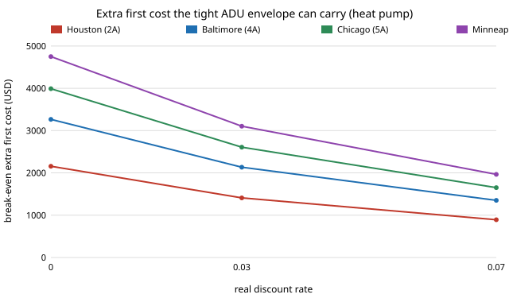

# house-breakeven: how much extra can a tight envelope cost before it stops paying back on a 480 sq ft backyard cottage?

Follow-up to [`house-open-design`](../house-open-design), whose next steps asked for a payback on the envelope upgrade. It cannot honestly price the upgrade (no sourced prices exist in this track), so this project turns the question around: for each upgrade, climate, heating system, energy price and discount rate, the **largest extra first cost** the 30-year energy saving can cover. Anyone with a real quote can compare it with the break-even directly. It adds no new engineering: the heat loss and degree-day energy are `house-open-design`'s, which are `house-energy`'s. Produced with AI assistance (Claude).

**Live page:** https://duncan-haywood.github.io/monorepo-projects/research/house-breakeven/

**Headline (stylised, assumed prices).** The whole tight package saves $72 (Houston) to $158 (Minneapolis) a year with a heat pump, so at a 3% real rate over 30 years it can carry **$1,409 to $3,104** of extra first cost ($892 to $1,965 at 7%, $2,157 to $4,750 at 0%). With gas heating the range is $1,267 to $2,330. Taking the upgrades one at a time, using `house-energy`'s unsourced unit prices where it has them, only the attic (R-30 to R-49, $319 extra) reaches break-even, and only in Minneapolis; air sealing from 5 to 3 ACH50 ($500) needs energy 1.3 to 2.6 times as expensive as assumed, and U-0.27 windows ($1,392) 2.7 to 5.5 times. The wall switch has the largest break-even of the five ($726 to $1,459) but its cost is not computed here. The point is the method and the thresholds, not a verdict on any real ADU.

**Builds on.** [`house-open-design`](../house-open-design) (plan, envelope, `annual_energy`, the two packages), [`house-energy`](../house-energy) (degree-day model, 30-year annuity, unit prices) and [`house-framing`](../house-framing) (whole-wall R). The net-present-cost idea follows NREL's BEopt in outline only; no BEopt, EnergyPlus or OpenStudio data is used. It builds on none of the CU Boulder groups in `prompt.md` and claims no connection to them.

**Not a design.** Research code. Nothing here has been reviewed by a licensed architect or engineer or checked against a building code. Every price is an assumption, not a quote.

## Use it
```bash
cd research/house-breakeven
python experiments/run.py      # prints and writes experiments/results.txt (under a second)
python experiments/figure.py   # draws experiments/breakeven_vs_rate.svg from results.txt
```
In code: `breakeven_cost(("attic_r", "window_u"), "Chicago (5A)", "heat pump", rate=0.05, energy_mult=1.5)` in `src/house_breakeven/model.py`.

## Method
- **Saving.** For a set of components moved from the baseline to the tight package (`wall_r`, `attic_r`, `window_u`, `ach50`, `floor_batt_r`), the annual heating and cooling cost of the baseline minus that of the partly upgraded envelope, both from `house_open_design.analysis.annual_energy`.
- **Break-even.** Annual saving times the level annuity for the real discount rate over 30 years (`house-energy`'s 3% gives its `ANNUITY`; 0% is 30). Energy is the only benefit counted: no resale value, comfort, maintenance, or replacement cycles.
- **Additivity.** Heat loss is a sum of per-component UA terms and energy is linear in UA, so the five one-at-a-time savings add up exactly to the whole package's (a test checks this to 1e-9). There are no interaction effects in this model, which real buildings have.
- **Assumed extra cost** (attic, windows, air sealing only): `house-energy`'s unit prices (attic $0.035 per sq ft per R, windows $50 against $38 per sq ft, air sealing $900 against $400) scaled to this plan's 480 sq ft ceiling and its window area. The wall (framing change plus R-5 foam) and floor batt have no cost here, so they carry a break-even and no verdict.
- **Energy prices** are `house-energy`'s $1.30 per therm and $0.16 per kWh times a multiplier.

## Reproduce
```bash
cd research/house-breakeven
PY=$(python3 ../../platform/ci/pyenv.py pytest | tail -1)
$PY -m pytest -q tests         # 10 tests plus parametrised cases
$PY experiments/run.py && $PY experiments/figure.py
```

## Results (from `experiments/results.txt`; deterministic)
- **A. Whole package, 3% rate:** annual saving and break-even, heat pump / gas: Houston $72, $1,409 / $65, $1,267; Baltimore $109, $2,134 / $84, $1,656; Chicago $133, $2,607 / $101, $1,976; Minneapolis $158, $3,104 / $119, $2,330.
- **B. By upgrade, heat pump** (Houston, Baltimore, Chicago, Minneapolis): wall $726, $1,019, $1,231, $1,459; attic $158, $222, $268, $317 (assumed extra cost $319); windows $256, $359, $433, $514 ($1,392); air sealing $190, $267, $323, $382 ($500); floor batt $79, $267, $352, $431. With gas heating the whole-package break-even is 10% (Houston) to 25% (Minneapolis) lower (C).
- **D. Price multiplier needed** for the assumed cost to break even (heat pump): attic 2.02, 1.44, 1.19, 1.01; air sealing 2.63, 1.87, 1.55, 1.31; windows 5.45, 3.88, 3.21, 2.71. Above 1 means it does not pay at the assumed prices.
- **E, F.** The break-even is 35% lower at a 3% real rate than at 0%, and 59% lower at 7%, and is exactly proportional to the energy price (Chicago, heat pump: $1,304 at half the price, $5,214 at double).
- Summing the three costed upgrades gives $2,211 of assumed extra cost against $1,024 of break-even in Chicago; the wall and floor then decide whether the whole package pays, and this project cannot say.



## Limitations
- **Every input is an assumption inherited from `house-energy`:** climates are degree-day stand-ins remembered from NOAA normals and not checked, prices are unsourced, the cooling COP and heat pump efficiency are fixed seasonal values, and one internal-gains credit stands in for solar and internal gains.
- **No price escalation**, no fuel switching, no replacement of windows at end of life, no equipment downsizing credit (a tighter envelope can allow a smaller heat pump, which would raise the break-even).
- **The floor sits over a vented crawlspace** with an assumed batt derate; its numbers are this project's assumption, not a measurement.
- **Not verified against EnergyPlus or BEopt.** The ranking of upgrades is the model's; magnitudes may differ.
- **The wall and floor upgrades have no cost**, so the largest line item in the best-paying upgrade is not compared.

## Next steps
Source and date real unit prices (a quote, a published cost database with a licence that allows it) for the wall, foam and floor batt and close the loop to a payback; add the heat-pump downsizing credit; run the same ADU in EnergyPlus for a check of the degree-day numbers.

## Owner steps
None required. Quotes for a real build, and a licensed engineer's or energy rater's review, are owner steps.

## Outside dependencies (vitamins)
Python and pytest only, plus the sibling projects. Real prices, weather files and a validated energy engine are outside what this project could make.
