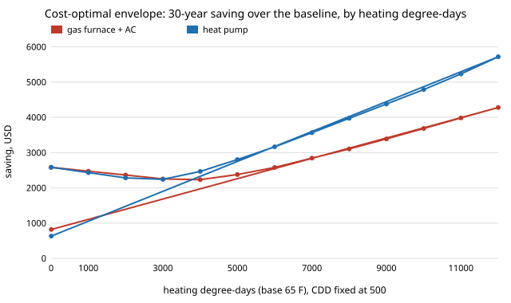

# house-climatesweep: at what climate does each envelope upgrade start to pay, when climate is a continuous axis?

A project of track 12, open-source residential construction (`PROJECTS.md`, milestone 5, the "sweep the climate itself" next step of [`house-energy`](../house-energy)). `house-energy` found the cost-optimal envelope in eight named cities. A reader in a ninth place, or at a different elevation, wants to know where the thresholds are: at how many heating degree-days does slab-edge insulation, a tighter house or a thicker attic start to pay over 30 years? This project makes (HDD65, CDD65) the axis and finds each threshold exactly. It adds no physics: it is `house-energy`'s 640-package net-present-cost model, unchanged, so every caveat of that model applies. Produced with AI assistance (Claude).

**Live page:** https://duncan-haywood.github.io/monorepo-projects/research/house-climatesweep/

**Headline (stylised, assumed prices).** With a gas furnace and 500 cooling degree-days, the cost-optimal package adds slab-edge R-10 from **3,271 heating degree-days**, attic R-30 over R-19 from 4,029, 5 ACH50 air sealing from 4,485, 3 ACH50 from 5,769 and an R-38 attic from 8,368. A heat pump lowers each of those four thresholds by about 27% (slab edge 2,386, R-30 attic 2,939, 5 ACH50 3,272, 3 ACH50 4,209) because electric heat costs more per Btu delivered than gas here, and is the only system that reaches an R-49 attic (10,074) and R-5 foam sheathing (11,446) inside the 0 to 12,000 range. **Cooling alone switches on only the attic and air sealing, and only above about 3,000 cooling degree-days** (R-30 attic 3,061 to 3,203, 3 ACH50 4,394 to 4,536), which is hotter than all but Miami. Windows never move off U 0.50 anywhere, as in `house-energy`, and the advanced 2x6 wall is chosen at every climate because it is cheaper as well as better. The slab-edge threshold falls exactly in proportion to the energy price (3,271 / 1,636 / 818 at 1x / 2x / 4x): the slab edge adds no cooling load in the model, so only heating and price enter its trade-off.

**Builds on.** [`house-energy`](../house-energy) (imported unchanged) and, through it, [`house-framing`](../house-framing). Nothing is added to the physics or the prices. It builds on none of the CU Boulder groups in `prompt.md`.

## Method (`src/house_climatesweep/sweep.py`)
- For a fixed package, `house-energy`'s NPC is exactly linear in (HDD, CDD): first cost plus a x HDD plus b x CDD. The sweep gets (first cost, a, b) for each of the 640 packages by calling `house_energy.evaluate` at (0,0), (1,0) and (0,1), once per system and price set. The optimum at any climate is then the minimum of 640 linear functions: exact.
- `transitions(line, lo, hi)` scans a line of climates every 25 degree-days and bisects every cell where the optimum changes, down to 0.5 degree-days. A cell where two upgrades switch is split until each is reported at its own value.
- Test E checks the sweep returns the same package and the same NPC as `house_energy.optimise` in all 16 city/system cases.

## Reproduce
```bash
pip install pytest
cd research/house-climatesweep
python -m pytest -q tests                                                           # 7 tests
PYTHONPATH=src:../house-energy/src:../house-framing/src python experiments/run.py   # a few seconds; writes experiments/results.txt
python experiments/figure.py                                                        # experiments/saving_by_hdd.svg from results.txt
```

## Results (from `experiments/results.txt`; deterministic)
- **A. Heating axis (CDD 500).** Gas furnace: slab edge R-10 at 3,271 HDD; attic R-19 to R-30 at 4,029; ACH50 7 to 5 at 4,485; 5 to 3 at 5,769; attic R-30 to R-38 at 8,368. Heat pump: 2,386; 2,939; 3,272; 4,209; 6,105; then attic R-38 to R-49 at 10,074 and R-5 foam sheathing at 11,446. No window upgrade in either system.
- **B. Cooling axis (HDD 500).** Only the attic and air sealing switch: gas furnace R-30 at 3,203 CDD, 5 ACH50 at 3,552, 3 ACH50 at 4,536; heat pump 3,061, 3,410, 4,394. The slab edge cannot switch on cooling because the model gives it no cooling load.
- **C. Saving over `house-energy`'s baseline** (conventional 2x4, attic R-30, U 0.35, 5 ACH50, bare edge) at 500 CDD: $2,583 at 0 HDD, falling to $2,233 (gas) at 4,000 HDD, then rising to $4,279 (gas) and $5,718 (heat pump) at 12,000. At zero heating the optimum is simply the cheapest envelope (advanced wall, U 0.50 windows, R-19 attic, 7 ACH50), so the saving is first cost saved against the baseline; it shrinks as energy starts to matter and then grows as upgrades start to pay (not separated further here).
- **D. Thresholds against the energy price** (gas, CDD 500). Slab edge: 6,541 / 3,271 / 1,636 / 818 HDD at 0.5x / 1x / 2x / 4x energy prices. 3 ACH50: never inside 12,000 at 0.5x, then 5,769 / 2,558 / 953. Doubling energy prices roughly halves each threshold; halving them roughly doubles it.
- **E. Consistency.** 16 of 16 city/system optima are identical to `house-energy`'s (package and NPC).
- **F. The eight cities** sit between the thresholds: Albuquerque (4,300 HDD) is just past slab-edge insulation, Chicago (6,200) past 3 ACH50, and only Duluth (9,500) past the R-38 attic under gas.



## Limitations
- **Everything in `house-energy` carries over:** degree-day loads, no solar gain or hourly weather, no HVAC cost, and every price an unsourced round number. A threshold is only as good as those prices; the energy-price rows (D) show how far they move. Treat the numbers as the shape of the answer, not as a place to stop insulating.
- **A line, not a map.** The thresholds above are along HDD at 500 CDD and along CDD at 500 HDD. Climates with many of both lie between the two lines; `optimum_at(hdd, cdd)` gives any point.
- **The climate pairs are degree-day totals only.** Two places with the same HDD and CDD can differ in sun, wind, humidity and ground temperature. The slab-edge threshold in particular uses a conventional F-factor, the weakest number in `house-energy`.
- **Not a design and not a code check.** A licensed architect or engineer, or the local code's prescriptive path, and a permit, are needed before anyone builds.

## Next steps
Replace the rounded city pairs with NOAA normals, then plot the full HDD-by-CDD map of the optimum rather than two lines. Add solar gain, which would give windows a climate in which they win. Fit a closed form for the threshold in terms of energy price and first-cost ratio.

## Owner steps
None required.

## Outside dependencies (vitamins)
Python standard library, `house-energy` and `house-framing`; pytest for tests. Prices, climates and F-factors are `house-energy`'s unsourced assumptions.

## References
- [`house-energy`](../house-energy) and its references (NREL BEopt for the net-present-cost method; NOAA 1991-2020 normals as the source the degree-day pairs should come from; neither consulted in this run).
