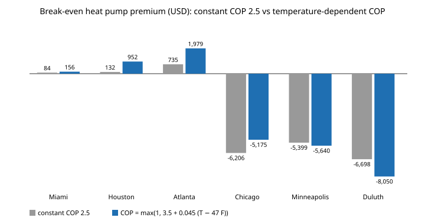

# house-coldcop: does a temperature-dependent heat-pump COP change how much more a heat pump can cost than gas before gas wins?

Track 12 project, open-source residential construction. [`house-hvacnpc`](../house-hvacnpc) found the break-even heat-pump premium with a constant seasonal heating COP of 2.5 and said so: "no cold derating, which flatters it in Chicago to Duluth". Its first next step was a cold-climate COP curve. This project adds one. It fits an hourly outdoor-temperature distribution to each climate's degree days, lets heating COP fall linearly with temperature (floored at 1, resistance backup), takes the heating-load-weighted seasonal COP, and reruns the break-even premium. Produced with AI assistance (Claude).

**Live page:** https://duncan-haywood.github.io/oss-monorepo/research/house-coldcop/

**Headline (stylised model, assumed COP curve).** The constant 2.5 was not simply too kind to the cold. With a central curve (COP 3.5 at 47 F, falling 0.045 per F) the seasonal heating COP is **4.01, 3.54, 3.27, 2.73, 2.45, 2.30** in Miami, Houston, Atlanta, Chicago, Minneapolis and Duluth, so 2.5 *understated* the heat pump in the South and Chicago and overstated it only in Minneapolis and Duluth. The break-even premium rises to **$156, $952, $1,979** in Miami, Houston and Atlanta (from $84, $132, $735), is **&minus;$5,175** in Chicago (from &minus;$6,206), and falls to **&minus;$5,640** and **&minus;$8,050** in Minneapolis and Duluth (from &minus;$5,399 and &minus;$6,698). The sign of the answer does not change anywhere; its size depends strongly on the curve: Duluth ranges from &minus;$1,961 to &minus;$16,661 across nine curves.



**Builds on.** [`house-hvacnpc`](../house-hvacnpc) (premium, imported unchanged), [`house-energy`](../house-energy), [`house-energyprices`](../house-energyprices) (EIA prices) and [`house-framing`](../house-framing). It builds on none of the CU Boulder groups in `prompt.md`. The shape of the curve follows the general fact that air-source heat-pump COP falls with outdoor temperature; no manufacturer data or standard's test points were used, and none are copied.

**Not a design, not advice.** Nothing here was reviewed by a licensed professional, and no equipment price is used.

## Method
- Hourly outdoor temperature ~ Normal(mu, sd) per climate. mu is exact (E[(65&minus;T)<sup>+</sup>] &minus; E[(T&minus;65)<sup>+</sup>] = 65 &minus; mu gives mu = 65 &minus; (HDD &minus; CDD)/365); sd is found by bisection so the expected HDD65 equals the table value. Both degree-day values are house-energy's, which that project says are from memory and unchecked.
- COP(T) = max(1, c47 + slope (T &minus; 47)). Seasonal COP = heating degree-hours divided by the sum of degree-hours over COP, in 1 F bins. Because heating load is proportional to degree-hours, this number does not depend on the envelope, so it replaces the constant COP for every package.
- Premium: `house_hvacnpc.premium` with the heat pump's heating efficiency temporarily replaced. A flat curve at 2.5 reproduces house-hvacnpc exactly (tested).

## Reproduce
```bash
pip install pytest
cd research/house-coldcop
python -m pytest -q tests                                   # 7 tests
PYTHONPATH=src:../house-energy/src:../house-framing/src:../house-energyprices/src:../house-hvacnpc/src python experiments/run.py > experiments/results.txt   # about a minute
python experiments/figure.py                                # experiments/premium.svg
```

## Results (from `experiments/results.txt`)
- **Fitted temperatures:** mean 76.8, 69.1, 62.0, 50.5, 46.4, 40.1 F; sd 8 to 21 F (Miami to Duluth).
- **Seasonal COP, central curve:** 4.01, 3.54, 3.27, 2.73, 2.45, 2.30.
- **Premium, central curve:** 156, 952, 1,979, &minus;5,175, &minus;5,640, &minus;8,050 USD.
- **Curve sensitivity (nine curves, COP at 47 F of 3.0 to 4.0, slope 0.02 to 0.07 per F):** Atlanta 787 to 2,716; Chicago &minus;10,872 to &minus;2,128; Duluth &minus;16,661 to &minus;1,961. A steeper slope helps in Miami, where little heating happens below 47 F, and hurts everywhere colder.

## Limitations
- The COP curve is **assumed, not sourced**: 3.5 at 47 F and 0.045 per F are illustrative. Real cold-climate units are specified at a few test temperatures and are not linear; a sourced curve is the main next step.
- A normal hourly distribution has no seasonal or diurnal structure, so it is a poor fit to Miami's narrow range and to any climate's real cold tail. Heating hours well below 0 F are where the COP floor matters, and the normal's tail there is a guess.
- No defrost losses, no capacity limit or backup-heat staging, no equipment sizing (see [`house-hpsize`](../house-hpsize)), no replacement, maintenance, rebates, fuel price escalation or cooling-COP change. The cooling COP stays at 3.5 for both systems.
- Climates are state-price stand-ins as in house-hvacnpc; degree-day values are the unchecked ones in house-energy.

## Next steps
Replace the assumed curve with dated, licensed manufacturer or open test data (for example NREL field-monitoring reports) and check it against the linear form; replace the normal with a real hourly or binned TMY temperature series; add the installed-cost ranges and incentives from [`house-hvacnpc`](../house-hvacnpc)'s next steps.

## Owner steps
None required.

## Outside dependencies (vitamins)
Python standard library and pytest. EIA prices via `house-energyprices`; envelope model via `house-energy`.
