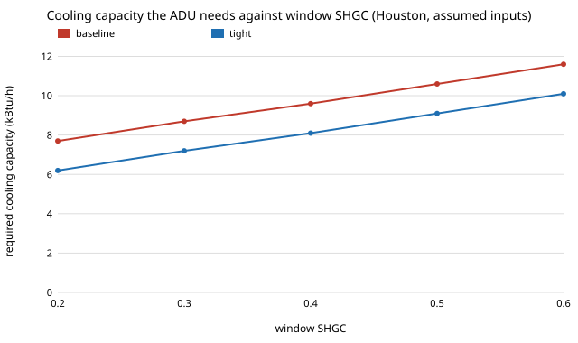

# house-coolsize: when does cooling, not heating, set the heat pump size for a 480 sq ft backyard cottage?

Follow-up to [`house-hpsize`](../house-hpsize), whose limitations said "no cooling-side sizing, which can govern in Houston". This project adds a summer design load (envelope conduction, window solar gain by wall, internal gains, a humidity allowance) and sizes the heat pump on the larger of the heating and cooling requirements. Produced with AI assistance (Claude).

**Live page:** https://duncan-haywood.github.io/oss-monorepo/research/house-coolsize/

**Headline (stylised, assumed inputs).** Cooling governs the size only in Houston: baseline 9.6 kBtu/h of cooling against 7.5 of heating, so the unit is 12 kBtu/h, not the 9 `house-hpsize` found. In Baltimore, Chicago and Minneapolis heating still governs by a wide margin (cooling needs 7.4 to 8.8 kBtu/h against 12.5 to 27.1), so the sizes (18, 24, 30 baseline; 9, 18, 18 tight) and credits ($1,350, $900, $1,800) are unchanged from `house-hpsize`. The tight package cuts the cooling load too (Houston 8,383 to 7,075 Btu/h), so Houston's size goes 12 to 9 and the credit stays **$450**. But Houston's answer sits on a knife edge: with window SHGC 0.2 or 0.3 the baseline already needs only 9 and the credit is $0; at 0.5 or above both packages need 12 and the credit is $0; and a latent allowance of 1.3 gives a $0 credit while 1.5 gives $900.

**Builds on.** [`house-hpsize`](../house-hpsize) (heating load, catalogue, prices), [`house-breakeven`](../house-breakeven), [`house-open-design`](../house-open-design) (envelope UA, packages, window areas by wall from the plan) and [`house-energy`](../house-energy). It follows the usual cooling-load idea (conduction plus solar plus internal gains) in outline only; it is not ACCA Manual J, and no manufacturer data is used. It builds on none of the CU Boulder groups in `prompt.md` and claims no connection to them.

**Not a design.** Research code. Nothing here has been reviewed by a licensed architect, engineer or HVAC designer or checked against a building code. Every temperature, size, factor and price is an assumption.

## Use it
```bash
cd research/house-coolsize
python experiments/run.py      # prints and writes experiments/results.txt (instant)
python experiments/figure.py   # draws experiments/cooling_need_vs_shgc.svg from results.txt
```
In code: `governing(package_with("wall_r"), "Houston (2A)")` returns `(size_kbtuh, "heating" | "cooling")`; `credit(COMPONENTS, "Houston (2A)")` is the downsizing credit with both loads counted (`src/house_coolsize/model.py`).

## Method
- **Cooling load** = (envelope UA, including infiltration, times (summer design temperature minus 75 F) + window solar gain + 1,200 Btu/h internal gain) times a 1.15 latent allowance.
- **Solar gain** = glass area on each wall (from the generated plan: S 48, N 36, E 16, W 16 ft2) times a peak factor (S 60, N 20, E and W 120 Btu/h per ft2) times SHGC 0.40, the same for both packages. No shading or overhang is credited.
- **Summer design temperatures** (Houston 95, Baltimore 91, Chicago 90, Minneapolis 89 F) are rounded values remembered from ASHRAE-style data and not checked against the source.
- **Required rated cooling** = load times the 1.15 sizing margin divided by a capacity derating of 0.5% per F above 95 F (assumed). The **governing size** is the smallest catalogue size covering the larger of the heating and cooling requirements; the catalogue, margin and prices are `house-hpsize`'s.

## Reproduce
```bash
cd research/house-coolsize
PY=$(python3 ../../platform/ci/pyenv.py pytest | tail -1)
$PY -m pytest -q tests         # 20 tests
$PY experiments/run.py && $PY experiments/figure.py
```

## Results (from `experiments/results.txt`; deterministic)
- **B.** Required rated capacity (kBtu/h), baseline cooling / heating: Houston 9.6 / 7.5, Baltimore 8.8 / 12.5, Chicago 8.6 / 20.1, Minneapolis 8.4 / 27.1. Tight: Houston 8.1 / 4.7, Baltimore 7.6 / 7.9, Chicago 7.5 / 12.7, Minneapolis 7.4 / 17.2. Cooling governs in Houston for both packages and nowhere else.
- **C.** Whole-package credit with both loads counted: Houston $450 (12 to 9), Baltimore $1,350, Chicago $900, Minneapolis $1,800. Only Houston's sizes change against `house-hpsize` (9/6 became 12/9), and its credit happens to be the same $450.
- **D.** One upgrade at a time in Houston: the wall switch drops the size 12 to 9 (cooling and heating both fall), the other four leave it at 12 — a different split from `house-hpsize`'s heating-only view.
- **E, G.** Window SHGC sweep (Houston): required baseline cooling 7.7, 8.7, 9.6, 10.6, 11.6 kBtu/h at SHGC 0.2 to 0.6; the credit is $0 at SHGC 0.2, 0.3, 0.5 and 0.6 and $450 at 0.4. Minneapolis is unaffected (30 to 18 throughout).
- **F.** Latent allowance (Houston): 1.0 gives 9 to 9 ($0), 1.15 gives 12 to 9 ($450), 1.3 gives 12 to 12 ($0), 1.5 gives 18 to 12 ($900).



## Limitations
- **All summer inputs are unchecked assumptions**: design temperatures, solar peak factors, SHGC, internal gain, latent allowance and derating. Houston's credit moves between $0 and $900 across them, so read it as "somewhere from nothing to about two catalogue steps", not as $450.
- **Not Manual J**: no time-of-day diversity, no shading or overhangs, no duct gains, no moisture model, same SHGC for both packages although real low-U windows often have a lower one.
- Heating-side limits from `house-hpsize` still apply (one fixed price line, unmodelled electrical-service steps, unpriced wall and floor).
- Not verified against EnergyPlus, BEopt or any real quote.

## Next steps
Replace the remembered design temperatures and the solar peak factors with an openly published source and compare one climate with an EnergyPlus run; price the wall and floor to close the break-even loop; add an overhang to see how much shading is worth in Houston.

## Owner steps
None required. Real quotes and an HVAC designer's load calculation are owner steps.

## Outside dependencies (vitamins)
Python and pytest only, plus the sibling projects.
