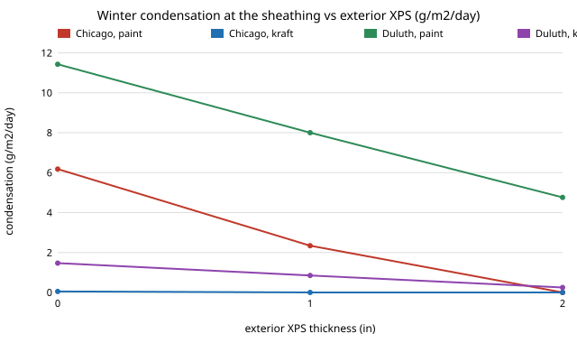

# house-dewpoint: where in a wall does water vapor condense, and does a vapor retarder or exterior foam fix it, by climate?

**Live page:** https://duncan-haywood.github.io/oss-monorepo/research/house-dewpoint/

Track 12, open-source residential construction (`PROJECTS.md`). It was picked because the 27 earlier `house-*` projects cover structure, cost, energy and schedule but none asks about moisture, the usual reason a code-compliant wall fails. This is a steady-state **Glaser** check, **not WUFI**: the permeances, R-values and climate months are **unsourced assumptions from memory**. Produced with AI assistance (Claude).

**Headline (stylised, assumed inputs).** (1) In the winter month nothing condenses in Miami or Atlanta, whatever the retarder. (2) Chicago: painted drywall gives about **6.2 g/m²/day** at the sheathing; 2 in of exterior XPS or a kraft facing removes it (0.05 g/m²/day with kraft and no foam). (3) Duluth: painted drywall gives about **11.4 g/m²/day**, and **only polyethylene** reaches zero (kraft with 2 in XPS still gives 0.25). (4) Exterior foam alone moves the condensing plane to the sheathing face: with 1 in XPS in Chicago the sheathing's unclamped RH is 97%, so foam thickness matters. (5) The summer inward-drive case, the classic danger of polyethylene in a cooled house, shows **no condensation** here, because the model has no wet-cladding reservoir; that is a model limit, not evidence of safety.

## Method (`src/house_dewpoint/model.py`)
- Temperature falls linearly in thermal resistance (films 0.12 and 0.03 m²K/W). Saturation pressure by the Magnus form.
- Vapor pressure falls linearly in vapor resistance (1/permeance). Where it would exceed saturation, the worst interface is clamped to saturation and the profile re-solved; the condensation rate is flux in minus flux out. No moisture storage, no liquid transport, no air leakage, no sorption.
- Wall (inside to outside): painted gypsum, optional retarder (none, kraft 1 perm, polyethylene 0.06 perm), R-19 batt, OSB (2 perm), optional 1 or 2 in XPS (1 and 0.5 perm), housewrap, vented siding.
- Four climates, each with a winter and a summer month (indoor 21 C / 35 to 40% in winter, 24 C / 50% in summer; outdoor values rounded from memory).

## Reproduce
```bash
pip install pytest
cd research/house-dewpoint
python -m pytest -q tests                      # 8 tests
PYTHONPATH=src python experiments/run.py       # instant; writes experiments/results.txt
python experiments/figure.py                   # experiments/winter_condensation.svg
```

## Results (from `experiments/results.txt`; deterministic)
- **A.** Condensation rate (g/m²/day) for 4 climates x 2 seasons x 3 foam options x 4 retarders, with unclamped sheathing RH. Winter only is non-zero, in Chicago and Duluth.
- **B.** Combinations with zero condensation in both months: all 12 in Miami and Atlanta; 7 of 12 in Chicago (none+2 in XPS, paint+2 in XPS, kraft+1 in or 2 in, polyethylene with any foam); only the 3 polyethylene walls in Duluth.



## Limitations
- Steady state: a month of mean conditions, so it misses a cold snap, drying in spring and the build-up of moisture over a winter. Air leakage carries far more vapor than diffusion and is excluded.
- Permeances (including that real kraft and OSB permeance rises with humidity) and climate months are assumed, not sourced. A rate above zero means the model's diffusion path saturates, not that the wall rots.
- Summer solar-driven inward drive is not modelled, so the summer result is uninformative.
- Not a design and not a code check. A licensed professional and the local code are needed first.

## Next steps
Replace assumed values with sourced ones (ASHRAE Fundamentals permeance tables, TMY monthly data); add a humidity-dependent "smart" retarder and an air-leakage term; add a wet-cladding source for summer; validate against a published Glaser example.

## Owner steps
None required.

## Outside dependencies (vitamins)
Python standard library; pytest for tests. Permeances, R-values and the climate months are outside the model and unsourced.

## References
- Glaser, H. (1959), Graphisches Verfahren zur Untersuchung von Diffusionsvorgängen (cited from memory; not read in this run).
- ASHRAE *Handbook of Fundamentals*, chapter on heat and moisture control (cited from memory; not read in this run).
- Magnus-form saturation pressure after Alduchov and Eskridge (1996) (cited from memory; not read in this run).
