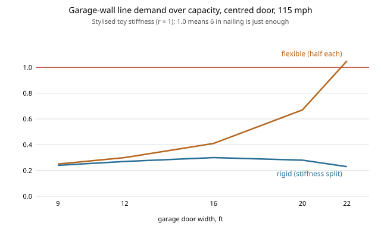

# house-diaphragm: does the half-and-half load split understate the demand on a garage-front wall?

A project of track 12, open-source residential construction (`PROJECTS.md`, milestone 6, a next step of [`house-structure`](../house-structure): "a rigid-diaphragm load split so the garage-front line carries its stiffness-based share"). It re-asks one question of `house-structure`, experiment G, whose note said a stiff partner wall would attract more load. Stylised and not a code check. Produced with AI assistance (Claude).

**Headline (stylised, negative for the worry).** In this toy model the half-and-half split is *not* flattering to the garage wall. With a rigid roof diaphragm, the weak garage line carries **less** than half: at a centred 22 ft door and 115 mph its demand-to-capacity at 6 in nailing falls from 1.05 (flexible split, which fails) to 0.18 to 0.63 depending on how softly the piers bend, while the stiff partner wall rises only to 0.26 to 0.35, with the long walls restraining the twist. The rigid split matters most for the biggest doors. The split cannot be used to pass a design: a flexible roof diaphragm is a real case, and it is the governing one here.

**Builds on.** [`house-structure`](../house-structure) (wind demand, the segmented-wall capacities and the garage-door walls, imported unchanged) and [`house-framing`](../house-framing). Rigid-versus-flexible diaphragm idealisation is standard structural-engineering practice (ASCE 7 and SDPWS discuss it; not consulted in this run). It builds on none of the CU Boulder groups in `prompt.md`.

## Method (`src/house_diaphragm/model.py`)
- **Layout.** Gable lines A and B at x = &plusmn;20 ft resist wind across the ridge; the two long walls at y = &plusmn;14 ft resist the twist. Load acts at the centre of mass.
- **Stiffness (assumed toy).** One full-height pier of width b and height h: k = (b/h) / (1 + r (h/b)<sup>2</sup>). r = 0 is pure shear; r = 1 and 3 add bending softness. A wall's stiffness is the sum over its piers. This is not a measured or code stiffness.
- **Flexible diaphragm.** Half of the load to each gable line.
- **Rigid diaphragm.** Solve the three-degree-of-freedom rigid-body equations (sway and twist) with the four wall lines as springs; loads follow from their displacements.
- **Capacity.** `house-structure`'s line capacity at 6 in edge nailing.

## Reproduce
```bash
pip install pytest
cd research/house-diaphragm
python -m pytest -q tests                                                               # 7 tests
PYTHONPATH=src:../house-structure/src:../house-framing/src python experiments/run.py    # writes experiments/results.txt
python experiments/figure.py                                                            # experiments/split.svg
```

## Results (from `experiments/results.txt`; deterministic)
Total ASD base shear 4,655 lb on the two gable lines (115 mph, Exposure-B-like), so 2,328 lb each under the flexible split.
- **r = 0.** Door width 9 to 22 ft: flexible D/C on line A 0.25, 0.30, 0.41, 0.64 (corner) or 0.67 (centred), 0.90 or 1.05; rigid 0.24, 0.27, 0.34, 0.45/0.47, 0.54/0.63.
- **r = 1 and 3.** A centred door makes the garage pier set much softer than the partner wall, so the rigid split sheds more load from it: at 22 ft centred, rigid D/C 0.23 (r = 1) and 0.18 (r = 3). The partner line B reaches 0.34 and 0.35.
- **Ordering.** The flexible split is the more demanding case for the garage line in every row except two small-door corner rows at r = 3 (9 ft: 2,344 lb against 2,328 lb, under 1% apart); the rigid split is the more demanding case for the partner line, which stays under 0.35.



## Limitations
- **Toy stiffness.** Real wood shear-wall stiffness comes from nail slip and hold-down deformation, is nonlinear, and depends on the nailing; the result depends on the ratio of garage-wall to partner-wall stiffness, which this model only guesses. A wider range of r changes the numbers, though not the sign in these runs.
- **What is missing.** No accidental torsion (code adds an eccentricity), no diaphragm shear or chord check, no collector at the door, no hold-down or overturning, no second storey, no stiffness from gypsum or interior walls, and no seismic case (seismic weight acts at a different place than wind).
- **Idealisation is a code decision.** Whether a roof may be treated as flexible or rigid is set by the code and the plan shape; this run did not check it. Designs are normally checked for the governing case, which here is the flexible one.
- **Not a design and not a code check.** A licensed engineer, or the local code's prescriptive path, and a permit, are needed first.

## Next steps
Replace the toy stiffness with an openly sourced nailed-wall deflection equation; add accidental torsion and a seismic case; add the door-header collector. Then the perforated-wall method in `house-structure`.

## Owner steps
None required.

## Outside dependencies (vitamins)
Python standard library, `house-structure`, `house-framing`; pytest for tests. Stiffness and capacity inputs come from standards not consulted in this run.
