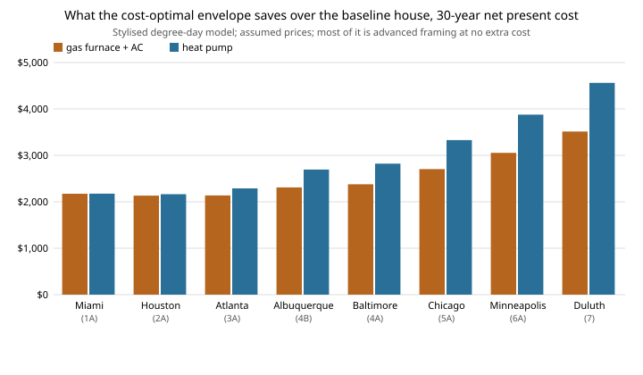

# house-energy: which envelope upgrades pay for themselves over 30 years, by climate, and does advanced framing belong in the answer?

Seventh project of track 12, open-source residential construction (`PROJECTS.md`, milestone 5, first version). Heating and cooling a house for 30 years costs about as much as its envelope does to build, so the question is where extra insulation, better windows and tighter air sealing stop paying. This project does the BEopt-style calculation in open code: the net present cost (NPC) of the envelope plus 30 years of heating and cooling energy, searched exhaustively over 640 packages (four wall systems, five attic R-values, four window U-values, four air tightness levels, two slab-edge options) in eight US climates and two heating systems. It uses a **degree-day model, not EnergyPlus**, and every price in it is an assumption (see Limitations). Produced with AI assistance (Claude).

**Headline (stylised, assumed prices).** In every one of the eight climates the cost-optimal package keeps the cheap, thin parts cheap and takes the wall from [`house-framing`](../house-framing)'s advanced 2x6 at 24 in: it costs $42 *less* to build than a conventional 2x4 wall in this model and loses 40% less heat through the opaque wall. That one switch is most of a **13 to 15% lower 30-year NPC than the baseline** ($2,100 to $4,600 per house, larger in colder climates and with a heat pump). Beyond the wall the optimum is modest and climate-driven: attic R-30 to R-38, a 3 ACH50 air-sealing target and slab-edge insulation from about 2,900 (heat pump) or 4,300 (gas) heating degree-days, and nothing past that. Better windows (U 0.27 or 0.20) and R-49 attics do not pay at the assumed prices: simple paybacks are 23 to 190 years for the one-at-a-time upgrades (experiment D). **The optimum picks windows worse than a typical code floor (U 0.50)**, because the model counts only conduction and a $13/ft<sup>2</sup> price step; it ignores solar gain, comfort and condensation. Holding windows to U 0.35 and air to 5 ACH50 costs $440 to $1,270 of NPC (experiment F). Doubling energy prices adds an R-49 attic in Chicago with gas; foam sheathing, R-60 attics and 1.5 ACH50 need energy prices doubled with first costs halved, and U 0.20 windows need 4x energy prices with first costs halved (experiment C).

**Builds on.** [`house-framing`](../house-framing) (imported unchanged: its takeoff gives each wall system's board feet, pieces, opaque area and whole-wall R-value, and the house is its 28 x 40 ft one-storey plan). The method follows NREL's BEopt (cost-optimal packages by net present cost) in outline only; this project does not use BEopt, EnergyPlus or OpenStudio, and none of their data. It builds on none of the CU Boulder groups in `prompt.md`.

## Method (`src/house_energy/model.py`)
- **Heat loss (UA, Btu/h F).** Walls from `house-framing`; ceiling area / (attic R + 1.5); windows (eight 36 x 48 in plus the 74 x 80 in slider, 137 ft<sup>2</sup>) times their U; the 38 in door fixed at U 0.35; slab edge as perimeter times an F-factor (0.73 bare, 0.54 with R-10 to 2 ft deep, approximate); infiltration as 0.018 Btu/ft<sup>3</sup>F times volume times ACH50/20.
- **Annual loads.** Heating = UA x 24 x HDD65 x 0.75 (a lumped 25% credit for internal and solar gains, assumed). Cooling = (UA minus the slab edge) x 24 x CDD65, because the slab edge couples to the ground and not the air. Solar gain through windows is not modelled.
- **Systems.** Gas furnace (AFUE 0.95) with AC (seasonal COP 3.5), or a heat pump (heating COP 2.5, cooling 3.5). Constant efficiencies; no sizing, no part-load or defrost effects.
- **NPC** = first cost of the envelope (wall, attic, windows, air sealing, slab edge) plus annual energy cost times the 30-year annuity factor at a 3% real discount rate (19.60), with no price escalation and no replacement or maintenance costs. Search is exhaustive (640 packages), so the optimum is exact for the model; there is no heuristic to validate.
- **Climates.** Eight cities standing in for IECC zones 1A to 7, as (HDD65, CDD65) pairs rounded to 100 *from memory of NOAA 1991-2020 normals; they were not checked against the source in this run*. They are inputs; replace them with checked normals before relying on a city's result.

## Reproduce
```bash
pip install pytest
cd research/house-energy
python -m pytest -q tests                                            # 9 tests
PYTHONPATH=src:../house-framing/src python experiments/run.py        # a few seconds; writes experiments/results.txt
python experiments/figure.py                                         # experiments/savings.svg from results.txt
```

## Results (from `experiments/results.txt`; deterministic)
- **A. Optimum by climate and system.** Saving over the baseline (conventional 2x4, attic R-30, U 0.35, 5 ACH50, bare slab edge): Miami $2,173 (14.1%) with gas and $2,175 with a heat pump; Chicago $2,704 (13.6%) and $3,329 (14.2%); Duluth $3,514 (14.5%) and $4,561 (15.4%). The optimum has advanced 2x6 walls in all 16 cases and U 0.50 windows in all 16.
- **B. The wall.** In Chicago with gas, the best package with each wall: conventional 2x4 NPC $18,838, conventional 2x6 $18,791, advanced 2x6 **$17,624**, advanced 2x6 plus R-5 foam sheathing $18,082. A conventional 2x6 wall's extra insulation roughly pays for its extra lumber and nothing more; advanced framing pays because it is cheaper *and* better.
- **C. Sensitivity.** The wall choice does not move across energy prices of 0.5x to 4x and first costs of 0.5x to 2x in Atlanta, Chicago and Duluth, except that cheap first costs with 2x or higher energy prices add R-5 foam sheathing. Everything else (attic R, windows, air tightness, slab edge) moves a lot; the U 0.50 window result holds only up to 2x energy prices at default first costs and gives way to U 0.35 or better at 4x prices or halved first costs in cold climates. Do not read the Results table's window column as a finding.
- **D. One upgrade at a time** (gas, Atlanta, Chicago, Duluth). Attic R-30 to R-49: $745 for $17, $24, $33 a year (43, 31, 23 years). Windows U 0.35 to 0.27: $1,645 for $14 to $27 a year (61 to 116 years). Air 5 to 3 ACH50: $500 for $21 to $40 a year (13 to 24 years). Slab-edge R-10: $408 for $18 to $60 a year (22 years in Atlanta, 7 in Duluth). Advanced 2x6 wall: saves $43 to $81 a year and $42 up front.
- **E. Where the heat goes** in the Chicago optimum: windows 68.6 Btu/h F, slab edge 73.4, walls 49.9, ceiling 35.6, infiltration 24.2, door 7.4. Slab-edge loss is the largest single term even with R-10, which is an artifact of the F-factor convention (perimeter loss in a degree-day model) and should be treated as the weakest number here.
- **F. A code-like floor** (windows no worse than U 0.35 and air no leakier than 5 ACH50, a stand-in for a prescriptive path, not a code check) costs $1,202 NPC in Miami, $1,050 in Chicago with gas, $438 in Duluth with a heat pump. Nothing here says a house at U 0.50 would be allowed.



## Limitations
- **Not EnergyPlus.** Steady-state degree-day loads: no hourly weather, no thermal mass, no solar gain, no duct losses, no ventilation or latent loads, no HVAC sizing, no part-load or defrost behaviour. The gains credit (25%) and the infiltration conversion (ACH50/20) are rules of thumb, assumed. Cooling is understated in hot, sunny climates because solar gain is left out, which understates the value of good windows there.
- **Every price is an assumption, not sourced.** Gas $1.30/therm and electricity $0.16/kWh are the order of US residential averages and were not checked against EIA in this run. Lumber $0.90/bf, $4 per framing piece, batts $0.60 and $1.00/ft<sup>2</sup>, foam $0.90/ft<sup>2</sup>, attic $0.035 per ft<sup>2</sup> per R, windows $25 to $75/ft<sup>2</sup>, air sealing $0 to $2,200, slab edge $3/ft are all invented round numbers. The wall result rests on `house-framing`'s own caveats too: its conventional baseline is generous (2x12 headers everywhere, 4-stud corners), and its labour is a $4-per-piece guess. The sensitivity runs (C) and the paybacks (D) show how much depends on them.
- **Climates from memory.** See Method.
- **Envelope only.** No HVAC equipment cost, no renewables, no replacement or maintenance, no resale value, no price escalation, and a single discount rate. A heat pump's higher equipment cost is not charged against it.
- **Not a design and not a code check.** The house is `house-framing`'s stylised box. Nobody should build to an optimum from here: a licensed architect or engineer, or the local code's prescriptive path, and a permit, are needed first.

## Next steps
Replace the rounded climate pairs with normals read from NOAA data, and the prices with dated sources (EIA, a cost database whose licence allows reuse). Add solar gain and an hourly model, or run EnergyPlus through OpenStudio if it installs in the container, and check this degree-day model against it on one house. Add HVAC equipment cost and sizing, and the `house-cost` labour model. Sweep the climate itself (continuous HDD and CDD) to find where each upgrade switches on.

## Owner steps
None required.

## Outside dependencies (vitamins)
Python standard library and `house-framing` for the model; pytest for tests. Climate normals, fuel prices, component costs and the F-factors come from outside the model and are unsourced assumptions, as stated.

## References
- NREL. BEopt (Building Energy Optimization Tool), for the cost-optimal-package method by net present cost. <https://www.nrel.gov/buildings/beopt.html> (named from memory; not read in this run)
- NOAA National Centers for Environmental Information, U.S. Climate Normals 1991-2020 (source the HDD and CDD values should be replaced from; not consulted).
- Sherman, M. H. (1987). Estimation of infiltration from leakage and climate indicators. *Energy and Buildings* 10(1) (origin of the ACH50/20 rule of thumb; cited from memory, not re-read).
