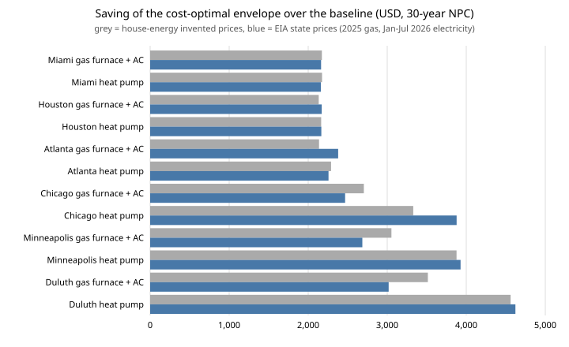

# house-energyprices: does the cost-optimal home envelope change when invented fuel prices are replaced by EIA state prices?

Track 12 project, open-source residential construction (`PROJECTS.md`, milestone 5 follow-up). [`house-energy`](../house-energy) finds the cost-optimal wall, attic, windows and air-sealing package for a house in eight US climates, but its README admits that gas ($1.30/therm) and electricity ($0.16/kWh) are "invented round numbers". This project replaces them with dated EIA state residential prices (2025 gas, January–July 2026 electricity) for the six climates that map to a state with data, and re-runs the exhaustive search. Produced with AI assistance (Claude).

**Live page:** https://duncan-haywood.github.io/oss-monorepo/research/house-energyprices/

**Headline.** The recommendation barely moves. In 10 of 12 climate-and-heating-system cases the optimal package is identical to house-energy's, and the 30-year saving over the baseline changes by −$496 to +$549, the largest changes being where real gas is far from $1.30 (Duluth with gas −$496, Chicago with a heat pump +$549). Advanced 2x6 walls win everywhere, U 0.50 windows are still chosen, and R-49 attics (27 to 40 year paybacks) and U 0.27 windows (74 to 107 years) still do not pay. Gas is dear in the South ($1.87 to $2.46/therm in Texas, Georgia and Florida, against $1.06 in Minnesota), yet a heat pump is only a tie on running cost there ($4 to $12 a year cheaper), and in the three cold climates gas is $260 to $326 a year cheaper to run (Chicago $395 against $695; Duluth $518 against $844).



**Builds on.** [`house-energy`](../house-energy) (model and package space imported unchanged) and [`house-framing`](../house-framing). Prices: EIA, listed with URLs in [`data/sources.md`](data/sources.md) and `data/eia_prices.csv`. It builds on none of the CU Boulder groups in `prompt.md`.

**Not a design, not advice.** A degree-day model with a stylised house. Only the *fuel* prices are now sourced; every first cost (lumber, windows, insulation, air sealing) is still house-energy's invented number, and the climate normals are still rounded from memory. Nothing here has been reviewed by a licensed professional, and nothing says a package meets any energy code.

## Method
- Prices are the EIA's average residential price in the state standing in for each climate (Miami: Florida, Houston: Texas, Atlanta: Georgia, Chicago: Illinois, Minneapolis and Duluth: Minnesota). A state average is not a utility tariff; gas "$/therm" here includes fixed monthly charges spread over the state's average use, so it overstates the marginal price for low-use southern homes.
- Gas $/Mcf becomes $/therm at 10.37 therms per Mcf (approximate). Electricity is the January–July 2026 preliminary average, which leaves out winter-peak months.
- Albuquerque and Baltimore are dropped: no state price was read (Maryland's 2025 gas price is NA).
- The search, first costs, 3% real discount rate, 30 years and no escalation are house-energy's.

## Reproduce
```bash
pip install pytest
cd research/house-energyprices
python -m pytest -q tests                                  # 5 tests
PYTHONPATH=src:../house-energy/src:../house-framing/src python experiments/run.py > experiments/results.txt   # seconds
python experiments/figure.py                               # experiments/savings.svg
```

## Results (from `experiments/results.txt`)
- **Prices.** Gas $2.46/therm Florida, $1.97 Georgia, $1.87 Texas, $1.08 Illinois, $1.06 Minnesota; electricity 15.3 to 19.2 ¢/kWh. House-energy's $0.16 electricity was close; its $1.30 gas was too low for the South and too high for the Midwest.
- **Optimum.** Same package as house-energy in 10 of 12 cases. Atlanta with gas (gas $1.97/therm makes saved heat dearer) moves from 5 to 3 ACH50 and adds the R-10 slab edge; Duluth with gas moves from an R-38 to an R-30 attic (gas $1.06 makes saved heat cheaper).
- **Savings over baseline.** $2,160 to $2,163 in Miami, $2,166 to $2,171 in Houston, $2,257 to $2,379 in Atlanta, $2,467 (gas) and $3,878 (heat pump) in Chicago, $2,685 and $3,928 in Minneapolis, $3,018 and $4,622 in Duluth. Cheap Midwest gas shrinks the gas-furnace saving by $237 (Chicago), $368 (Minneapolis) and $496 (Duluth); Atlanta's grows by $242. The heat-pump saving moves by −$33 to +$549.
- **Running cost.** The heat pump is cheaper to run by $4 to $12 a year in Miami, Houston and Atlanta (a tie, given the model) and dearer by $260 to $326 a year in Chicago, Minneapolis and Duluth. Equipment and installation cost are not charged to either system.
- **Single upgrades** (gas): attic R-30 to R-49 pays back in 27 to 40 years, windows U 0.35 to 0.27 in 74 to 107, air sealing 5 to 3 ACH50 in 15 to 22.

## Limitations
- **Only fuel prices are sourced.** The conclusion that the envelope recommendation is robust to fuel prices says nothing about its robustness to the invented component costs, which house-energy's own sensitivity (C) shows matter far more.
- **State averages, one season of electricity data, an approximate Mcf-to-therm factor.** The values were read through a page-to-text fetch on 2026-10-20 and not cross-checked against a downloaded table; recheck before relying on any single number.
- Degree-day model without solar gain; climate normals unverified; no escalation of energy prices; no HVAC equipment cost.

## Next steps
Replace the component prices with dated sources (lumber futures, BLS producer price indexes), then check whether the first-cost sensitivity or the fuel price ranks higher; read NOAA normals for the climates; add equipment cost to compare gas with heat pump on NPC.

## Owner steps
None required.

## Outside dependencies (vitamins)
Python standard library and pytest. EIA price tables (public domain US government data), read via the web on 2026-10-20.
