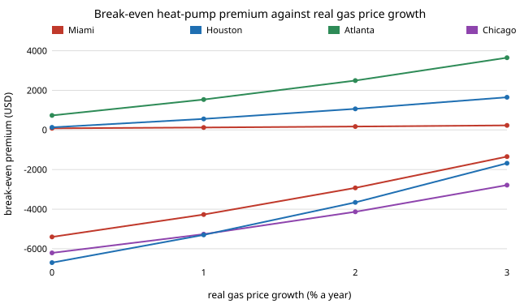

# house-escalate: how fast must gas prices rise against electricity before a heat pump ties a gas furnace on 30-year cost?

Track 12 project, open-source residential construction. [`house-hvacnpc`](../house-hvacnpc) and [`house-coldcop`](../house-coldcop) both listed "fuel price escalation" among the things they leave out: every energy price was held flat in real terms for 30 years. A heat pump bet is largely a bet on the gas price rising faster than the electricity price, so this project adds that one lever and nothing else. It separates each package's yearly bill into its gas and electricity parts, lets each grow at its own real rate, and reports (A) how the break-even heat-pump premium moves and (B) the gas growth rate at which a heat pump ties for a given extra installed cost. Produced with AI assistance (Claude).

**Live page:** https://duncan-haywood.github.io/monorepo-projects/research/house-escalate/

**Headline (stylised model).** With electricity flat in real terms, gas has to get *cheaper* in real terms for a heat pump that costs the same as furnace + AC to lose in Miami, Houston and Atlanta (tie at &minus;2.9%, &minus;0.3% and &minus;1.1% a year), so there it already wins at equal price if gas merely holds still. In Chicago, Minneapolis and Duluth a heat pump of equal installed cost needs gas to rise **4.6%, 3.7% and 3.7% a year in real terms for 30 years** to tie (3.7% a year compounds to about 3&times; the price by year 30), because the constant-COP model makes it dearer to run. If the heat pump costs $4,000 more to install, the required gas growth is 6.0% in Houston, 3.3% in Atlanta and 5.2% to 6.3% in the three northern cities. Raising electricity by 1% a year real adds about one point to every northern requirement. Across 1% to 6% discount rates the northern figures span about a point (Chicago 4.3% to 5.3%).



**Builds on.** [`house-hvacnpc`](../house-hvacnpc) (break-even premium; with zero growth this project reproduces its numbers exactly, tested), [`house-energy`](../house-energy), [`house-energyprices`](../house-energyprices) (EIA prices) and [`house-framing`](../house-framing). It builds on none of the CU Boulder groups in `prompt.md`.

**Not a design, not advice.** Nothing here was reviewed by a licensed professional. No equipment price is used; the installed-cost premium is the axis, never an input.

## Method
- A package's annual bill is linear in the two prices, so `house-energy`'s energy function is evaluated once with electricity set to zero and once with gas set to zero to get each package's gas bill and electricity bill. A gas furnace + AC house pays gas for heat and electricity for cooling; a heat pump pays electricity for both.
- Present value of a bill growing at real rate g, discounted at r for 30 years: bill &times; &sum;<sub>t=1..30</sub> ((1+g)/(1+r))<sup>t</sup>. Each system picks its own cost-optimal envelope out of the 640 packages at the growth in force.
- Premium = NPC(gas) &minus; NPC(heat pump). The break-even gas growth is found by bisection on that premium (60 steps, range &minus;5% to 15%).

## Reproduce
```bash
pip install pytest
cd research/house-escalate
python -m pytest -q tests                                   # 8 tests
PYTHONPATH=src:../house-energy/src:../house-framing/src:../house-energyprices/src:../house-hvacnpc/src python experiments/run.py > experiments/results.txt   # seconds
python experiments/figure.py                                # experiments/premium_by_growth.svg
```

## Results (from `experiments/results.txt`)
- **A. Premium, electricity flat, gas growing 0, 1, 2, 3% a year:** Miami 84, 124, 172, 230; Houston 132, 559, 1,067, 1,650; Atlanta 735, 1,535, 2,495, 3,649; Chicago &minus;6,206, &minus;5,262, &minus;4,132, &minus;2,784; Minneapolis &minus;5,399, &minus;4,270, &minus;2,926, &minus;1,345; Duluth &minus;6,698, &minus;5,300, &minus;3,657, &minus;1,681 (USD). The 0% column is `house-hvacnpc`'s table.
- **B. Gas growth that ties** (heat pump installed cost above furnace + AC of $0 / $2,000 / $4,000): Houston &minus;0.3% / 3.5% / 6.0%; Atlanta &minus;1.1% / 1.5% / 3.3%; Chicago 4.6% / 5.6% / 6.3%; Minneapolis 3.7% / 4.6% / 5.4%; Duluth 3.7% / 4.5% / 5.2%. Miami is &minus;2.9% / 12.6% / above 15%: its heating bill is so small that no plausible gas path pays for a premium.
- **C. Electricity +1% a year real:** the required gas growth rises by 0.9 to 1.1 points in every climate except Miami (Miami X=0: &minus;2.9% to &minus;1.8%).
- **D. Discount rate 1% / 3% / 6%** at $0 extra: Chicago 4.3 / 4.6 / 5.3%; Duluth 3.4 / 3.7 / 4.3%.

## Limitations
- **Constant-COP heat pump.** The 2.5 seasonal COP has no cold derating, which [`house-coldcop`](../house-coldcop) found cuts both ways; it is not combined with this project, so the northern thresholds are only as good as the 2.5.
- **No forecast.** Nothing here says gas *will* rise 4% a year; it says what the heat pump bet requires. Long-run real price paths for the two fuels would have to come from a sourced forecast or history, and none is used.
- **Constant growth, no volatility.** One growth rate for 30 years per fuel; no shocks, and no electricity price change caused by electrification itself.
- **Gas price includes fixed charges** spread over average use (see `house-energyprices`), which overstates the marginal gas cost in small southern homes and flatters the heat pump there.
- No equipment sizing, replacement, maintenance, rebates or financing; component first costs remain `house-energy`'s invented numbers; state averages stand in for climates.

## Next steps
Combine with `house-coldcop`'s COP curve; replace constant growth with dated EIA price history or a sourced projection; add installed-cost ranges and incentives from a licensed source.

## Owner steps
None required.

## Outside dependencies (vitamins)
Python standard library and pytest. EIA prices via `house-energyprices`; model via `house-energy` and `house-hvacnpc`.
