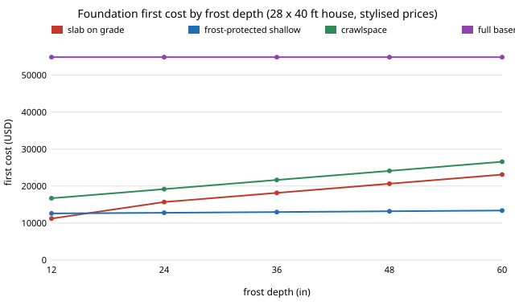

# house-foundation: which foundation is cheapest for a small house as the frost line gets deeper?

Thirtieth project of track 12, open-source residential construction (`PROJECTS.md`, the foundation-type lever named in milestone 4, `house-cost`; no earlier project covers it). It was chosen because the last dozen `house-*` projects were refinements of the shell and schedule model, and the ground floor was still unpriced. It sizes and prices four foundations for the 28 x 40 ft house of [`house-framing`](../house-framing): slab on grade, frost-protected shallow foundation (FPSF), crawlspace and full basement. Stylised and not a design. Produced with AI assistance (Claude).

**Live page:** https://duncan-haywood.github.io/monorepo-projects/research/house-foundation/

**Headline (stylised).** In this model the cheapest foundation for a small house is a conventional slab only where the frost line is about 12 in; from about 18 in down to 60 in it is a **frost-protected shallow foundation, 100% of 5,000 random price draws**, because its footing stays 16 in deep while a conventional slab, stem wall and crawlspace footing follow the frost line down. At 48 in frost the midpoint first costs are **$13,200 (FPSF), $20,600 (slab), $24,100 (crawlspace), $54,900 (basement)**. A basement adds **$25 to $36 per square foot of floor over a crawlspace** (10th to 90th percentile $24 to $40 across frost depths) and costs roughly twice as much as anything else, mostly in excavation (469 cy against 88 cy), forms, waterproofing and stairs. Footing width is not the lever: the bearing check asks for under 14 in of footing on 2,000 psf soil, below the 16 in minimum I assumed, so soil only matters below about 1,500 psf. Price ranges do not decide the ranking; the structural assumptions behind the FPSF do (see H: the insulation would have to be 4 to 8.5 times my quantity to lose to a slab).

**Builds on.** [`house-framing`](../house-framing) for the house dimensions and roof loads. Prior work: ASCE/SEI 32-01, *Design and Construction of Frost-Protected Shallow Foundations* (ASCE, reaffirmed 2025), which defines the real insulation design; ASCE 7 for the allowable-stress load combinations (used from memory of the combination form, not copied); IRC R401 and R403 for presumptive soil bearing and footings (sections cited, tables not copied). No group in `prompt.md` covers construction and none is claimed.

**Not a design, not a cost estimate.** Research code. Nothing here has been reviewed by a licensed professional; a foundation is a life-safety system and needs an engineer's or the local prescriptive code's review and a permit. Not checked: soil pressure on basement walls, drainage and water table, expansive or frost-susceptible soil, uplift, seismic and wind overturning, radon, termites, the real FPSF insulation design, slab reinforcement. Never read this as code compliance.

## Method (`src/house_foundation/model.py`)
- **Load.** Allowable-stress line load on a long-wall footing: roof dead plus snow from `house-framing`'s `Loads`, wall weight at 12 psf, the foundation wall's own weight and, for crawl and basement, a framed floor (10 psf dead, 40 psf live, 14 ft tributary). The governing of D+L, D+S and D+0.75(L+S).
- **Footing.** Width = load over (allowable bearing less footing self-weight), rounded up to 2 in, no narrower than 16 in; 8 in thick. These minima are my assumptions.
- **Quantities.** Footing, 8 in stem or basement wall, 4 in slab, formwork contact area, excavation (a trench for slab, FPSF and crawl; a full pit with 2 ft working space for the basement), insulation, waterproofing, drain, vapour barrier and fixed items. Slab and FPSF at 12 in frost or less use a monolithic thickened edge. FPSF has a 16 in deep footing, a 2 in vertical skirt and a horizontal wing of 0.75 x (frost depth less 12 in), capped at 48 in; that wing rule is invented here to be plausible, not taken from ASCE 32.
- **Cost and carbon.** Thirteen unit prices as (low, mid, high) from memory, not quotes; concrete carbon 230 to 360 kg CO2e per cy, product stage only. Cost includes the ground floor surface: a finished slab, or a framed floor over the crawlspace or basement.
- **Monte Carlo.** 5,000 draws of every unit price, each draw shared by all four foundations (so a price spike moves them together, unlike `house-wallsystems`' independent draws).

## Reproduce
```bash
pip install pytest
cd research/house-foundation
python -m pytest -q tests                                              # 12 tests
PYTHONPATH=src:../house-framing/src python experiments/run.py         # seconds; writes experiments/results.txt
python experiments/figure.py                                           # experiments/cost_by_frost.svg
```

## Results (from `experiments/results.txt`; deterministic)
- **A. Footing width.** On 2,000 psf soil all four need 16 in (the minimum; the unrounded need is 4.9 in for slab and FPSF, 8.7 in crawl, 13.4 in basement). Widths exceed 16 in only at 1,500 psf (basement 20 in) and below: 600 psf asks 20, 34 and 52 in.
- **B. First cost by frost depth** (12, 24, 36, 48, 60 in): slab $11.2k, 15.7k, 18.2k, 20.6k, 23.1k; FPSF $12.6k to 13.4k; crawlspace $16.7k to 26.6k; basement $54.9k at every depth (its footing is already below any frost line).
- **C. Crossover.** Slab beats FPSF by $1.4k at 12 in; FPSF beats slab by $1.8k at 18 in and $7.4k at 48 in.
- **D. Monte Carlo.** Winner shares are 100% (slab at 12 in, FPSF otherwise): the gaps are larger than the price spread, so the unit-price ranges do not change the ranking.
- **E. Basement increment** over crawlspace: $34 per sq ft at 12 in falling to $25 at 60 in (midpoints), because the crawlspace deepens while the basement does not.
- **F. Which price moves the basement-versus-crawl gap** ($30,750 at midpoint, 48 in frost): excavation and backfill ($28.5k to $34.9k), formwork, slab, then stairs; none changes its sign.
- **G. Soil.** At 48 in frost the crawlspace costs $24.1k on 1,500 psf soil or better and $25.8k at 600 psf (34 in footing): soil moves cost by about 7% at most.
- **H. FPSF tolerance.** A tie with the slab would need 4.0x (18 in frost) to 8.5x (60 in) the modelled insulation.



## Limitations
- **Every price is from memory** and no region is specified; absolute dollars should not be trusted, only the structure of the comparison.
- **The FPSF result leans on an invented wing rule and on ignoring the design work, the inspector's acceptance, and heated-building and drainage conditions** that ASCE 32-01 requires. The basement is likewise priced with no soil-pressure, water-table or lateral check.
- **Not equal use.** A basement gives 1,120 sq ft of unfinished space the others lack; the per-sq-ft increment in E prices that, not the value of using it. Finishing, egress windows and heating it are excluded.
- **Operating effects are missing**: slab-edge and basement heat loss, moisture, radon, and the crawlspace's effect on floor comfort. No energy comparison is made.
- **Load model is service-level and simple**; bearing is checked on the long walls only and applied everywhere.
- **Carbon is concrete only**; foam, rebar and the framed floor are left out, so the FPSF's carbon is understated.

## Next steps
Source real regional prices and the ASCE 32 insulation tables (read the standard, then replace the wing rule); add heat loss from the slab edge and basement wall to `house-energy`'s degree-day model; check basement wall bending under soil pressure; put the foundation into `house-open-design`'s ADU takeoff.

## Owner steps
None required. Quotes from an excavator and a concrete supplier, a soils report, and an engineer's review are owner steps.

## Outside dependencies (vitamins)
Python standard library for the model; `pytest` for the tests; the sibling project `house-framing` for the house and loads. No price is sourced.
