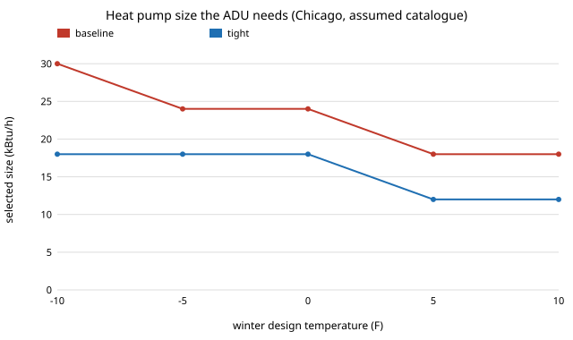

# house-hpsize: does a tighter envelope let a 480 sq ft backyard cottage use a smaller heat pump, and is the saving worth counting?

Follow-up to [`house-breakeven`](../house-breakeven), whose limitations named the missing term: a tighter envelope lowers the peak heating load, which can allow a smaller heat pump. This project computes that **equipment downsizing credit** and adds it to the energy break-even. Because equipment comes in discrete sizes, the credit is a step function of the load, so the interesting question is how robust the step is. Produced with AI assistance (Claude).

**Live page:** https://duncan-haywood.github.io/oss-monorepo/research/house-hpsize/

**Headline (stylised, assumed inputs).** The tight package lowers the ADU's design heating load by about 36.5% in every climate (Chicago: 10,899 to 6,918 Btu/h). With an assumed catalogue (6, 9, 12, 18, 24, 30, 36 kBtu/h), a 15% sizing margin and a capacity loss in the cold, the selected heat pump drops one to two steps: 9 to 6 kBtu/h (Houston), 18 to 9 (Baltimore), 24 to 18 (Chicago), 30 to 18 (Minneapolis). At assumed prices ($1,500 plus $150 per kBtu/h) that is a credit of **$450, $1,350, $900 and $1,800**. The three upgrades `house-breakeven` could cost (attic, windows, air sealing; assumed $2,211 extra) were $998 to $1,607 short of paying back on energy alone; with the credit the gap falls to **$98 (Minneapolis), $287 (Chicago), $463 (Baltimore)** and stays $1,607 in Houston, where the size does not move. Taken one upgrade at a time, only the wall switch moves the size in Chicago and Minneapolis. The credit is not a stable number: moving Chicago's assumed design temperature by 5 F, or the sizing margin from 1.3 to 1.5, doubles or halves it.

**Builds on.** [`house-breakeven`](../house-breakeven), [`house-open-design`](../house-open-design) (envelope UA, packages) and [`house-energy`](../house-energy). It follows the usual heating-load idea (UA times design temperature difference) in outline only; it is not ACCA Manual J, and no manufacturer data is used. It builds on none of the CU Boulder groups in `prompt.md` and claims no connection to them.

**Not a design.** Research code. Nothing here has been reviewed by a licensed architect, engineer or HVAC designer or checked against a building code. Every temperature, size and price is an assumption.

## Use it
```bash
cd research/house-hpsize
python experiments/run.py      # prints and writes experiments/results.txt (instant)
python experiments/figure.py   # draws experiments/size_vs_design_temp.svg from results.txt
```
In code: `selected_size(package_with("wall_r"), "Chicago (5A)")` and `downsizing_credit(COMPONENTS, "Chicago (5A)")` in `src/house_hpsize/model.py`.

## Method
- **Design load.** `house-open-design`'s total UA times (70 F minus the design temperature). No internal or solar gain credit and no ventilation beyond the model's infiltration term.
- **Design temperatures** (Houston 33, Baltimore 17, Chicago 0, Minneapolis -11 F) are rounded values remembered from ASHRAE-style 99% data and not checked against the source.
- **Required rated capacity** = load times a 1.15 sizing margin divided by the share of rated (47 F) capacity kept at the design temperature, taken as 1 minus 0.008 per degree F below 47 (floor 0.5; assumed linear, not a manufacturer curve).
- **Selection** is the smallest size in the assumed catalogue that covers it; **equipment cost** is $1,500 plus $150 per kBtu/h (assumed). **Credit** is the baseline's cost minus the upgraded envelope's.
- Energy break-even and the assumed upgrade costs are `house-breakeven`'s, unchanged.

## Reproduce
```bash
cd research/house-hpsize
PY=$(python3 ../../platform/ci/pyenv.py pytest | tail -1)
$PY -m pytest -q tests         # 18 tests
$PY experiments/run.py && $PY experiments/figure.py
```

## Results (from `experiments/results.txt`; deterministic)
- **A.** Design load, baseline then tight (Btu/h): Houston 5,761 / 3,657; Baltimore 8,252 / 5,238; Chicago 10,899 / 6,918; Minneapolis 12,611 / 8,005. Selected size 9/6, 18/9, 24/18, 30/18 kBtu/h.
- **B.** Whole package, energy break-even + credit = total: Houston 1,409 + 450 = 1,859; Baltimore 2,134 + 1,350 = 3,484; Chicago 2,607 + 900 = 3,507; Minneapolis 3,104 + 1,800 = 4,904.
- **C.** Costed upgrades only: gap to payback without the credit 1,607 / 1,363 / 1,187 / 998, with it 1,607 / 463 / 287 / 98. It does not flip any verdict to "pays" in this model.
- **D.** One upgrade at a time: the wall switch alone moves the size in Baltimore (18 to 12), Chicago (24 to 18) and Minneapolis (30 to 24); windows, air sealing and the floor batt each help in Baltimore only; the attic alone never moves it. The credit is not additive.
- **E, F.** Sensitivity (Chicago): a sizing margin of 1.0 gives 18 to 12 kBtu/h, 1.15 and 1.3 give 24 to 18, 1.5 gives 30 to 18 ($1,800 credit); design temperatures of -10, -5, 0, 5, 10 F give credits of $1,800, $900, $900, $900, $900.



## Limitations
- **Design temperatures, the capacity curve, the catalogue and the equipment prices are unchecked assumptions**; the credit changes by one catalogue step ($450 to $900) with small changes to them, so read it as a range.
- **Not Manual J**: no solar or internal gains at peak, no duct losses, no latent load, and no cooling-side sizing, which can govern in Houston.
- **One fixed equipment price line** for all sizes; real prices have installation and electrical-service steps, and a smaller unit may need no panel upgrade, which is unmodelled.
- The tight package's wall and floor still have **no cost** here, so the largest credit source (the wall) is not compared with its price.
- Not verified against EnergyPlus, BEopt or any real quote.

## Next steps
Source a licensed or openly published heat-load method (for example a free ASHRAE-derived load calculator) and real design temperatures, price the wall and floor to close the loop, and add cooling-side sizing.

## Owner steps
None required. Real quotes and an HVAC designer's load calculation are owner steps.

## Outside dependencies (vitamins)
Python and pytest only, plus the sibling projects.
