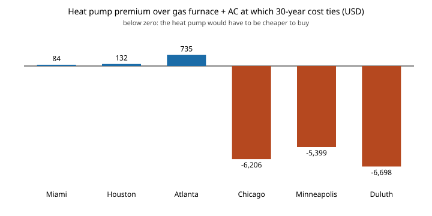

# house-hvacnpc: how much dearer can a heat pump be than a gas furnace plus AC before gas wins on 30-year cost?

Track 12 project, open-source residential construction. [`house-energyprices`](../house-energyprices) ended with two admissions: equipment cost was "not charged to either system", and its next step was to compare gas with heat pump on net present cost (NPC). Equipment prices are the one input this repository has no dated source for, so rather than invent one, this project reports the **break-even premium**: the extra installed cost of a heat pump over a gas furnace + AC at which the two tie on 30-year NPC, each with its own cost-optimal envelope, at EIA state prices. A reader can compare it with any real quote. Produced with AI assistance (Claude).

**Live page:** https://duncan-haywood.github.io/oss-monorepo/research/house-hvacnpc/

**Headline (stylised model).** In Miami, Houston and Atlanta the heat pump ties if it costs no more than **$84, $132 and $735** above furnace + AC, so it wins only when the two systems cost nearly the same to install. In Chicago, Minneapolis and Duluth the heat pump would have to cost **$6,206, $5,399 and $6,698 less** to buy, because it is $260 to $326 a year dearer to run. The cold-climate result holds across 1% to 6% real discount rates (premium −$3,962 to −$8,569). The southern result is fragile: with gas 25% cheaper the premium in Houston and Atlanta goes negative (−$601, −$706).



**Builds on.** [`house-energyprices`](../house-energyprices) (EIA prices), [`house-energy`](../house-energy) (model, imported unchanged) and [`house-framing`](../house-framing). It builds on none of the CU Boulder groups in `prompt.md`.

**Not a design, not advice.** Nothing here was reviewed by a licensed professional. No equipment price is used, so nothing here says what a heat pump costs.

## Method
- For each climate, each system (gas furnace + AC, heat pump) gets the package out of house-energy's 640 that minimises its own NPC at the chosen discount rate; the premium is NPC(gas) − NPC(heat pump), the envelope part included.
- Prices, 30 years and the 3% real rate default are those of `house-energyprices`/`house-energy`; no energy price escalation.

## Reproduce
```bash
pip install pytest
cd research/house-hvacnpc
python -m pytest -q tests                                   # 5 tests
PYTHONPATH=src:../house-energy/src:../house-framing/src:../house-energyprices/src python experiments/run.py > experiments/results.txt   # about a minute
python experiments/figure.py                                # experiments/premium.svg
```

## Results (from `experiments/results.txt`)
- **Running cost** (optimal envelope): gas $287 to $518 a year, heat pump $283 to $844. Heat pump is cheaper by $4 to $12 in the three southern climates.
- **Premium at 3%:** 84, 132, 735 (Miami, Houston, Atlanta); −6,206, −5,399, −6,698 (Chicago, Minneapolis, Duluth).
- **Discount rate** (1%, 6%): Atlanta 933 and 646; Chicago −8,046 and −4,606.
- **Gas ±25%:** Chicago −7,911 to −4,588; Atlanta −706 to +2,108; Houston −601 to +864.

## Limitations
- The heat pump has a constant seasonal COP of 2.5 and no cold derating, which flatters it in Chicago to Duluth; real cold-climate performance would widen the gap. Cooling COP is the same for both systems.
- Gas "$/therm" includes fixed charges spread over average use (see `house-energyprices`), which overstates marginal gas cost for small southern homes and so flatters the heat pump there.
- No equipment sizing, replacement within 30 years, maintenance, rebates, electrification-driven electricity price changes or fuel price escalation. Component first costs remain house-energy's invented numbers.
- State averages stand in for climates.

## Next steps
Source dated equipment installed-cost ranges (and incentives) and place them against these premiums; add a cold-climate COP curve; combine with [`house-hpsize`](../house-hpsize) so the smaller heat pump a tighter envelope allows enters the premium.

## Owner steps
None required.

## Outside dependencies (vitamins)
Python standard library and pytest. EIA prices via `house-energyprices`.
