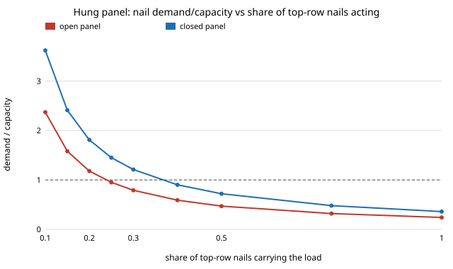

# house-liftnails: do the nails carry a hung wall panel, and how few can act before they fail?

Project of track 12, open-source residential construction (`PROJECTS.md`). [`house-panellift`](../house-panellift) checked a lifted panel's plate bending, weight and wind, and listed the nail load path as a next step. This checks it: the weight of everything below the top plate hangs from the sheathing nails, and the stud end nails get no credit at all. Produced with AI assistance (Claude).

**Live page:** https://duncan-haywood.github.io/monorepo-projects/research/house-liftnails/

**Headline.** In a sheathed panel the weight hangs from the 8d sheathing nails at the top plate. At 6 in spacing and a 1.5 impact factor they carry **17 to 31 lb each, 0.20 to 0.36 of the 84 lb adjusted lateral value** of one nail (worst: the closed rear-wall panel, 0.36). That holds only if the nails share the load: the closed panel reaches capacity when about **40% of the top-row nails** act, the open panel at about 25%. The stud-to-sheathing field nails are at 0.04. A bare frame (no sheathing) hung by its top plate is a different case: each stud's ~24 lb hangs from end nails in end-grain withdrawal, which the NDS gives no design value for, so this model credits it **0 lb**; it needs straps or ties, not nails. Every nail input is my assumption.

**Builds on.** [`house-panellift`](../house-panellift) for the panels and weights, [`house-offsite`](../house-offsite), [`house-framing`](../house-framing). No group in `prompt.md` covers construction and none is claimed.

**Not a lift plan.** Research code. Nothing here replaces a rigger's or engineer's lift plan or a manufacturer's lifting-point rating, and nothing has been reviewed by a licensed professional. A lifted panel is a falling-object hazard. Not checked: slings, shackles, picks' anchorage into the plate, plate splices, the second top plate's laminating nails, nail slip, tilt-up from flat, and gusts.

## Method (`src/house_liftnails/model.py`)
- **Nail strength** (`yield_modes`, `nail_capacity`): single-shear yield-limit equations (modes Im, Is, II, IIIm, IIIs, IV, reduction term 2.2 for D ≤ 0.17 in), dowel bearing 16,600 G<sup>1.84</sup> psi, written from first principles; no NDS table is copied. 8d common (0.131 × 2.5 in, F<sub>yb</sub> 100 ksi), 7/16 in OSB (G 0.50) into SPF (G 0.42). Times the 1.25 duration factor for a lift.
- **Load path** (`check_nails`): weight below the top plates (panel weight minus the plates, from `house-panellift`) times the impact factor, divided among the sheathing-to-top-plate nails at 6 in. Studs and the bottom plate go through the 12 in field nails. This ignores the bottom-edge nails, so it is conservative for them.
- **Bare frame** (`stud_end_nail_demand`): stud weight plus its bottom-plate share, against zero credit for end-grain withdrawal. Side-grain withdrawal (1380 G<sup>2.5</sup> D lb/in) is printed for scale only.

## Reproduce
```bash
pip install pytest
cd research/house-liftnails
python -m pytest -q tests                      # 10 tests; needs ../house-panellift, ../house-offsite, ../house-framing (set in pyproject)
python experiments/run.py > experiments/results.txt   # seconds, deterministic
python experiments/figure.py                   # writes experiments/nail_share.svg
```

## Results (from `experiments/results.txt`)
- **A. One nail.** Mode IIIs governs: 67 lb before and 84 lb after the duration factor.
- **B. Top row.** 17 to 31 lb per nail, ratio 0.20 to 0.36 across the 16 panel and open/closed cases.
- **C. Nails that act.** Demand over capacity scales as 1/share: 1.0 at about 25% (open) and 40% (closed) of the nails. Real sheathing is a flexible deep beam hung from two picks and the nails near the picks will be loaded first, so this share is the number to worry about, not the uniform ratio.
- **D. Field nails.** 3 to 4 lb each, ratio 0.04.
- **E. Bare frame.** 24 lb per stud against no credited capacity.



## Limitations
The uniform-sharing result is an optimistic bound; how the load really spreads needs the sheathing's in-plane stiffness and nail slip. OSB bearing strength, G and F<sub>yb</sub> are assumed, not the NDS panel values. Withdrawal and head pull-through of the sheathing nails are not checked. Impact factor 1.5 is assumed. Conclusions about the uncredited end-grain case follow the NDS rule, not a test.

## Next steps
A finite-element or beam-on-springs model of the hung sheathing with nail slip, to replace the share sweep; head pull-through; the second top plate's nailing; a measured nail test.

## Owner steps
None required.

## Outside dependencies (vitamins)
Python standard library for the model; `pytest` for the tests. The yield-limit equations are the published NDS form; their inputs are assumed.
