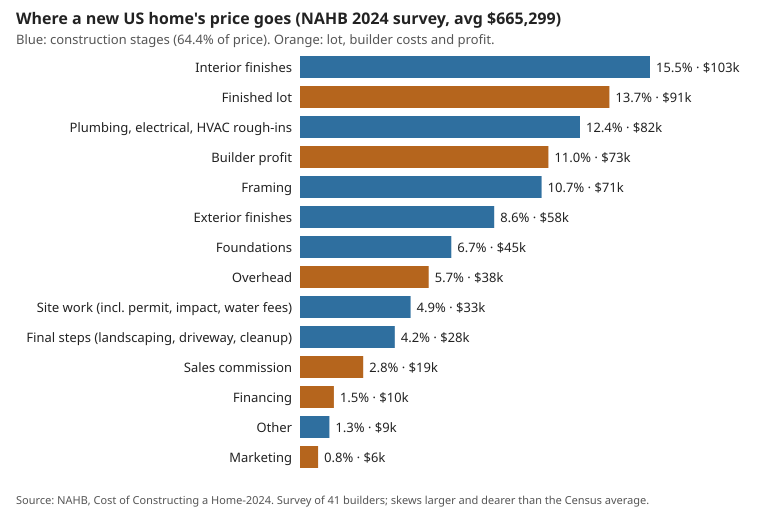

# house-market: what does it cost to build a new home in the US and in Colorado in 2026, and where does the money go?

Track 12 project, open-source residential construction (`PROJECTS.md`). A market report on new single-family homes as of October 2026. It covers the state of the market, a dollar breakdown of a new home's price, Colorado's prices, fees, codes and permits, and what each construction technique costs relative to a wood frame. Every figure is a row of [`data/facts.csv`](data/facts.csv), dated and tied to a source in [`data/sources.csv`](data/sources.csv). A short stdlib model (`src/house_market/model.py`) does the arithmetic that joins the sources, and its assumptions are stated where they are made. Produced with AI assistance (Claude). All sources were read on 2026-10-20.

**Live page:** https://duncan-haywood.github.io/oss-monorepo/research/house-market/

**Headline.**
- **Prices are falling while costs rise.** The median new US home sold for $393,700 in August 2026, down 5.8% on a year earlier. Builder sentiment (29) is the lowest since June 2012, and 43% of builders cut prices in October. Over the same period the inputs to residential construction rose 10.3% (5.5% for materials excluding energy) and the 30-year mortgage rate rose from 6.27% to 7.40%.
- **Where the price of an average new US home goes** (NAHB 2024):
  - construction 64.4% ($428,215, $162 per sq ft);
  - lot 13.7%;
  - profit 11.0%;
  - overhead, commission, financing and marketing 10.9% together.
  - Within construction, interior finishes (24.1%) and mechanical rough-ins (19.2%) cost more than framing (16.6%).
- **Changing the wall system cannot move the price much.** Foundations, framing and exterior together are 26% of the price. A 20% saving on all three moves the price 5.2%; a 20% saving on framing alone moves it 2.1%. Manufactured (HUD-code) homes cost about half as much per sq ft as site-built homes, land excluded. They get there by building the whole house in a factory, systems and finishes included.
- **In Denver, fees and plan-review delay are about 12% of a new home's price** (lot excluded), against 3.5% nationally. A 2,000 sq ft home carries $45,486 in itemised fees plus about $9,625 in carrying cost for a 209-day plan review. Those fees and Denver's 0.94 construction-cost index put this model's Denver home at about $462,000 before land, or $231 per sq ft. The Census median for new homes sold in the West in 2025 was $212.50 per sq ft.

**Builds on.** This project supplies the sourced, dated numbers that earlier track-12 models lacked:
- [`house-cost`](../house-cost) reported a price index; this report gives dollars and the Census reconciliation it listed as a next step.
- [`house-wallsystems`](../house-wallsystems) and [`house-foundation`](../house-foundation) priced from memory; the technique table and Colorado's 36 in frost depth here are sourced.
- [`house-open-design`](../house-open-design) designs a backyard ADU, which Colorado's HB24-1152 now allows by right.

It builds on none of the CU Boulder groups in `prompt.md`.

**Not advice, not a quote.** This is a report from public sources, not an estimate for any site, lot or builder. Several figures come from search-result excerpts rather than pages that were read in full. They are marked "(search excerpt)" in `sources.csv` and should be checked before anyone relies on them.

## 1. State of the US market (October 2026)

| Indicator | Value | Period | Source |
|---|---|---|---|
| Median / average new-home sales price | $393,700 / $478,700 (Aug 2025: $417,900 / $525,100) | Aug 2026 | Census New Residential Sales |
| Median / average, full year | $417,400 / $523,800 (2024: $420,300 / $514,500) | 2025 | Census |
| New homes for sale, months' supply | 483,000; 8.5 months | Aug 2026 | Census |
| Single-family starts | 939,700 (2024: 1,012,900); Jan–Aug 2026 −4.7% y/y | 2025 | Census New Residential Construction |
| Median size, completed / sold | 2,142 / 2,194 sq ft | 2025 | Census Characteristics of New Housing |
| Median / average price per sq ft, lot excluded | $154.79 / $171.95; West median $212.50 | 2025 | Census |
| Framing / foundations / storeys | wood 94%, concrete 5%, steel under 0.5%; slab 75%, basement 16%, crawl 9%; one storey 48% | 2025 | Census |
| NAHB/Wells Fargo builder sentiment (HMI) | 29, the lowest since June 2012; West 26 | Oct 2026 | NAHB |
| Builders cutting prices / using incentives | 43% (average cut 6%) / 65% | Oct 2026 | NAHB |
| 30-year fixed mortgage | 7.40% (a year earlier: 6.27%) | week of Oct 15, 2026 | Freddie Mac via FRED |
| Construction loan, pre-sold home, effective rate | 11.67% | Q2 2026 | NAHB AD&C survey |
| PPI inputs to residential construction | +10.3% y/y; +52.9% since Feb 2020 | Sep 2026 | BLS via NAHB, AGC |
| …materials excluding energy | +5.5% y/y, the highest since Dec 2022 | Sep 2026 | NAHB |
| …lumber and plywood / steel mill / copper | +9.6% / +27.6% / +30.0% y/y | Sep 2026 | AGC PPI tables |
| Tariffs on Canadian softwood lumber | AD/CVD 35.16% plus Section 232 at 10% (NAHB: price +45%) | since Sep–Oct 2025 | NAHB, GHY |
| Tariffs on cabinets and vanities / steel, aluminium, copper | 25% (50% from Jan 1, 2027) / 50% | 2026 | GHY, NAHB |
| Builders' tariff cost per home | $10,900 | Apr 2025 survey | NAHB |
| Builders reporting labour shortages / framing crews short | 47% / 57% | Sep 2026 | NAHB |
| Labour cost for the same house | +4.2% y/y (materials +6.7%, Jul 2026) | Sep 2026 | NAHB |

**Reading.** Builders face both sides of a squeeze. Demand is weak at a 7.4% mortgage rate: prices are down year over year, supply is 8.5 months, and two thirds of builders offer incentives. Meanwhile, tariffs (lumber, cabinets, metals), a 2026 energy-price spike (diesel was up 115% year over year in September), and labour shortages, which NAHB links partly to immigration enforcement, push costs up. Starts have fallen two years running.

## 2. Where a new home's price goes



NAHB's *Cost of Constructing a Home-2024* (41 builders; average 2,647 sq ft on a 20,907 sq ft lot) is the only itemised national breakdown. No 2025 or 2026 edition was found.

| Component | USD | Share of price | Per sq ft |
|---|---:|---:|---:|
| Finished lot | 91,057 | 13.7% | 34.40 |
| **Construction** | **428,215** | **64.4%** | **161.77** |
| Financing | 10,220 | 1.5% | 3.86 |
| Overhead and general | 38,248 | 5.7% | 14.45 |
| Marketing | 5,633 | 0.8% | 2.13 |
| Sales commission | 18,955 | 2.8% | 7.16 |
| Profit | 72,971 | 11.0% | 27.57 |
| **Sales price** | **665,298** | 100% | 251.34 |

| Construction stage | USD | Share of construction | Share of price |
|---|---:|---:|---:|
| Site work (includes permit $7,640, impact $6,367, water/sewer $6,260) | 32,719 | 7.6% | 4.9% |
| Foundations | 44,748 | 10.5% | 6.7% |
| Framing | 70,982 | 16.6% | 10.7% |
| Exterior finishes | 57,510 | 13.4% | 8.6% |
| Major systems rough-ins (plumbing, electrical, HVAC) | 82,319 | 19.2% | 12.4% |
| Interior finishes | 103,391 | 24.1% | 15.5% |
| Final steps | 27,710 | 6.5% | 4.2% |
| Other | 8,835 | 2.1% | 1.3% |

**NAHB against Census.** The NAHB sample is dearer than the market. On the same basis (price excluding the lot, per sq ft), NAHB's house is $216.94 against a Census 2025 average of $171.95, 26% higher. NAHB itself says the sample is not representative. The defensible use is NAHB's shares applied to Census prices. Split that way, the Census median new home (2,194 sq ft at $154.79/sq ft, lot excluded, $339,609) has:
- construction ≈ $253,000, of which interior finishes $61k, systems $49k, framing $42k, exterior $34k, foundations $26k and site work $19k;
- profit ≈ $43k;
- overhead ≈ $23k;
- commission ≈ $11k.

**Regulation.** NAHB's 2021 study put regulation at 23.8% of a new home's price ($93,870), split between lot development (10.5 points) and construction (13.3). That is a builder-association estimate, not an independent one.

## 3. Colorado

| Indicator | Value | Period | Source |
|---|---|---|---|
| Denver metro median close price (all homes) | $594,495; 13,080 active listings | Aug 2026 | DMAR via ColoradoBiz |
| Denver detached / attached median | $675,000 / $391,750 | Jun 2026 | DMAR via ColoradoBiz |
| Colorado statewide median | $550,000 | Aug 2026 | Colorado Association of Realtors |
| Average new-home price, Denver | $701,767 (search excerpt; source PDF unavailable) | Q2 2025 | Land Advisors / Zonda |
| Housing units permitted, Colorado | 31,850 (2024), 33,451 (2025), 21,232 (Jan–Aug 2026) | — | Census BPS via FRED |
| …of which single-family | 20,139 (2024), 17,726 (2025, −12%), 12,128 (Jan–Aug 2026) | — | Census BPS via FRED |
| Denver single-family permits against 2021 peak | −43% | through 2025 | Common Sense Institute (CSI), Jul 2026 |
| Denver construction cost index (RSMeans, US = 1) | 0.94 composite; materials 1.051 (7th highest of 318 metros); installation 0.772 | 2026 | CSI |
| Denver fee stack, 2,000 sq ft home | water/sewer $16,930 + affordable-housing linkage $16,360 ($8.18/sq ft) + permit and review $4,510 + materials sales tax $7,686 (9.15%) = $45,486 | 2026 | CSI |
| Denver Water tap fee (SDC), typical home | $10,450 after +13% in Jul 2026; national average $5,470 | 2026 | CSI, Denver Water |
| Water + sewer tap fees across Colorado | $2,994 (Lamar) to $46,800 (Arvada) | 2026 | CSI |
| Denver plan review | 209 days on average, about $9,625 carrying cost per unit | 2026 | CSI |
| Construction average hourly earnings, Colorado | $43.30 (Aug 2025: $41.44) | Aug 2026 | BLS via FRED |
| Frost depth / ground snow load (Aurora, Englewood) | 36 in / 30–34 psf | current | city design criteria (search excerpt) |

**A Denver new home, built up from sources.** `denver_house()` estimates a 2,000 sq ft Denver home, lot excluded, in four steps:
1. Take NAHB's construction cost per sq ft without NAHB's fees ($154.12).
2. Scale it by Denver's 0.94 RSMeans index.
3. Add CSI's Denver fee stack and the plan-review carrying cost.
4. Add NAHB's shares for financing, overhead, marketing, commission and profit.

The result:
- hard cost $289,740;
- fees $45,486;
- review delay $9,625;
- soft costs and profit $117,599;
- **total $462,450, or $231 per sq ft**, against the Census West median of $212.50.

Fees and the delay are **11.9%** of that price; NAHB's national fees are 3.5% of its price excluding the lot. Two assumptions matter:
- Denver's fees replace NAHB's national fees rather than adding to them.
- Some of the materials sales tax may already sit in NAHB's national materials cost.

**Policy that changes what can be built.**
- **HB24-1152.** Since June 30, 2025, one ADU per lot is allowed with administrative approval in covered jurisdictions. The bill also funds $5M of grants and $8M of CHFA financing.
- **HB24-1313** sets transit-oriented density goals (40 units/acre on average).
- **HB24-1304** removes parking minimums near transit.
- **HB22-1362.** The 2021 IECC plus electric-ready and solar-ready provisions apply on code updates, and a low energy and carbon code applies from July 1, 2026. For the 2021 IECC's cost, national estimates of the increment over the 2018 code range from about $2,300 (PNNL) to $6,500 (Home Innovation) per home.
- **HB25-1272** reformed construction-defect law in May 2025: a voluntary warranty program, and an HOA vote to sue now needs 65%, up from 50%.
- **Colorado Wildfire Resiliency Code** applies to permits from July 1, 2026. Cited cost estimates run from +2–3% (a California-based study) to a county staff estimate of up to 15–20%.
- In the 2026 session, bills capping minimum lot sizes and allowing lot splits died in Senate committee.
- **Factory funding.** The state's Innovative Housing Incentive Program and Prop 123 awarded $12.1M to four factory-built housing applicants in January 2026. Earlier recipients include Fading West (Buena Vista; a 110,000 sq ft modular plant targeting 350–450 homes a year), Key Structures, Guerdon and Huron Components.

**Site factors that raise Front Range costs.**
- **Frost depth** of 36 in, which per [`house-foundation`](../house-foundation) favours a frost-protected shallow foundation over a basement on cost.
- **Snow loads** of 30–34 psf.
- **Expansive bentonite soils**, which often call for drilled piers, over-excavation or a structural floor. No sourced cost premium was found.
- **Wildfire-code requirements** in the wildland-urban interface.

## 4. Construction techniques

| Technique | Cost vs site-built wood frame (published) | US share | Notes and source |
|---|---|---|---|
| Site-built wood frame | baseline: $162/sq ft construction (NAHB 2024) | 94% of 2025 completions | Census |
| Advanced framing (OVE) | saves $500–1,000 in materials and 3–5% of framing labour | partial use | Home Innovation / PATH TechSpec (search excerpt); DOE says up to a third fewer studs |
| Panelized walls and trusses | 2–6 fewer framing days, ~$1/sq ft labour; no total-cost figure | 15,000 units (1.5%) in 2024; 5–12% under a broader definition | NAHB, Pro Builder. Entekra (panelized) shut down in 2023 |
| Volumetric modular | claims of up to −20% cost and 20–50% faster (McKinsey 2019, conditional); −16% cost and −45% schedule in a Utah study of 17 mixed-sector projects | 13,000 units (1.3%) in 2024; peak 4% in 1998 | Katerra (2021) and Veev (2023) failed |
| HUD-code manufactured | **$86.62 vs $165.94 per sq ft, land excluded (52%)** in 2023; 2024 average $123,300 for 1,460 sq ft ($84.45/sq ft; single-section $78.60, double $86.71) | ~9% of single-family starts plus shipments (2023); 103,288 shipped in 2024 | Census MHS. The ROAD to Housing Act (Jul 2026) drops the permanent-chassis requirement (chassis up to ~$10k a unit, search excerpt); HUD standards still to be written |
| ICF | +0.5–4% (NAHB brief); about +$3,000, 6–7% (HUD 1999 side by side) | concrete framing, including block, 5% (2025) | search excerpts |
| SIPs | about +10% on framing; −55% framing labour (industry-funded study) | under 2% of walls | SIPA; CU Boulder thesis |
| Light-gauge steel | +14.2% installed (HUD demonstration homes, late 1990s); framing up to +15% | under 0.5% (~5,000 homes, 2025), ~95% of them in the South | HUD, Steel Framing Alliance |
| CLT / mass timber | +21% total construction (2016 thesis) | no single-family data | Colorado School of Mines |
| 3D-printed concrete | no independent cost study. ICON's Wolf Ranch homes (Georgetown TX, Lennar) start around $430,000 for ~1,850 sq ft. Vendor claims are $80/sq ft for walls, foundation and roof | a few hundred homes | ICON laid off 114 staff in 2025; Mighty Buildings was put up for sale in 2025 |
| Post-frame "barndominium" / container | blog ranges only ($65–160 and $150–350 per sq ft) | no data | no credible source |

**The arithmetic of a cheaper structure** (section F of `results.txt`). Foundations, framing and exterior are 40.5% of construction and 26% of the price. Systems and interior finishes are 43.4% of construction. So a structural system that saves 10% on all three stages moves the price 2.6%; 20% moves it 5.2%, and 30% moves it 7.8%. The cost studies of SIPs, ICF, steel and CLT, most of them 1999–2017 and several industry-funded, find them dearer than a wood frame, not cheaper. The one method with evidence of a large saving is the HUD-code factory. It builds the whole house, systems and finishes included, on one federal code, and reaches about half the site-built cost per sq ft. The comparison is not like-for-like: site work, foundation, utility connections and land are generally outside the manufactured price.

## 5. What this means for low-cost, good homes

A 1,200 sq ft home at each benchmark, lot excluded (section H):

| Benchmark | $/sq ft | 1,200 sq ft |
|---|---:|---:|
| HUD-code manufactured, US average 2024 | 84.45 | $101,340 |
| Site-built, US median 2025 (Census) | 154.79 | $185,748 |
| Site-built, West median 2025 (Census) | 212.50 | $255,000 |
| Site-built, Denver (this model) | 245.11 | $294,134 |

The site-built rows are lower bounds. Kitchens, baths and fixed fees do not shrink with floor area, so a small house costs more per sq ft than the ~2,150 sq ft averages behind these figures ([`house-cost`](../house-cost) finds +57% per sq ft at 800 sq ft against 2,000).

My reading of the sources, not a finding of a model:
1. **Land and soft costs are as big a lever as the build.** In NAHB's average, the lot, profit, overhead, commission, financing, marketing and permit/impact/water fees together are 38.5% of the price. A backyard ADU (now by right in Colorado), infill on land already owned, and low-fee jurisdictions remove costs no construction technique can touch. In Colorado, water and sewer tap fees alone vary by a factor of 15.
2. **The factory has to build the whole house.** Wall-system choice moves the price a few percent at most. Manufactured housing's roughly 50% advantage comes from building in a factory on one code, systems and finishes included. A chassis-free HUD-code home under the 2026 ROAD to Housing Act, or a CrossMod-style home, is the closest existing route to a "low-cost nice home". Volumetric modular has the same promise but a record of factory failures.
3. **On site, keep the wood frame and simplify it.** Advanced framing, prefabricated trusses (−40–55% roof lumber in [`house-truss`](../house-truss)), a slab or frost-protected shallow foundation, and a simple one-storey or two-storey box are the low-risk savings. They are worth single-digit percentages, not halves.
4. **Timing.** Builders are cutting prices and land development loans cost 12.6% effective. A buyer's market for finished lots and for builders' unsold stock may be cheaper than building new in 2026–27.

## Reproduce
```bash
pip install pytest
cd research/house-market
python -m pytest -q tests                                              # 9 tests
PYTHONPATH=src python experiments/run.py > experiments/results.txt     # instant, deterministic
python experiments/figure.py                                           # experiments/price_breakdown.svg from results.txt
```

## Limitations
- **NAHB's breakdown comes from one survey of 41 builders** whose house is 26% dearer per sq ft than the Census average. Its shares are applied to Census prices on the assumption that cost structure does not change with price or region.
- **The Denver estimate is a composition of sources, not a measurement.** It depends on three assumptions: the RSMeans composite index applies to house construction, NAHB's soft-cost shares hold in Denver, and the CSI fee stack is complete and not double-counted. No official Colorado new-construction cost per sq ft was found. The lot is excluded because no sourced Denver finished-lot cost was found.
- **The technique costs are old and often industry-sourced.** Most studies are 1999–2017, several were funded by the industry promoting the system, and several are search excerpts. No independent 2024–2026 cost study was found for SIPs, ICF, steel, CLT or 3D printing.
- **Figures after mid-2026 come from the sources as read on 2026-10-20.** Monthly series will be revised; September 2026 Census sales are due October 27.
- Colorado Springs and Aurora tap fees, Colorado labour-shortage numbers, the energy code's cost in Colorado and the premium for expansive-soil foundations were not found.

## Next steps
- Feed these dollar figures into [`house-cost`](../house-cost) (replace the index) and [`house-wallsystems`](../house-wallsystems) (replace the from-memory ranges).
- Price [`house-open-design`](../house-open-design)'s ADU under Colorado's fee schedules.
- Add a per-jurisdiction Colorado fee table from the utilities' own schedules.
- Track the HUD rule-making on chassis-free manufactured homes.

## Owner steps
None required. Quotes from local builders, a lot, and a jurisdiction's fee estimate are owner steps.

## Outside dependencies (vitamins)
Python standard library; pytest for the tests. Every number is from a public source listed in `data/sources.csv`. RSMeans data was read second-hand through the CSI report; the paid database was not used.
