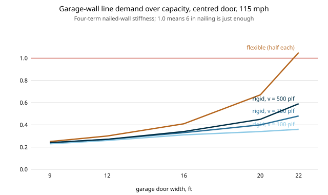

# house-nailedwall: does the rigid-diaphragm relief for a garage-front wall survive a nailed-wall stiffness model?

A project of track 12, open-source residential construction (`PROJECTS.md`, milestone 6, a next step of [`house-diaphragm`](../house-diaphragm): "replace the toy stiffness with an openly sourced nailed-wall deflection equation"). `house-diaphragm` found that a rigid roof diaphragm sheds load from a garage-door gable wall, but its stiffness was a guess with one free softness knob. This swaps the guess for a four-term pier deflection (chord bending, panel shear, nail slip, hold-down slip) and asks whether the sign of the result holds. Stylised and not a code check. Produced with AI assistance (Claude).

**Live page:** https://duncan-haywood.github.io/monorepo-projects/research/house-nailedwall/

**Headline (stylised).** Yes, the sign holds. With a four-term stiffness, a centred 22 ft garage door leaves line A at 0.05 to 0.19 of its partner wall's stiffness (it depends on the unit shear at which stiffness is taken), and under a rigid diaphragm its demand over capacity at 6 in nailing falls from 1.05 (flexible split, fails) to **0.36 at 100 plf, 0.48 at 250 plf and 0.59 at 500 plf**. The relief shrinks as the load rises, because nail slip softens the partner wall too; the toy model's 0.18 to 0.63 spread brackets these numbers. The flexible split stays the governing case, so nothing here lets a design pass.

**Builds on.** `house-diaphragm` (the rigid sway-and-twist solve, imported unchanged), `house-structure` (wind demand, pier segmentation, capacities) and `house-framing`. The deflection form follows the four-term equation used in wood shear-wall practice (SDPWS-style); every constant is from memory and was not checked. It builds on none of the CU Boulder groups in `prompt.md`.

## Method (`src/house_nailedwall/model.py`)
- Pier deflection under unit shear v: bending 8vh<sup>3</sup>/(EAb) + panel shear vh/(Gt) + nail slip 0.75 h e<sub>n</sub> with e<sub>n</sub> = (nail load/616)<sup>3.276</sup> in + hold-down slip h&middot;da/b.
- Inputs (assumed): E 1.4e6 psi, chord A 10.5 in<sup>2</sup>, Gt 83,500 lb/in, 6 in edge nailing, da 0.10 in.
- Pier stiffness is the secant v&middot;b/d at a reference unit shear (100, 250, 500 plf); a wall's is the sum over its piers. Hold-down slip is switched on and off.
- Everything else (the rigid solve, capacities, loads) is `house-diaphragm` and `house-structure` unchanged.
- Tests (8) check the shear-only and bending-only limits against hand formulas, the nail-slip reference point, monotonicity, and zero stiffness for a wall with no piers.

## Reproduce
```bash
pip install pytest
cd research/house-nailedwall
python -m pytest -q tests                                                                                   # 8 tests
PYTHONPATH=src:../house-diaphragm/src:../house-structure/src:../house-framing/src python experiments/run.py  # writes experiments/results.txt
python experiments/figure.py                                                                                # experiments/split.svg
```

## Results (from `experiments/results.txt`; deterministic)
Total ASD base shear 4,655 lb on the two gable lines (115 mph); flexible D/C on line A is 0.25, 0.30, 0.41, 0.67, 1.05 for centred 9, 12, 16, 20, 22 ft doors.
- **Rigid D/C on line A, hold-down on.** At 100 plf: 0.23, 0.26, 0.31, 0.34, 0.36. At 250 plf: 0.24, 0.27, 0.33, 0.40, 0.48. At 500 plf: 0.24, 0.27, 0.34, 0.45, 0.59.
- **Stiffness ratio kA/kB at 22 ft.** 0.05, 0.11, 0.18 at 100, 250, 500 plf. Stiffness falls steeply with load because the nail-slip term grows as the 3.276 power.
- **Hold-down slip off.** Stiffer walls everywhere; rigid D/C at 22 ft is 0.41, 0.53, 0.60. The relief is slightly smaller without it (0.60 against 0.59 at 500 plf, 0.41 against 0.36 at 100); the cause was not isolated.
- **Partner line B.** Rigid D/C stays between 0.20 and 0.31 with hold-down on.
- **Ordering.** The flexible split gives line A the higher demand in every row.



## Limitations
- **Unverified constants.** The nail-slip law, Gt, E and the hold-down slip are from memory of published practice and were not checked against SDPWS or a test report. The conclusion rests on the ratio of the two walls' stiffness, not the absolute values.
- **Secant stiffness at a fixed v.** Real walls soften as the load rises; the reference unit shear is swept rather than solved self-consistently with the load split.
- **Chord and hold-down simplified.** Two studs as the chord, one hold-down slip for all piers, no dead-load relief, no cumulative effects from stacked or coupled piers.
- **Still missing:** accidental torsion, a seismic case, the collector over the door, a second storey, gypsum and interior walls. Whether a roof is rigid or flexible is a code decision not checked here.
- **Not a design and not a code check.** A licensed engineer, or the local code's prescriptive path, and a permit, are needed first.

## Next steps
Check the constants against SDPWS and a published test, then solve the secant stiffness self-consistently with the load split; add accidental torsion and a seismic case; add the door-header collector; then the perforated-wall method in `house-structure`.

## Owner steps
None required.

## Outside dependencies
Nothing it could not run itself; the published coefficients it needs checking against are the one thing it could not read.
