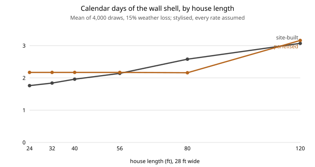

# house-offsite: when does building a house's wall shell in a factory beat building it on site?

Eighth project of track 12, open-source residential construction (`PROJECTS.md`, milestone 7). It takes the exterior walls of the [`house-framing`](../house-framing) house (advanced 2x6 at 24 in) and asks the offsite question on a small, checkable model: split the walls into panels, nest the sheathing, load the trailers, then compare the crew days and an assumed cost of panelising against framing on site. Produced with AI assistance (Claude).

**Headline.** In this stylised model **panelising the walls of a 28 x 40 ft house does not pay**: the shell takes 1.96 calendar days on site and 2.17 panelised, and the panelised shell costs 38% more at assumed rates. Factory work hides behind the foundation (it is off the critical path whatever the factory's productivity), so the only lever on *days* is the fixed delivery-plus-crane time against site labour that grows with the house: panelised is faster from about **58 ft long at 15% weather loss (78 ft with no weather, 44 ft at 30%)**. On *cost*, with a $1,500 crane day it never wins up to 200 ft; with $750 only if factory labour is about 3x as productive as site labour; with a free crane day it wins from 24 ft. **Nesting the sheathing in a factory saves 1 sheet in 33** (lower bound 26): a 4 x 9 sheet cut to a 97 in wall leaves an 11 in strip that few pieces can use, so sheet waste is a property of the wall height, not the cutting method. Every rate is my assumption; what the model supports is the *shape* (fixed costs against size), not the dollars.

**Builds on.** [`house-framing`](../house-framing) for the walls, openings and member counts; [`house-schedule`](../house-schedule) for the finding that a factory shell only helps if ordered early. It does not reuse [`garment-nesting`](../garment-nesting): that project packs polygons into an unbounded strip, while this is rectangles into fixed 4 x 9 ft sheets, so I wrote a small guillotine packer instead. No group in `prompt.md` covers construction and none is claimed.

**Not a design, not a cost estimate.** Research code. Nothing here has been reviewed by a licensed professional. Structural, fire and transport rules are not checked: panel handling loads, lifting points, bracing during the crane lift and road-weight limits are outside the model.

## Method (`src/house_offsite/model.py`)
- **Panels** (`panelise`): each wall is cut into the fewest equal-ish panels no longer than a handling limit (24 ft by default). A break moves to the nearest position at least 5.5 in clear of any opening, so no panel cuts through a header, king or sill.
- **Sheathing pieces** (`sheathing_pieces`): full-height 4 x 9 ft OSB sheets laid in 48 in columns from the start of the wall (site) or of each panel (factory), each cut around openings into pieces beside, over and under them. Covered area equals wall area minus openings (tested).
- **Packing** (`pack_sheets`): guillotine packing onto 48 x 108 in sheets, no rotation unless stated (OSB strength axis matters in a shear wall). *Site habit*: pieces in building order, first fit, keep offcuts with both sides at least 12 in. *Factory nesting*: largest first, best fit, keep offcuts of 4 in and up. Placements are checked for overlap and bounds in tests.
- **Trips** (`plan_trips`): panels in flat stacks of up to 6 of similar length, stacks packed end to end on a 48 ft trailer.
- **Process** (`simulate_shell`, `Process`): site labour = members x 12 min + sheets x 15 min + 3 labour-hours to raise and brace each wall; crew of 4; each calendar day lost to weather with probability 15%. Factory labour = 0.6 x the member and sheet labour (the ratio is the thing swept), on flat tables with no raising, in parallel with a 12-day foundation. On site after delivery: one trip-day per trailer, at least one crane day, 45 min per panel set and 45 min per joint. Cost uses assumed wages ($55 site, $45 factory, 25% plant overhead), sheets $24, $900 per trip and $1,500 per crane day. **None of these rates is sourced.**
- Weather draws share a seed across scenarios (common random numbers), 4,000 draws.

## Reproduce
```bash
pip install pytest
cd research/house-offsite
python -m pytest -q tests                      # 11 tests; needs ../house-framing/src (set in pyproject)
python experiments/run.py > experiments/results.txt   # under a second, deterministic
python experiments/figure.py                   # experiments/size.svg from results.txt
```

## Results (from `experiments/results.txt`)
- **Layout.** At a 24 ft handling limit the 154-member shell is 8 panels with 4 joints and one trailer. Shorter limits add panels (14 at 12 ft) but not trips.
- **Sheathing.** 927 ft<sup>2</sup> of OSB needs at least 26 sheets by area; site habit used 33, factory nesting 32, and 31 with rotation allowed. The panel layout's extra seams cost nothing measurable (same counts as the site layout). A larger share of waste comes from the 97 in wall on a 108 in sheet.
- **Baseline.** Site labour 51 h, factory 23 h; shell days 1.96 site, 2.17 panelised; assumed cost $3,600 against $4,972.
- **Factory productivity does not move the days.** The factory finishes inside the foundation time at every ratio from 0.3 to 1.0 (experiment D); the difference in days depends only on weather (+0.40 d with none, +0.21 at 15%, 0.00 at 30%) because the crane day is the exposed step in both.
- **Size.** Longer houses grow site labour but not the crane day (experiment E): at 80 ft the shell is 2.58 d on site and 2.16 panelised, but panelised still costs 30% more. At 120 ft a second trailer erases the gain.
- **Cost break-even** (F0): with a free crane day panelising wins from 24 ft at factory ratios of 0.6 or better; at $750 per crane day only a ratio of 0.3 wins, and only from 34 ft; at $1,500 it never wins up to 200 ft.
- **Overheads** (G): a free crane day takes panelising from +$1,373 to −$127; tripling the trip cost adds $1,800.



## Limitations
- **The labour rates are guesses.** I did not find or use measured crew productivity; the 12 min per member and 0.6 factory ratio are placeholders that give a believable 51 hours for the walls of a small house. Change them in `Process`.
- **Only the wall shell.** Floors, roof trusses, windows installed in the factory, wiring and insulation in the panel (the usual offsite gains) are not counted, so this is the weakest version of the offsite case. Closed panels would move more labour into the factory.
- **Savings elsewhere are excluded**: less site theft and weather damage, interest on a shorter build (`house-schedule` sizes that), and quality. Costs elsewhere too: design freeze, plant utilisation, minimum order sizes, and the permit and inspection of factory work.
- **Crane and transport are one-line models.** One crane day at a fixed price, a 48 ft trailer, no width or weight limits, no escort, no lifting-frame design.
- **Weather is a coin flip per day**, the same every day; the shell is under three days, so the draw matters.
- **Sheathing nesting is greedy**, one run of each policy, no exact solver; rotation of OSB may not be allowed structurally.

## Next steps
Calibrate labour to a published productivity source and the factory ratio to a real plant; add floors and trusses and a closed-panel variant; let `house-schedule` consume the shell step so the interest saving is priced together with the labour; check panel handling loads with `house-structure` once it exists.

## Owner steps
None required. Any real panelised build needs an engineer's design for lifting and bracing and the local authority's approval of factory-built walls.

## Outside dependencies (vitamins)
Python standard library for the model; `pytest` for the tests. Wall geometry comes from `house-framing`. No price or rate is sourced; a real study needs a framing crew's productivity data and a panel plant's quote.
