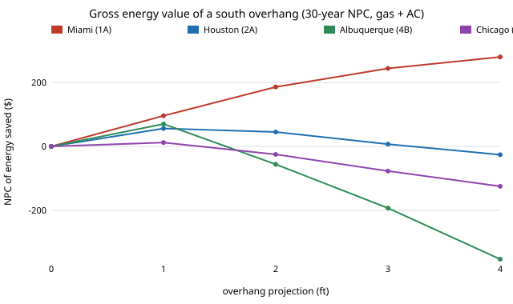

# house-overhang: does a roof overhang over south windows pay for itself, and in which climates does it cost energy instead of saving it?

Track 12, open-source residential construction (`PROJECTS.md`, milestone 5), the "add overhang shading" next step of [`house-solar`](../house-solar). `house-solar` gave south glass its winter sun but left it unshaded in summer. A horizontal overhang blocks the high summer sun and, if too deep, also the low winter sun. This project adds the overhang geometry (profile angle, shadow depth on the glass) to `house-solar`'s hourly beam calculation, shades the beam term only, and searches projection (0 to 4 ft) jointly with `house-energy`'s 640 envelope packages. It is a **degree-day model, not EnergyPlus**, and the window height, overhang gap and overhang price are **unsourced assumptions**. Produced with AI assistance (Claude).

**Headline (stylised, assumed inputs).** (1) At the assumed price ($12 per foot of window width per foot of projection) **no overhang is cost-optimal in any of the 8 climates or 2 systems**; the optimum projection is 0 ft in all 16 cases (experiment C). (2) The gross energy value is small: at most **$280 of 30-year NPC** for a 4 ft overhang over a 21 ft south wall, in Miami (cooling only, so the same for either system), against a build cost near $1,000 (experiment B). (3) In cold and mixed climates deeper overhangs *lose* energy: from 2 ft in Chicago, Duluth and Minneapolis, and from 2 ft in Albuquerque, the lost winter gain exceeds the summer cooling saved (e.g. Albuquerque, heat pump: &minus;$594 at 4 ft). Only a 1 ft projection is slightly positive there ($3 to $70, gas). (4) The overhang would be chosen only if it cost roughly $0.60 to $4.20 per foot of width per foot of projection or less (experiment D, gas, coarse price grid), a fraction of the assumed price, except Duluth where even $0.12 was needed. Nothing here says overhangs are not worth building: they also protect siding and keep rain off the glass, which this model ignores.

**Builds on.** [`house-solar`](../house-solar) (solar geometry, clearness, SHGC, glazing splits) and [`house-energy`](../house-energy) (packages, prices, systems), via [`house-framing`](../house-framing). Overhang geometry is the standard profile-angle method (shadow depth = projection x tan(profile angle) &minus; gap), written from memory and checked by closed-form tests, not against a published tool. It builds on none of the CU Boulder groups in `prompt.md`.

## Method (`src/house_overhang/model.py`)
- **Shading.** Profile angle = atan(tan(sun altitude) / cos(sun azimuth from south)); shaded fraction of the glass = clip((P x tan(profile) &minus; gap) / window height, 0, 1). Window height 4 ft, gap 0.5 ft (assumed). Sun azimuth by the standard hourly formula.
- **Applied to** beam radiation on the south face only (east, west and north unshaded). Diffuse and ground-reflected terms are not reduced.
- **Everything else** is `house-solar`'s: same representative days, same heating/cooling month split, same loads, same NPC. South-heavy glazing (60% of window area south) is used throughout, so the south wall is 21 ft of 4 ft glass. Projection grid: 0, 1, 2, 3, 4 ft, searched exhaustively with the 640 packages.
- **Price.** $12 per foot of width per foot of projection (extra rafter tail, soffit, fascia), assumed.

## Reproduce
```bash
pip install pytest
cd research/house-overhang
python -m pytest -q tests                                                                 # 9 tests
PYTHONPATH=src:../house-solar/src:../house-energy/src:../house-framing/src python experiments/run.py   # seconds; writes experiments/results.txt
python experiments/figure.py                                                              # experiments/overhang_value.svg
```

## Results (from `experiments/results.txt`; deterministic)
- **A. Shade fraction at noon, Chicago.** 21 Dec: 0 at 1 ft, 0.10 at 2 ft, 0.33 at 4 ft. 21 Jun: 0.62 at 1 ft, fully shaded from 2 ft. A 2 ft overhang is fully shading in June but already costs 10% of the glass in December.
- **B. Gross value** (baseline package, 30-year NPC of energy saved, gas): Miami +$96 / +$186 / +$244 / +$280 at 1 to 4 ft; Houston peaks at +$56 (1 ft) and goes negative by 4 ft; Atlanta, Albuquerque, Baltimore, Chicago, Minneapolis and Duluth are +$3 to +$70 at 1 ft and negative from 2 or 3 ft (Albuquerque &minus;$353 at 4 ft, gas).
- **C. Cost optimum with the assumed price:** 0 ft in all 16 cases; window U unchanged from `house-solar` (U 0.35 in Miami, U 0.50 elsewhere).
- **D. Break-even price:** about 0.35x the assumed price in Miami, Houston and Albuquerque ($4.20), 0.15x in Atlanta and Baltimore ($1.80), 0.05x in Chicago and Minneapolis ($0.60), 0.01x or less in Duluth. The grid is coarse, so these are upper brackets of the true break-even.



## Limitations
- **Not EnergyPlus.** Degree-day loads, no hourly weather, no thermal mass; inherits every `house-solar` limitation, including its assumed latitudes, clearness indices, SHGC and the 0.80 useful-gain share, whose formulas were written from memory.
- **The overhang does not block diffuse sky**, so the model slightly overstates the gain left under a deep overhang. Overhang width beyond the window, side fins, trees and neighbours are not modelled.
- **Albuquerque's size comes largely from its assumed Kt of 0.65.**
- **Window height, gap and overhang price are assumed**, not sourced; the break-even prices in D are the more portable result. The overhang's non-energy benefits (weather protection of the wall and glass) are excluded, and its structural cost is only the lump price.
- **Not a design and not a code check.** A licensed architect or engineer and a permit are needed first.

## Next steps
Validate shading against a published tool (for example a sun-path shading calculator) on one latitude; add east and west fins; make the overhang an adjustable projection on the plan from `house-plan`; replace the assumed price with a sourced framing takeoff from `house-cost`.

## Owner steps
None required.

## Outside dependencies (vitamins)
Python standard library, `house-solar`, `house-energy` and `house-framing`; pytest for tests. Window height, gap, overhang price, weather and the solar inputs inherited from `house-solar` are outside the model and unsourced assumptions.

## References
- Duffie, J. A. and Beckman, W. A. *Solar Engineering of Thermal Processes* (Wiley), profile angle and shading geometry (cited from memory, not re-read).
- `house-solar` README, for the Erbs, Klein and Duffie (1982) diffuse-fraction method and its caveats.
