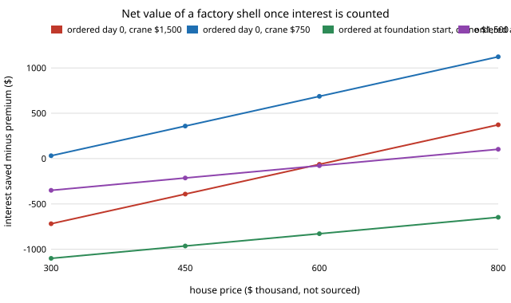

# house-shellvalue: does a factory-built shell pay once the interest on the days it saves is counted?

Twenty-ninth project of track 12, open-source residential construction (`PROJECTS.md`, milestone 7, the "let `house-schedule` consume the shell step" next step of `house-offsite`). `house-offsite` found that panelising a house's walls costs more than framing them on site; `house-schedule` found that a factory shell shortens a build. Neither priced the other's side. This project joins them: the shell's extra cost in dollars against the interest on the working days it saves. Produced with AI assistance (Claude).

**Live page:** https://duncan-haywood.github.io/monorepo-projects/research/house-shellvalue/

**Headline.** In this stylised model **a factory shell saves 15.5 working days when it is compared with a site-built house ordered on the same day, not the 78 days `house-schedule` reports for "shell plus ordering everything at day 0"**: most of that 78 is the ordering, not the shell. At 8% interest that is **0.22% of the sale price**, about $990 on a $450,000 house, against a $1,373 premium for panelising the walls, so **the shell does not pay below a house price of about $629,000** (with the premium from `house-offsite`'s $1,500 crane day; with a $750 crane day it pays at every price tried, from $300,000). If the shell is ordered only when the foundation starts, its 25-day lead time eats the gain (6.4 days, 0.09% of price, break-even $1.5 million) unless the factory's lead time is 10 days or less. The finding that survives my assumptions is the shape: the interest value of a few weeks is a few hundred to a thousand dollars, the same size as the crane day, so the verdict flips on the crane price and the ordering date, not on factory productivity.

**Builds on.** [`house-offsite`](../house-offsite) for the premium, [`house-schedule`](../house-schedule) for the days and interest share, [`house-orderlead`](../house-orderlead) for why ordering date matters. No group in `prompt.md` covers construction and none is claimed.

**Not a design, not a cost estimate.** Research code. Nothing here has been reviewed by a licensed professional. The house prices in the tables are parameters I chose to bracket a range, not sourced figures. Every rate is an assumption of the two sibling projects.

## Method (`src/house_shellvalue/model.py`)
- `premium_dollars`: `house-offsite`'s panelised-minus-site shell cost.
- `shell_value`: runs `house-schedule` twice on the same random numbers, with `prefab_shell` off and on, **at the same ordering policy** (`order_early` the same in both), so the difference is the shell alone. Interest is the schedule's percent of price times a house price.
- `breakeven_price`: premium divided by the interest share saved.

## Reproduce
```bash
pip install pytest
cd research/house-shellvalue
python -m pytest -q tests                      # 5 tests
python experiments/run.py > experiments/results.txt   # about a minute, deterministic
python experiments/figure.py                   # experiments/netvalue.svg
```

## Results (from `experiments/results.txt`)
- **Premium** (A): $1,373 at a $1,500 crane day, $623 at $750, −$127 with no crane charge.
- **Days saved by the shell alone** (B, 4,000 builds): 15.5 d ordered at day 0, 6.4 d ordered at foundation start with a 25-day lead; 12.0 d with a 10-day or 5-day lead (the same, because the foundation is then the limit).
- **Interest** at 8%: 0.22%, 0.09% and 0.17% of price for those cases.
- **Net value** (C, D): ordered at day 0 the shell loses $391 on a $450,000 house at a $1,500 crane day and gains $359 at $750. Ordered at foundation start it loses at every price below $800,000 at $1,500 (−$647 at $800,000) and breaks even only near $800,000 at $750.
- **Interest rate** (E): break-even price $1.26 million at 4%, $629,000 at 8%, $419,000 at 12%.



## Limitations
- **Mismatched scopes.** The schedule's shell replaces framing and roof (20 site days); `house-offsite` prices only wall panels. The days side is generous to the factory and the cost side is narrow; a roof-truss premium (see `house-truss`) is not included.
- **Interest only.** No carrying cost of materials ordered early (`house-orderlead` prices that), no saved overhead or supervision, no weather or theft damage, no factory design-freeze costs.
- **House price is a free parameter**, and a bigger house also changes the premium; the premium here is for the 28 x 40 ft house.
- **Small dollar differences.** Net values are within a couple of hundred dollars of zero at the interesting prices, smaller than the uncertainty in every rate, so the sign should not be trusted; the dependence on ordering date and crane price is the result.
- No standard errors are reported for the day savings beyond the common random numbers; N = 4,000.

## Next steps
Price the roof shell (trusses plus crane) so scopes match; fold in `house-orderlead`'s holding cost for the early order; source a factory lead time and a crane day rate.

## Owner steps
None required. Real quotes from a panel plant and a crane operator, and an engineer's review, are owner steps.

## Outside dependencies (vitamins)
Python standard library for the model; `pytest` for the tests; the sibling projects `house-offsite`, `house-schedule` and `house-framing`. No price is sourced.
