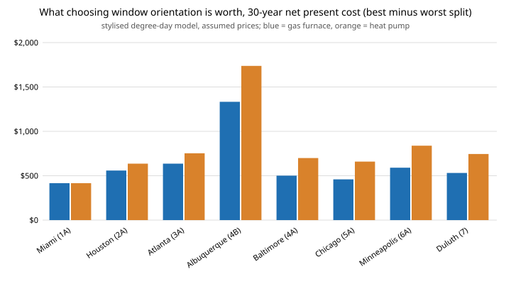

# house-solar: does solar gain through windows change which envelope is cheapest over 30 years, and is the direction the windows face worth money?

Eighth project of track 12, open-source residential construction (`PROJECTS.md`, milestone 5, the first "next step" of [`house-energy`](../house-energy): add solar gain). `house-energy` found that the cost-optimal envelope takes the cheapest, worst window (U 0.50) in almost every climate, but it counted only conduction and said so: no solar gain. Sunlight through glass offsets heating in winter and adds to cooling in summer, and which way a window faces is a free design choice. This project adds both, with the solar geometry computed from first principles (declination, hourly beam on a vertical surface, an Erbs diffuse split, isotropic sky), and re-runs the same 640-package search. It uses a **degree-day model, not EnergyPlus**, and every price is `house-energy`'s unsourced assumption. Produced with AI assistance (Claude).

**Headline (stylised, assumed prices and clearness).** (1) Adding solar gain does not rescue better windows: U 0.50 stays the cost-optimum in 15 of 16 climate and system cases (Miami moves to U 0.35, where cooling-season gain through the cheap, high-SHGC glass costs more than it earns). (2) Orientation is free and worth **$420 to $1,740 of 30-year net present cost** per house, depending on climate and system (best against worst of four glazing splits, experiment D); in Albuquerque, with the most winter sun, a south-heavy house saves $1,333 (gas) over the worst split. (3) Forcing a U 0.20 window costs $5,300 to $5,700 of NPC over the optimum in Chicago whatever its solar heat gain coefficient (0.20 to 0.50, experiment E), so the window result is not an artifact of the missing solar term. (4) Forcing windows to U 0.35 or better costs $830 to $1,180 in the cold and mixed climates, close to `house-energy`'s $440 to $1,270 without solar. Nothing here says a U 0.50 window is allowed: it ignores condensation, comfort and code.

**Live page:** https://duncan-haywood.github.io/monorepo-projects/research/house-solar/

**Builds on.** [`house-energy`](../house-energy) (imported unchanged: packages, first costs, UA, prices, systems), via [`house-framing`](../house-framing). Solar geometry follows textbook method: declination and the sunset-to-sunrise hourly integration of Duffie and Beckman, *Solar Engineering of Thermal Processes*, and the Erbs, Klein and Duffie (1982) diffuse-fraction correlation (both written from memory in this run; the coefficients were **not** re-checked against the sources, see Limitations). It builds on none of the CU Boulder groups in `prompt.md`.

## Method (`src/house_solar/model.py`)
- **Incident radiation.** For one representative day per month, hourly horizontal radiation is Kt times the extraterrestrial value; the diffuse part comes from Erbs' daily correlation; beam on a vertical surface at azimuth gamma uses the standard angle-of-incidence formula; diffuse sky and ground-reflected (albedo 0.2) terms are isotropic. Output: Btu/ft<sup>2</sup> per year for S, E, W and N.
- **Heating or cooling credit.** Daily mean temperature is a sinusoid with mean 65 + (CDD &minus; HDD)/365 (exact) and an amplitude found by bisection so the annual HDD65 matches. Each month's incident energy is split between "heating" and "cooling" in proportion to that month's HDD and CDD.
- **Load.** Heating = conduction x (1 &minus; 0.15 internal-gains credit) &minus; 0.80 x solar heating-share gain (not all of it is useful), floored at zero. Cooling = conduction + all cooling-share solar gain. Gain = area x SHGC x 0.75 (frames, screens, incidence, dirt) x incident. SHGC is tied to U: 0.55 (U 0.50), 0.35, 0.30, 0.28 (U 0.20), assumed.
- **Everything else** is `house-energy`'s: 640 packages, NPC = first cost + 30-year annuity (3% real) of energy cost, exhaustive search. The 0.15 internal credit replaces `house-energy`'s lumped 0.25 (internal plus solar); the two models therefore differ in more than the solar term.
- **Glazing splits** (window area share S/E/W/N): even 25 each; south-heavy 60/15/15/10; north-heavy 10/15/15/60; east-west 0/50/50/0. No overhangs or shading.
- **Climates.** `house-energy`'s eight (HDD65, CDD65) pairs, from memory, unchecked. Latitudes (to 0.1 degree) and clearness indices Kt (0.48 to 0.65) are assumed round values, not read from any dataset.

## Reproduce
```bash
pip install pytest
cd research/house-solar
python -m pytest -q tests                                                         # 9 tests
PYTHONPATH=src:../house-energy/src:../house-framing/src python experiments/run.py  # seconds; writes experiments/results.txt
python experiments/figure.py                                                       # experiments/orientation.svg
```

## Results (from `experiments/results.txt`; deterministic)
- **A. Incident solar** (kBtu/ft<sup>2</sup> a year, heating-weighted / cooling-weighted): Chicago south 202/97, east or west 162/109, north 113/86. Albuquerque south 317/137. The south face collects about twice the heating-season energy of the north face in the cold climates.
- **B. Optimum packages.** Walls: advanced 2x6 in all 16 cases (as in `house-energy`). Windows: U 0.50 in 15, U 0.35 in Miami. Savings over the baseline package: $955 (Miami) to $5,667 (Duluth, heat pump).
- **C and D. Orientation.** Best split minus worst split, 30-year NPC: Miami $416; Houston $558 to $636; Atlanta $636 to $753; Albuquerque $1,333 (gas) and $1,738 (heat pump); Chicago $459 to $659; Duluth $531 to $745. South-heavy is best everywhere except Miami, where north-heavy is.
- **E. SHGC sensitivity.** Forcing U 0.20 glass in Chicago with a south-heavy house costs $5,293 (SHGC 0.50) to $5,690 (SHGC 0.20) over the free optimum.
- **F. Code-like floor** (U &le; 0.35, 5 ACH50 or better, a stand-in and not a code check): $0 in Miami, $831 to $1,175 elsewhere.



## Limitations
- **Not EnergyPlus.** Steady-state degree-day loads with a sinusoidal temperature, no hourly weather, no thermal mass, no overheating control, no shading by overhangs, trees or neighbours, no night setback. The 0.80 "useful" share and 0.75 solar factor are assumed; a better model could move the orientation values a lot.
- **Orientation values depend on assumed Kt.** Clearness indices and latitudes were not taken from data. Albuquerque's larger number mostly reflects its assumed Kt of 0.65.
- **Formulas written from memory.** The Erbs coefficients and the vertical-surface incidence formula were recalled, not rechecked against the sources in this run. Tests check geometry symmetries and monotonic behaviour, not agreement with a published dataset. Treat absolute kBtu/ft<sup>2</sup> as unvalidated; the comparisons between orientations are more reliable than the totals.
- **Prices are `house-energy`'s unsourced assumptions**, and the window price is per square foot, independent of orientation. Whether a floor plan can put most of its glazing south is not modelled.
- **Not a design and not a code check.** Nobody should build to this result. A licensed architect or engineer, or the local code's prescriptive path, and a permit, are needed first.

## Next steps
Validate the solar model against a published typical-year dataset or EnergyPlus on one house and one city; replace Kt, latitude and climate pairs with data; add overhang shading (south glass in summer); couple orientation to floor-plan geometry via `house-plan`.

## Owner steps
None required.

## Outside dependencies (vitamins)
Python standard library, `house-energy` and `house-framing`; pytest for tests. Weather, clearness, glazing properties and prices are outside the model and unsourced assumptions.

## References
- Duffie, J. A. and Beckman, W. A. *Solar Engineering of Thermal Processes* (Wiley), for the solar-geometry method (cited from memory, not re-read).
- Erbs, D. G., Klein, S. A. and Duffie, J. A. (1982). Estimation of the diffuse radiation fraction for hourly, daily and monthly-average global radiation. *Solar Energy* 28(4) (cited from memory, coefficients not re-checked).
- NREL. BEopt, for the cost-optimal-package method (see `house-energy`).
