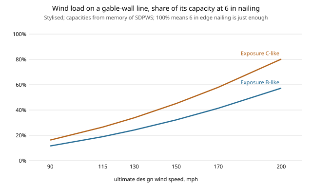

# house-structure: does a small wood-frame house have enough shear wall for wind and earthquakes once the windows and doors are cut out?

Eighth project of track 12, open-source residential construction (`PROJECTS.md`, milestone 6, first version: wood-frame lateral design only; the alternative wall systems are next steps). It takes the 28 x 40 ft one-storey house of [`house-framing`](../house-framing), computes wind and seismic base shear, and checks it against the segmented wood shear-wall length its real openings leave. Stylised and not a code check: the capacities are from memory (see Limitations). Produced with AI assistance (Claude).

**Live page:** https://duncan-haywood.github.io/monorepo-projects/research/house-structure/

**Headline (stylised).** At 115 mph and a seismic SDS of 0.50 this house uses **19% of one gable-wall line's capacity at the loosest nailing** (6 in panel edges) for wind across the ridge, and 6 to 8% in the other cases: it needs about 4.6 ft of full-height sheathed wall against 24 ft available. Lateral load is not what limits this plan. Wind has to reach 264 mph (Exposure-B-like) or 223 mph (C-like) before 6 in nailing runs out, and SDS 7. What does bite is the **openings**: adding windows to each gable wall takes the solid length from 24 ft to 18 ft with three windows, to 11 ft with four, and to zero with six, because narrow piers (under height/3.5) do not count. Framing choice does not matter: the advanced 2x6 at 24 in has the same shear capacity as the conventional wall (experiment E). Hold-down tension at the demand shear is under 800 lb at 115 mph (experiment A).

**Builds on.** [`house-framing`](../house-framing) (imported unchanged: the walls and the positions of the openings). Method follows the structure of the American Wood Council's SDPWS and ASCE 7 in outline only, from memory. It builds on none of the CU Boulder groups in `prompt.md`.

## Method (`src/house_structure/model.py`)
- **Wind.** Strength pressure = 0.00256 Kz Kd V<sup>2</sup> x Cp x G with Kz 0.70 (B-like) or 0.98 (C-like), Kd 0.85, net Cp 1.3 (windward plus leeward) and gust 0.85, all assumed; ASD = 0.6 x that. Applied to the projected area (walls to mid-height plus the 4:12 roof for wind across the ridge; gable wall plus roof triangle along it). Each direction is resisted by the two walls parallel to it, half each.
- **Seismic.** Weight = 15 psf roof and ceiling on plan plus 10 psf for the upper half of the walls (22,304 lb); V = SDS / 6.5 x W; ASD = 0.7 V. Same two-line split.
- **Capacity.** Segmented shear walls: full-height solid piers between openings, counted only if at least height/3.5 wide; unit shear from a nailing table (15/32 structural-I OSB, 8d at 6, 4, 3 or 2 in edges, nominal values from memory, ASD = nominal / 2); an aspect-ratio reduction of 1.25 &minus; 0.125 h/b above 2:1. The design picks the loosest nailing that carries the demand.
- **Hold-down.** Tension = demand unit shear x 8 ft, with no dead-load relief.

## Reproduce
```bash
pip install pytest
cd research/house-structure
python -m pytest -q tests                                             # 12 tests
PYTHONPATH=src:../house-framing/src python experiments/run.py         # under a second; writes experiments/results.txt
python experiments/figure.py                                          # experiments/wind.svg from results.txt
```

## Results (from `experiments/results.txt`; deterministic)
- **A. 115 mph, SDS 0.50.** Gable-wall line, wind across the ridge: need 2,328 lb, capacity at 6 in 12,282 lb (D/C 0.19). Long-wall line along the ridge: 1,193 lb of 14,068 (0.08). Seismic: 600 lb against 8,790 and 10,068 (0.07, 0.06). Every case passes at 6 in nailing.
- **B. Wind sweep.** Required solid wall at 6 in grows from 2.8 ft (90 mph, B-like) to 13.8 ft (200 mph) and from 3.9 to 19.3 ft (C-like) against 24.1 ft available. Even 200 mph in Exposure C-like passes at 6 in nailing, in this model.
- **C. Seismic sweep.** At SDS 3.0 the D/C at 6 in is still 0.41.
- **D. Limits.** 6 in: wind to 264 / 223 mph (B / C-like), SDS 7.3; 2 in: 408 / 345 mph, SDS 17.5.
- **E. Scheme.** Conventional 2x4, conventional 2x6 and advanced 2x6 differ by under 2% in capacity (wall length only).
- **F. Glazing.** 1 to 6 windows per gable wall: solid 24.1, 21.1, 18.1, 11.3, 9.7, 0 ft.



## Limitations
- **Unverified numbers.** The nailing table, the Kz, Cp and gust factors, the R factor and the aspect-ratio rule are from memory of SDPWS and ASCE 7 and were not checked in this run. They are inputs; the conclusion that lateral load does not govern is robust to errors of a factor of two, but not to a factor of five.
- **What is missing.** No diaphragm check, no roof or sheathing uplift, no overturning with dead load, no collector or drag design (a single top plate in advanced framing needs a splice there), no hold-down product capacities, no torsion, no anchor bolts or sill plate, no wind-borne debris, no high-wind or seismic-category prescriptive limits, and no perforated-wall method. Interior walls and gypsum add capacity and are ignored. Real codes limit nailing, wall bracing percentage and building configuration in ways not modelled here.
- **The result is for this plan.** A small one-storey box with a mostly solid gable wall. A two-storey house, a garage front or a large glazed wall changes the answer, as experiment F starts to show.
- **Not a design and not a code check.** A licensed engineer, or the local code's prescriptive path, and a permit, are needed first.

## Next steps
Check the nailing table and coefficients against SDPWS and ASCE 7 and replace this sourcing. Add a second storey and a garage-front wall (the case where lateral does govern). Add the perforated-wall method and dead-load overturning. Then the alternatives in `PROJECTS.md` milestone 6: steel stud, ICF, SIPs, CLT and printed concrete on cost, carbon, speed and strength.

## Owner steps
None required.

## Outside dependencies (vitamins)
Python standard library and `house-framing`; pytest for tests. The load coefficients and unit-shear table come from standards not consulted in this run.

## References
- American Wood Council. *Special Design Provisions for Wind and Seismic* (SDPWS), shear wall tables and aspect-ratio rules (cited from memory; not read in this run).
- ASCE/SEI 7. *Minimum Design Loads and Associated Criteria for Buildings and Other Structures*, wind and seismic chapters (cited from memory; not read in this run).
