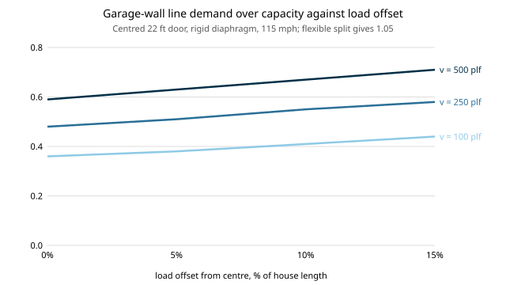

# house-torsion: how much does accidental torsion add to the garage-front wall's demand in a rigid-diaphragm wind split?

A project of track 12, open-source residential construction (`PROJECTS.md`, milestone 6, a next step of [`house-nailedwall`](../house-nailedwall): "add accidental torsion"). `house-nailedwall` found a rigid roof diaphragm sheds load from a garage-door gable wall, but it put the wind load exactly at the centre of mass. Real loads land off-centre, and an off-centre load twists the roof toward the stiff wall. This offsets the load by up to 15% of the house length and asks whether the relief survives. Stylised and not a code check. Produced with AI assistance (Claude).

**Live page:** https://duncan-haywood.github.io/monorepo-projects/research/house-torsion/

**Headline (stylised).** Yes, the relief survives, but it shrinks. For a centred 22 ft garage door, line A's demand over capacity at 6 in nailing rises from 0.36 / 0.48 / 0.59 (load at the centre, v = 100 / 250 / 500 plf) to **0.38 / 0.51 / 0.63 at a 5% offset, 0.41 / 0.55 / 0.67 at 10%, and 0.44 / 0.58 / 0.71 at 15%**. That is 20% more demand at 15%, all of it still below the flexible split's 1.05. The partner wall, which has the stiffness, rises only from 0.27–0.31 to 0.29–0.33. A house with no door goes from 0.19 to 0.23.

**Builds on.** `house-nailedwall` (four-term pier stiffness, imported unchanged), `house-diaphragm` (the rigid solve, extended here with an offset load), `house-structure` and `house-framing`. The offset range is a placeholder in the spirit of the accidental eccentricity that ASCE 7 asks for in seismic design (section 12.8.4.2, a 5% offset); wind torsion cases in ASCE 7 chapter 27 are different and not modelled. It builds on none of the CU Boulder groups in `prompt.md`.

## Method (`src/house_torsion/model.py`)
- Load F along y acts at x = e. Three unknowns balance: sway v, twist &theta;, and the line forces k(v + &theta;x). Force balance and moment balance about the centre give two linear equations, solved directly.
- The long walls, together stiffness `k_long`, resist the twist at y = &plusmn;W/2.
- Each line's demand is the larger over e = +e and &minus;e. Offset fractions 0, 5, 10, 15% of the 40 ft length.
- Stiffnesses and capacities are `house-nailedwall`'s, unchanged (hold-down on).
- Tests (6) check that e = 0 reproduces `house-diaphragm`'s `rigid_split`, force balance, moment balance, the two-line lever formula with no long walls, and that the stiffer end attracts more.

## Reproduce
```bash
pip install pytest
cd research/house-torsion
python -m pytest -q tests                                                                                                              # 6 tests
PYTHONPATH=src:../house-nailedwall/src:../house-diaphragm/src:../house-structure/src:../house-framing/src python experiments/run.py  # writes experiments/results.txt
python experiments/figure.py                                                                                                           # experiments/torsion.svg
```

## Results (from `experiments/results.txt`; deterministic)
Total ASD base shear 4,655 lb on the two gable lines (115 mph). Worst D/C, line A | line B, offsets 0 / 5 / 10 / 15%:
- **22 ft door, v = 100 plf.** A 0.36, 0.38, 0.41, 0.44; B 0.31, 0.32, 0.32, 0.33.
- **22 ft door, v = 250 plf.** A 0.48, 0.51, 0.55, 0.58; B 0.29, 0.30, 0.30, 0.31.
- **22 ft door, v = 500 plf.** A 0.59, 0.63, 0.67, 0.71; B 0.27, 0.28, 0.29, 0.29.
- **No door.** A and B are equal: 0.19, 0.20, 0.22, 0.23 at 100 plf. This is the pure torsion effect, because the walls are the same.
- **9 and 16 ft doors** sit between (16 ft at 250 plf: 0.33, 0.35, 0.37, 0.39).
- The e = 0 column equals `house-nailedwall`'s table.



## Limitations
- **Placeholder eccentricity.** 5% is borrowed from the seismic accidental-torsion idea, applied here to wind along one axis, and the 10 and 15% cases are just a sweep. The real wind torsion cases were not read or modelled.
- **Only the along-y offset in x** is modelled, not an offset in y (which would load the long walls and is not the garage-line question).
- **Unverified stiffness constants** carry over from `house-nailedwall`; the conclusion rests on the ratio of the walls' stiffness.
- **Secant stiffness at a fixed v**, not solved self-consistently with the load. The flexible split is unchanged by torsion in the model, so 1.05 is not a bound once a roof is partly rigid.
- **Still missing:** a seismic case, the collector over the door, a second storey, interior walls. Whether a roof is rigid or flexible is a code decision not checked here.
- **Not a design and not a code check.** A licensed engineer, or the local code's prescriptive path, and a permit, are needed first.

## Next steps
Check the constants against SDPWS and a published test; solve the stiffness self-consistently with the load; add the seismic case with the real accidental-torsion rule; add the door-header collector; then the perforated-wall method in `house-structure`.

## Owner steps
None required.

## Outside dependencies
Nothing it could not run itself; the published coefficients it needs checking against are the one thing it could not read.
