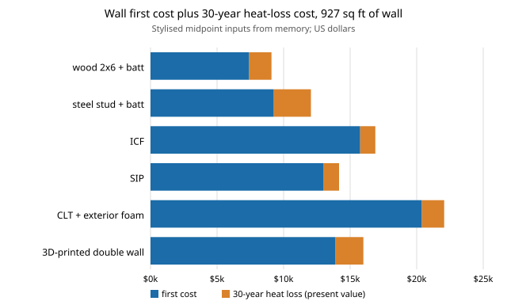

# house-wallsystems: does any alternative to a wood-framed wall beat it on cost, carbon or heat loss for a small house?

Track 12 project, open-source residential construction (`PROJECTS.md`, milestone 6, the alternative-systems half that `house-structure` left as a next step). It prices six exterior wall systems (wood 2x6, steel stud, insulated concrete forms, structural insulated panels, cross-laminated timber and 3D-printed concrete) on the 927 sq ft of net wall of the [`house-framing`](../house-framing) house, and asks which conclusions survive the uncertainty in the inputs. Stylised and not a design: every per-square-foot figure is a range from memory, not a quote or an environmental product declaration. Produced with AI assistance (Claude).

**Live page:** https://duncan-haywood.github.io/monorepo-projects/research/house-wallsystems/

**Headline (stylised).** With the inputs below, wood 2x6 is the cheapest system in 96.8% of 20,000 random draws, has the lowest product-stage carbon in 100%, and has the lowest first cost plus 30 years of heat-loss cost in 99.9%. The better insulated systems (ICF R22, SIP R21) save only about $500 of heat-loss present value against wood at 5,000 degree-days, a small fraction of their $5,500 to $8,300 first-cost premium, and wood still wins at $0.80 per kWh and at 12,000 degree-days. For a tie with wood, SIP's first cost would have to fall 39%, ICF's and the printed wall's 50%, CLT's 64% and steel stud's 32%. Where the alternatives do win is **labour**: SIP (65 crew hours) and CLT (46) take roughly half the 111 hours of the wood wall, which this model prices at nothing beyond the per-square-foot cost. Read this as a method and a sensitivity result, not a price list: the ranges are assumptions, and the result largely follows from them (see Limitations).

**Builds on.** [`house-framing`](../house-framing) (imported unchanged: the walls and openings that give the net area) and the cost and energy sibling projects for the style of the degree-day heat-loss calculation. NAHB, DOE/NREL BEopt and the Inventory of Carbon and Energy are the kind of source the ranges should be replaced with. It builds on none of the CU Boulder groups in `prompt.md`.

## Method (`src/house_wallsystems/model.py`)
- **Area.** Gross wall (perimeter x 97.125 in plate height) less the rough openings from `house-framing`'s `walls_of`.
- **Inputs.** Per system, per sq ft of net wall: installed cost (structure, insulation, sheathing; cladding and interior finish excluded), product-stage embodied carbon (A1-A3, biogenic carbon **not** credited), whole-wall R including thermal bridging, and on-site crew hours. Cost, carbon and R are (low, mid, high); all from memory.
- **Heat loss.** Present value of heating the conduction loss through the wall: area / R x HDD x 24 / 3412 kWh, divided by a heat-pump COP of 3, at $0.15 per kWh, 30 years at 5%. Wall only; no windows, air leakage, solar gain or cooling.
- **Uncertainty.** Monte Carlo, 20,000 independent triangular draws per system (mode at the mid), seeded; the share of draws each system wins on first cost, carbon and first cost plus heat. Independent draws overstate how often a cheap-end alternative beats an expensive-end wood wall if prices are correlated across systems (a lumber spike moves wood, SIP and CLT together); that would only strengthen the headline for wood versus steel and concrete.
- **Pareto set** at the midpoints on cost, carbon and R.

## Reproduce
```bash
pip install pytest
cd research/house-wallsystems
python -m pytest -q tests                                              # 10 tests
PYTHONPATH=src:../house-framing/src python experiments/run.py          # seconds; writes experiments/results.txt
python experiments/figure.py                                           # experiments/systems.svg from results.txt
```

## Results (from `experiments/results.txt`; deterministic)
- **A. Midpoints.** First cost: wood $7,415, steel $9,269, SIP $12,977, printed $13,904, ICF $15,757, CLT $20,392. Carbon (kg CO2e): wood 1,854, SIP 4,635, steel 5,561, CLT 5,561, printed 10,196, ICF 12,977. Heat-loss present value: ICF $1,139 and SIP $1,193 lowest, wood $1,670, steel $2,784. Cost plus heat: wood $9,086 is lowest, then steel $12,053, SIP $14,170.
- **B. Not dominated** at midpoints on (cost, carbon, R): wood, ICF (best R) and SIP.
- **C. Monte Carlo.** Cheapest: wood 96.8%, steel stud 3.2%. Lowest carbon: wood 100%. Lowest cost plus heat: wood 99.9%, steel 0.1%.
- **D. Electricity price** $0.10 to $0.80 per kWh: wood is lowest cost plus heat throughout; SIP closes to $19,340 against $16,324 at $0.80.
- **E. Climate** 2,000 to 12,000 degree-days: wood stays lowest; SIP's gap narrows from $5,400 to $4,400.
- **F. Break-even first cost** for a tie with wood on cost plus heat: steel $6.8/sf (now 10.0), ICF 8.6 (17.0), SIP 8.5 (14.0), CLT 8.0 (22.0), printed 7.5 (15.0).



## Limitations
- **Inputs are assumptions.** Costs, carbon and R-values are ranges from memory of published figures, not checked this run, and vary by region, supplier and year. The wood-wins result is mostly a consequence of them: wall conduction heat loss is a small cost next to first cost, so no plausible R-value advantage repays a $5,000 premium on a small house. Re-run with sourced numbers before quoting.
- **Not credited.** Biogenic carbon stored in wood and CLT (which would favour them further), operational and end-of-life carbon, the avoided cost of other trades (SIPs and ICF replace insulation and sheathing labour; CLT is a finished interior; printed walls can integrate chases), foundation differences, speed to dry-in and financing during the build, thermal mass, fire, acoustics, moisture and durability.
- **Strength is not compared.** Lateral and gravity capacity of each system is out of scope; `house-structure` covers wood only. Printed concrete cost excludes the printer and its operators.
- **One house, one climate model.** A small one-storey box with a degree-day heat loss; no EnergyPlus.
- **Not a design and not a code check.** A licensed engineer or architect, a local code review and a permit are needed before anyone builds anything.

## Next steps
Replace the ranges with sourced, dated values (a regional cost database with a permissive licence, EPDs, manufacturer R-values), credit biogenic carbon, price the saved trades and build schedule through `house-schedule`, and add per-system lateral capacity so strength joins the comparison.

## Owner steps
None required. Local quotes are an owner step.

## Outside dependencies (vitamins)
Python standard library and `house-framing`; pytest for tests. Real prices, EPDs and wall-assembly R-values are outside what this project could make.

## References
- NAHB Research Center / Home Innovation Research Labs, cost and builder-practice surveys (cited from memory; not read in this run).
- Hammond and Jones, *Inventory of Carbon and Energy* (ICE), University of Bath (cited from memory; not read in this run).
- US DOE / NREL, BEopt building energy optimisation (cited from memory; not read in this run).
