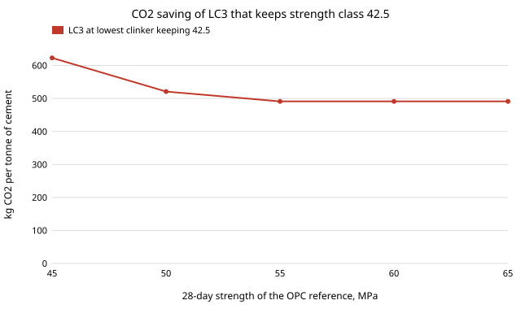

# infra-cement: how much CO2 does clinker substitution save, and how much can you substitute and keep the strength class? OPC, LC3 and slag cement balances

Milestone 6 of track 21, applied R&D for the industries modern life runs on (`PROJECTS.md`). Cement is about two thirds of its CO2 chemistry, not fuel, so the way to cut it is to make less clinker. This project writes the mass, energy and CO2 balance of a tonne of ordinary Portland cement (OPC), a limestone cement, two slag cements and three limestone calcined clay (LC3) blends, with the calcination CO2 computed from molar masses, then asks how far the clinker content can fall before a strength class is lost. Produced with AI assistance (Claude).

**Live page:** https://duncan-haywood.github.io/monorepo-projects/research/infra-cement/

**Headline.** At baseline parameters OPC (95% clinker) comes to **830 kg CO2 per tonne**, of which 485 is calcination and 306 kiln fuel. LC3-50 (50% clinker, 30% calcined clay, 15% limestone, 5% gypsum) comes to **491, 41% lower**; a 50% slag cement 441 (47% lower). The LC3 saving stays between **39% and 43%** when the clay calcination energy, grid carbon, grinding energy, kiln heat and fuel carbon are each swept over their plausible ranges. Whether the clinker can fall that far depends on how much strength headroom the OPC reference has: with the only 28-day strength data this run could reach (one study, read through a search summary), an OPC reference of 55 MPa or more lets LC3 go to 50% clinker and keep class 42.5, 50 MPa limits it to 54% clinker (37% saving) and 45 MPa to 68% (25% saving).



## Method (`src/infra_cement/model.py`)
- **Calcination CO2** = CaO share of clinker &times; 44.009/56.077 (CaCO<sub>3</sub> &rarr; CaO + CO<sub>2</sub>). At 65% CaO that is 510 kg per tonne of clinker, computed, not looked up. Calcined clay releases water instead: kaolinite Al<sub>2</sub>Si<sub>2</sub>O<sub>5</sub>(OH)<sub>4</sub> loses 13.96% of its mass as 2 H<sub>2</sub>O (computed), so its only CO2 is its fuel.
- **Fuel CO2** = kiln heat per tonne of clinker &times; fuel emission factor; the clay calciner has its own heat and gas factor. **Electricity** = grinding kWh per tonne of cement &times; grid factor, the same for every blend (a simplification: blends with hard clinker or slag grind differently).
- **Other** = embodied CO2 of slag, limestone and gypsum per tonne.
- **Blends** are mass fractions of one tonne of cement. Strength is not modelled from chemistry; it is a table of measured 28- and 91-day strengths relative to a CEM I control, interpolated, against EN 197-1 class limits (32.5, 42.5, 52.5 MPa at 28 days).

### Inputs and where they come from
| Input | Value | Source |
|---|---|---|
| Calcination | 784.8 kg CO2/t CaO | computed from molar masses (tested) |
| CaO in clinker | 65% | USGS comment on the US GHG inventory (found by search, not the inventory itself) |
| Kiln heat | 3.4 GJ/t clinker (swept 3.2 to 3.6) | secondary report of dry-process kilns, found by search; a 2026 plant LCA reported 3.16 |
| Coal, gas CO2 factors | 94.6, 56.1 kg/GJ | IPCC 2006 defaults (from memory of the guidelines, not re-read this run) |
| LC3-50 composition | 50 / 30 / 15 / 5 | Scrivener et al. (2018) as quoted by secondary sources; the other LC3 mixes and the slag cements are my own round compositions |
| Slag CO2 | 52 kg/t (swept 0 to 150) | one secondary table of embodied CO2; the allocation of blast furnace CO2 to slag is the open question, hence the sweep |
| 28- and 91-day LC3 strength relative to CEM I | 0.988, 0.960, 0.902, 0.820 (28 d) at 80, 70, 60, 50% clinker | one study of 2:1 clay:limestone LC3 mortars, from a search summary; the primary paper was not read. A second study reports LC3-50 equal to CEM I (37 MPa) at 28 days: the two disagree, which is the spread to expect between clays |
| Grinding energy, grid carbon, clay calcination energy, limestone and gypsum CO2 | 100 kWh/t, 0.4 kg/kWh, 2 GJ/t, 5 and 5 kg/t | **assumed**, swept (section C) |

## Reproduce
```bash
pip install pytest
cd research/infra-cement
python -m pytest -q tests                       # 7 tests
PYTHONPATH=src python experiments/run.py        # instant; writes experiments/results.txt
python experiments/figure.py                    # experiments/saving.svg from results.txt
```
Standard library only.

## Results (`experiments/results.txt`; deterministic)
- **A. Stoichiometry.** 784.8 kg CO2 per tonne CaO; 510.1 per tonne clinker at 65% CaO; kaolinite dehydroxylation loses 13.96% of its mass.
- **B. Balance per tonne of cement (kg CO2: calcination / kiln fuel / clay fuel / electricity / other = total).** OPC 485/306/0/40/0 = 830. Limestone cement 80/15: 706 (&minus;15%). Slag 50: 441 (&minus;47%); slag 70: 285 (&minus;66%). LC3-65: 604 (&minus;27%); LC3-50: 491 (&minus;41%); LC3-40: 413 (&minus;50%). Heat per tonne of cement falls from 3.2 GJ (OPC) to 2.3 GJ (LC3-50): the calciner uses less per tonne than the kiln, so LC3 saves energy as well as CO2.
- **C. Sensitivity.** LC3-50 saving against OPC: 43.0 / 40.9 / 38.9% at clay calcination 1 / 2 / 3 GJ/t; 43.0 to 39.0% over grid carbon 0 to 0.8; 41.5 to 40.3% over grinding 70 to 130 kWh/t; 40.8 to 41.1% over kiln heat 3.2 to 3.6; 39.9 to 41.1% over fuel carbon 60 to 100. The saving is nearly the clinker factor: it hardly depends on the assumed inputs. Slag-50 saving runs from 50.1% (slag carbon 0) to 41.0% (150 kg/t), so how slag is allocated decides whether slag beats LC3.
- **D/E. Strength limit.** With an OPC reference of 40 MPa no LC3 reaches class 42.5; at 45 MPa the clinker can fall to 67.5% (CO2 623, &minus;25%); at 50 MPa to 54% (521, &minus;37%); at 55 MPa or more to the 50% where the table ends (491, &minus;41%). Class 32.5 is kept down to 50% clinker from a 40 MPa reference.
- **F. 91 days.** In the same study the gap shrinks to 1.6 to 5.5%, so by 91 days a 45 MPa reference reaches 50% clinker; a 91-day strength is not an EN 197-1 class, so this shows the strength-gain argument and not compliance.

## Limitations
- **The strength model is one study's table.** It is a 2:1 clay:limestone LC3 on mortars; clay kaolinite content, fineness and cement fineness move it, and the second study I could see disagrees at 50% (equal to CEM I). It was read through a search summary, not the paper. The result "what clinker content keeps 42.5" is therefore an illustration of the method on one dataset, not a design rule.
- **Slag cements are not strength-checked.** EN 15167-1 and ASTM C989 activity indices (as I recall them: 70% at 28 days for 50:50 in EN; I did not read either) are not in the code; slag strength classes are not computed.
- **Primary sources unreachable.** `lc3.ch`, the EPFL decks and the standards were blocked or paywalled from this sandbox. Values marked "secondary" or "from memory" are to be checked against the primary before use.
- **One plant, steady state.** No clinker CaO variation, alternative fuels (biomass would cut fuel CO2), clay moisture drying, transport, or carbon capture. Electricity use is the same for all blends.
- **Not engineering advice**; not a mix design or a certified EPD.

## Next steps
- Read the primary: Scrivener et al. (2018), Antoni et al. (2012), the RILEM TC 282-CCL review (Hanein et al. 2022) for calciner energy, and EN 197-1 / EN 15167-1; replace the secondary figures.
- Add a strength model fitted to a public dataset of cement strengths versus composition, in place of the interpolated table, and pair it with `energy-tou` for plant electricity.
- Add the cost axis: delivered cost per tonne and per kg CO2 avoided by blend.

## Outside dependencies
None: standard library for the code, pytest for the tests. Facts were gathered through web search summaries on 2026-10-21; the primary papers and standards were not read. No CU Boulder group's work is built on.
