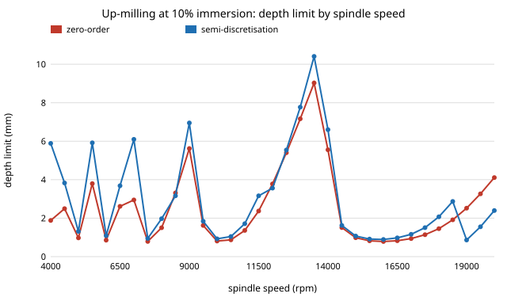

# infra-chatter: when does the textbook milling chatter chart mislead? Zero-order stability lobes against semi-discretisation and time-domain simulation

Milestone 8 of track 21, applied R&D for the industries modern life runs on (`PROJECTS.md`). A milling cutter that vibrates (chatter) ruins the surface and the tool, and shops pick spindle speeds from a stability lobe chart. The standard chart is the Altintas-Budak zero-order solution (ZOA), which keeps only the average of the time-varying cutting force. This project builds the ZOA, a semi-discretisation Floquet solution of the same equation (Insperger and Stepan 2002 form), and a time-domain simulation, and asks where the ZOA is safe to trust and what a spindle-speed choice is worth. Produced with AI assistance (Claude).

**Live page:** https://duncan-haywood.github.io/oss-monorepo/research/infra-chatter/

**Headline.** For a one-mode tool (922 Hz, damping 0.011, modal stiffness 1.4 MN/m; the Insperger-Stepan benchmark values as I recall them, not re-read) the ZOA reproduces the closed-form minimum depth for slotting (0.311 mm) and agrees with semi-discretisation at 50% up-milling (the true limit is never below it). It fails exactly where the cut is short: at **10% up-milling the ZOA depth limit is up to 3.3 times the true limit at some speeds** (worst SD/ZOA ratio 0.30) and its minimum is 18% too high (0.787 against 0.669 mm), and in **down-milling at 10% and 50% immersion the mean cutting coefficient is negative, so the ZOA predicts no chatter at all** while the semi-discretised system goes unstable below 0.9 mm at every speed tried (4000-20000 rpm). The semi-discretisation Floquet multiplier and an independent time-domain simulation agree on stable-versus-unstable in all 30 test points (85% and 115% of the boundary). Picking the best spindle speed raises the stable removal rate 5 to 18 times over running at the minimum stable depth.



## Method (`src/infra_chatter/model.py`)
- Equation: x'' + 2 &zeta; &omega;<sub>n</sub> x' + &omega;<sub>n</sub><sup>2</sup> x = &minus;(w h(t)/m)(x(t) &minus; x(t&minus;&tau;)), &tau; = 60/(N n), h(t) = &Sigma;<sub>j</sub> g(&phi;<sub>j</sub>) sin&phi;<sub>j</sub> (K<sub>t</sub> cos&phi;<sub>j</sub> + K<sub>n</sub> sin&phi;<sub>j</sub>). One mode, two teeth, displacement normal to the feed.
- **ZOA.** Average h(t) over a tooth period (closed form, h<sub>0</sub>), then on the boundary w h<sub>0</sub> G(i&omega;<sub>c</sub>)(1 &minus; e<sup>&minus;i&omega;<sub>c</sub>T</sup>) = &minus;1: w = &minus;1/(2 h<sub>0</sub> Re G), &omega;<sub>c</sub>T = 2 arg G + 3&pi; + 2&pi;k. Defined only if h<sub>0</sub> &gt; 0.
- **Semi-discretisation (SD).** Zeroth-order scheme with 40 steps per delay period; the Floquet matrix is the product of the one-step maps, stable if its largest eigenvalue modulus is below 1. The limit at each speed is the smallest depth where it is unstable (scan of 60 depths up to 20 mm, then bisection), a conservative choice when stable pockets exist above it.
- **Time domain.** RK4 with a true delay line, 200 steps per period, 150 periods from a 1 micron perturbation, growth factor per period from the last half. Independent code path from SD.

### Inputs
| Input | Value | Source |
|---|---|---|
| f<sub>n</sub>, &zeta;, k | 922 Hz, 0.011, 1.4 MN/m | Insperger-Stepan benchmark as I recall it; **not re-read**, and **no measured tool-tip FRF** was used |
| K<sub>t</sub>, K<sub>n</sub> | 6e8, 2e8 N/m<sup>2</sup> | same recollection |
| Teeth, immersions | 2; 100%, 50%, 10% | chosen |
The depth limit scales as k/K<sub>t</sub> and speed with f<sub>n</sub>, so other tools shift the chart rather than change which cases fail.

## Reproduce
```bash
pip install pytest numpy scipy
cd research/infra-chatter
python -m pytest -q tests                        # 9 tests
PYTHONPATH=src python experiments/run.py         # about 35 s; writes experiments/results.txt
python experiments/figure.py                     # experiments/chart.svg
```

## Results (`experiments/results.txt`; deterministic)
- **A.** Slotting minimum depth from the code 0.3114 mm equals the single-mode closed form 2k&zeta;(1+&zeta;)/h<sub>0</sub> (tested, 0.1%). h<sub>0</sub> in MN/m<sup>2</sup>: slotting 100, up-50% 145, up-10% 40, down-50% &minus;45, down-10% &minus;29.
- **B. ZOA against SD** (4000-20000 rpm, 250 rpm steps): slotting minimum 0.311 against 0.338 mm (SD mean 1.4 times ZOA, 6% of speeds where SD is more than 2% below ZOA); up-50% 0.214 against 0.220 (none below); up-10% 0.787 against 0.669 (14% of speeds below, worst ratio 0.30); down 50% and 10%: ZOA empty, SD limit 0.651 and 0.877 mm.
- **C. Time domain.** 30 of 30 stable/unstable classifications agree with the Floquet multiplier. The growth factors differ by up to 0.03 per period (SD 1.043 against 1.071 in one case; at 10% down-milling and 14000 rpm 1.303 against 1.391): the zeroth-order SD scheme with 40 steps is good for the boundary, not for the growth rate.
- **D. Spindle speed.** Removal rate &prop; depth &times; speed. The best stable speed beats running at the minimum depth by 9.1 (slotting), 13.3 (up-50%), 17.9 (up-10%), 5.2 (down-50%) and 8.3 times (down-10%), capped at 20 mm depth. At the ZOA's own best speed for slotting (13 750 rpm) the ZOA promises 3.96 mm and SD allows 3.61, 9% less; SD's best speed is 18 750 rpm.

## Limitations
- **No measured FRF.** The milestone asks for a tool-tip FRF from a public dataset; none was reachable here, so one benchmark mode stands in. The conclusions about where the ZOA fails (short cuts, down-milling) do not depend on the values, but the millimetres and rpm do.
- One mode in one direction; real tools have two orthogonal directions and several modes, which add lobes.
- Linear regenerative model: no process damping at low speed (it raises real limits), no runout, helix angle or nonlinear cutting force; flip-lobe predictions are not checked against cutting trials.
- SD grid is coarse (250 rpm, 40 steps); the depth limit is the first unstable depth, ignoring stable pockets above it.
- Benchmark constants recalled, not re-read. Not machining advice.

## Next steps
- Replace the benchmark mode with a measured FRF (a public impact-test dataset) and two directions; check the ZOA failure map against published cutting tests.
- Add process damping and a helical edge; test whether the speed gain survives.
- Pick speeds with a measured chatter-frequency feedback loop in simulation.

## Outside dependencies
numpy and scipy for the code, pytest for the tests. Prior work: Altintas and Budak (1995), Insperger and Stepan (2002). No CU Boulder group's work is built on.
