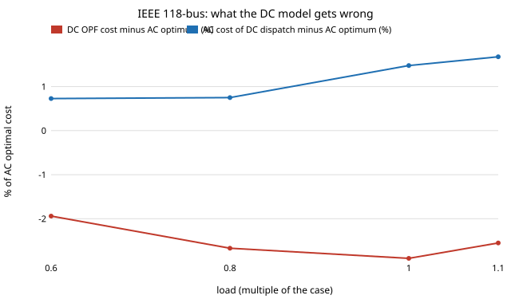
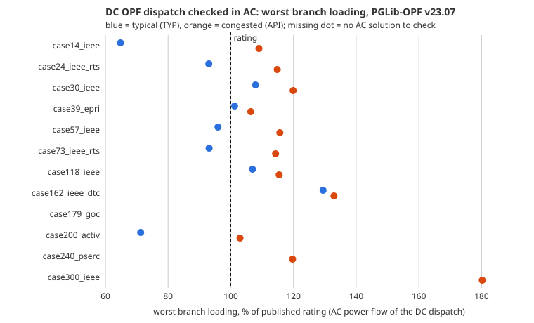
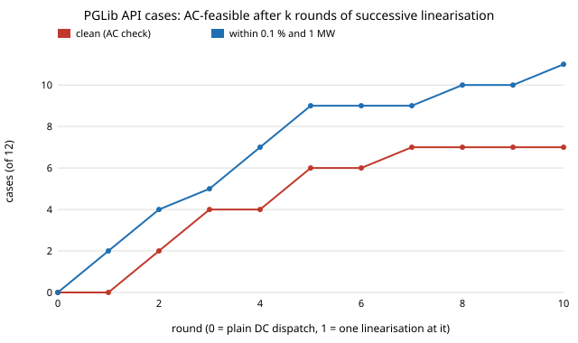

# infra-dcopf: how wrong is the DC approximation of optimal power flow on the IEEE 30-, 39- and 118-bus cases?

Track 21 (`infra`), grid first. Grid dispatch is routinely planned and priced with the DC optimal power flow (a linear programme with no losses and no voltage), and the AC OPF is the physics it stands in for. This project measures the difference on three standard cases, with the same cost curves and limits in both models: how far off is the DC model's cost, and what happens when its dispatch is run through an AC power flow? Produced with AI assistance (Claude). No method transfer from outside power systems; the benchmark use of IEEE cases follows the pandapower and MATPOWER literature. No CU Boulder group's work is reproduced and no connection is claimed.

**Live page:** https://marisstella.app/research/infra-dcopf/

**Headline (modelled in pandapower on the MATPOWER/IEEE cases; not a measured system; results in `experiments/results.txt`).**
- **IEEE 118-bus, no branch binding:** the DC OPF reports a cost **1.9 to 2.9 % below** the AC optimum (it cannot see 55 to 150 MW of losses). Running its dispatch through an AC power flow (the slack pays the losses) costs **0.7 to 1.7 % more than the AC optimum** (up to 1.9 % with limits scaled by 0.5) with no voltage or loading violation, so the DC dispatch is feasible but wrongly ordered; the excess grows with load (0.73 % at 0.6 of the case's load, 1.48 % at 1.0, 1.68 % at 1.1).
- **IEEE 39-bus:** the DC cost is 1.0 to 1.5 % below the AC optimum, and the DC dispatch is nearly free in cost terms (within 0.06 %) but **breaks voltage limits**: 15 buses out of band at 0.6 of load, 5 at 0.8, 1 at the case's load (highest 1.079 pu).
- **IEEE 30-bus:** the DC cost is 1.3 to 2.3 % below; at the case's load the DC dispatch overloads one branch to 111 % and is 0.31 % *cheaper* than the AC optimum, which is the signature of a violated constraint, not a better plan.
- **PGLib-OPF with published binding ratings (2026-11-11):** on 11 congested (API) benchmark cases the DC OPF's dispatch overloads branches in **every** case when run through an AC power flow (worst 103 to 180 % of rating), finds a median 56 % of the binding lines, and its LMPs correlate with the AC ones at a median r = 0.66; uniform derating or iterated AC correction repairs only 1 of 11. Also: MATPOWER's and PowerModels' DC OPFs differ by up to 2.8 % on these cases ([section below](#with-published-ratings-that-bind-23-pglib-opf-cases-added-2026-11-11-experimentsrun_pglibpy-results_pglibtxt)).
- **Linearising the AC power flow instead (2026-11-12):** successive linearisation (finite-difference loss factors and apparent-flow sensitivities at each AC point, a QP, a step box) gives an AC-feasible dispatch on **7 of the 11 congested API cases** within 10 rounds, at the AC optimum's own cost, and leaves the other four within 0.012 % of their ratings; one linearisation at the plain DC dispatch clears none, and even the oracle linearisation at the AC optimum clears only 7 ([section below](#linearising-the-ac-power-flow-at-an-ac-point-added-2026-11-12-experimentsrun_aclinpy-results_aclintxt)).
- **Reading:** the DC model's price error is a loss term of 1 to 3 % here, and the danger of its dispatch is not cost but reactive and voltage limits it never modelled, on the smaller cases. Neither is a large number, and none says DC is wrong for planning.



## With published ratings that bind: 23 PGLib-OPF cases (added 2026-11-11, `experiments/run_pglib.py`, `results_pglib.txt`)
Next step 1 asked for cases whose *published* ratings bind, in place of the synthetic caps above. PGLib-OPF v23.07 (Babaeinejadsarookolaee et al. 2019) ships each case twice: typical operating conditions (TYP) and "active power increase" (API), with load pushed up until thermal limits bind. Twelve cases from 14 to 300 buses, both sets, solved with PYPOWER (AC: PIPS; DC: its LP), on the library's own costs, ratings and ±30° angle limits.

- **Validation first.** Our AC optimum matches PGLib's published PowerModels.jl/IPOPT objective within **0.004 %** on 23 of 24 cases (case179_goc API did not converge here; it is excluded below). The published DC objectives did **not** match MATPOWER's DC OPF at first: 4,664 against 4,798 $/h on case14 API (2.8 %), 234,169 against 231,290 on case118 API. Emulating PowerModels' DCP model (series susceptance x/(r²+x²) instead of 1/x, off-nominal taps ignored) reproduces all 24 published DC values within 0.003 %. So **"the DC OPF" is two models**: on typical cases they differ by a median 0.001 % (max 0.42 %), on congested ones by a median 0.04 % and up to **2.8 %**, and on case240_pserc TYP the MATPOWER form is *infeasible* while the PowerModels form solves. Studies that quote a DC-vs-AC gap should say which B matrix they used. The tables below use MATPOWER's (DC-MP); `results_pglib.txt` has both, and the conclusions are the same.
- **Cost.** The DC optimum is below the AC optimum by a median 4.2 % on TYP cases (0.3 to 8.6 %) and **6.5 % on API cases (1.4 to 22 %)**: larger than the 1 to 3 % loss term found above, because these cases' quadratic costs and binding limits magnify the losses and the reactive flows the DC model omits.
- **Feasibility.** Each DC dispatch went through an AC power flow on the true network, with generator voltages held at the AC optimum's schedule and the slack paying the losses. On **every one of the 11 API cases** the dispatch overloads branches, 1 to 10 of them, worst loadings 103 to 180 % of rating (figure). On TYP cases it overloads branches in 4 of the 9 that could be checked (worst 108 to 129 %); case179 and case300 TYP had no AC power-flow solution. The slack also runs past its P limit in 6 of 11 API cases (49 to 1,700 MW), so the API dispatches' "AC cost below the optimum" is a violated constraint, not a saving.
- **Congestion pattern and prices.** Of the branches binding at the AC optimum, the DC OPF binds a median **56 % on API cases** (20 to 100 %) against 100 % on TYP cases. Across buses, DC LMPs correlate with AC LMPs at a median r = 0.66 on API (0.09 on case300 API) against 0.96 on TYP, with a median absolute error of 30 % of the mean AC price (8 % on TYP). Under real congestion the DC model picks the wrong binding lines, and its nodal prices follow.
- **Two cheap fixes, both mostly fail on API cases.** (a) Derating every rating uniformly by a = 0.98 to 0.8 clears the overloads on only 1 of 11 API cases (case57, at a = 0.85, +2.7 % cost); on the rest the DC OPF becomes infeasible before the overloads go. On TYP it works at a = 0.9 to 0.98 (+0.4 to +1.7 %). (b) An iterated AC-corrected DC (feed the measured losses back into the loads and cut the DC rating of each overloaded branch by rating/AC flow, `corrected_dc`) gives a clean dispatch on 8 TYP cases (cost 0 to 4.7 % above the AC optimum, 0.7 % on case118) but on only **1 of 11 API cases**; on 9 the DC becomes infeasible within one or two corrections. Two variants tried in a scratch diagnosis (a reactive-flow rating sqrt(rate²−Q²); a damped square-root cut) gave the same picture: the API cases leave no headroom for a linear model whose flows are off by the reactive and loss terms.
- **Reading.** On a stressed network, the operating point congestion pricing exists for, the plain DC OPF is not a mild approximation. Its dispatch is AC-infeasible on all 11 congested benchmarks, it finds about half the binding lines, and the usual fixes (a security margin, loss and flow feedback) run out of feasible region. On typical loadings those fixes are enough. Limits: one AC solver (PIPS), checked against IPOPT's objective only, not its point; voltages held at the AC optimum's schedule, which favours the DC dispatch; no N-1, no unit commitment; benchmark cases, not a measured system.



## Does feeding the losses back fix it? (loss-adjusted DC, `experiments/results_lossadj.txt`)
`loss_adjusted_dc` solves the DC OPF, runs its dispatch through an AC power flow, spreads the measured losses over all loads in proportion to their power, and re-solves, until the losses move by under 0.05 MW (2 to 4 passes). Everything else is as above. Losses are placed uniformly, not where they occur, which is the simplest scheme; nodal loss factors are the next step.
- **The cost estimate is largely repaired.** On the 118-bus case the adjusted DC cost is within **0.6 to 1.2 %** of the AC optimum, against 1.9 to 2.9 % below it for plain DC. On case30 and case39 it is within 0.4 % (plain DC: 1.0 to 2.3 % below).
- **The dispatch is barely repaired.** The AC cost of the adjusted 118-bus dispatch is 0.58 to 1.18 % above the AC optimum, against 0.73 to 1.68 % for plain DC: it recovers only **13 to 32 %** of the excess (0.6, 0.8, 1.0, 1.1 of load: 13, 23, 20, 32 %). The surviving excess is generators ordered by a loss-blind marginal cost, which a uniform loss share does not change.
- **No effect on voltages.** Case39 still has 15, 5 and 1 buses out of band at 0.6, 0.8 and 1.0 of load, exactly as plain DC; the losses are not what breaks them (reactive power is, step 3 below).
- On case30 and case39 the dispatch differences are within 0.1 % of cost and change sign, so the "recovered" percentage there is not meaningful. The load 1.1 rows of case30 and case39 returned no solution from the AC OPF.
- **Reading:** loss feedback is the right fix for the *price level* and the wrong one for the *merit order*. Fixing the order needs losses charged at the margin where they occur (penalty factors).

## Nodal loss penalty factors (added 2026-11-04, `experiments/run_penalty.py`, `results_penalty.txt`)
`penalty_adjusted_dc` adds to the uniform loss share each generator's penalty factor 1/(1 - dLoss/dP), from a finite-difference AC loss sensitivity (+1 MW at the generator, the external grid absorbing), applied as a multiplier on the generator's cost curve, with the factors updated each pass (damped 0.5; undamped it oscillated at full load). Dispatches are priced with the original costs under AC power flow. AC cost of the dispatch above the AC optimum, case118:

| load | plain DC | uniform loss share | penalty factors |
|---|---|---|---|
| 0.6 | 0.728 % | 0.635 % | 0.559 % |
| 0.8 | 0.750 % | 0.577 % | 0.461 % |
| 1.0 | 1.479 % | 1.179 % | 1.345 % |
| 1.1 | 1.678 % | 1.149 % | 2.236 % |

- **Mixed result, one solver, one dispatch point per cell.** Penalty factors repair the merit order further at light load (at 0.8 they recover about 39 % of plain DC's excess against 23 % for the uniform share), but at the case's full load and above they are *worse* than the uniform share and, at 1.1, than plain DC. A first undamped run was far worse (3.5 and 20.8 %), so the damping matters and I have not shown the damped iteration converges; the sensitivities are taken at the DC dispatch, not the AC optimum, and an operating point where the slack's own loss sensitivity differs from the marginal one may make the factors wrong.
- On case30 and case39 differences are within 0.1 % and change sign, as before; not interpretable. Load 1.1 has no AC solution on those two.
- So step 2 is not "done": penalty factors are not a safe fix at high load here. Next: take sensitivities at the AC optimum (one-shot), or use a distributed slack.

## Case300: pandapower's AC OPF does not give usable prices (added 2026-11-05, `experiments/run_case300.py`, `results_case300.txt`)
Next step 1 asked for a case whose published ratings bind. MATPOWER `case300` (300 buses, 68 generators) was run at loads 0.5 to 1.0 and branch-limit factors 1.0, 0.5, 0.3, with the AC OPF tried from pandapower's default start and then from a flat start.
- **The AC OPF converged in 3 of 18 cells** (loads 0.6, 0.7, 0.8 at the published limits); nowhere at full load or with tightened limits. The DC OPF solved in all 18.
- **No DC branch binds** in any converged cell, so DC prices are one flat number (31.9, 34.0, 36.0).
- **The AC prices are not credible.** Bus prices range from -2954 to 115 per MWh at load 0.6, 31 to 83 at 0.7, and -16 to 1366 at 0.8, against a DC price of about 32 to 36. The AC-optimum cost is 2.6 to 4.0 % *above* the DC cost, and the DC dispatch run through AC power flow costs 0.7 to 2.0 % *less* than the claimed AC optimum, which cannot happen at a true optimum. So these are local or poorly converged points of a non-convex problem, not optima.
- **Conclusion for this step:** I could not separate the loss and congestion components of price on case300 with this solver. The comparison needs a different AC OPF solver (for example IPOPT through PowerModels.jl or MATPOWER's own MIPS/IPOPT) and a check against MATPOWER's published case300 optimum; both are outside this container. Until then, the case118 LMP result above is the only price comparison here, and case300 AC cost figures should not be quoted.

## Voltage violations: a setpoint and reactive problem, not a dispatch one (added 2026-11-05, `experiments/run_voltage.py`, `results_voltage.txt`)
Next step 3 asked whether voltage-band constraints in the LP would remove case39's violations. Before building that LP I held the *same* DC dispatch under AC with different voltage controls (case39, loads 0.6, 0.8, 1.0; pandapower, one solver):
- **Setpoints matter, not P.** As shipped, the PV buses are held at the case's `vm_pu` (up to 1.064, above the 1.06 band), giving 15, 5 and 1 buses out of band. Clamping setpoints into the band alone fixes almost nothing (14, 5, 1; the last is 1.0600 by rounding). A single uniform setpoint (1.005, 1.010, 1.015) gives **0 voltage violations** at 0.02 to 0.07 % cost difference from the AC optimum.
- **But that breaks reactive limits.** pandapower does not enforce generator Q limits in a power flow; checking them, the uniform setpoint leaves 5, 3 and 3 generators outside their Qmin/Qmax, and no uniform setpoint on a 0.005 grid satisfies both voltage and Q at any of the three loads.
- **A simple per-generator rule fails too:** nudging each generator's setpoint against its own Q violation (`q_balancing_setpoints`) found a feasible profile at load 1.0 only, not at 0.6 or 0.8 (a heuristic, not an optimiser).
- **The DC dispatch itself is fine.** An AC OPF with real power pinned to the DC dispatch (`reactive_redispatch`, only voltages, Q and slack free) finds a feasible profile at 0.6 and 0.8 on case39 (vmax 1.06, cost **0.023 and 0.039 %** above the AC optimum) and on case30 (0.078, 0.069 %). At load 1.0 pandapower returned no solution on either case, which is not proof of infeasibility.
- **Reading:** the violations come from fixed voltage setpoints and reactive capability, which the DC model (and a plain power flow) leave uncontrolled. A voltage-aware *P* dispatch is not what is missing; a voltage/Q stage after the DC dispatch is. Not shown: that this holds on other cases, with N-1, or at full load. No LP with voltage-band constraints was built, so step 3 as written is answered by a different route.

## Penalty factors taken at the AC optimum (added 2026-11-06, `experiments/run_penalty_acopt.py`, `results_penalty_acopt.txt`)
Next step 2 asked for loss sensitivities at the AC optimum instead of at a DC dispatch. `ac_optimum_penalty_dc` solves the AC OPF, takes the finite-difference loss sensitivities there (same `loss_sensitivities`, slack as reference), sets the loss level to the AC optimum's own losses, and solves the DC OPF once on penalty-scaled costs (no iteration, nothing to damp). AC cost of the resulting dispatch above the AC optimum, case118:

| load | plain DC | uniform loss share | iterated penalty factors | factors at AC optimum |
|---|---|---|---|---|
| 0.6 | 0.728 % | 0.635 % | 0.559 % | 0.563 % |
| 0.8 | 0.750 % | 0.577 % | 0.461 % | 0.464 % |
| 1.0 | 1.479 % | 1.179 % | 1.345 % | **0.367 %** |
| 1.1 | 1.678 % | 1.149 % | 2.236 % | **0.339 %** |

- **The failure at high load was the sensitivity point, not the idea.** With sensitivities at the AC optimum the penalty-factor dispatch recovers about 75 % (load 1.0) and 80 % (1.1) of plain DC's excess, against 9 % and -33 % for the iterated version; at 0.6 and 0.8 the two versions agree (within 0.004 points).
- **This is a diagnostic bound, not a method.** It uses the AC optimum, which a DC planner does not have; it shows what factors evaluated at the right operating point can do. A practical scheme needs factors from a good estimate of that point (for example a previous interval's AC solution).
- Case30 and case39: differences are within 0.1 % and change sign, as before, so not interpretable; load 1.1 has no AC solution there. One solver, one dispatch point per cell.

## Penalty factors from a previous interval (added 2026-11-07, `experiments/run_prev_interval.py`, `results_prev_interval.txt`)
Next step 2 asked for a usable scheme: `previous_interval_penalty_dc` takes factors and loss share from the AC optimum at a *different* load level (standing in for the previous dispatch interval) and solves one DC OPF at the current load, with no AC solve there. AC cost above the current AC optimum, case118 (prediction before running: a 0.1 step keeps most of the gain, a 0.2 step much less):

| previous load | current load | plain DC | factors from previous | factors at current optimum |
|---|---|---|---|---|
| 0.5 | 0.6 | 0.728 % | 0.570 % | 0.563 % |
| 0.7 | 0.8 | 0.750 % | 0.472 % | 0.464 % |
| 0.9 | 1.0 | 1.479 % | 0.402 % | 0.367 % |
| 1.0 | 1.1 | 1.678 % | 0.368 % | 0.339 % |
| 0.8 | 1.0 | 1.479 % | 0.703 % | 0.367 % |
| 1.0 | 0.8 | 0.750 % | 0.471 % | 0.464 % |

- A 0.1 load step keeps 88 to 90 % of the oracle's gain at high load (0.402 vs 0.367 against plain 1.479) and nearly all at low load. Supported.
- A 0.2 upward step (0.8 to 1.0) keeps about 70 % of it (0.703 %); stale factors still beat plain DC, but the sensitivity point matters, consistent with the earlier finding. Stepping down (1.0 to 0.8) costs almost nothing.
- Limits: one network (case118), a load scale stands in for a real interval (same load shape, no outages or renewables), one solver, one dispatch point per cell.

## Linearising the AC power flow at an AC point (added 2026-11-12, `experiments/run_aclin.py`, `results_aclin.txt`)
Next step 1: plain DC, derating and `corrected_dc` all leave the API dispatches AC-infeasible. Does a linear model taken from the AC power flow itself do better? At an AC operating point (`src/infra_dcopf/aclin.py`), each generator is moved 1 MW in PYPOWER's AC power flow with the slack compensating, giving its marginal loss factor (d P<sub>slack</sub>/d P<sub>k</sub>, 0.95 to 1.38 MW per MW on case24 API) and the change of the apparent flow |S| at both ends of every rated branch. With the point's own flows as offsets, the model is exact at the point and first order away from it; it carries losses and reactive flow, which the DC model does not. A QP on the case's costs (PYPOWER's PIPS) gives the next dispatch, then the same AC check as above (generator voltages at the AC optimum's schedule). Predictions were logged before the run (`LOG.md`, 2026-11-12); all four were refuted as stated.

| API cases with an AC optimum (11) | clean dispatches | AC cost where clean |
|---|---|---|
| plain DC (MATPOWER B) | 0 | n/a |
| derating, best a in 0.8 to 1 | 1 | +2.7 % |
| `corrected_dc` (loss and rating feedback) | 1 | see `results_pglib.txt` |
| **B**: one linearisation at the plain DC dispatch's AC flow | 0 | n/a |
| **A**: one linearisation at the AC optimum (oracle bound) | 7 | within 0.001 % |
| **C**: successive linearisation from B, at most 10 rounds | **7** (rounds 2 to 7) | within 0.001 % (case24 −0.47 %, 4 buses out of band) |

- **One shot is not enough, even at the right point.** Linearised at the AC optimum itself, the QP still moves to a cheaper dispatch that the first-order model calls feasible and the AC flow does not (case24, 57, 300 end 0.15 to 3.9 % over), and on case73 a branch whose flow redispatch barely moves leaves the model with no feasible point. Linearised once at the plain DC dispatch (B), nothing is clean: on 5 cases the residual is a curvature hair (worst branch 100.05 to 100.66 %), on 2 the model is infeasible, and on 4 the point is so far off (the DC dispatch's slack 50 to 800 MW outside its limits) that the step lands at 108 to 167 %.
- **Relinearising closes most of it.** C relinearises at each new dispatch with a per-unit step box (20 % of the unit's range, halved when a step does not lower the infeasibility) and an l1-penalised elastic QP when the model has no feasible point in the box (Fletcher's Sl1QP device). Seven API cases reach a clean dispatch at the AC optimum's cost; the other four (case57, 73, 200, 300) end within **0.012 %** of their ratings and 0.8 MW of the slack's limits after 10 rounds, so a strict-feasibility margin in the last round should finish them (untested). On TYP, C is clean on 7 of 9 that could start (case179 and case300 TYP have no AC power flow at the plain DC point; case240 TYP has no DC solution). Run time 1 to 13 s per case on one CPU, n<sub>gen</sub> power flows per round.



- **Reading.** The congested cases are not beyond a linear model; they are beyond a linear model taken once. The DC model's error on them is mostly the losses and reactive flows a first-order AC model carries, plus curvature that relinearising removes. This is the successive linear programming idea that AC OPF solvers have used for decades, measured here as a repair for the DC dispatch on today's benchmark set.
- **Limits, plainly.** C's step rules (the elastic fallback, the 1 ppm tolerance, the box halving) were added after the first runs failed, on these same cases, with no held-out set; its first version cleared 3 of 12. Voltages stay at the AC optimum's schedule, so only the active-power side is tested, and the schedule itself comes from the AC OPF this is meant to avoid. One AC solver (PYPOWER), finite-difference sensitivities, benchmark cases, no N-1.

## Method (`src/infra_dcopf/dcopf.py`)
- **Cases.** `case30`, `case39` and `case118` from `pandapower.networks` (MATPOWER cases), with their quadratic generator costs (`poly_cost`).
- **Two OPFs per condition.** `runopp` (AC, PIPS interior point, voltage and branch loading limits) and `rundcopp` (DC), on the same network with load scaled by 0.6, 0.8, 1.0 and 1.1 (P and Q together).
- **DC dispatch under AC.** The DC generator set-points are fixed in an AC power flow with the external grid as slack; we count buses outside their voltage limits, branches above their loading limit, and the cost of the resulting dispatch (slack included) with the same cost function (`gen_cost`, checked to match pandapower's `res_cost` to 1e-6).
- **Tightened limits.** A second sweep scales every line's `max_i_ka` and transformer `sn_mva` by 0.7 and 0.5 to force congestion. Many of those runs have no solution (below).

## Checks (`tests/`, 24)
- `tests/test_aclin.py` (5): on case30 API, the linearisation's offsets reproduce the AC power flow at its point, a 5 MW redispatch is predicted to within 0.05 MW of slack and 0.5 MVA of branch flow, the loss factors lie in a physical range, the QP solution satisfies its own linear constraints, and the linearisation at the AC optimum returns an AC-feasible dispatch.
- `tests/test_pglib.py` (5): the PGLib reader, the parsed BASELINE.md table, the AC OPF against PGLib's published case118 TYP and API objectives (within 0.01 %), and the PowerModels DC convention reproducing the published case14 API DC cost while MATPOWER's B matrix does not.
A two-bus network with a closed-form answer (DC cost 10x50 + 0.01x50^2 = 525; the AC slack supplies load plus line loss); `gen_cost` equals pandapower's cost on case39; the 118-bus DC dispatch is feasible and costs no less than the AC optimum; the DC cost error lies in 1 to 5 %; case39's DC dispatch breaks voltage limits at light load; the loss-adjusted model's cost on case118 is under half of plain DC's error and the losses it feeds back exceed 50 MW; on the two-bus case its fed-back loss equals the AC loss of its dispatch.

## Limitations
- **"No solution" is not "infeasible".** A row marked `no solution` means pandapower's solver returned an error; for the tightened-limit sweeps on case30 and case39 this happens often, and I did not separate true infeasibility from non-convergence. Those rows prove nothing about the cases. At limits x0.7 case30 solves only at 0.6 of load.
- **On case118 the thermal limits never bind.** The case's `max_i_ka` is large (peak branch loading 2.9 to 9 % of it even at 0.5 limits), so the 118-bus rows are a losses-only comparison, not a congestion study. LMP and congestion-rent error are not measured here (next step).
- **Single dispatch point per condition, no unit commitment, no N-1 security.** Costs are the cases' own, in the case currency, not market prices; the loss share depends on each case's line data, taken as published.
- One solver per model (pandapower's PYPOWER-based OPF); another solver might differ at the margin on the non-convex AC problem.
- Safety-critical note: this is research on a benchmark. Any operational use of dispatch methods needs the system operator and licensed engineers.

## LMP comparison on case118 (added 2026-11-02)
`experiments/run_lmp.py` (about 1 min) compares bus prices (`lam_p`) from pandapower's AC and DC OPF on case118 at nominal load, with every line's `max_i_ka` scaled by f so some limits bind. Output: `experiments/results_lmp.txt`.

| f | DC binding lines | mean AC / DC LMP | mean abs LMP gap | AC price spread | DC price spread |
|---|---|---|---|---|---|
| 1.00 to 0.05 | 0 | 39.4 to 39.5 / 39.38 | 0.9 to 1.3 | 4.7 to 5.4 | 0.00 |
| 0.04 | 2 | 39.32 / 39.56 | 1.33 | 6.39 | 1.99 |
| 0.03 | 2 | 39.23 / 39.92 | 1.47 | 9.02 | 6.81 |

Findings (one case, one load level, preliminary):
- Where no DC line binds, the DC price is flat (one system price). The AC price still varies by 4.7 to 5.4 per MWh across buses, which is the loss component. A lossless model cannot show it, so the DC-to-AC LMP gap there (about 1 per MWh, roughly 2.4 % of the price) is a loss effect, not congestion.
- Only at f <= 0.04 (limits at 4 % of case118's published ratings, an extreme setting; the case's ratings are loose, see Limitations) do two lines bind and DC prices separate. Even then the AC spread (6.4, 9.0) exceeds the DC spread (2.0, 6.8): the DC model understates the price separation.
- The load-weighted "rent" column is a proxy (sum of (LMP minus system mean) times load), not settlement-grade congestion rent. The AC proxy includes losses, so the DC-AC rent difference mixes both effects. Separating them needs nodal loss factors (next step 2).
- Correlation of bus prices is undefined (nan) while the DC prices are flat, and 0.31 to 0.39 once two lines bind.

## Case300 with a converging AC solver (loss versus congestion), 2026-11-06
Next step 1 above, done. `experiments/run_case300_pypower.py` uses PYPOWER's primal-dual interior-point AC OPF (`pip install pypower`, a port of MATPOWER's PIPS). **Validation first:** on unmodified case300 it returns 719,725.08 $/h, equal to MATPOWER's published optimum (719,725.08) to the cent, where pandapower's solver failed in 15 of 18 cells (above).
Loss and congestion are separated by differencing two AC solves: with no branch limits, the bus-price spread is losses (and voltage effects) only; adding limits and subtracting leaves the congestion part. Case300's own ratings do not bind, so the n most loaded branches are capped at a fraction f of their free-flow value (binding by construction; capping all branches is infeasible and the solver says so). Full table: `experiments/results_case300_pypower.txt`.

| load | f | n capped | AC cost rise from limits | AC loss-only price spread ($/MWh) | AC congestion part (max abs shift) | DC price spread |
|---|---|---|---|---|---|---|
| 0.8 | 0.90 | 3 | 0.025 % | 7.15 | 1.53 | 1.93 |
| 0.8 | 0.90 | 10 | 0.179 % | 7.15 | 25.63 | 6.75 |
| 1.0 | 0.90 | 3 | 0.067 % | 9.57 | 2.45 | 3.13 |
| 1.0 | 0.80 | 3 | 0.275 % | 9.57 | 5.57 | 5.60 |

Findings (this one case, 12 converged cells of 18 attempted; 6 were infeasible for AC or both):
- Losses alone spread bus prices by 7 to 10 $/MWh, larger than the congestion spread when only 3 branches bind. A DC model, whose spread is congestion only, therefore misses the larger part of the price gap in that regime; with 10 caps the congestion part (25.6) dominates.
- DC's congestion spread tracks the AC congestion shift within about 0.2 to 1.0 $/MWh when 3 branches bind (5.60 vs 5.57 at load 1.0, f 0.8) and understates it badly with 10 (6.75 vs 25.63): once many limits bind, the DC price is a poor guide.
- DC cost is 1.4 to 1.9 % below AC cost in every cell, because DC drops losses; this is not DC "being cheaper".
- Limitation: caps are synthetic, not published ratings. The loss/congestion split by differencing is an approximation (the two solves can also differ through voltage-limit effects).

## A real hourly load profile (added 2026-11-08, `experiments/run_hourly_profile.py`, `results_hourly_profile.txt`)
Next step 2 asked for a real time series. The load shape is the AEP zone's hourly load in PJM for two 168-hour weeks of 2017 (`data/`, source in `data/README.md`), scaled so the 2017 peak hour is 1.1 of case118's load; every hour is a full AC OPF plus three DC dispatches on case118. "Previous hour" takes penalty factors and the loss share from the AC optimum of hour h-1 (what an operator has); "oracle" takes them at hour h. Excess is the AC cost of the dispatch above the AC optimum of that hour.

| week | plain DC | previous-hour factors | oracle factors |
|---|---|---|---|
| winter, 16 Jan (mean / median) | 0.734 / 0.729 % | 0.499 / 0.492 % | 0.498 / 0.493 % |
| summer, 17 Jul (mean / median) | 1.053 / 0.809 % | 0.436 / 0.445 % | 0.431 / 0.428 % |

- Hour-ahead factors keep essentially all of the oracle gain (the means differ by under 0.01 point) and cut plain DC's excess by about 32 % in winter and 59 % in summer, over 334 of 336 hours (the first hour of each week has no previous hour; every other hour converged).
- Hourly load moves slowly relative to the 0.1 steps tested before, so this is the favourable case; the factors would age worse across a morning ramp or an outage.
- Limits: one case with unscaled generation costs, a zone's load shape applied uniformly to every bus, one solver (pandapower), no unit commitment, ramping or congestion (case118's ratings do not bind), and a mirrored copy of PJM data whose licence I took from the mirror's description, not from PJM.

## Stale factors at the steepest real ramps (added 2026-11-08, `experiments/run_stale_factors.py`, `results_stale_factors.txt`)
Next step 2 asked for a ramp stress test. Factors taken from the AC optimum L hours earlier (L = 1, 3, 6, 12, 24) are applied at the 10 hours of the 2017 AEP shape (same scaling as above) with the largest load change over L hours (at least 4 hours apart). Mean excess AC cost over that hour's AC optimum, 10 hours per lag, all converged:

| lag | plain DC | stale factors | oracle factors |
|---|---|---|---|
| 1 h | 0.763 % | 0.470 % | 0.459 % |
| 3 h | 0.732 % | 0.486 % | 0.483 % |
| 6 h | 0.922 % | 0.544 % | 0.477 % |
| 12 h | 1.406 % | 0.584 % | 0.422 % |
| 24 h | 0.878 % | 0.514 % | 0.441 % |

- Prediction (before running): factors age gracefully for ramps of a few hours and lose most of the gain at 12 hours. Half refuted: the gap to oracle grows from 0.01 point (1 h, 3 h) to 0.16 point (12 h), but stale factors still beat plain DC in every one of the 50 hours, and at 12 h they cut plain DC's excess by 58 %.
- The ramps worth worrying about are the afternoon-peak ones: the 12 h hours at 16:00 to 17:00 show plain DC at 1.6 to 1.8 %, stale 0.55 to 0.60 %, oracle 0.34 to 0.36 %. Most overnight hours sit near 0.72 for plain DC regardless of lag, so the mean across lags is driven by which hours the ramp selection picks, not by the lag alone: read within a row, not down the columns.
- Limits: 10 hours per lag, one case (case118), one load shape applied uniformly to every bus (so factors age less than with uneven regional ramps), no outage (a topology change would age them faster; not tested), one solver.

## Line outages: factors from before the trip (added 2026-11-11, `experiments/run_outage.py`, `results_outage.txt`, `results_outage_k1.1.txt`)
Next step 2 asked for an outage stress test. Penalty factors and loss share are taken at the AC optimum of the intact network (what an operator holds just before a trip) and applied to the DC OPF of the network with one line out; the DC model knows the new topology, only the factors are stale. 40 outages per load level on case118: the 20 most-loaded lines whose trip leaves every bus supplied (7 of 173 trips island a bus and were skipped) and 20 others drawn at random (seed 0). All 80 post-outage AC OPFs converged. Mean excess AC cost over the post-outage AC optimum:

| load | outage set | plain DC | stale (pre-trip) factors | oracle (post-trip) factors | stale beats plain |
|---|---|---|---|---|---|
| 1.0 | 20 most-loaded | 1.671 % | 0.409 % | 0.367 % | 20 / 20 |
| 1.0 | 20 random | 1.491 % | 0.368 % | 0.365 % | 20 / 20 |
| 1.1 | 20 most-loaded | 1.874 % | 0.378 % | 0.338 % | 20 / 20 |
| 1.1 | 20 random | 1.692 % | 0.341 % | 0.338 % | 20 / 20 |

- Prediction (logged before running): stale factors beat plain DC on at least 80 % of outages (held: 80 of 80); their gap to the oracle grows with the tripped line's flow (held: Spearman 0.69 at load 1.0, 0.59 at 1.1, n = 40 each); on at least one outage they do worse than plain DC (refuted: never).
- The worst case is the heaviest line, 25-29 (196 MW before the trip): stale 0.582 % against oracle 0.378 % and plain 2.131 %, so the stale factors still keep 88 % of the oracle's gain (90 % at load 1.1). A random trip costs them almost nothing (worst 0.015 point at load 1.0).
- The trip matters more to plain DC than to the factors: tripping 37-64 lifts plain DC's excess from about 1.48 % to 2.73 %, while the stale factors rise only to 0.546 %. The largest change in any generator's factor across a trip (up to 0.086) tracks the stale-oracle gap (Spearman 0.74 at load 1.0), so it is a cheap flag for when to refresh the factors.
- Limits: one network (case118, whose ratings do not bind at the intact optimum; post-trip line loadings were not reported, and a trip that congests the network is where stale factors are most at risk, to be tested on the PGLib API cases), single-line trips only, one solver, one dispatch per outage, the oracle uses the post-trip AC optimum (a bound, not a scheme).

## Next steps
1. Published binding ratings done on 23 PGLib-OPF cases, and an AC-informed linearisation on them (sections above): successive linearisation clears 7 of 11 API cases where `corrected_dc` clears 1. Next: PGLib's SAD cases as a held-out test of C's step rules; a 99.9 % rating margin in the last round for the four near-clean cases; analytic Jacobian sensitivities in place of finite differences; a voltage schedule that does not come from the AC optimum; an exact loss/congestion decomposition of the API LMPs from the AC duals.
2. Previous-interval factors keep ~90 % of the oracle gain for 0.1 load steps, and essentially all of it on two real hourly weeks (above). Ramp and single-line outage stress tests done (above): stale factors beat plain DC on all 80 trips. Next: outages on a case whose ratings bind (PGLib API), a refresh rule driven by the factor change, a DC-based estimate of the point, or a distributed slack.
3. Done by another route (see "Voltage violations" above). Next: a voltage/Q stage that is not a full AC OPF, and full-load feasibility with a solver that converges.

## Reproduce
```bash
pip install pytest numpy pandapower
cd research/infra-dcopf
python -m pytest -q tests                     # 24 tests, about 30 s
PYTHONPATH=src python experiments/run.py      # about 1 min; writes experiments/results.txt
PYTHONPATH=src python experiments/run_penalty_acopt.py  # about 3 min; writes results_penalty_acopt.txt
PYTHONPATH=src python experiments/run_prev_interval.py  # about 2 min; writes results_prev_interval.txt
PYTHONPATH=src python experiments/run_lossadj.py  # loss-adjusted DC, about 1 min; writes results_lossadj.txt
python experiments/run_pglib.py               # PGLib TYP+API, about 3 min; needs pypower; writes results_pglib.txt/.json
python experiments/figure_pglib.py            # experiments/pglib_overload.svg
python experiments/run_aclin.py               # AC-informed linearisation, about 2 min; needs pypower; writes results_aclin.txt/.json
python experiments/figure_aclin.py            # experiments/aclin_rounds.svg
PYTHONPATH=src python experiments/run_case300_pypower.py  # about 2 min; needs pypower; writes results_case300_pypower.txt
PYTHONPATH=src python experiments/run_case300.py  # case300 sweep, about 1.5 min; writes results_case300.txt
PYTHONPATH=src python experiments/run_hourly_profile.py  # about 25 min; writes results_hourly_profile.txt
PYTHONPATH=src:experiments python experiments/run_stale_factors.py  # about 4 min; writes results_stale_factors.txt
PYTHONPATH=src python experiments/run_outage.py 1.0   # about 9 min; writes results_outage.txt (1.1 writes results_outage_k1.1.txt)
python experiments/run_lmp.py                 # LMP comparison, about 1 min; writes experiments/results_lmp.txt
PYTHONPATH=src python experiments/run_voltage.py  # voltage setpoint study, about 1 min; writes results_voltage.txt
python experiments/figure.py                  # experiments/gap_vs_load.svg
```

## References
(DOIs from memory; the DOI resolver was unreachable through the proxy, so they were not looked up in this run. 2026-11-11: the PowerModels.jl DOI and bibliographic data were checked against the BibTeX in its README; the PGLib arXiv id was checked against the PGLib-OPF README, which links it as the library's report and asks users to cite it, but arxiv.org was unreachable, so its author list and title are from memory.)
- Thurner, L. et al. (2018), pandapower, *IEEE Trans. Power Systems* 33(6), doi:10.1109/TPWRS.2018.2829021.
- Zimmerman, R. D., Murillo-Sanchez, C. E., Thomas, R. J. (2011), MATPOWER, *IEEE Trans. Power Systems* 26(1), doi:10.1109/TPWRS.2010.2051168.
- Stott, B., Jardim, J., Alsac, O. (2009), DC power flow revisited, *IEEE Trans. Power Systems* 24(3), doi:10.1109/TPWRS.2009.2021235.

- Babaeinejadsarookolaee, S. et al. (2019), The Power Grid Library for Benchmarking AC Optimal Power Flow Algorithms, arXiv:1908.02788 (PGLib-OPF; cases v23.07 in `data/pglib/`, CC BY 4.0).
- Fletcher, R., Sainz de la Maza, E. (1989), Nonlinear programming and nonsmooth optimization by successive linear programming, *Mathematical Programming* 43, 235&ndash;256, doi:10.1007/BF01582292 (the l1-penalised SLP step used in C; DOI, volume and pages checked 2026-11-12 against the publisher's first page via a web search, the resolver being unreachable).
- Coffrin, C., Bent, R., Sundar, K., Ng, Y., Lubin, M. (2018), PowerModels.jl: An Open-Source Framework for Exploring Power Flow Formulations, *Power Systems Computation Conference (PSCC)*, doi:10.23919/PSCC.2018.8442948.

## Outside dependencies
pandapower (and its PYPOWER-derived solvers), the MATPOWER case data it ships, PYPOWER, and PGLib-OPF v23.07 case files (CC BY 4.0, `data/pglib/`), and SciPy (sparse matrices for PYPOWER's QP).
