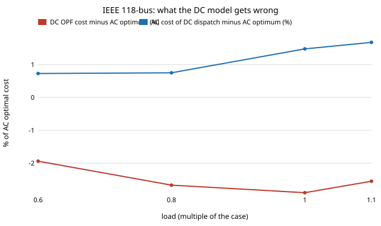

# infra-dcopf: how wrong is the DC approximation of optimal power flow on the IEEE 30-, 39- and 118-bus cases?

Track 21 (`infra`), grid first. Grid dispatch is routinely planned and priced with the DC optimal power flow (a linear programme with no losses and no voltage), and the AC OPF is the physics it stands in for. This project measures the difference on three standard cases, with the same cost curves and limits in both models: how far off is the DC model's cost, and what happens when its dispatch is run through an AC power flow? Produced with AI assistance (Claude). No method transfer from outside power systems; the benchmark use of IEEE cases follows the pandapower and MATPOWER literature. No CU Boulder group's work is reproduced and no connection is claimed.

**Live page:** https://duncan-haywood.github.io/monorepo-projects/research/infra-dcopf/

**Headline (modelled in pandapower on the MATPOWER/IEEE cases; not a measured system; results in `experiments/results.txt`).**
- **IEEE 118-bus, no branch binding:** the DC OPF reports a cost **1.9 to 2.9 % below** the AC optimum (it cannot see 55 to 150 MW of losses). Running its dispatch through an AC power flow (the slack pays the losses) costs **0.7 to 1.7 % more than the AC optimum** (up to 1.9 % with limits scaled by 0.5) with no voltage or loading violation, so the DC dispatch is feasible but wrongly ordered; the excess grows with load (0.73 % at 0.6 of the case's load, 1.48 % at 1.0, 1.68 % at 1.1).
- **IEEE 39-bus:** the DC cost is 1.0 to 1.5 % below the AC optimum, and the DC dispatch is nearly free in cost terms (within 0.06 %) but **breaks voltage limits**: 15 buses out of band at 0.6 of load, 5 at 0.8, 1 at the case's load (highest 1.079 pu).
- **IEEE 30-bus:** the DC cost is 1.3 to 2.3 % below; at the case's load the DC dispatch overloads one branch to 111 % and is 0.31 % *cheaper* than the AC optimum, which is the signature of a violated constraint, not a better plan.
- **Reading:** the DC model's price error is a loss term of 1 to 3 % here, and the danger of its dispatch is not cost but reactive and voltage limits it never modelled, on the smaller cases. Neither is a large number, and none says DC is wrong for planning.



## Method (`src/infra_dcopf/dcopf.py`)
- **Cases.** `case30`, `case39` and `case118` from `pandapower.networks` (MATPOWER cases), with their quadratic generator costs (`poly_cost`).
- **Two OPFs per condition.** `runopp` (AC, PIPS interior point, voltage and branch loading limits) and `rundcopp` (DC), on the same network with load scaled by 0.6, 0.8, 1.0 and 1.1 (P and Q together).
- **DC dispatch under AC.** The DC generator set-points are fixed in an AC power flow with the external grid as slack; we count buses outside their voltage limits, branches above their loading limit, and the cost of the resulting dispatch (slack included) with the same cost function (`gen_cost`, checked to match pandapower's `res_cost` to 1e-6).
- **Tightened limits.** A second sweep scales every line's `max_i_ka` and transformer `sn_mva` by 0.7 and 0.5 to force congestion. Many of those runs have no solution (below).

## Checks (`tests/`, 6)
A two-bus network with a closed-form answer (DC cost 10x50 + 0.01x50^2 = 525; the AC slack supplies load plus line loss); `gen_cost` equals pandapower's cost on case39; the 118-bus DC dispatch is feasible and costs no less than the AC optimum; the DC cost error lies in 1 to 5 %; case39's DC dispatch breaks voltage limits at light load.

## Limitations
- **"No solution" is not "infeasible".** A row marked `no solution` means pandapower's solver returned an error; for the tightened-limit sweeps on case30 and case39 this happens often, and I did not separate true infeasibility from non-convergence. Those rows prove nothing about the cases. At limits x0.7 case30 solves only at 0.6 of load.
- **On case118 the thermal limits never bind.** The case's `max_i_ka` is large (peak branch loading 2.9 to 9 % of it even at 0.5 limits), so the 118-bus rows are a losses-only comparison, not a congestion study. LMP and congestion-rent error are not measured here (next step).
- **Single dispatch point per condition, no unit commitment, no N-1 security.** Costs are the cases' own, in the case currency, not market prices; the loss share depends on each case's line data, taken as published.
- One solver per model (pandapower's PYPOWER-based OPF); another solver might differ at the margin on the non-convex AC problem.
- Safety-critical note: this is research on a benchmark. Any operational use of dispatch methods needs the system operator and licensed engineers.

## Next steps
1. Locational marginal prices from both models and the congestion rent they disagree on, on a case whose limits bind (the MATPOWER `case300` or a ratings-corrected `case118`).
2. Replace DC by a loss-adjusted DC (iterating loss factors) and see how much of the 1 to 3 % it recovers.
3. Reactive-aware fix: add voltage-band constraints to the LP and see whether case39's violations go away.

## Reproduce
```bash
pip install pytest numpy pandapower
cd research/infra-dcopf
python -m pytest -q tests                     # 6 tests, about 15 s
PYTHONPATH=src python experiments/run.py      # about 1 min; writes experiments/results.txt
python experiments/figure.py                  # experiments/gap_vs_load.svg
```

## References
(DOIs from memory; the DOI resolver was unreachable through the proxy, so they were not looked up in this run.)
- Thurner, L. et al. (2018), pandapower, *IEEE Trans. Power Systems* 33(6), doi:10.1109/TPWRS.2018.2829021.
- Zimmerman, R. D., Murillo-Sanchez, C. E., Thomas, R. J. (2011), MATPOWER, *IEEE Trans. Power Systems* 26(1), doi:10.1109/TPWRS.2010.2051168.
- Stott, B., Jardim, J., Alsac, O. (2009), DC power flow revisited, *IEEE Trans. Power Systems* 24(3), doi:10.1109/TPWRS.2009.2021235.

## Outside dependencies
pandapower (and its PYPOWER-derived solvers), the MATPOWER case data it ships.
