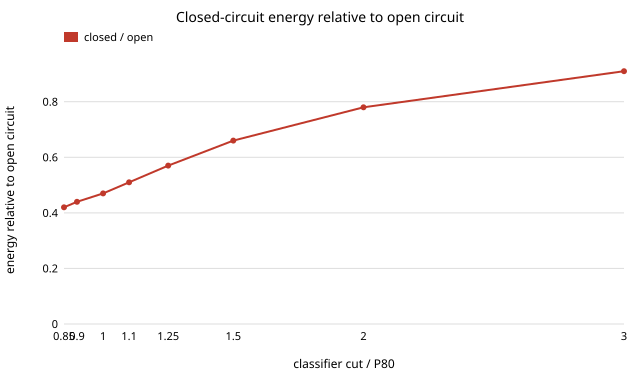

# infra-grind: how much energy does a classifier loop save when grinding to the same size, and does a ball-mill population balance agree with Bond's law?

Milestone 7 of track 21, applied R&D for the industries modern life runs on (`PROJECTS.md`). Grinding ore and clinker is a large share of the electricity of mining and cement. This project writes a size-by-size population-balance model of a ball mill (selection and breakage functions, in the Austin form) with an optional classifier loop, then asks two questions: at the same product size (P80), how much energy does a closed circuit (mill plus classifier, with the coarse stream returned) save over an open one, and does the model reproduce the size exponent of Bond's third theory of comminution? Produced with AI assistance (Claude).

**Live page:** https://duncan-haywood.github.io/oss-monorepo/research/infra-grind/

**Headline.** At a 100 &micro;m P80 from a 1500 &micro;m feed, a closed circuit with the classifier cut at the P80 and a 278% circulating load uses **0.47 of the open-circuit energy** (a 53% saving, 2.1&times;). A coarser cut saves less: 0.78 at a cut of twice the P80, where the load is 35%. The ratio stays between **1.8&times; and 3.7&times;** over mill mixing (1 to 10 tanks in series), classifier sharpness (2 to 8) and bypass (0 to 0.3), so the model's saving is robust and **much larger than the published ones**: Bond's open-circuit efficiency factor EF2 is 1.20 at 80% passing, and a vendor guide puts open-circuit cement mills at 36-42 kWh/t against 32-38 closed. This is reported as a discrepancy, not tuned away. On the second question, the energy-versus-size exponent of the model runs from 0.60 to 1.27 as the selection exponent goes from 0.4 to 1.2, against 0.68 from Bond's law over the same sizes, so Bond's law is the case of a selection exponent near 0.5.



## Method (`src/infra_grind/model.py`)
- **Size classes** on a &radic;2 ladder, 26 classes from 2000 &micro;m down; the finest is a sink. **Feed**: Rosin-Rammler, F80 = 1500 &micro;m.
- **Mill** (Austin, Klimpel and Luckie 1984, the standard textbook form): each class breaks at rate S<sub>i</sub> = S<sub>1</sub>(x<sub>i</sub>/1 mm)<sup>&alpha;</sup> per unit specific energy (t/kWh), so a pass is described by its specific energy E, not a time. Progeny follow the primary breakage function B(x;y) = &phi;(x/y)<sup>&gamma;</sup> + (1&minus;&phi;)(x/y)<sup>&beta;</sup>. The mill is `tanks` perfectly mixed tanks in series (1 is fully mixed, many is plug flow); each tank is lower-triangular, so it is solved by forward substitution.
- **Classifier**: Whiten's efficiency curve with sharpness &alpha;<sub>c</sub> and a bypass of fines to the coarse stream; the coarse stream returns to the mill and the loop is iterated to a fixed point. **Circulating load** = return / fresh feed.
- **Energy** per tonne of fresh feed = mill pass energy &times; (1 + circulating load). Energy for a target P80 is found by bisection. Because S is per kWh, **ratios between circuits do not depend on the scale S<sub>1</sub>**; absolute kWh/t here are model units, not a prediction for any mill.
- **Feasibility**: circuits with a circulating load above 350% are excluded from "best": a vendor guide calls 300-400% typical for an untuned cement circuit and under 200% a tuned target, and a mill has a throughput limit this model does not carry.

### Inputs and where they come from
| Input | Value | Source |
|---|---|---|
| Model form (S, B, perfect-mixing tanks, Whiten classifier) | as above | Austin, Klimpel and Luckie (1984), *Process Engineering of Size Reduction: Ball Milling*; Whiten (1974); known from the literature, **not re-read this run** |
| &alpha;, &phi;, &gamma;, &beta; | 0.9, 0.4, 0.8, 3.5 | typical magnitudes from memory of the Austin literature; **swept** (section C) |
| Tanks, classifier sharpness, bypass | 3, 4, 0.1 | **assumed**, swept |
| Bond's formula | W = 10 Wi (1/&radic;P80 &minus; 1/&radic;F80) | Bond (1952), *Trans. AIME* 193; tested against its arithmetic |
| Open-circuit factor | EF2 = 1.20 at 80% passing | Rowland's tabulation as shown on the metdynamics wiki (found by search 2026-10-21; the wiki, not Rowland's paper, was read via a summary) |
| Plant figures | 36-42 vs 32-38 kWh/t (open vs closed cement ball mills); 300-400% untuned load | an equipment-maintenance vendor's guide (oxmaint.com, via search summary); a vendor, so indicative |

## Reproduce
```bash
pip install pytest
cd research/infra-grind
python -m pytest -q tests                       # 13 tests
PYTHONPATH=src python experiments/run.py        # about 4 minutes; writes experiments/results.txt
PYTHONPATH=src python experiments/throughput.py  # section G, about a minute; writes experiments/throughput.txt
python experiments/figure.py                    # experiments/circuit.svg from results.txt
```
Standard library only.

## Results (`experiments/results.txt`; deterministic)
- **A. Cut size.** At P80 100 &micro;m the open circuit needs 46.3 model-kWh/t. Closed, per tonne of fresh feed: cut 0.9&times;P80 20.3 (load 468%), 1.0&times; 21.8 (278%), 1.25&times; 26.2 (113%), 1.5&times; 30.3 (65%), 2&times; 36.3 (35%), 2.5&times; 39.8 (25%). A finer cut always saves more energy in this model, at the cost of load; the load limit, not the energy, picks the cut.
- **B. Bond's exponent.** Local exponent m in E &prop; P80<sup>&minus;m</sup> between 50 and 200 &micro;m: 0.60, 0.75, 0.92, 1.00, 1.09, 1.27 at &alpha; = 0.4, 0.6, 0.8, 0.9, 1.0, 1.2. Bond's formula gives 0.68 over the same sizes and F80. The model reproduces it near &alpha; = 0.5, a value inside the 0.5 to 1.5 range I recall for ball-mill selection exponents, so Bond's law is consistent with the model, but a default &alpha; of 0.9 is not.
- **C. Sensitivity of the saving** (best feasible closed vs open). Tanks 1, 2, 3, 4, 6, 10: 73, 59, 53, 50, 47, 44%. Classifier sharpness 2 to 8: 47 to 54%. Bypass 0 to 0.3: 53 to 48%. &alpha; 0.6 to 1.2: 50 to 53%. &beta;, &gamma;, &phi;: 48 to 55%. Mixing is the one input that moves it much: a fully mixed mill overgrinds heavily.
- **E. Open/closed energy ratio** over tanks &times; sharpness: 1.8 to 3.7, never near 1.2.
- **F. Fines slowing (negative result).** Cause (1) below was tested: S<sub>i</sub> divided by 1+(x<sub>fine</sub>/x<sub>i</sub>)<sup>k</sup>, with x<sub>fine</sub> 10 to 200 &micro;m and k 1, 2, 4. The open/closed ratio does **not** fall toward 1.20: it stays 2.10 to 2.12 for x<sub>fine</sub> up to 100 &micro;m and rises to 2.29 to 2.30 at 200 &micro;m (the open-circuit energy grows 1.2 to 3.7&times;, the closed one grows with it). Slowing the fines raises the cost of both circuits about equally, so it cannot explain the gap. The form is an assumed one (not fitted to cushioning data).
- **G. Mill-flow limit (cause 2 tested; `experiments/throughput.txt`).** One mill of fixed power, whose total flow (fresh plus return) may not exceed *m* times the open circuit's fresh feed. The closed circuit's fresh-feed capacity relative to open is min(E<sub>open</sub>/E<sub>closed</sub>, m/(1+load)), with the cut chosen per *m*. Unlimited, the capacity ratio is the energy ratio, 2.12 at cut = P80. At m = 1.5 it falls to **1.16** (cut 2.5&times;P80, load 25%), at m = 2 to **1.37** (cut 1.75&times;, load 45%), at m = 3 to 1.52, and at m &ge; 4 it is back to 1.77 to 2.12. So a flow limit of about 1.5 to 2 times the open circuit's throughput brings the model's advantage into the range of Bond's EF2 = 1.20; the limit is **not sourced**: I know of no published hold-up figure that I read, so this shows what limit would be needed, not that real mills have it. It is a capacity comparison at fixed power, so it is not the energy ratio of E above.

## Discrepancy with the published figures
The model's open/closed ratio is 1.8 to 3.7, against Bond's EF2 of 1.20 and about 1.1 from the vendor ranges. Possible causes: (1) real fines grind more slowly than a power-law S predicts (cushioning, slurry effects), which shrinks the overgrinding that open circuit pays for (**tested in F: it does not close the gap**; the rest are untested); (2) the model has no throughput limit, so the closed circuit's high load is free (**tested in G: a flow limit of 1.5 to 2 times the open circuit's feed brings the capacity advantage to 1.2 to 1.4, but the limit is an unsourced assumption**); (3) auxiliary power of separators and elevators (a trade article puts it near 22% of mill power) is excluded; (4) EF2 is defined against a closing screen size, not a P80 match, and cement is specified by Blaine surface rather than P80; (5) the shape parameters are typical values, not fitted to any mill. The honest reading is that the structure is right (closed beats open, finer cut and sharper classifier help) but the magnitude needs fitting to a real mill's size distributions before it is used.

## Limitations
- **No real mill data.** Nothing here is fitted to a measured feed and product size distribution; a public one (e.g. a grindability test with sieve data) would replace the assumed parameters.
- **Sources were secondary.** Rowland's factor and the plant ranges came via search summaries; Austin et al. and Bond were not re-read.
- **Steady state, one mill, one ore**; no wear, ball charge, speed or slurry density; no throughput limit; a classifier curve of one standard shape.
- **Absolute energy is in model units**; the numbers say nothing about kWh/t in a plant.
- Not engineering advice.

## Next steps
- Fit S, B to a public batch-grinding dataset and test whether the discrepancy closes; source a real mill hold-up or flow limit for section G's *m* (a throughput limit was tried in G; fines slowing alone did not close it).
- Add the cost axis with `energy-tou` (time-of-use tariff) and the separator's own power.
- Pair with `infra-cement`: grinding energy per blend is currently a flat 100 kWh/t there.

## Outside dependencies
None: standard library for the code, pytest for the tests. Facts were gathered through web search summaries on 2026-10-21. No CU Boulder group's work is built on.
