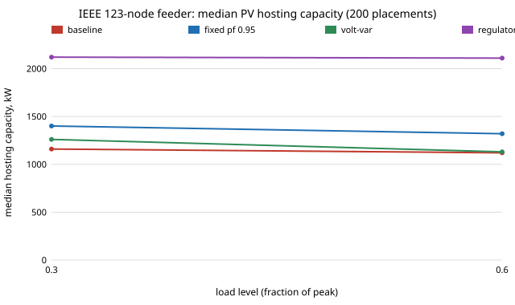
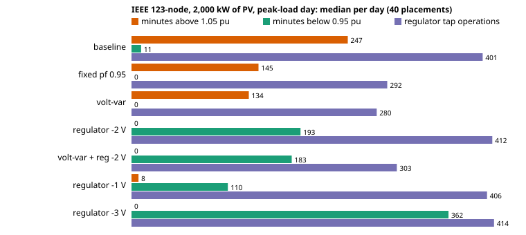

# infra-hosting-feeders: does a lower regulator set-point still beat inverter volt-var for rooftop PV on the IEEE 34- and 123-node feeders?

Track 21 (`infra`), the first next step of [`infra-hosting`](../infra-hosting/) ("run the same ramp on the IEEE 34- and 123-node feeders"). `infra-hosting` found, on the 13-node feeder, that lowering the regulator voltage set-point by 2 V raised PV hosting capacity by 31 % while inverter reactive power did nothing once the regulators responded, and warned not to generalise from one small, heavily loaded feeder. This project asks the same question of two longer feeders, with identical method and measures. Produced with AI assistance (Claude).

**Live page:** https://duncan-haywood.github.io/monorepo-projects/research/infra-hosting-feeders/

**Headline (modelled in OpenDSS, not measured feeders; 200 random placements per case, seed 1).** On the **IEEE 123-node feeder** at 30 % of its 3,490 kW peak, the median placement takes **1,160 kW of PV** (10th to 90th percentile 380 to 2,440 kW) before a service voltage passes 1.05 pu (voltage binds first in 198 of 200 placements, a transformer in 2). **Lowering every regulator's set-point by 2 V adds +790 kW (+68 %) and is better on 100 % of placements**; a fixed power factor of 0.95 adds +180 kW (better on 64 %, worse on 34 %) and the IEEE 1547-2018 Category B volt-var curve +100 kW (64 % / 28 %); set-point plus volt-var adds +990 kW. The ranking of `infra-hosting` holds, but the claim that inverter reactive power does nothing does **not** carry over: on this longer feeder it helps a little and unreliably. The cost of the set-point is undervoltage at peak: with no PV the lowest service voltage is 0.979 pu as published, 0.960 at -2 V, 0.953 at -3 V and 0.940 at -4 V, so about 3 V is the most this feeder allows before the 0.95 floor breaks. The **IEEE 34-node feeder as published has no hosting capacity at all**: its source is set to 1.05 pu, so bus 814 sits at 1.0503 pu with no PV and every placement and measure scores 0 kW. With the source set to 1.00 pu (my one edit, labelled) the median is 590 kW, and there a **fixed power factor beats the set-point (+180 kW, better on 97 %, against +140 kW, 79 %)** while volt-var adds +20 kW. So the measure ranking is a property of the feeder, not a law.

**Builds on.** [`infra-hosting`](../infra-hosting/) (same code path, generalised to any feeder and to every `RegControl` in it), EPRI's OpenDSS through `OpenDSSDirect.py`, the IEEE PES test feeders (Kersting 1991, 2001), ANSI C84.1 and IEEE Std 1547-2018. Method transfer (track 21): none from outside power systems. No CU Boulder group's work is reproduced and no connection is claimed.

**Quasi-static day (added 2026-10-23; `experiments/results_day.txt`).** On the 123-node feeder with 2,000 kW of PV (40 of the placements above) on the peak-load day, one-minute steps: the baseline spends a median **247 min above 1.05 pu** and makes **401 regulator tap operations**. The -2 V set-point removes the overvoltage (**0 min**) but adds **193 min below 0.95 pu** (baseline 11) and does not reduce tap operations (412). Fixed pf 0.95 and volt-var cut overvoltage to 145 and 134 min and tap operations by about 30 % (292, 280) with no undervoltage minutes at the median. So the snapshot verdict "set-point wins" reverses into a trade once a day and the lower limit are counted; volt-var plus set-point gives 0 min over, 183 under and 303 operations.





## Method (`src/infra_hosting_feeders/hosting.py`)
- **Feeders** (`feeder/`, copied unchanged from the OpenDSS sample cases, see `feeder/README.md`): IEEE 123-node (91 customer loads, 3,490 kW, seven single-phase regulator controls and a 5 MVA head regulator) and IEEE 34-node Mod 1 (68 loads, 1,769 kW, six regulator controls, a 500 kVA 24.9/4.16 kV transformer). A global `LoadMult` sets the load level (0.3 and 0.6 of peak; the published 34-node case already loads its 500 kVA transformer to 1.05 of rating at peak).
- **Placements.** A random subset of 1 to 8 loads with Dirichlet(1) weights, drawn once per feeder (seed 1) and reused for every measure and load level. PV sits at the load's bus (a line-to-line single-phase load gets a line-to-neutral PV on its first node), inverter kVA = 1.1 times PV kW, unity power factor.
- **Hosting capacity.** Total PV is ramped from zero (200 kW steps, then 20 kW steps in the first failing interval) with the regulators following from solve to solve. Limits: any service bus above 1.05 pu (every bus except the source), any transformer above its kVA rating (taken from the model), or a non-converged solution. **No line ampacity limit**: the cases carry only OpenDSS's default of 400 A and the test-feeder reports give no ratings, so rather than recall them the run reports the worst line current at the capacity (section D).
- **Measures**, as in `infra-hosting`: fixed power factor 0.95 absorbing; the IEEE 1547-2018 Category B volt-var curve through `InvControl`; every regulator set-point lowered by 2 V (the 123-node set-points are 120 and 124 V, the 34-node 122 and 124 V); and volt-var plus set-point. Each is run with live regulators, with taps frozen at their no-PV values, and (the first four) with line-drop compensation off. The EV measure of `infra-hosting` is dropped: its rounded charging factor was the least supported number there.

### Checks (`tests/`, 8)
Total customer load is 3,490 kW (123-node) and 1,769 kW (34-node), the published totals; both published cases converge and the 123-node case holds every service voltage above 0.95 pu at peak; the 34-node case as published starts above the limit (capacity 0) and with its source at 1.00 pu does not; PV of 300 kW displaces 280 to 320 kW at the source; the capacity brackets a violation within 60 kW; frozen taps do not move; the single-phase PV terminal logic; placements are valid and deterministic. The published bus voltages of the 34- and 123-node reports were not available here to compare with (unlike the 13-node case), so voltages are checked only against the published load totals and the 0.95 to 1.05 band.

### Quasi-static day (`src/infra_hosting_feeders/day.py`, `tests/test_day.py`, 4 tests)
- **Shapes** (`feeder/123/PVShape.dss`, `PaperLoadShape.txt`, copied unchanged from the OpenDSS 123Bus folder): a 1,440-point one-minute PV irradiance shape (peak 1.0, 768 min above 2 %, strongly cloud-broken) and an 8,760-point hourly load fraction (peak 1.0). Their provenance is not stated in the files (the PV file says only that it is used in examples that reuse the 123-bus case), so I treat them as an example day, not a site measurement. Two load days: day 222 (the highest-load day, fraction 0.51 to 1.00) and day 359 (lowest mean, 0.33 to 0.42), linearly interpolated to minutes.
- **Run.** Each minute sets the load multiplier and PV irradiance, solves, and lets the regulators settle in that solve (snapshot control iterations; no tap delay). Reported per day: minutes in which any service node is above 1.05 or below 0.95 pu, and tap operations (tap steps moved between consecutive minutes, summed over the seven regulators). Because the regulators settle fully every minute, tap counts are an upper bound on a delayed regulator. Total PV 0, 1,000, 2,000, 3,000 kW at the first 40 placements, all seven measures (adds regulator -1 V and -3 V).
- **Not converged.** 3,000 kW volt-var runs fail to converge for 943 to 1,030 steps in total (the number of placements affected was not counted) (see the "not converged" column); their medians are over all placements and should be read with that in mind. The lowest voltages at 3,000 kW (0.79 to 0.89 pu) come from heavily loaded single phases with single-phase PV and were not diagnosed further.
- **Also seen.** The published case with no PV already has 123 min above 1.05 pu on the peak-load day (light-load hours, set-point as published); the -2 V set-point clears them, which is part of its overvoltage gain.

## Reproduce
```bash
pip install pytest numpy OpenDSSDirect.py
cd research/infra-hosting-feeders
python -m pytest -q tests                      # 12 tests
PYTHONPATH=src python experiments/run.py       # about 10 min; writes experiments/results.txt
python experiments/figure.py                   # experiments/hosting.svg
PYTHONPATH=src python experiments/run_day.py   # about 25 min; experiments/results_day.txt
python experiments/figure_day.py               # experiments/hosting_day.svg
```

## Results (`experiments/results.txt`; deterministic)
- **A. Live regulators, median hosting capacity (kW) at load 0.3 / 0.6.** 123-node: baseline 1,160 / 1,120; fixed pf 1,400 / 1,320; volt-var 1,260 / 1,130; set-point -2 V 2,120 / 2,110; volt-var + set-point 2,280 / 2,380. 34-node with source 1.00: baseline 590 / 920; fixed pf 780 / 1,160; volt-var 580 / 940; set-point 760 / 1,100. 34-node as published: 0 for everything. The 10th percentile is 340 to 1,156 kW and the 90th 1,084 to 4,480 kW, so where the PV goes matters about as much as any measure.
- **B. Taps frozen.** 123-node baseline 480 / 420, fixed pf 690 / 620, volt-var 520 / 460, set-point 1,140 / 1,040. 34-node (1.00) baseline 60 / 40: with the taps frozen at their no-PV values the feeder takes almost nothing, and the live regulators are what hosts the PV; the set-point recovers +160 kW, fixed pf and volt-var 0.
- **C. Paired change at load 0.3**, median kW and share better / worse. 123-node live: fixed pf +180 (64 / 34 %), volt-var +100 (64 / 28 %), set-point +790 (100 / 0 %), volt-var + set-point +990 (98 / 2 %). 123-node frozen: +200, +40, +580. 123-node without line-drop compensation: +240, 0, +950. 34-node (1.00) live: +180 (97 / 2 %), +20 (61 / 29 %), +140 (79 / 0 %).
- **D. What binds.** 123-node baseline: voltage 198, transformer 2 (of 200); with volt-var + set-point: voltage 185, transformer 13, 2 with no headroom at all. 34-node (1.00): voltage 200. Worst line current at the baseline capacity: 123-node median 241 A (90th percentile 691 A, maximum 2,057 A), 34-node (1.00) median 22 A, maximum 559 A. A real study would add the conductor ampacities; the larger values mean thermal limits would bind in the upper tail of the 123-node placements.
- **I. Set-point sweep (123-node, first 100 placements, load 0.3).** Median capacity 1,130 kW at no change, 1,580 at -1 V, 2,110 at -2 V, 2,470 at -3 V, 2,760 at -4 V, against a lowest peak-load service voltage of 0.979, 0.966, 0.960, 0.953 and 0.940 pu. Capacity keeps rising with the drop; the 0.95 floor at peak is what stops it, between -3 and -4 V. The same sweep on the 34-node (1.00) feeder saturates at 800 kW and its lowest peak voltage does not move (0.893 pu, below the floor at every set-point, at a bus the regulators do not reach).

## Limitations
- **Two feeders are two data points.** The ranking changed between them (set-point first on the 123-node, fixed pf first on the 34-node at 1.00), so none of it generalises without EPRI Ckt5/Ckt7 or real utility feeders.
- **Hosting capacity is a snapshot** (one load level, PV at full output); the day above covers only the 123-node feeder, one PV shape, 40 placements and fixed PV totals, with instant regulator settling and no tap delay or dead time.
- **No conductor ampacity limit**, as above; the capacities are voltage-and-transformer capacities and are upper bounds on a study with line limits.
- **The 34-node source at 1.00 pu is my edit**; the published 1.05 is part of how that case reproduces a long, low-voltage feeder. At peak load the 34-node feeder falls to 0.893 pu with the source at 1.00 (0.923 as published), below ANSI Range A before any PV is added.
- **The 34- and 123-node published bus voltages were not compared** (see Checks); the load totals and convergence were.
- **The Category B curve points are recalled** from IEEE 1547-2018, and inverter kVA is 1.1 times PV kW.
- **Safety-critical designs are research.** Regulator set-points and inverter settings are the utility engineers' decisions; nothing here is operating advice and no real utility system was touched.

## Next steps
1. Add the conductor ampacities from a source and the line limit; the 123-node upper tail suggests it matters.
2. ~~Quasi-static day~~ done (above). Next: a sourced irradiance series (e.g. NREL NSRDB or a measured clear/cloudy pair), regulator delays, and the cause of the 3,000 kW volt-var non-convergence.
3. EPRI Ckt5 and Ckt7 (in the OpenDSS sample set) to see whether the ranking follows feeder length.
4. Why does fixed pf win on the 34-node feeder? Regress the paired gains on feeder features (X/R at the PV bus, distance from the nearest regulator).

## Outside dependencies
NumPy and `OpenDSSDirect.py` (and its OpenDSS engine). The feeder cases are copied into `feeder/` with their provenance.
