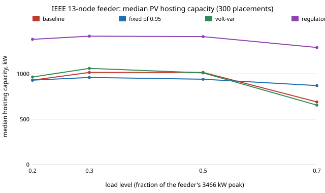

# infra-hosting: how much rooftop PV can an IEEE feeder take before voltage binds, and which cheap measure adds the most?

Track 21 (`infra`), milestone 1 of [`PROJECTS.md`](../PROJECTS.md) (hosting capacity on an IEEE test feeder, each measure scored on the same placements). The question is the one a distribution planner asks before approving rooftop solar on a street: at light midday load, how many kW of PV can sit on the feeder before a customer sees more than 1.05 per unit (ANSI C84.1 Range A), a conductor passes its ampacity or a transformer passes its rating, and does an inverter power factor, an inverter volt-var curve, a lower regulator set-point or midday EV charging raise that number? Produced with AI assistance (Claude).

**Live page:** https://duncan-haywood.github.io/monorepo-projects/research/infra-hosting/

**Headline (modelled in OpenDSS on the IEEE 13-node test feeder, not a measured feeder; 300 random placements per case, seed 1).** At 30 % of the feeder's 3,466 kW peak (a midday minimum), the median placement takes **1,015 kW of PV** (10th to 90th percentile 510 to 1,893 kW) before the first violation, and **voltage binds first in 224 of 300 placements** (transformer rating in 47, a line's ampacity in 29). Of the cheap measures, **lowering the regulator voltage set-point by 2 V (122 to 120 V on a 120 V base) adds the most: +310 kW median (+31 %), better on 74 % of placements and worse on 10 %**, and it costs 0.007 per unit of margin at peak load (lowest service voltage 0.954 pu at peak, still above 0.95). **Inverter reactive power does not help on this feeder when the regulators respond**: a fixed power factor of 0.95 changes the median by -60 kW (better on only 34 % of placements) and the IEEE 1547-2018 Category B volt-var curve by 0 kW, because the regulators' line-drop compensation sees the lower current and holds the voltage up. Freeze the regulator taps and the same measures help (+110 kW fixed power factor, +60 kW volt-var, better on 72 % and 65 %), and with line-drop compensation off they are close to neutral (+50 and +10 kW). Midday EV charging at 14 % of customer load moves the median by +10 kW because the added load lands on the same 500 kVA transformer the PV is trying to use. The most-used mitigation is therefore not the one with the most hype: **regulator set-points beat inverter reactive power on this feeder, and the answer depends on regulator settings that a hosting study usually leaves out**.

**Builds on.** EPRI's OpenDSS through `OpenDSSDirect.py` (BSD-3; the IEEE 13-node case from the OpenDSS sample set), the IEEE PES Distribution System Analysis Subcommittee's test feeders (Kersting 1991, 2001), ANSI C84.1 voltage ranges and IEEE Std 1547-2018 inverter volt-var requirements. The stochastic method (random PV placements, scale until the first violation) is the common hosting-capacity approach in the utility literature; no single paper is reproduced here. Method transfer (track 21): none from outside power systems, the work is the feeder study the milestone names. No CU Boulder group's work is reproduced and no connection is claimed.



## Method (`src/infra_hosting/hosting.py`)
- **Feeder.** IEEE 13-node test feeder as shipped with OpenDSS (`feeder/`), 3,466 kW of customer load across 15 load elements, three single-phase regulators with line-drop compensation (R 3, X 9 V), a 500 kVA 4.16/0.48 kV transformer to bus 634, a 5 MVA substation transformer. A global `LoadMult` sets the load level (0.2, 0.3, 0.5, 0.7 of peak); 0.3 is the headline. At peak load the 500 kVA transformer is already at 1.009 of its rating in the unmodified case, so levels above 0.7 are not used.
- **Placements.** A random subset of 1 to 8 of the 15 load nodes with Dirichlet(1) weights on the total PV, drawn once (seed 1) and reused for every measure and load level, so measures are compared on identical placements. PV is a `PVSystem` at the load's bus and phases (single-phase on single-phase loads, three-phase on 671), inverter kVA = 1.1 times PV kW, unity power factor.
- **Hosting capacity.** The total PV is ramped from zero (100 kW steps, then 10 kW steps inside the first failing interval) with the regulators following from solve to solve; the capacity is the last total before the first violation of: any service voltage above 1.05 pu (every bus except the source and the regulator primary), any non-switch line above its ampacity, any transformer above its kVA rating, or a non-converged solution. Ramping makes the answer path-defined, since bisection reported totals above earlier violations in 13 of 40 placements (regulator taps are discrete and depend on history).
- **Measures** (each compared with the baseline on the same placements): fixed power factor 0.95 absorbing; the IEEE 1547-2018 Category B default volt-var curve (points 0.92/+0.44, 0.98/0, 1.02/0, 1.08/-0.44 per unit of inverter kVA) through OpenDSS's `InvControl`; regulator set-point 122 to 120 V; midday EV charging as a flexible load of 0.14 kW per kW of customer load at every load node (30 % of homes with an EV x one third plugged in at midday x 7.2 kW charger / 5 kW of peak per home; a rounded estimate, not a dataset); and all three together. Each runs with the regulators live, with the taps frozen at their no-PV values, and (the first four) with line-drop compensation off, because the live-regulator result was the surprise.

### Checks (`tests/`, 9)
The unmodified feeder with the published fixed taps and controls off reproduces the published voltages at buses 632, 671 and 675 on all three phases to 0.003 pu (for example 632: 1.0208, 1.0418, 1.0175 against 1.0210, 1.0420, 1.0174); the load sums to 3,466 kW; 400 kW of PV displaces 380 to 420 kW at the source; PV raises the voltage at light load; the capacity brackets a violation within 40 kW; the volt-var and fixed-power-factor inverters absorb reactive power at high voltage; frozen taps do not move; placements are valid. A fresh solve at each reported capacity is clean in 60 of 60 placements and 100 kW above it violates in 56 of 60 (section G), so the ramp does not hide a path effect larger than the step.

## Reproduce
```bash
pip install pytest numpy OpenDSSDirect.py
cd research/infra-hosting
python -m pytest -q tests                      # 9 tests
PYTHONPATH=src python experiments/run.py       # about 7 min; writes experiments/results.txt
python experiments/figure.py                   # experiments/hosting.svg
```

## Results (`experiments/results.txt`; deterministic)
- **A. Live regulators, median hosting capacity (kW) at load 0.2 / 0.3 / 0.5 / 0.7.** Baseline 930 / 1,015 / 1,015 / 690; fixed power factor 930 / 960 / 940 / 870; volt-var 965 / 1,060 / 1,010 / 655; regulator -2 V 1,380 / 1,415 / 1,410 / 1,290; midday EV 960 / 1,025 / 945 / 555; all three 1,400 / 1,410 / 1,370 / 1,275. The 10th percentile is 120 to 630 kW everywhere and the 90th 1,780 to 2,740 kW: where the PV goes matters more than any measure.
- **B. Taps frozen.** Baseline 760 / 815 / 825 / 610; fixed power factor 910 / 930 / 940 / 830; volt-var 805 / 850 / 830 / 585; regulator -2 V 1,255 / 1,280 / 1,225 / 1,130.
- **C. Paired change at load 0.3**, median kW and share better / worse than the same-regime baseline. Live: fixed pf -60 (34 / 63 %), volt-var 0 (49 / 41 %), regulator -2 V +310 (74 / 10 %), EV +10, all three +290 (79 / 14 %). Taps frozen: fixed pf +110 (72 / 27 %), volt-var +60 (65 / 32 %), regulator -2 V +380 (93 / 2 %), all three +470 (93 / 6 %). Line-drop compensation off: fixed pf +50, volt-var +10, regulator -2 V +300.
- **D. What binds.** At load 0.3, baseline: voltage 224, transformer 47, line 29 (of 300). With all three measures: transformer 110, line 97, voltage 90 (3 placements fail with no PV: the EV load overloads the 500 kVA transformer). Mitigation shifts the binding limit from voltage to thermal, as it should.
- **E. Single-node hosting (kW at load 0.3).** Bus 671 on the three-phase primary takes 4,910 kW; the single-phase and 480 V nodes take 360 to 1,060 kW (634a/b/c 390 to 460, 675c 410, 611 390). Volt-var raises 675b from 360 to 510 and lowers 692 from 2,400 to 1,680 (the regulators). Regulator -2 V raises 670c from 580 to 1,260.
- **I. Undervoltage cost with no PV (lowest service pu, live regulators).** Baseline 1.010 at load 0.3 and 0.961 at peak; regulator -2 V 0.996 and 0.954. The 0.95 floor holds; the added EV load at peak (not a midday case) takes the lowest voltage to 0.948.
- **G. Path dependence.** See Checks.

## Limitations
- **A 13-node feeder is small and heavily loaded**, with high-impedance 4.16 kV laterals and a regulator pair that responds sharply to PV. The ranking of measures is a statement about this feeder; the IEEE 34- and 123-node and EPRI Ckt5/Ckt7 feeders would show whether inverter reactive power does better on a longer, lighter feeder. Do not generalise "regulator beats volt-var".
- **Snapshots, not time series.** One midday load level per case with PV at full output; no cloud ramp, no quasi-static day, no regulator tap-change counts (a lower set-point does not change tap operations here but a real study counts them).
- **Thermal limits use recalled conductor ampacities** (typical ACSR/AA tables by line code: 730, 340, 230, 260 A) and the feeder's nameplate transformer ratings. They were not checked against a source in this environment; they matter only in the 29 of 300 baseline placements where a line binds.
- **Regulator behaviour is the OpenDSS `RegControl` with the test case's line-drop-compensation settings**; the live/frozen/no-LDC rows bracket it, but a utility's real settings (set-point, bandwidth, delay) are what decide the answer.
- **The EV measure is a flexible midday load**, not an EV-hosting study and not a charging-schedule model; the 0.14 kW per kW factor is a rounded estimate. EV charging at the evening peak and its transformer ageing are in [`infra-transformer`](../infra-transformer/).
- **The Category B curve is recalled from IEEE 1547-2018**, with the voltage points and +/-0.44 limits as I remember them, and inverter kVA is 1.1 times PV kW (an assumption: a smaller inverter has less reactive headroom at full power).
- **Safety-critical designs are research.** Interconnection limits, regulator settings and inverter settings are the utility's engineers' decisions; nothing here is operating advice, and no real utility system was touched.

## Next steps
1. Run the same ramp on the IEEE 34- and 123-node feeders and EPRI Ckt5 (all in the OpenDSS sample set) and see whether the volt-var result flips.
2. Replace the snapshot with a quasi-static day: PV and load shapes, tap-change counts, and hosting defined by hours above 1.05 pu.
3. Source the line ampacities and the IEEE 1547-2018 curve table, and sweep the inverter oversizing.
4. Add EV hosting proper: evening charging load, the 500 kVA transformer from [`infra-transformer`](../infra-transformer/)'s ageing model, and a charging schedule (milestone 2's next step 4).

## Outside dependencies
NumPy and `OpenDSSDirect.py` (and its OpenDSS engine). The IEEE 13-node case is copied into `feeder/` with its provenance.
