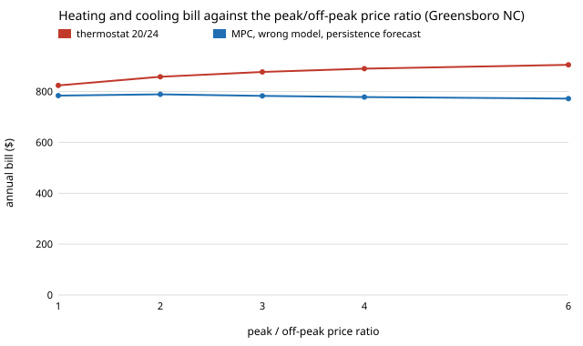

# infra-hvacmpc: how much does model-predictive heating and cooling save over a thermostat on a time-of-use tariff, when the model and the weather forecast are wrong?

Track 21 (`infra`), milestone 12. Produced with AI assistance (Claude). Searchers' version: *does MPC beat a thermostat for a heat pump on a time-of-use electricity tariff, and does it survive a wrong building model and a poor forecast?*

**Live page:** https://duncan-haywood.github.io/oss-monorepo/research/infra-hvacmpc/

**Headline (simulated house on real TMY3 weather; assumed tariff; envelope numbers recalled, not checked).** For a 48 m&sup2; ASHRAE 140 Case 600 style house with a heat pump on Greensboro NC weather and the assumed three-band tariff of `energy-tou`, a receding-horizon LP controller whose model is deliberately wrong (the true house leaks 15&ndash;30% more, is lighter, sunnier and has a worse cooling COP) and whose forecast is *yesterday's weather* pays **$783 a year**, against **$877** for a PI thermostat at 20/24 &deg;C: **10.7% less**, with 2,383 K&nbsp;h outside the 20&ndash;24 &deg;C band against the thermostat's 7,621. With the exact model and a perfect forecast it pays $791 and is never outside the band. A thermostat tuned for similar discomfort (21.5/22.5 &deg;C: 2,839 K&nbsp;h) pays $1,300. On a flat tariff the saving is 4.8%; at Sand Point AK (cold, 8,900 &deg;F-days) it is 4.1% on the tariff and 2.4% flat. The saving rises with the peak/off-peak ratio (4.9% at 1 to 14.7% at 6), rises steeply with thermal mass (6.5% at half the mass to 25% at four times), and is gone when the forecast of outdoor temperature has a standard deviation of 8 K (&minus;0.1%); it is 8.3% at 4 K.



**Builds on.** The lesson of [`energy-tou-lp-forecast`](../energy-tou-lp-forecast) (an optimiser fed a naive forecast loses most of its edge) and the tariff of [`energy-tou`](../energy-tou); the method transfer is receding-horizon LP control (Drg&ntilde;a et al. 2020, *Annual Reviews in Control* 51, 190&ndash;232) applied to a residential heat pump. It builds on none of the CU Boulder groups in `prompt.md`.

**Not engineering or financial advice.** A simulation of a modelled house; nothing here was run on a real building or connected to any system.

## Data and parameters (what is sourced)
| Input | Value | Source |
|---|---|---|
| Weather | hourly dry-bulb temperature and GHI, 8,760 h | NREL TMY3 files `723170TYA` (Greensboro Piedmont Triad, NC) and `703165TY` (Sand Point, AK), as bundled with pvlib 0.16.1 (BSD-3-Clause), trimmed to four columns in `data/` |
| Check on the weather | Greensboro 3,923 &deg;F-days (base 18 &deg;C = 64.4 &deg;F) | the usual published normal is about 3,800; the test accepts 3,000 to 4,500 |
| Heat pump heating COP | 6.81 &minus; 0.121 &Delta;T + 0.000630 &Delta;T&sup2;, &Delta;T = 35 &deg;C &minus; T<sub>out</sub> | Staffell et al. (2012), *Energy Environ. Sci.* 5, 9291, air-source fit; quoted from memory, not re-read |
| Walls, roof, floor, window U; window area; 0.5 ACH; 200 W internal gain | 0.514, 0.318, 0.039, 3.0 W/m&sup2;K; 12 m&sup2;; 0.5; 200 W | ASHRAE 140 Case 600 **as I remember them; the standard was not opened** (paywalled). UA total 107.6 W/K. |
| Heat capacities | C<sub>i</sub> 3 MJ/K, C<sub>e</sub> 8 MJ/K | **not sourced**; swept 0.5 to 4 times in section C |
| Cooling COP | 0.4 of Carnot, 12 &deg;C coil, condenser T<sub>out</sub> + 10 K, capped 2 to 7 | **assumed** |
| Solar gain | 12 m&sup2; &times; SHGC 0.769 &times; 0.5 | the 0.5 orientation/shading factor is **assumed** |
| Tariff | $0.15 off-peak 21&ndash;07, $0.45 peak 16&ndash;21, $0.28 otherwise | **assumed** (from `energy-tou`); ratio swept in B |
| Equipment | 6 kW thermal heating and cooling | **assumed**; 4 kW left the thermostat cases overheating in summer, so it was raised before the reported run |

**No measured building dataset.** The milestone asked for a grey-box model fitted to an open dataset. The BOPTEST, CityLearn, UCI and Zenodo hosts were unreachable from this environment (proxy 403 or 404), so the model is built from published envelope values instead and nothing is fitted. A fit to measured indoor-temperature data is the first next step.

## Method (`src/infra_hvacmpc/model.py`)
- **Model.** Two states, indoor air + contents and envelope mass, exact one-hour zero-order-hold discretisation (`scipy.linalg.expm`); tests check the steady state against a UA balance and a small step against Euler.
- **Plant vs model.** The "plant" has opaque UA &times;1.15, infiltration &times;1.3, C<sub>i</sub> &times;0.7, C<sub>e</sub> &times;1.4, solar &times;1.3, cooling Carnot fraction &times;0.85 compared with the controller's model.
- **Thermostat.** PI (k<sub>p</sub> 500 W/K, k<sub>i</sub> 150 W/K per hour, clamped), heating below one set-point and cooling above another. A P-only thermostat was tried first: at an hourly step k<sub>p</sub> = 5000 W/K was unstable and k<sub>p</sub> = 700 drooped 1.2 K below its set-point; both were discarded.
- **MPC.** Each hour an LP (HiGHS) over 24 h minimises the electricity bill plus $0.5 per K&nbsp;h outside 20&ndash;24 &deg;C, from the measured indoor temperature and an envelope temperature carried by its own model, then applies the first hour. COP varies with the forecast outdoor temperature, so the problem stays linear.
- **Forecasts.** Perfect; persistence (the value 24 h earlier; the current hour is measured); Gaussian error on outdoor temperature (gains error 0.3 times that, relative).
- **Discomfort** is K&nbsp;h outside 20&ndash;24 &deg;C of the true indoor air, all hours.

## Reproduce
```bash
pip install numpy scipy pytest
cd research/infra-hvacmpc
python -m pytest -q tests                                   # 9 tests, about 5 s
python experiments/run.py > experiments/results.txt         # about 33 min on 4 cores (about 35 year-long LP loops)
python experiments/figure.py                                # experiments/ratio.svg
```

## Results (`experiments/results.txt`; deterministic, seed fixed)
- **A. Full year.** Greensboro, TOU: thermostat 21/24 $954, 20/24 $877; MPC exact model $791 (0 K&nbsp;h); MPC wrong model with persistence $783 (2,383 K&nbsp;h) or perfect forecast $767. Flat: $1,029, $946, $911, $901. Sand Point, TOU: $897, $823, $803, $789; flat: $1,116, $1,028, $1,019, $1,003.
- **B. Price ratio** (mean price fixed, Greensboro): saving 4.9, 8.0, 10.8, 12.6, 14.7% at ratio 1, 2, 3, 4, 6. A 4.9% saving with no price signal comes from the COP (running when it is warmer) and from the thermostat's overshoot, not from load shifting.
- **C. Thermal mass** (exact model, perfect forecast): saving 6.5, 12.9, 21.3, 25.0% at 0.5, 1, 2, 4 times the capacities.
- **D. Forecast error:** saving 12.6, 12.4, 11.3, 8.3, &minus;0.1% at 0, 1, 2, 4, 8 K standard deviation.
- **E. Heat-loss error** (controller keeps the nominal model): saving stays 9 to 13% from 0.7 to 1.6 times the true loss, but the MPC's discomfort grows from 0 (exact) to 3,379 K&nbsp;h at 1.6 times, because it plans for a house that loses less heat than the real one.
- **F. Thermostat set-points:** 20/24 $877 (7,621 K&nbsp;h), 20.5/23.5 $956 (5,794), 21/23 $1,078 (4,456), 21/24 $954 (6,162), 21.5/22.5 $1,300 (2,839). No thermostat set-point reaches the MPC's cost and discomfort together.

## Limitations
- The thermostat's discomfort is large partly because set-points sit on the comfort band's edge and the hourly step lets it overshoot; a real thermostat acts continuously. Section F shows the trade, but the K&nbsp;h figures should not be read as what a real thermostat delivers.
- The MPC's discomfort with a wrong model (2,383 K&nbsp;h) is a cost of model error that the headline saving does not price; with the exact model it is 0.
- Simplifications: no latent load, no defrost or cold derating beyond the COP fit, no compressor minimum or cycling, no occupancy schedule or setback, fixed 6 kW capacity, one zone, a tariff with no demand charge, export or standing charge, and hourly steps.
- No measured data: envelope values from memory, capacities and cooling COP assumed. Absolute dollars are not a prediction for any house; the comparison between controllers is the result, and it depends on thermal mass (C) and the price ratio (B).

## Next steps
- Fit the RC model to measured indoor temperature and HVAC power (the milestone's original design) and re-run A with the fitted parameters as the plant.
- Replace the persistence forecast with a real numerical-weather forecast archive and test the 4 to 8 K noise threshold of D against measured forecast error.
- Add an occupancy schedule and a demand charge.

## Outside dependencies
None to run beyond numpy and scipy. The weather files come from NREL TMY3 through pvlib's package data; the Staffell COP fit and the ASHRAE 140 values are cited from memory, not re-read.
