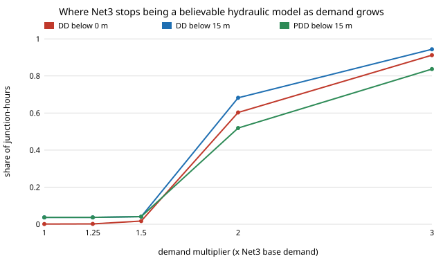

# infra-leakpdd: does demand-driven simulation mislead leak detection when a water network is stressed, and where does pressure-driven demand help?

Track 21 (`infra`), a follow-up to [`infra-waterloss`](../infra-waterloss) (its "Next steps", item 4: pressure-dependent demand). That project simulated leaks on EPANET's Net3 with WNTR's default demand-driven (DD) model, where every junction receives its full demand whatever the pressure. In a real main a leak lowers pressure, and low pressure should cut what customers draw, so a detector tuned on DD signals might be tuned on the wrong physics. This asks how big that error is on Net3 and at what demand level it starts to matter. Produced with AI assistance (Claude). Simulated, one network, preliminary.

**Live page:** https://duncan-haywood.github.io/monorepo-projects/research/infra-leakpdd/

**Headline (Net3, WNTR; simulated).** **For leak detection at Net3's own demand, DD versus PDD makes no difference**: with demand at 1.0 and 1.25 times the base, pressures and sensor responses are identical to the three decimals printed (median difference 0.000 m) and leak flows match. At 1.5 times, the 30 sampled leak locations that five pressure sensors can see are the same in both (29 of 30), and the median sensor drop moves from 0.798 m to 0.792 m. **At 2 times and above, neither model is believable**: the pumps run past their rated flow (WNTR warns), the DD run has 60 % of junction-hours below 0 m (down to −186 m, 3 times: −458 m) and a leak there passes 0 % of its design flow, because there is no pressure to push it. PDD (15 m required pressure) caps the damage (minimum −35 m, only 86 % of demand served at 2 times, 62 % at 3 times) but is still below the required pressure at 52 to 84 % of junction-hours. So on this network the answer to "does PDD change the conclusions of `infra-waterloss`" is **no, because its conclusions were drawn where DD and PDD agree**; the cases where they disagree are cases where the network itself cannot deliver the demand.



**Not for operational use.** A model of a textbook network; nothing here was checked against a real utility or sensor. Drinking-water pressure work needs licensed engineers and the operator's approval.

## Builds on
EPANET (Rossman 2000) and its Net3 example as shipped with WNTR 1.5 (Klise, Hart, Moriarty, Haxton et al. 2017, "Water Network Tool for Resilience", US EPA; BSD-3). The pressure-driven demand curve is WNTR's PDD option: demand is zero at the minimum pressure, full at the required pressure and rises between them with a square-root head law, the form of Wagner, Shamir and Marks (1988), "Water distribution reliability: simulation methods", *Journal of Water Resources Planning and Management* 114(3). Leak model: WNTR's orifice-law `add_leak` (discharge coefficient 0.75), as in `infra-waterloss`. The sensor-placement heuristic is that project's greedy rule.

## Method (`src/infra_leakpdd/sim.py`, `experiments/run.py`)
- **Demand level.** Every junction's base demand times a multiplier (1, 1.25, 1.5, 2, 3), 72 hours, hourly, Net3's own daily pattern. The multiplier stands for growth or a peak day.
- **Models.** WNTR's simulator with `demand_model` DD (default) or PDD, minimum pressure 0 m, required pressure 15 m; section C sweeps 10, 15 and 25 m at a multiplier of 2.
- **Leak.** One leak per run, opening at hour 24 and read at hour 48, at 30 junctions chosen with a seeded draw. Its area is fixed from the 2 % size at multiplier 1 (leak flow 2 % of the 691 L/s mean demand at the node's own pressure), so at higher multipliers it is the same hole under changed pressure.
- **Signal.** The pressure drop at the five greedily chosen sensors (253, 15, 10, 143, 225), against the same model without the leak. A location is "covered" if some sensor drops more than 0.5 m.

| Input | Value | Source |
|---|---|---|
| Network, demands, pump curves | Net3 | EPANET example, WNTR 1.5 |
| Required pressure | 15 m (10 and 25 m swept) | assumed planning value; no utility's figure used |
| Leak coefficient | 0.75 | WNTR default, `infra-waterloss` |
| Demand multiplier | 1 to 3 | swept; no growth forecast used |

## Reproduce
```bash
pip install pytest numpy wntr
cd research/infra-leakpdd
python -m pytest -q tests                      # 5 tests
PYTHONPATH=src python experiments/run.py       # about 6 min, one core; writes experiments/results.txt
python experiments/figure.py                   # experiments/pdd.svg
```

## Results (`experiments/results.txt`)
**A, no leak.** Share of junction-hours below 15 m: DD 3.7 %, 3.7 %, 4.1 %, 68 %, 94 % at multipliers 1, 1.25, 1.5, 2, 3; PDD 3.7 %, 3.7 %, 4.1 %, 52 %, 84 %. Served demand under PDD: 100 %, 100 %, 100 %, 86 %, 62 %. DD minimum pressure: −0.7, −2.5, −17, −186, −458 m (a DD solution ignores that negative pressure is not physical).
**B, leak response.** Realised leak flow 1.96 % of demand in both models at 1 and 1.25 times, 1.61 % at 1.5 times; at 2 and 3 times DD gives 0.00 % and PDD 0.89 % and 0.60 %. Sensors see 8, 11, 29, 0 and 0 of the 30 locations under DD at the five multipliers, and 8, 11, 29, 1 and 0 under PDD; the only disagreement is one location at 2 times.
**C.** At 2 times, served demand is 87 %, 86 % and 85 % at required pressures 10, 15 and 25 m, so the required pressure moves it by about two points.

## Limitations
- **One network.** Net3's low-pressure areas are mostly zero-demand nodes, which is why PDD does nothing at base demand. A network with real low-pressure customers at base demand (hilly, intermittent supply) can behave differently; the claim here is for Net3.
- **"No difference" is for the pressure signal at five sensors with no noise.** It does not test detectors, demand error or the false-alarm budget of `infra-waterloss`, which are untouched by this.
- At 2 and 3 times, neither model is validated; the PDD curve and required pressure are assumed, and a stressed network would in practice have pumps added or demand restricted.
- 30 leak locations, one leak size, one hour of reading; the 0.5 m coverage cut is arbitrary and the disagreement counts are small integers.
- PDD in WNTR does not reduce a leak's flow to zero by itself (a leak is an orifice, not a customer demand), which is why PDD leak flow at 2 times is positive while DD is zero; whether a real leak behaves like either is not tested.

## Next steps
1. A network with low-pressure customers at base demand (for example one of WNTR's other bundled networks) so that PDD matters at multiplier 1.
2. Rerun `infra-waterloss`'s detector comparison at the 1.5 multiplier, where the sensor drops are about twice as large, to see whether detection thresholds move.
3. Give the leak a pressure-dependent exponent (leaks in flexible pipes grow with pressure) and compare with the orifice law.

## Outside dependencies
EPANET and WNTR from PyPI; Net3 ships inside WNTR and is not vendored here.
