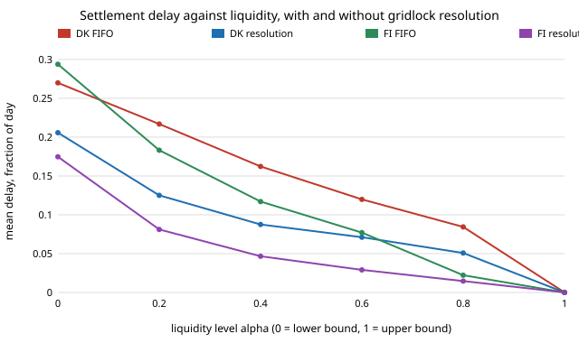

# infra-netting: how much liquidity does a payment system need, and how much do netting and gridlock resolution save?

Milestone 11 of track 21, applied R&D for the industries modern life runs on (`PROJECTS.md`). It simulates a day of a real-time gross settlement (RTGS) system, fits the simulator to the liquidity bounds Bech and Soram&auml;ki (2001) published for the Danish and Finnish systems, and then asks what their gridlock resolution algorithm buys at each liquidity level. Produced with AI assistance (Claude). Simulated payments only; no real accounts, funds or customer data, and not financial advice.

**Live page:** https://duncan-haywood.github.io/oss-monorepo/research/infra-netting/

**Headline.** Payments drawn independently need far more liquidity than real ones, because real flows are reciprocal. Once about 80&ndash;90% of payments are followed by a return payment, a Danish-shaped system (146 banks, 925 payments a day) needs **34.7% of gross value to settle on arrival and 10.1% to settle by close**, against the published 37.2% and 10.7%; a Finnish-shaped one (13 banks, 1,428 payments) needs 23.3% and 4.2% against 27.4% and 4.3%. At those settings bilateral netting leaves 15.6% (DK) and 7.2% (FI) to fund and multilateral netting 10.1% and 4.2%. Gridlock resolution cuts mean settlement delay by **24&ndash;46% in the Danish-shaped system, in line with the paper's "up to 50%"**, but also by 34&ndash;62% in the Finnish-shaped one, where the paper found only about 10%: **a discrepancy this model does not explain** (below).



## Method (`src/infra_netting/model.py`)
- **A day of payments.** Senders and receivers are drawn from Zipf weights 1/k<sup>s</sup>, with *s* set (by bisection) so the three largest banks carry the paper's share of value (about half in Denmark, almost two thirds in Finland); values are lognormal with median 1 and log-sd &sigma;; times are uniform over the day. With **reciprocity** &rho;, a payment is followed later that day by a return payment between the same banks of about the same value (log-sd 0.2). The payment count per day is the paper's average (925 and 1,428).
- **Bounds** (the paper's definitions, section 4.1). Upper bound: the liquidity every bank would need to settle every payment on arrival, the sum of peak net outflows. Lower bound: the liquidity needed to settle all payments by the close, the sum of positive end-of-day net positions. Also bilateral netting: each bank funds the sum of its positive pairwise net positions.
- **Queueing.** Each bank holds liquidity LB<sub>i</sub> + &alpha;(UB<sub>i</sub> &minus; LB<sub>i</sub>) for &alpha; in {0, 0.2, ..., 1} (the paper's six levels; its equation 8 prints in garbled form in the copy read, and I read it as this). A payment is released when the bank's earlier queued payments are gone and the balance covers it. Banks cannot add liquidity during the day. Payments still queued at the close settle at time 1.
- **Gridlock resolution** (Bech and Soram&auml;ki 2001, section 3.3): include every queued payment, then repeatedly remove the last queued payment of any bank whose ex post balance would be negative, and settle what is left. It runs whenever a payment is left queued. A test checks by brute force that its result is feasible and that no feasible prefix of every queue dominates it.
- **Delay measure.** Value-weighted mean time from initiation to settlement, as a fraction of the day. This is **not** the paper's delay indicator (queued value over sent value, per minute); relative reductions are compared, not levels.

### Inputs and where they come from
| Input | Value | Source |
|---|---|---|
| Participants, payments per day | DK 146 and 925; FI 13 and 1,428 | Bech and Soram&auml;ki (2001), section 4.2 (averages over their sample period) |
| Largest-bank share of value | three banks about 50% (DK), about 66% (FI) | same ("almost half", "almost two thirds"); the exact figures are my reading |
| Published bounds to match | UB 37.2% and LB 10.7% (DK); UB 27.4% and LB 4.3% (FI), of gross value | same, Table 1 averages |
| Payment-value spread &sigma; | 1, 2, 3 (2 used) | assumed, swept; the paper's value distribution was not read |
| Reciprocity &rho; | 0 to 1 (0.8 DK, 0.9 FI used) | **fitted** to the LB; not independent evidence |
| Time of day | uniform | assumed; the paper's data are timed and the timing shapes gridlock |

&sigma; and &rho; are two knobs fitted to two numbers per system, so the match of the bounds in section A is calibration, not validation. The held-out comparison is the delay reduction in sections C and D.

## Reproduce
```bash
pip install pytest
cd research/infra-netting
python -m pytest -q tests                       # 7 tests
PYTHONPATH=src python experiments/run.py > experiments/results.txt   # about 40 s
python experiments/figure.py                    # experiments/delay.svg from results.txt
```
Standard library only; seeded, so the results file is reproduced exactly.

## Results (`experiments/results.txt`)
- **A. Reciprocity decides the bounds.** At &rho; = 0 (independent payments) the Danish-shaped LB is 44.5% of gross at &sigma; = 2, four times the published 10.7%; the independent-payment model is therefore a poor stand-in for a payment system. At &rho; = 0.8 it is 10.1%. Over &sigma; = 1 to 3 and &rho; = 0.5 to 1 the UB runs 22&ndash;53% and the LB 2.7&ndash;28% (DK), so the match depends on both knobs; no single pair is forced by the data. At &sigma; = 1 no &rho; of 0.5 or more reaches the published UB (it tops at 26%), so a heavier tail than &sigma; = 1 is needed.
- **B. Netting.** DK: 100% gross, 15.6% bilateral, 10.1% multilateral, 34.7% to settle on arrival; FI: 7.2%, 4.2% and 23.3%. Bilateral netting captures about 94% (DK) and 97% (FI) of the gross-to-multilateral reduction here; multilateral netting takes a further 35% (DK) and 42% (FI) off the bilateral figure. These ratios follow from the fitted &rho; and are not published numbers.
- **C. Danish-shaped delay.** Mean delay with a FIFO queue falls from 0.270 of a day (&alpha; = 0) to 0.084 (&alpha; = 0.8) and 0 at the upper bound. Resolution cuts it by 23.8%, 42.3%, 46.1%, 40.6% and 39.9% at &alpha; = 0, 0.2, 0.4, 0.6, 0.8. At &alpha; = 0 FIFO leaves 78% of value unsettled at the close and resolution 0%. Consistent with "up to 50%".
- **D. Finnish-shaped delay.** Cuts of 40.6%, 55.7%, 60.2%, 62.2%, 34.3%, larger than the Danish ones, with the same 0% unsettled under resolution. **The paper reports the opposite ordering and about 10% at low to moderate liquidity.** Reported here as a discrepancy, not an error by the authors. Candidate causes, none tested: strict FIFO queues (head-of-line blocking is harsher than a system that lets banks reorder); my uniform timing and perfectly reciprocal pairs, which create many exploitable cycles among only 13 banks; the Finnish banks' extra TARGET liquidity the paper mentions; and a different delay measure.
- **E. Value spread.** At &alpha; = 0.2 the Danish-shaped cut is 27.4%, 42.3% and 45.4% for &sigma; = 1, 2, 3: resolution helps more when a few large payments dominate.

## Limitations
- **The simulator is fitted, not derived.** Section A is calibration; reciprocity, the value distribution and time of day are all modelled, not the paper's data. Treat the DK match of the delay cut as suggestive, and the FI mismatch as a sign the model misses structure.
- **FIFO, no reordering, no liquidity top-ups, no behaviour.** Banks do not change when they pay as liquidity falls; the paper has the same limit and says it may overstate queuing.
- **Delay is not the paper's indicator.** Compare shapes and relative reductions only.
- **Sizes were not read.** I did not obtain the paper's payment-value distribution, so &sigma; is swept; the Zipf share targets are readings of "almost half" and "almost two thirds".
- **Not financial, legal or operational advice**, and no real payment system was touched.

## Next steps
- Obtain a public payment-size distribution and intraday timing profile (for example from a central bank's published statistics) and fit &sigma; and the timing instead of assuming them.
- Test the Finnish discrepancy by letting banks reorder their queues, then by replacing the reciprocal-pair generator with a network-based one.
- Add a liquidity-saving mechanism (offsetting at a schedule, as in modern RTGS designs) and a bank-behaviour layer.

## Outside dependencies
None: standard library for the code, pytest for the tests. Reference: Bech, M. L. and Soram&auml;ki, K. (2001), *Gridlock resolution in interbank payment systems*, Bank of Finland Discussion Paper 9/2001, [publications.bof.fi/handle/10024/47308](https://publications.bof.fi/handle/10024/47308); its figures were read from the PDF on 2026-10-21. No CU Boulder group's work is built on.
