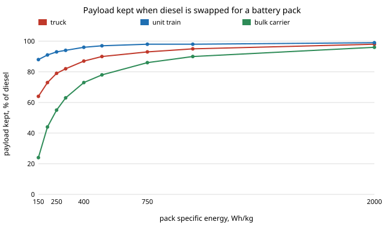

# infra-propulsion: which freight modes can run on batteries or hydrogen, and what does it cost in payload? Energy per tonne-km from first principles for trucks, trains, ships and freight aircraft

Milestone 4 of track 21, applied R&D for the industries modern life runs on (`PROJECTS.md`). It asks how much energy each freight mode needs per tonne-km when only physics sets the answer (rolling resistance, air drag, hull drag, lift-to-drag), then swaps the diesel or jet fuel for a battery pack or hydrogen at the same gross mass and range and reports how much payload is left. Produced with AI assistance (Claude).

**Live page:** https://duncan-haywood.github.io/monorepo-projects/research/infra-propulsion/

**Headline.** At a pack specific energy of 250 Wh/kg a long-haul truck (800 km) keeps **79%** of its diesel payload, a unit train (1,500 km) **93%**, a Panamax bulk carrier (20,000 km) **55%**, and a 747-class freighter (8,250 km) cannot fly the route at all: with every spare kilogram as battery its range is **669 km**. The pack specific energy that keeps 90% of the diesel payload is about **510 Wh/kg for the truck, 180 for the train, 990 for the ship and 5,600 for the aircraft**. Compressed hydrogen at 700 bar (5% system mass fraction, an assumed figure) keeps 95%, 98% and 90% for truck, train and ship but still cannot fly the aircraft route (3,765 km at zero payload); liquid hydrogen (25%, assumed) keeps 90% of the payload on the aircraft. The ordering by mode, aircraft far behind ship, truck and train, survives every input sweep in section E; the numbers move by a factor of two to four with design range.



## Method (`src/infra_propulsion/model.py`)
- **Force balance.** Each mode gives the tractive force at gross mass *m* and cruise speed. Truck: *C*<sub>rr</sub> *m g* + &frac12; &rho; *C*<sub>d</sub>*A* *v*<sup>2</sup>. Train: Davis (1926) per-car resistance 1.3 *W* + 29 *N* + 0.045 *W V* + 0.0005 *A V*<sup>2</sup> (lb, *W* short tons, *N* axles, *V* mph), aerodynamic term in full on the lead car and 12% on each trailing car. Ship: the Admiralty law *P* = &Delta;<sup>2/3</sup> *v*<sup>3</sup> / *C*, force = *P*/*v*. Aircraft: *W* / (*L*/*D*).
- **Store and chain.** A carrier has a system specific energy (J per kg of the whole store, tank or pack included) and an energy-to-work efficiency per mode. Fuels lose mass as they burn (integrated in 400 steps); batteries do not.
- **Storage swap.** At fixed gross mass *M*<sub>0</sub> and structure mass, bisect for the smallest store that reaches the design range; payload is what is left (capped by the zero-fuel-weight limit for the aircraft). Batteries use 90% of their capacity. No allowance is made for reserves, climb, grades or stops, so every range is a ceiling.
- **Fixed structure.** The non-store, non-payload mass is the same for every carrier. A battery truck's lighter drivetrain, or a hydrogen aircraft's heavier fuselage, are not modelled.

### Inputs and where they come from
| Input | Value | Source |
|---|---|---|
| Truck gross mass | 37,195 kg (82,000 lb) | US federal gross limit; Tesla Semi rated at 82,000 lb GCW (electrive, Feb 2026) |
| Truck *C*<sub>rr</sub>, *C*<sub>d</sub>*A* | 0.0065, 5.4 m<sup>2</sup> diesel; 0.0045, 3.6 m<sup>2</sup> for the Semi check | assumed, swept (0.0040&ndash;0.0080, 3.6&ndash;6.5) |
| Truck structure mass | 15,000 kg | assumed (typical empty tractor-trailer); swept via range |
| Truck speed | 90 km/h; 65 mph for the Semi check | assumed; Semi 500-mile demonstration at about 65 mph is not confirmed here |
| Train | 9,100 t gross, 100 cars of 91 t, 50 mph, 2,840 t structure (27% car tare plus two locomotives) | assumed; Davis constants as recalled from standard texts, not checked against the 1926 paper |
| Ship | &Delta; = 91,000 t, lightship 14,000 t, 14 kn, *C* = 600 | assumed Panamax values; *C* swept 500&ndash;700; no source retrieved |
| Aircraft | MTOW 396.9 t; OEW 160.4 t; payload cap 118 t; *L*/*D* 17 | MTOW and payload from 747-400F listings (aerocorner, airport-technology; sources disagree on OEW, 158&ndash;169 t, and payload, 118&ndash;124 t); *L*/*D* assumed, swept 15&ndash;19 |
| Lower heating values | diesel 42.8, jet 43.2, H<sub>2</sub> 120, NH<sub>3</sub> 18.6 MJ/kg | standard values, assumed |
| Chains (fuel to work) | diesel 0.40 truck, 0.34 rail, 0.48 ship; jet 0.38 overall; battery 0.88, 0.85, 0.90, 0.80; fuel cell 0.46, 0.44, 0.45, 0.40 | assumed; the Semi check tests only the 0.88 battery figure |
| Pack specific energy | 150&ndash;2,000 Wh/kg swept | `research/energy-density` for the ceilings; no pack-level source retrieved this run |
| H<sub>2</sub> and ammonia system fractions | 5% (700 bar), 25% (liquid), 90% (ammonia) | assumed; `energy-density` gives an ideal 700-bar sphere at 41% |

## Reproduce
```bash
pip install pytest
cd research/infra-propulsion
python -m pytest -q tests                       # 9 tests
PYTHONPATH=src python experiments/run.py        # under a second; writes experiments/results.txt
python experiments/figure.py                    # experiments/payload.svg from results.txt
```
Standard library only.

## Results (`experiments/results.txt`; deterministic)
- **A. Physical floor, fuel-fed, loaded one way (cruise only).** Fuel energy per net tonne-km: truck 0.50 MJ (139 Wh), train 0.10 (28), bulk carrier 0.035 (9.8), freighter 4.4 MJ (1,229 Wh). The work at the wheels, shaft or wing is 0.20, 0.035, 0.017 and 1.68 MJ/tkm. Truck to ship is a factor of 14 and ship to aircraft a factor of 125.
- **B. Checks against published figures.**
  - *Battery truck.* Semi-like inputs give 1.76 kWh/mile against the rated 1.7: +4%. The inputs (*C*<sub>rr</sub>, *C*<sub>d</sub>*A*, speed, 0.88 efficiency) are all assumed, so the agreement shows the force balance is the right shape, not that the inputs are measured.
  - *Diesel truck.* 7.6 mpg as a steady-state floor against fleet reports of 5.5&ndash;6.5 mpg and SuperTruck demonstrators at 10.7&ndash;12.2. A floor above the fleet average and below the demonstrators is the expected place.
  - *Rail.* 0.102 MJ/tkm loaded one way and 0.135 with an empty return, against 0.220 MJ/tkm from the Federal Highway Administration's 305 Btu per short ton-mile (Class I, 2009): the model is 0.46 and 0.61 of the published figure. The missing share is grades, starts and stops, idling and lighter trains, none of which is modelled and none of which can be separated here.
  - *Freighter.* Breguet cruise range with 118 t of payload and 118 t of fuel is 9,401 km, 1.14 times the 8,250 km one listing gives for the 747-400F (another lists 5,760 km; the variants differ). Reserves, climb and descent explain a gap of this size, but the listing was not checked against Boeing's document.
- **C. Payload kept (% of diesel).** The table in `results.txt`. At 250 Wh/kg: truck 79, train 93, ship 55, aircraft infeasible. 700-bar H<sub>2</sub>: 95, 98, 90, infeasible. Liquid H<sub>2</sub>: 100, 100, 99, 90. Ammonia: 99, 99, 98, 23.
- **D. Break-even pack specific energy for 90% of the diesel payload.** Truck 511, train 183, ship 992, aircraft 5,593 Wh/kg; for 50%: 110, 50, 225, 4,106.
- **E. Sensitivity.** Truck 412&ndash;569 over the *C*<sub>rr</sub> range and 329&ndash;737 over 500&ndash;1,200 km. Ship 275&ndash;1,396 over 5,000&ndash;30,000 km and 541&ndash;1,246 over 10&ndash;16 kn. Aircraft 1,356 at 2,000 km, 5,593 at 8,250 and 6,881 at 12,000. Range matters more than any drag input; the mode ordering never changes.

## Limitations
- **Floors, not fleets.** No grades, acceleration, idling, weather, reserves or empty returns except in the rail check. Real energy per tonne-km is higher, as the rail and diesel truck checks show (rail by roughly a factor of two).
- **Most inputs are assumed.** Only the Semi's rated consumption and weight, the FHWA rail figure, the truck mpg range and the 747 mass listings were retrieved, and the 747 range listings disagree. The ship Admiralty constant, Davis constants, drag areas, efficiencies and hydrogen system fractions are not from a source; sections D and E sweep the ones that matter most, not all.
- **Fixed structure mass.** Electric and hydrogen drivetrains and tanks are lighter or heavier than the diesel ones they replace; this is ignored. The battery aircraft and the liquid-hydrogen aircraft would need new airframes.
- **Payload by mass only.** Volume limits (a 700-bar tank or a battery pack in a trailer or a hold) and the cost of cargo displaced are not modelled; bulk cargoes fill by mass, containers and air cargo by volume.
- **No charging, cost, life or emissions.** Charging time and power, cost per tonne-km and the carbon of the electricity or hydrogen are not addressed.
- **Not engineering advice.** Not a design basis for any vehicle, vessel or aircraft.

## Next steps
- Source the pack and tank system specific energies (Li-ion packs in production trucks, DOE hydrogen tank targets) and replace the swept values with cited ones.
- Add cost per tonne-km on a time-of-use tariff, joining track 21's `infra-routing` milestone and track 16's `energy-tou`.
- Replace the idealised rail resistance with a grade-and-stop profile to close the factor-of-two gap to the FHWA figure.
- Check the Admiralty constant and the 747 range against a primary source (Boeing airport planning document, the Fourth IMO GHG Study annexes).

## Outside dependencies
None: standard library for the code, pytest for the tests. Published figures are cited from public web pages checked on 2026-10-21; they are listed in the inputs table, and no CU Boulder group's work is built on.
