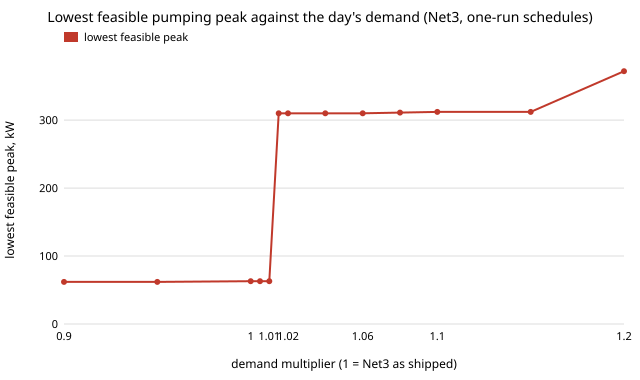

# infra-pumpdays: how much of a pump-scheduling saving survives when one hot day sets the month's demand charge?

Track 21 (`infra`), the second next step of [`infra-pumpdemand`](../infra-pumpdemand/). That project billed Net3 pump schedules on PG&E's B-19 tariff with every day identical and found that schedules idling the 310 kW booster cut the bill 56 to 67 %. A demand charge is billed on the highest 15-minute kW of the **month**, so this one asks what one high-demand day does to that saving. Produced with AI assistance (Claude).

**Live page:** https://duncan-haywood.github.io/monorepo-projects/research/infra-pumpdays/

**Headline (simulated Net3, B-19 list prices; not a field result).** The saving is fragile to demand headroom. With every Net3 demand 1.5 % above its shipped level, the lowest feasible peak among one-run pump-10 schedules jumps from **63 kW to 310 kW** (the booster pump), and at +20 % it is 372 kW, the same as the shipped schedule's 373 kW. So one such day sets the month's demand charge: a month with **three days at +20 %** saves **43.5 % in summer and 18.7 to 19.2 % in winter and spring** against the shipped schedule on the same month, where identical days saved 56, 66 and 67 %. At +40 % the saving is 1 to 15 %, and at +60 % no schedule (the shipped one included) meets the tank test. Running a different schedule on the hot days than on ordinary days adds at most 4.2 points over one schedule that is feasible on every day.



## Method
- **Network, schedules, feasibility, step:** exactly as `infra-pumpdemand` (Net3 through WNTR 1.5, pump 10 on an hourly mask repeated daily, every mask with at most two cyclic on-runs, 21,806; 900 s step; tanks at least 0.5 m above minimum, 20 psi, tanks back to within 0.1 % of the day's demand). The only change is `build(mask, mult)` in `src/infra_pumpdays/net.py`, which multiplies every junction's base demand by `mult` (Net3's 24-hour demand pattern keeps its shape). At `mult` = 1 the shipped schedule reproduces `infra-pumpdemand` (pump 10 869 kWh, pump 335 1,703 kWh a day; tested).
- **Day types:** all 21,806 masks simulated at `mult` 0.8, 1.0, 1.2, 1.4 and 1.6 (`experiments/simulate_days.py`; the caches are not committed, about 10 minutes each on 4 cores).
- **Months** (`experiments/run_month.py`, section B): 30 days, the rest at 1.0 and *k* = 1, 3 or 10 at the hot multiplier. Energy is the days' mean scaled to a 365/12-day month; each B-19 demand charge is its rate times the highest 15-minute kW *of the month* in its period (the tariff and its source are `infra-pumpdemand`'s, copied in `src/infra_pumpdays/tariff.py`). Four policies: the shipped schedule every day; one schedule feasible on every day (cheapest over all masks); the cheapest average-day schedule every day (flagged where it fails on the hot day); and one schedule per day type (best pair over each type's 300 cheapest feasible masks).
- **Threshold scan** (`experiments/threshold.py`): the 554 one-run schedules (plus off and 24 h) at multipliers 0.90 to 1.20, lowest feasible peak at each.
- **Where the multipliers come from.** They are a sweep, not a measured distribution. Planning documents quote a maximum-day to average-day ratio of roughly 1.2 to 2.5 for water systems (for example the [North Reading, MA water supply needs analysis](https://www.northreadingma.gov/water-division/files/section-4), which also reports a town ratio of 1.53 to 1.79 over six years); those figures are an annual maximum over an average, not a within-month spread, and I did not verify them against a primary source, so the grid 0.8 to 1.6 is chosen to cover the range, and the finding is stated as a function of it.

## Results (`experiments/results.txt`, `experiments/results_threshold.txt`; deterministic)
- **A. One day at a time** (all masks, 0.1 % drift): demand 47,741, 59,676, 71,611, 83,546, 95,481 m³ a day at 0.8 to 1.6; shipped schedule 840, 2,573, 5,753, 8,299, 8,241 kWh, peak 62, 373, 373, 373, 371 kW; feasible masks 14,270, 17,536, 18,230, 713, 0; lowest feasible peak 61, 63, 372, 373 kW and none at 1.6.
- **Threshold.** One-run schedules, lowest feasible peak: 62 kW at 0.90 and 0.95, 63 kW at 1.000, 1.005 and 1.010, **310 kW from 1.015**, 311 to 312 kW to 1.15, 372 kW at 1.20. Its energy rises with it (1,429 kWh a day at 1.00, 2,128 at 1.015, 7,150 at 1.20).
- **B. Months** (examples, "a schedule per day type" vs the shipped schedule on the same month): summer 3 days at 1.2 $24,533 vs $43,450 (−43.5 %), at 1.4 $43,086 vs $44,388 (−2.9 %); winter 3 days at 1.2 −18.7 %, at 1.4 −13.8 %; spring −19.2 % and −14.2 %. All the policies peak at 373 kW (371 to 372 where the shipped schedule is infeasible) once a hot day is in the month. Ten hot days instead of one barely moves the percentage saving; it is the single worst day that matters.
- **Comparison with identical days** (`infra-pumpdemand`): saving 56 % summer, 66 % winter, 67 % spring.

## Reproduce
```bash
pip install pytest numpy wntr matplotlib
cd research/infra-pumpdays
python -m pytest -q tests                                                  # 5 tests
PYTHONPATH=src python experiments/simulate_days.py 1.0 1.2 1.4 0.8 1.6     # ~50 min on 4 cores; writes cache_<m>.npz (not committed)
PYTHONPATH=src python experiments/run_month.py > experiments/results.txt   # a few minutes
PYTHONPATH=src python experiments/threshold.py > experiments/results_threshold.txt   # ~6 min
python experiments/figure.py                                               # experiments/peak.svg
```

## Limitations
- **Each day is simulated as periodic** (three days at one multiplier, the last scored, tanks required back within 0.1 % of that day). A real hot day can start with tanks topped up by a quiet day and borrow from the next one; that would lower the booster need and the peak. The 1.6 result (no feasible schedule) and the +1.5 % threshold are partly this constraint: they say the *periodic* day does not close, not that Net3 cannot supply the water. Re-running with tank carry-over between days is the obvious next step.
- **The +1.5 % threshold is for one-run schedules** and the 0.1 % tolerance; section A (all two-run masks) has only the 1.0, 1.2, 1.4 and 1.6 points. At +1.5 % a free-form schedule might still avoid the booster.
- **Multipliers scale all demands together** and keep Net3's pattern shape; real hot days shift the peak hour and the outdoor share.
- **The shipped schedule is infeasible at 1.4 and above**, so "vs shipped" there compares against a schedule that does not hold the tanks; the policy-to-policy differences are the more reliable numbers.
- Everything in `infra-pumpdemand`'s limitations carries over: B-19 is not a tariff a utility this size is on, one teaching network, list prices without riders or taxes, no pump start-up limits. Nothing here is operating advice; pumping affects drinking-water pressure and supply.

## Builds on
[`infra-pumpdemand`](../infra-pumpdemand/) and [`infra-pumpsched`](../infra-pumpsched/) (schedule family, feasibility test, tariff); EPANET (Rossman 2000) and Net3 through WNTR 1.5 (Klise et al. 2017, US EPA; BSD-3); PG&E Electric Schedule B-19 (tariff book, as cited there). No CU Boulder group's work is reproduced and no connection is claimed.

## Next steps
1. Carry tank levels from day to day through a month of sampled demand (a weather-driven daily series) instead of periodic days, and check whether the threshold survives.
2. All two-run and free-form masks at 1.00 to 1.05, to locate the real threshold.
3. A second network whose booster is not the dominant load, billed on a municipal-scale tariff.

## Outside dependencies
EPANET and WNTR from PyPI; the B-19 rates are PG&E's public tariff book values (see `infra-pumpdemand`), not vendored.
