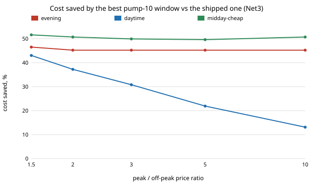

# infra-pumpsched: when should a water utility run its lake pump, and how much of the saving is the tariff?

Track 21 (`infra`), a new milestone beyond the twelve listed in [`PROJECTS.md`](../PROJECTS.md): pump scheduling on a time-of-use tariff, on EPANET's Net3 through WNTR (the same network as [`infra-waterloss`](../infra-waterloss/)). Pumping is one of the largest energy costs of a water utility, and moving pump hours out of peak-price hours is the textbook lever. This project runs the hydraulics rather than assuming the saving, and finds that on Net3 most of a large apparent saving is not the tariff at all. Produced with AI assistance (Claude).

**Live page:** https://duncan-haywood.github.io/monorepo-projects/research/infra-pumpsched/

**Headline (simulated Net3, assumed tariff shapes with a swept price ratio; not a field result).** Net3 ships with pump 10 (the lake source) running 01:00 to 15:00. Searching every daily window (409 start and duration pairs, plus 21,806 hourly schedules below) that keeps the tanks in range and periodic, **running pump 10 for 21 hours from 01:00 cuts pumping energy by 52 % (2,728 to 1,307 kWh a day) at a flat tariff.** The reason is Net3's own source mix: the river supplies about 50,000 of the 59,700 m<sup>3</sup> daily demand mostly by gravity through pipe 330, and booster pump 335 runs only when tank 1 is low (6 hours a day as shipped, 1 hour in the best window). More lake pumping keeps tank 1 full and idles the booster. **That saving needs no tariff.** What the tariff adds on top, over the flat-optimal window, depends on the price ratio and shape: for a 16:00 to 21:00 peak, 3.3 % at ratio 1.5, **15.8 % of the shipped cost at ratio 3**, and 95 % at ratio 10 (where the flat-optimal window would cost 1.5 times the shipped one, because it puts 24 % of its energy in the peak). For an 08:00 to 20:00 peak, 3.1 %, 12.1 % and 39.2 % at ratios 1.5, 3 and 10. For a midday-cheap shape, 1.5, 5.2 and 15.9 %. Minimum service pressure never binds (25.6 m or more in all 21,806 schedules simulated against a 14 m floor), nor does the tank range (3.9 m or more above the minimum); the only constraint that ever excludes a schedule is the daily balance (742 of 21,806).

**Hourly schedules (new, `run_hourly.py`).** Letting pump 10 switch on and off in any hours of the day, not one window, adds almost nothing. Over every schedule with at most two runs of on-hours (one or two windows a day; exhaustive, 21,806 EPANET runs), a second window saves **0.0 to 0.02 % of shipped cost for 8 of the 10 tariffs**, and 9.5 % for the daytime peak at ratio 10 and 1.2 % for midday-cheap at ratio 10, where the optimum drops the long daytime run. A genetic algorithm and a local search over all 2<sup>24</sup> hourly masks (600 EPANET runs each) beat that two-window optimum by 0 to 4 points of shipped cost, but **the tank-drift tolerance is where most of that comes from**: all but one of the winners end the scored day with the tanks 0.6 to 1 % of daily demand lower, which is pumping owed tomorrow. Pricing that drawdown at pump 10's own 83 Wh/m<sup>3</sup>, the gain over the two-window optimum falls to roughly 0 to 1.3 points, except for midday-cheap at ratio 10 (43.7 to 44.4 against 46.1, in 2 of 3 seeds; the third is worse at 49.0). In other words: on Net3 nearly all of the saving is the choice of *how long* to run the lake pump, and a one-window search finds it.

**Step size matters for windows that use the booster (new, `step_check.py`).** Every number below was computed at EPANET's 1-hour step. Pump 335 and pipe 330 switch on tank 1's level inside the hour, and one sample an hour mis-integrates them. At a 900 s step the shipped schedule uses **2,573 kWh, not 2,728 (pump 335 1,703 kWh, not 1,859), so the flat-tariff saving of the 21-hour window is 49 %, not 52 %.** The 1,307 kWh of the booster-free long windows does not change. Windows that still run the booster move by up to 15 % between 3600 and 900 s and by 3 % more between 900 and 300 s (`results_step.txt`), so the cost of those windows, and with them the tariff-dependent comparisons, are step-sensitive; they have not been re-run at 900 s.

**Correction to the first version of this project.** The window builder did not close a window that crosses midnight on day one, so any such window was simulated with its first day running long and tanks that had not settled by the scored day. The shipped-window numbers and the 52 % are unchanged; the tariff-dependent results above were re-run (they had said 0.1 %, 8.6 %, 33.9 % and 0, 1.1 %, 13.8 %, and 346 of 409 windows feasible rather than 384).



**Builds on.** EPANET (Rossman 2000) and Net3 as bundled with WNTR 1.5 (Klise et al. 2017, "Water Network Tool for Resilience", US EPA; BSD-3), pump energy from WNTR's `pump_energy`. Pump scheduling on time-of-use tariffs is a long-studied problem (for example Lansey and Awumah 1994, *J. Water Resources Planning and Management*, and Mala-Jetmarova, Sultanova and Savic 2017, "Lost in optimisation of water distribution systems?", *Environmental Modelling and Software*; neither was re-read for this project, they are named as the field, not reproduced). Method transfer (track 21): none; this is a grid search over a one-window schedule, the simplest possible baseline. No CU Boulder group's work is reproduced and no connection is claimed.

## Method (`src/infra_pumpsched/sched.py`)
- **Network.** Net3 unchanged except pump 10's time controls, which are removed and replaced by one daily window (start hour 0 to 23, 6 to 22 hours, or on all day). Pump 335 and pipe 330 keep their tank-1 level controls. Pump 10's controls come from an hourly 24-bit mask repeated daily (`build_mask`); a window is a mask. Three days are simulated with EPANET's solver at a 1-hour step; the **last day is scored**, and the first two let the tanks settle.
- **Feasible** means, over days 2 and 3: every tank stays at least 0.5 m above its minimum level, the three tanks' net volume change over the scored day is within 1 % of that day's demand (so energy is not saved by draining storage), and the lowest pressure at any demand junction is at least 14.06 m (20 psi; swept to 20 and 25 m, which changes nothing, see above). 384 of 409 windows are feasible.
- **Energy** is `wntr.metrics.economic.pump_energy` at Net3's global 75 % efficiency, summed over pumps 10 and 335, in kWh per hour.
- **Tariffs are assumptions** (no tariff was reachable and sourced here): `evening` peak 16:00 to 21:00, `daytime` peak 08:00 to 20:00, `midday-cheap` (cheap 10:00 to 16:00, dear 17:00 to 21:00, a shoulder of the square root of the ratio otherwise), off-peak price 1 and the peak to off-peak ratio swept over 1.5, 2, 3, 5, 10. Cost is energy times relative price; no demand charge, no fixed charge.

### Hourly schedules (`src/infra_pumpsched/hourly.py`)
- **Not a MILP.** The hydraulics are EPANET's nonlinear solve (tank levels feed back into pump 335's controls), so each schedule is one black-box simulation (0.035 s). The next-steps suggestion of a MILP would need a linearised tank model; this is search instead.
- **Exhaustive two-run grid.** Every mask with at most two cyclic runs of on-hours: 2 + 2&middot;C(24,2) + 2&middot;C(24,4) = 21,806, simulated once and priced under every tariff. 554 of them are the earlier one-window grid (plus all-off), and its optimum is recovered from the same set.
- **Searches.** A first-improvement local search (single and adjacent flips, a 3-flip kick when stuck) from the best window, and a genetic algorithm (population 24, tournament 3, uniform crossover, 1/24 mutation, elitism) from random masks. Same constraint handling: a penalty on the violation. 600 fresh EPANET runs and 3 seeds per tariff; small budgets and seeds, so ranks between the two searches mean little.
- **Drift check (`drift_check.py`).** Reports each winner's tank drift and its cost with the drawdown priced at pump 10's marginal energy per m<sup>3</sup> times the tariff's mean price (a rough price, not a model of tomorrow's schedule).

### Checks (`tests/`, 13)
The shipped window reproduces Net3's controls (14 hours on from 01:00); the lake pump delivers less than demand and the tanks do not drift by more than 1 %; the energy of an hour of pump 10 matches P = &rho;gQH/&eta; with the head read off the pump's published three-point curve, within 5 %; a 24-hour window runs all day; a longer lake window reduces booster energy; the tariff shapes; a flat tariff's cost is its energy. The mask builder reproduces the window builder for the shipped window and for a midnight-crossing window; the mask enumeration count is 21,806 as counted by hand; the feasibility test and the penalty agree; the searches never return worse than their seed. Mass balance over the scored day leaves a gap of about 1 % (river plus lake outflow 60,273 m<sup>3</sup> against 59,676 m<sup>3</sup> junction demand and 16 m<sup>3</sup> of tank change) that I did not trace.

## Reproduce
```bash
pip install pytest numpy wntr matplotlib
cd research/infra-pumpsched
python -m pytest -q tests                        # 13 tests
PYTHONPATH=src python experiments/run.py > experiments/results.txt   # about 25 s
python experiments/figure.py                     # experiments/saving.svg
PYTHONPATH=src python experiments/run_hourly.py > experiments/results_hourly.txt   # about 10 min on 4 cores (1,300 s of EPANET), caches experiments/masks_cache.json (19 MB, not committed)
PYTHONPATH=src python experiments/drift_check.py > experiments/results_drift.txt
```

## Results (`experiments/results.txt`; deterministic)
- **A.** As shipped: 2,728 kWh a day (pump 10 869, pump 335 1,859); pump 10 delivers 10,468 m<sup>3</sup>; minimum service pressure 27.3 m.
- **C.** Flat tariff: the least-energy feasible window is 01:00 for 21 h, 1,307 kWh (52.1 % less); the worst feasible window uses 3,904 kWh.
- **D.** Best feasible window per tariff and ratio, cost saved against the shipped window: evening 49.7 % at ratio 1.5, 47.5 % at 2 and 45.2 % at 3 to 10 (best window starts 21:00, 19 to 21 h); daytime 46.1 % at 1.5, 34.3 % at 3, 18.4 % at 10; midday-cheap 52.8 to 53.9 %. The "of which kWh saved" column splits out the part that is pure energy.
- **E, H.** The shipped schedule already puts 0 % of its energy in 16:00 to 21:00 and 16 % in 08:00 to 20:00; the flat-optimal one puts 24 % and 57 %.
- **G.** Extra saving from knowing the tariff, beyond the flat-optimal window, as a share of shipped cost: see the headline.
- **Hourly (`results_hourly.txt`, `results_drift.txt`).** Section B: best one-window against best two-window cost as a percentage of shipped cost, for ten tariffs; section C: the two searches against the two-window optimum. The drift file lists, for the cases where the search won, its tank drift and drift-priced cost.

## Limitations
- **One network.** The two-window grid is exhaustive, the free-form search is not (600 runs of 16.8 million masks), so the claim is that a second window and the searches found little, not that nothing better exists.
- **Drift tolerance.** The 1 % daily balance lets a schedule borrow up to about 600 m<sup>3</sup> from the tanks, about 50 kWh of pump 10 energy, 3 to 4 % of a good day; the free-form comparison is read through the drift-priced column for that reason.
- **One window per day in the headline.** Net3 is a teaching network with an unusual gravity river source; the 52 % is a property of its source mix and controls, not of water utilities. A real scheduler would use several windows, variable-speed pumps and tank trajectories (the optimisation literature above).
- **Tariffs are assumed shapes**, and there is no demand charge; a demand charge would penalise the long, high-flow windows.
- **Demand is Net3's own pattern**, one repeated day; no forecast error.
- **The scored day is periodic only to 1 %**, and the unexplained 1 % mass-balance gap above applies.
- **Safety-critical designs are research.** Pump operation affects drinking-water pressure and supply; nothing here is operating advice, and no real utility system was touched.

## Mass balance (the 1 % gap, traced)
At the 3600 s step the scored day's river plus lake outflow is 60,273 m<sup>3</sup> against 59,676 m<sup>3</sup> of junction demand and 16 m<sup>3</sup> of tank change: a 598 m<sup>3</sup> gap, exactly the sum of the three tanks' sampled flows. The tank levels barely move, so those flows are a sampling artefact, not water: hourly samples of a flow that switches inside the hour. At 900 s the gap is 37 m<sup>3</sup> (12 m<sup>3</sup> of drift) and at 300 s 38 m<sup>3</sup> (11 m<sup>3</sup>). A test pins this (`test_sub_hourly_step_closes_mass_balance`). Run: `PYTHONPATH=src python experiments/step_check.py > experiments/results_step.txt` (about 10 s).

## Next steps
1. A sourced tariff and a demand charge (a demand charge penalises the long windows found here, and the hourly masks may then beat one window).
2. Make the schedule truly periodic (a terminal tank-level constraint in place of the 1 % drift tolerance), so the search cannot borrow from tomorrow; the drift check shows that is where the free-form gain sits.
3. Re-run the window grid and the hourly search at a 900 s step (`simulate(..., step=900)`), which the step check shows is needed for any schedule that runs the booster.
4. Variable-speed pumps and a second network.

## Outside dependencies
EPANET and WNTR (installed from PyPI); no tariff or utility data.
