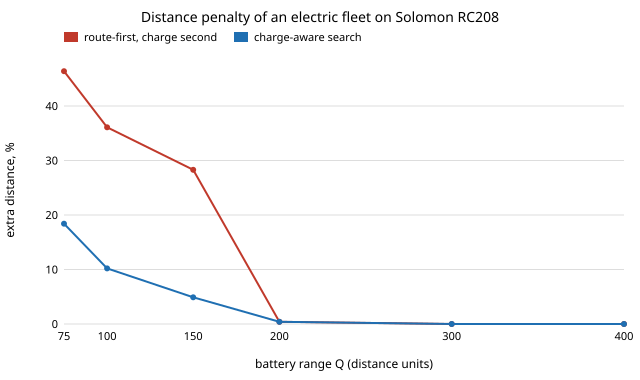

# infra-routing: how much longer does an electric delivery fleet's plan get once the battery and chargers count, and does a charge-aware search recover it? Solomon RC208 with a battery

Milestone 5 of track 21, applied R&D for the industries modern life runs on (`PROJECTS.md`). Delivery fleets are electrifying, and routing software built for diesel vans ignores range. This project takes the real Solomon RC208 VRPTW instance, solves it battery-blind with a strong solver (PyVRP), then asks what it costs to make that plan electric: first the cheap way (keep the routes, add charging stops, split routes that cannot be charged), then with a local search that judges every move by the exact charging plan. Why it seemed the right next step: the milestone asked for EVRPTW against published solutions, and the published instances were unreachable, so this measures the same question on an instance I could get. Produced with AI assistance (Claude).

**Live page:** https://duncan-haywood.github.io/monorepo-projects/research/infra-routing/

**Headline (one instance, assumed battery).** Battery-blind, RC208 is 4 routes and **778.93** distance (equal to the best-known Solomon distance as I recall it, not re-checked). With a battery of range Q and five stations plus the depot, recharge time 0.3 per unit of range: Q = 300 costs **0%** extra, Q = 200 **0.4%**, but at Q = 150 route-first/charge-second costs **28%** more distance (6 routes), at 100 **36%** (8 routes) and at 75 **46%**. A charge-aware iterated local search, 60 s from that start, cuts those to **4.9%, 10.2% and 18.4%**. Slower charging (g = 1.0 at Q = 150) leaves **11%** after search, only 2 stations **11.7%**, 10 stations **3.4%**. So ignoring the battery is harmless at ranges of 200 and above here (the battery-blind routes are about 195 long each), and costly below, and most of that cost is a planning artefact that a search aware of charging removes.



## Method
- **Instance** (`data/RC208.vrp`): Solomon (1987) RC208, 100 customers, capacity 1000, service 10, horizon 960, Euclidean float distances, as distributed in the PyVRP test data (MIT; the instance itself is a standard benchmark).
- **Battery-blind baseline** (`experiments/baseline.py`): PyVRP, 60 s, seed 0; coordinates and times scaled by 100 and rounded because PyVRP is integer (its own float-to-int "none" rounding truncates and gives a wrong 766, so it is not used). Routes saved in `data/baseline_routes.json`.
- **Electric additions** (mine, not in any file): 1 unit of range per unit of distance; vehicles leave full; recharge at the depot or a station, **always to full**, taking `g` per unit restored; windows allow waiting; stations are k-means centres of the customers.
- **Exact charging plan per route** (`src/infra_routing/evrptw.py`): given the customer order, a label-setting search over (distance, time, range left) with dominance finds the cheapest legal plan, at most one stop between consecutive stops, or none. Tested on hand cases.
- **Route-first, charge-second**: the baseline's routes, each given its plan; a route with none is cut greedily into the longest feasible pieces.
- **Charge-aware search** (`src/infra_routing/search.py`): iterated local search from that start. Moves are relocate, swap, 2-opt* and route elimination; each is scored by the exact plan of the routes it changes. After a local optimum, 8 random customers are removed and greedily reinserted. Objective: total distance including detours (vehicles are reported, not optimised).

### Inputs
| Input | Value | Source |
|---|---|---|
| Customers, windows, demand, service | RC208 | Solomon (1987), via PyVRP's copy |
| Battery range Q | 75 to 400 distance units (swept) | **assumed.** If one unit is 1 km, 200 is about an e-van's EPA range (a 68 kWh Ford E-Transit, about 126 miles, from memory, not checked) |
| Recharge time per unit g | 0.1, 0.3, 1.0 per unit (swept) | **assumed.** At 1 unit = 1 km = 1 min, 0.13 min/km would be 115 kW into a 0.25 kWh/km van (from memory); 0.3 allows for taper |
| Stations | 2, 5, 10 plus the depot, k-means of customers | **assumed** sites; a real network is not this regular |
| Charging cost | none | no tariff used (see next steps) |

## Reproduce
```bash
pip install pytest          # tests need only this
cd research/infra-routing
PYTHONPATH=src python -m pytest -q tests          # 8 tests, a few seconds
pip install pyvrp && python experiments/baseline.py 60 0   # optional; routes are committed
python experiments/run.py 60       # about 8 min on 4 cores; writes results.txt, solutions.json
python experiments/figure.py       # penalty.svg from results.txt
```
The core is standard library only. The search uses wall-clock time, so a rerun gives close but not identical numbers; the committed `results.txt` is the reported run.

## Results (`experiments/results.txt`)
Extra distance over 778.93, route-first, then after search (best of three seeds), routes in brackets:

| Q | g | stations | route-first | after search | search seeds (distance) |
|---|---|---|---|---|---|
| 400 | 0.3 | 5 | 0.0% (4) | 0.0% (4) | 778.9 all |
| 300 | 0.3 | 5 | 0.0% (4) | 0.0% (4) | 778.9 all |
| 200 | 0.3 | 5 | 0.4% (4) | 0.4% (4) | 782.4 all |
| 150 | 0.3 | 5 | 28.3% (6) | 4.9% (4) | 817 to 831 |
| 100 | 0.3 | 5 | 36.1% (8) | 10.2% (5) | 858 to 870 |
| 75 | 0.3 | 5 | 46.4% (8) | 18.4% (5) | 922 to 931 |
| 150 | 0.1 | 5 | 5.4% (4) | 1.4% (4) | 790 to 809 |
| 150 | 1.0 | 5 | 34.8% (6) | 11.0% (5) | 865 to 887 |
| 150 | 0.3 | 2 | 36.3% (7) | 11.7% (4) | 870 to 878 |
| 150 | 0.3 | 10 | 10.9% (5) | 3.4% (4) | 805 to 824 |

- The route-first penalty is a cliff, not a slope: between Q = 200 and 150 it goes from 0.4% to 28%, because routes of about 195 distance can no longer be driven on one charge and must be split, which adds vehicles (4 to 6).
- Charging time dominates the cost at low range: charge time in the best plans is 129 (Q 150), 152 (100) and 194 (75) time units in total.
- Station density matters as much as range: at Q = 150, going from 2 to 10 stations moves the post-search penalty from 11.7% to 3.4%.

## Limitations
- **One instance, and not the Schneider et al. (2014) EVRPTW set**, which was unreachable from this sandbox. The numbers show the effect on RC208; other geometries (clustered C, random R) will differ. Do not read them as benchmark results against published EVRPTW solutions.
- **Battery, recharge rate and station sites are assumptions**, swept but not measured; consumption is linear in distance (no load, speed or temperature effect), recharge is always to full (the paper allows partial charging, which lowers time), and at most one station between two stops.
- **The search is short and rough.** 60 s of Python, 0 to 23 perturbations per run, seeds spread up to 3% (Q = 75: 922 to 931; Q = 150, g = 0.1: 790 to 809), and far below PyVRP's strength on the battery-blind problem. The "after search" gaps are an upper bound on what a good EVRPTW solver would get, so the penalty a solver can recover is at least what is shown. The comparison is also not at equal wall budget: the baseline had 60 s of PyVRP, the search a further 60 s.
- 778.93 as the published best-known distance is from memory.
- Not an operations tool; a depot and charging plan for real vehicles needs the operator's data.

## Next steps
- Get the Schneider instances (or another EVRPTW set) and compare with published best-known solutions.
- Add the time-of-use charging tariff from track 16's `energy-tou` (needs a sourced tariff first) and partial charging.
- Replace the search with an EVRPTW-capable solver (battery as a resource in PyVRP or OR-Tools) at the same budget.

## Outside dependencies
PyVRP (optional, MIT) to make the battery-blind baseline; its RC208 file. Everything else is standard library. No CU Boulder group's work is built on.
