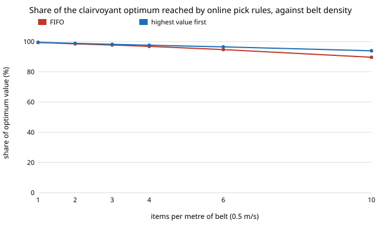

# infra-sortbound: how far below a clairvoyant schedule is online pick dispatch in a robotic waste-sorting cell? An exact bound on `infra-sortvalue`'s greedy rules

Follow-up to `infra-sortvalue` (milestone 10's second project in track 21, applied R&D for the industries modern life runs on; `PROJECTS.md`), taking its first next step: "an offline optimal schedule as an upper bound on dispatch gain". It compares FIFO, highest-value-first and value-per-second dispatch with the best schedule anyone could pick who knew every arrival and travel time in advance. Produced with AI assistance (Claude).

**Live page:** https://duncan-haywood.github.io/monorepo-projects/research/infra-sortbound/

**Headline.** The greedy rules are closer to the best possible schedule than they are to FIFO's worst case, and the headroom is not where pick order helped most. At 6 items/m on a 0.5 m/s belt, highest-value-first reaches **96.5%** of the clairvoyant optimum (FIFO 94.7%); at 10/m, **93.9%** (FIFO 89.6%); at 1/m both reach 99.4 to 99.5%. Value per second of pick is within noise of value-first everywhere. The largest gaps are **about 10% at 0.75 m/s belt speed (FIFO 11%) and 9% for a 0.4 m/s arm**, where no rule tested gets within 9% of the optimum; they vanish for a 5 m/s arm or a 0.25 m/s belt. The bound is exact to under 0.1% of value (a bracket, not an estimate).



## Method (`src/infra_sortbound/model.py`)
The belt, TACO class mix and sizes, assumed values, detector, arm travel and reach window are those of `infra-sortvalue` (code and `data/taco_items.csv` copied so this project stands alone; TACO annotations, CC BY 4.0, Proen&ccedil;a and Sim&otilde;es 2020, arXiv:2003.06975). New here:
- **Online rules** are `infra-sortvalue`'s `fifo`, `value` and `density`, scored on attempted value (the grasp success rate of 0.95 multiplies every rule alike, so it is applied at the end and no grasp noise enters the comparison). FIFO's value per minute matches `infra-sortvalue` at 6/m (27.52); at other loads it differs by a few tenths of a per cent because that project draws grasp outcomes from the same random stream.
- **Clairvoyant optimum.** One arm, non-preemptive picks, each with an arrival time, a deadline (arrival plus the reach window) and a duration. Every item has the same window, so deadlines are in arrival order ("agreeable"). For such jobs a set is feasible in any order only if it is feasible in arrival order (swapping two adjacent out-of-order jobs never hurts: the earlier-released one has the earlier deadline). So the optimum is a subsequence of the called items in arrival order, and a dynamic program over Pareto states (finish time, value) finds it. The tests check this against a brute-force search of every subset in every order.
- **Bracket.** Finish times sit on a grid of `eps` seconds. Rounding each pick duration up gives a schedule the cell could really run (a lower bound); rounding down allows each pick to finish up to one step early (an upper bound). Results use their midpoint; the width is printed beside each. At `eps` = 5 ms the width is below 0.1% of value at 6/m.
- **Design.** All rules and the bound see the same 40 arrival streams (1,800 s each), so shares are paired, with 95% intervals.

### Inputs
| Input | Value | Source |
|---|---|---|
| Item mix and sizes | 4,784 annotations | TACO annotations (above) |
| Category values | clear bottle 1, other bottle 0.6, glass 0.15, food can and aerosol 0.3, drink can 4 (swept 1 to 16) | **assumed**, as in `infra-sortvalue`; not a price list |
| Arm speed, base pick, belt width, reach | 0.6 m/s, 0.5 s, 0.6 m, 1 m | **assumed**; arm and belt speed swept |
| Detector, grasp | recall curve, 0.97 max, 3% false calls; grasp 0.95 | **assumed**, detector not trained |

## Reproduce
```bash
pip install pytest
cd research/infra-sortbound
python -m pytest -q tests                 # 6 tests
python experiments/run.py                 # about 10 s; writes experiments/results.txt
python experiments/figure.py              # experiments/load.svg
```
Standard library only.

## Results (`experiments/results.txt`; deterministic)
Share of the optimum's value (midpoint of the bracket), FIFO / value-first / value-per-second:
- **A. Load** (0.5 m/s belt): 99.4 / 99.5 / 99.5% at 1 item/m; 97.7 / 98.2 / 98.2% at 3; 94.7 / 96.5 / 96.4% at 6; 89.6 / 93.9 / 93.7% at 10.
- **B. Can value** (6/m): value-first reaches 97.5 to 95.9% of the optimum as the can goes from 1x to 16x a bottle (FIFO 96.3 to 93.7%). The larger the spread in value, the more a schedule that sees the future can add.
- **C. Arm speed** (6/m): value-first 94.5, 91.0, 96.5, 99.7, 100.0% at 0.2, 0.4, 0.6, 1.2, 5 m/s. At 0.2 m/s the arm is saturated and 5.5% is left; at 0.4 m/s 9% is left; a fast arm clears everything.
- **D. Belt speed** (6/m): value-first 100.0, 96.5, 89.5, 91.1% at 0.25, 0.5, 0.75, 1.0 m/s (FIFO 100.0, 94.7, 88.6, 91.0%). Faster belts shorten the window (1 m reach at 1 m/s is 1 s, which only the shortest picks fit), and a better order cannot recover what was never reachable, but a clairvoyant one can pack more short picks into it.
- **E. Bracket.** Grid step 0.2, 0.1, 0.05, 0.02, 0.01, 0.005 s gives a bracket of width 33.3, 15.9, 7.8, 3.0, 1.5, 0.76 (units of attempted value summed over 40 runs, of about 917); the gap halves as the step halves, as expected.

Two side checks, not in the committed scripts: shortest-pick-first and a value-per-second rule weighted by slack reached 94.4 and 96.4% at 6/m and 88.9 and 89.7% at 0.75 m/s, so neither closes the gap that value-first leaves. The structure of the best schedule (which low-value picks it skips so that two short ones fit) is not analysed.

Tests check: the dynamic program agrees with brute force over all subsets and orders on 25 random small instances; the bounds bracket one another and dominate all three online rules; at light load every rule reaches the optimum; refining the grid tightens the bracket; runs repeat exactly.

## Limitations
- **Clairvoyant, not achievable.** The bound knows every arrival, class and travel time in advance. No real cell does, so it is the ceiling on dispatch, not a target; a rule with a short look ahead would sit somewhere between.
- **Assumed inputs,** as in `infra-sortvalue` (values, arm, detector, grasp, reach); the shares move with them as swept. The detector is not trained, and nothing here is fitted to or measured on a cell.
- **Single arm, independent items,** no lateral tracking error, no bin or contamination cost, and all items share one reach window (the agreeable-deadline argument fails if windows differ, for example for items of different sizes). `infra-sortvalue`'s contamination sweep (D) is not repeated: its value-first rule reads a false call's true (zero or negative) value, which a real robot cannot, so that sweep may overstate the gain and this project keeps false calls at zero cost.
- Simulated, not a measured cell. Not engineering advice.

## Next steps
- Add a rolling-horizon rule (re-solve the dynamic program over the items currently visible, with their class and position known) and see how much of the 3 to 11% gap a short look ahead recovers.
- Replace assumed values with dated, sourced per-kg prices and item masses.
- Repeat `infra-sortvalue`'s contamination sweep with a policy that cannot see false calls.

## Outside dependencies
TACO annotations (copied). Nothing else; standard library only.
