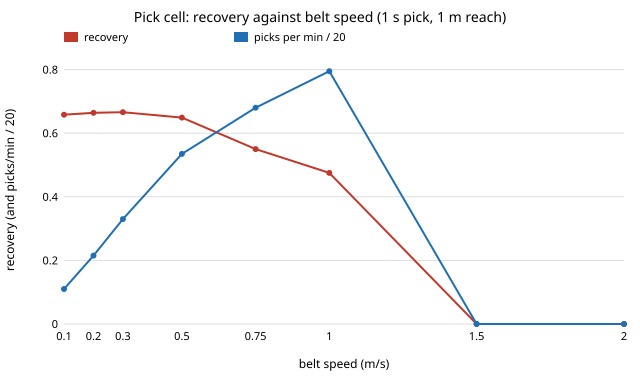

# infra-sorting: how fast can a belt run before a robot pick cell stops recovering recyclables? Conveyor waste sorting on TACO's class mix and sizes

Milestone 10 of track 21, applied R&D for the industries modern life runs on (`PROJECTS.md`). It asks how belt speed, pick cycle time, detector quality and pick order set purity, recovery and picks per minute for one robot sorting bottles and cans off a moving waste belt, using the item mix and sizes of a real dataset. Produced with AI assistance (Claude).

**Live page:** https://duncan-haywood.github.io/oss-monorepo/research/infra-sorting/

**Headline.** With a 1 s pick cycle, 1 m of reach and 3 items per metre, recovery of bottles and cans is **0.66 at 0.1 m/s, 0.65 at 0.5, 0.55 at 0.75, 0.48 at 1.0 m/s and zero from 1.5 m/s**: an item must stay in reach longer than one pick, so reach / pick time is a hard speed limit. The fastest belt keeping 80% of the slow-belt recovery is **1.6, 0.8 and 0.4 m/s** for 0.5, 1 and 2 s picks. Purity is set by the detector's false-call rate and recovery by its size threshold; the pick order (FIFO, LIFO, largest first) makes no difference.



## Data (`data/`)
[TACO](http://tacodataset.org/) (Proen&ccedil;a and Sim&otilde;es, 2020, *TACO: Trash Annotations in Context for Litter Detection*, arXiv:2003.06975): 1,500 photos, 4,784 annotations, 60 categories. Annotations are CC BY 4.0 (images carry their own licences and are not used). `data/make_table.py` downloads `annotations.json` and writes `data/taco_items.csv`: supercategory and linear size (sqrt of box area over image area) per annotation. Bottles and cans are the target bin: 14.9% of annotations. The most common classes are plastic bags and wrappers (17.8%), cigarettes (13.9%) and unlabelled litter (10.8%); median linear size is 5.9% of photo width. TACO photos are litter on streets and beaches, not material on a sorting belt, so the mix is a stand-in for a real input stream.

## Method (`src/infra_sorting/model.py`)
- **Belt.** Poisson arrivals at `density` x `speed` items per second, each drawn from the TACO table. An item is reachable for `window / speed` seconds.
- **Detector (assumed, not trained).** Recall on a target is `recall_max` x logistic((size - s50) / slope) with size = rel. size x photo width; non-targets are called targets with probability `false_call`. Nothing was trained: the container has no GPU, torch or the images. The curve encodes only that small objects are missed more often.
- **Robot.** One pick at a time, `pick_time` s, grasp success 0.95; a pick must finish before the item leaves reach; a failed grasp is lost. Policies: FIFO, LIFO, largest first.
- **Metrics.** Purity = true targets / items in the bin. Recovery = true targets picked / true targets arrived. Picks per minute counts successful picks. 1,800 s of belt per run, 40 runs, 95% intervals shown in `results.txt`.

### Inputs
| Input | Value | Source |
|---|---|---|
| Item mix and sizes | 4,784 annotations | TACO annotations.json (above) |
| Pick cycle | 1 s (0.5 to 2 swept) | assumed; sorting-robot vendors quote tens of picks per minute, not checked here |
| Reach, density, belt speed | 1 m, 3/m, 0.1 to 2 m/s | assumed, speed swept |
| Detector s50, slope, ceiling, false call | 4 cm, 1.5 cm, 0.97, 3% | assumed; s50 and false call swept |
| Photo width | 0.6 m | assumed; 0.4 to 1.0 swept |
| Grasp success | 0.95 | assumed |

## Reproduce
```bash
pip install pytest
cd research/infra-sorting
python -m pytest -q tests                          # 6 tests
python experiments/run.py                          # about 1.5 minutes; writes experiments/results.txt
python experiments/figure.py                       # experiments/speed.svg
```
Standard library only. `python data/make_table.py` rebuilds the CSV (network).

## Results (`experiments/results.txt`; deterministic)
- **A. Belt speed.** Recovery 0.66, 0.66, 0.67, 0.65, 0.55, 0.48, 0, 0 at 0.1, 0.2, 0.3, 0.5, 0.75, 1.0, 1.5, 2.0 m/s. Picks per minute climb from 2 to 16 at 1.0 m/s, well below the 60 a 1 s cycle allows: only called items need a pick, and few arrive per second. Purity stays near 0.80 at every speed.
- **B. Pick time** (0.5 m/s): recovery 0.66 at 0.5 s, 0.65 at 1 s, 0.55 at 1.5 s, 0.48 at 2 s.
- **C. Pick order** (0.75 m/s): FIFO, LIFO and largest-first give the same recovery (0.550) and picks (13.6/min). Items are exchangeable and all share one window length, so order cannot change how many fit; a model with item value, travel time to a position, or windows that differ would be needed to separate them.
- **D. Detector size threshold** (0.3 m/s): s50 of 2, 4, 6, 8 cm gives recovery 0.79, 0.67, 0.52, 0.39 and purity 0.83, 0.80, 0.76, 0.71.
- **E. Photo width** (0.3 m/s): 0.4, 0.6, 1.0 m gives recovery 0.53, 0.67, 0.80. The conversion from photo fraction to centimetres is a large uncertainty: about as large as halving the detector's threshold.
- **F. False calls** (0.5 m/s): purity 1.00, 0.80, 0.55, 0.38 at 0, 3, 10, 20%; recovery barely moves (0.65 to 0.62) though picks per minute double, because bottles and cans are only 15% of items, so false calls dominate the picks.
- **G. Speed limit.** With picks of 0.5, 1 and 2 s the highest speed (0.05 m/s steps) keeping recovery at 80% of the 0.1 m/s value is 1.6, 0.8 and 0.4 m/s, roughly 0.8 x reach / pick time.

Checks (tests): at very light load recovery equals the analytic detection probability x grasp success; successful plus failed picks never exceed one per cycle; zero false calls give purity 1.0; recovery falls with speed; runs repeat exactly.

## Limitations
- **No trained detector.** The recall curve, false-call rate and grasp success are assumed. Real recall depends on occlusion, dirt, overlap and lighting, none of which TACO's single annotated items show.
- **TACO is not a belt stream.** Its class mix comes from litter in the wild; a materials recovery facility sees different mixes, overlapping and stacked items, and items that move on the belt.
- **One robot, one bin, one window,** items independent on a line (no lateral position, no tracking error). Throughput is therefore capped by arrival of called items, not by robot cycles, which a denser belt would change.
- **No cost.** Neither the cell cost nor the value of recovered material is modelled, so this does not say whether a pick cell pays.
- Simulated results, not a measured device; not engineering advice.

## Next steps
- Train a detector on the TACO or ZeroWaste images (needs a GPU and image access) and replace the assumed recall curve with its measured one.
- Add robot travel time by item position, several robots in series, and per-class value so pick order matters.
- Use `robofab-cell`'s twin for the arm instead of a fixed cycle time.

## Outside dependencies
TACO annotations (CC BY 4.0, network at build time for `make_table.py` only). No CU Boulder group's work is built on; the closest is HIRO's manipulation work, not reproduced.
