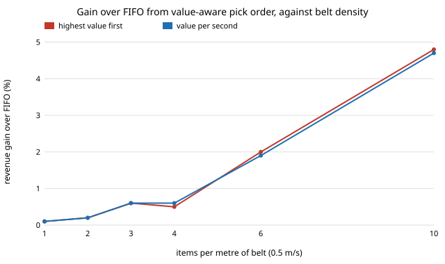

# infra-sortvalue: does pick order matter for a robotic waste-sorting cell once items differ in value and arm travel? Value-aware dispatch on TACO's class mix

Follow-up to `infra-sorting` (milestone 10 of track 21, applied R&D for the industries modern life runs on; `PROJECTS.md`), taking its "per-class value so pick order matters" and "robot travel time by item position" next steps. That project found FIFO, LIFO and largest-first tie, and explained why: all items were worth the same and took the same time. This asks whether the tie breaks once they are not. Produced with AI assistance (Claude).

**Live page:** https://duncan-haywood.github.io/monorepo-projects/research/infra-sortvalue/

**Headline.** Mostly it does not, and it is worth knowing how little. With aluminium cans worth 4 plastic bottles, arm travel of 0 to 1 s and 0.5 m/s belt, picking the highest-value item first beats FIFO by **0.1% at 1 item/m, 2.0% at 6/m and 4.8% at 10/m** (paired, 95% intervals about +-0.5 points). Picking by value per second of pick gives the same gain within noise. The gain grows with can value (+1.1% at equal value, +2.6% at 16x), is largest for a mid-speed arm (+2.0% at 0.6 m/s, +0.1% at 5 m/s, +0.3% at 0.2 m/s) and grows when contaminants cost value (+4.2% at a cost of 2 bottles each). The belt-speed and pick-time limits found in `infra-sorting` matter far more than the order.



## Method (`src/infra_sortvalue/model.py`)
Same belt, TACO class mix and sizes, assumed detector and Poisson arrivals as `infra-sorting` (data file copied: `data/taco_items.csv`, TACO annotations, CC BY 4.0, Proen&ccedil;a and Sim&otilde;es 2020, arXiv:2003.06975). New:
- **Value per category** (units of one clear plastic bottle): clear bottle 1, other plastic bottle 0.6, glass 0.15, food can and aerosol 0.3, drink can `can_value` (4, swept 1 to 16). A pick earns the value if the grasp (0.95) succeeds; a pick of a falsely called item earns `-false_cost` (0 by default, swept).
- **Travel.** Each item has a uniform lateral offset across a 0.6 m belt; a pick takes 0.5 s plus offset / `arm_speed` (0.6 m/s), so 0.5 to 1.5 s.
- **Policies.** `fifo`; `value` (highest value first); `density` (value divided by that item's pick time). A pick is only attempted if it ends before the item leaves its 1 m reach.
- **Design.** Every policy sees the same 40 arrival streams, so gains are paired differences with 95% intervals. Density is 6 items/m by default (`infra-sorting` used 3) so the robot is loaded.

### Inputs
| Input | Value | Source |
|---|---|---|
| Item mix and sizes | 4,784 annotations | TACO annotations (above) |
| Category values | 1 / 0.6 / 0.15 / 0.3 / can 4 | **assumed**, not from a price list; only the drink-can ratio is swept. Real scrap prices are per kg and vary by region and month |
| Arm speed, base pick, belt width | 0.6 m/s, 0.5 s, 0.6 m | assumed; arm speed swept |
| Detector, grasp, reach | as `infra-sorting` | assumed |

## Reproduce
```bash
pip install pytest
cd research/infra-sortvalue
python -m pytest -q tests                 # 6 tests
python experiments/run.py                 # about 35 s; writes experiments/results.txt
python experiments/figure.py              # experiments/load.svg
```
Standard library only.

## Results (`experiments/results.txt`; deterministic)
- **A. Load.** Value-first gain over FIFO: +0.1, +0.2, +0.6, +0.5, +2.0, +4.8% at 1, 2, 3, 4, 6, 10 items/m. When few items compete for the robot, there is nothing to choose between.
- **B. Can value** (6/m): +1.1, +1.5, +2.0, +2.4, +2.6% at 1, 2, 4, 8, 16x.
- **C. Arm speed** (6/m): +0.3, +1.5, +2.0, +0.9, +0.1% at 0.2, 0.4, 0.6, 1.2, 5 m/s. A slow arm is saturated either way; a fast one clears everything.
- **D. Contamination cost** (6/m): +2.0, +2.4, +2.9, +4.2% at 0, 0.5, 1, 2 per false pick. No policy can see a false call (the detector's call is all it knows), so this is a value-mix effect: value-first fills more picks with high-value items, leaving fewer picks for worthless false calls.
- **E. Belt speed** (6/m): +0.0, +2.0, +0.9, +0.2% at 0.25, 0.5, 0.75, 1.0 m/s; the 1.0 m/s cell loses most items to the clock whatever the order.
- **F. Policy choice.** `value` and `density` differ by less than the interval everywhere; no policy beat the other.

Tests check: light-load revenue equals the analytic expectation (arrival rate x recall x value x grasp); identical item values leave the policies tied; value-first is not worse than FIFO under overload; revenue never exceeds the value that arrived; runs repeat exactly.

## Limitations
- **Values are assumed,** not read from a price list; the result is a ratio (gain relative to FIFO) and moves with the can-to-bottle ratio as shown in B, but a real mix with a much larger spread (a few high-value items among many worthless ones) could gain more.
- **Greedy only.** No lookahead or optimal schedule (a scheduling bound would say how much headroom is left); the greedy rules might be beaten.
- **Detector is not trained** and cannot tell a bottle from a can; it only calls "target". A policy that used class probabilities would be a different, stronger question.
- One robot, one bin, independent items, no lateral tracking error (as `infra-sorting`). Simulated, not a measured cell; no cell cost is modelled. Not engineering advice.

## Next steps
- Add an offline optimal schedule (MILP or DP on a short window) as an upper bound on dispatch gain (done: `infra-sortbound`, an exact DP; the greedy rules reach 90 to 97% of it at 6 to 10 items/m).
- Replace assumed values with dated, sourced per-kg prices and item masses.
- Let the detector return class probabilities and dispatch on expected value.
