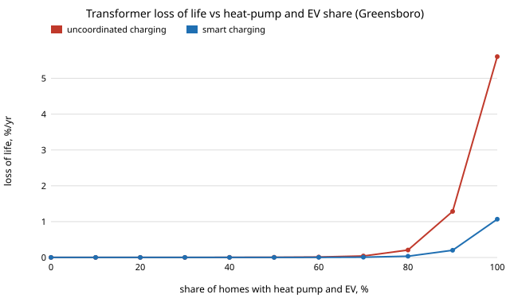

# infra-transformer: how much heat-pump and EV load growth wears out a distribution transformer, and how much does smart charging buy back?

Track 21 (`infra`), milestone 2 of [`PROJECTS.md`](../PROJECTS.md) ("distribution transformer ageing under heat-pump and EV load growth"). The question is the one a utility planner asks before electrification reaches a street: at what share of homes with a heat pump and an EV does the pole-top or pad-mount transformer start losing its insulation faster than its rated life, and does charging EVs overnight, instead of on arrival, delay that? Produced with AI assistance (Claude).

**Live page:** https://duncan-haywood.github.io/oss-monorepo/research/infra-transformer/

**Headline (modelled; an IEEE C57.91-form thermal model with swept, unverified constants, TMY weather, a standard load profile; not a field measurement).** For 10 homes on a transformer sized at 4.5 kVA per home (baseline peak is half the rating) in Greensboro, NC weather, loss of life stays below 0.01 %/yr until about **50 %** of homes have both a heat pump and an EV, then climbs steeply: **0.0075 %/yr at 50 %, 0.21 %/yr at 80 % and 5.6 %/yr at 100 %** with uncoordinated charging (about 18 years to end of life), against **0.0025, 0.035 and 1.07 %/yr** with EV charging valley-filled overnight, about 5 times less at 100 % (93 years). Smart charging recovers an EV alone completely (100 % of homes with an EV: 0.035 %/yr uncoordinated, 0.0026 smart, baseline 0.0019) but only part of the heat-pump cold-snap peaks: with 100 % heat pumps the peak is 2.4 times the rating at a transformer sized for 0.7 per unit, and no charging schedule fixes that. Uniform load growth of only **1.16x to 1.28x doubles** loss of life, but it starts from a baseline of ~0.002 %/yr, so doubling means nothing; the threshold that matters is the **rated-life rate (4.87 %/yr)**, reached at **3.1x** uniform growth at 0.5 loading. Where heat pumps are not needed (Miami weather) only the EV matters and smart charging removes it. The two things the result needs from outside are the constants of the transformer (paywalled in IEEE C57.91; swept here) and a real feeder's diversity.

**Builds on.** IEEE Std C57.91 (guide for loading mineral-oil-immersed transformers; clause 7 thermal model and the ageing acceleration factor `FAA = exp(15000/383 - 15000/(theta_H + 273))`, 110 C reference hot spot and 180,000 h normal insulation life, as reproduced in the open literature and confirmed for the 15000, 383 and 180,000 h figures by secondary sources). Load: the BDEW H0 household standard load profile through `demandlib` (MIT). Weather: NREL TMY3 (Greensboro 723170, Sand Point 703165) and TMY2 (Miami 12839) as bundled in `pvlib` (BSD-3). Method transfer (track 21): the thermal model is a first-order lag with a nonlinear load function, so the technique is the same as in `energy-home`'s battery loop and `grid-twin`; no CU Boulder group's work is reproduced and no connection is claimed.



## Method (`src/infra_transformer/model.py`)
- **Transformer.** Hourly. Ultimate top-oil rise `dTO_u = dTO_R ((K^2 R + 1)/(R + 1))^n`, with `K` load per unit of rating; top oil approaches it with time constant `tau_TO` (exact exponential over each hour, two years of warm-up on the cyclic year); hot-spot rise over top oil `dH_R K^(2m)` taken as instantaneous (its time constant is minutes); hot spot = ambient + top oil + gradient; ageing `FAA`; annual loss of life = sum(FAA) / 180,000 h. Not modelled: oil-viscosity correction of the time constants and losses, tap changes, harmonics, power factor below 1, cooling-mode changes.
- **Load, 10 homes.** BDEW H0 scaled to 10,800 kWh/yr per home (an assumed round figure near US averages; swept 6,000-14,000), hourly mean of the 15-minute profile. The H0 profile is a diversified German group shape, applied to the whole group.
- **Heat pump.** Electric draw = `UA (T_bal - T)+ / COP(T)` with UA 0.42 kW/K, balance 16 C, `COP = 3.2 + 0.054 (T - 8.3)` clipped to [1, 6] (a cold-climate air-source pump; the line is an approximation, swept). No thermostat setback, no defrost, no diversity: every home with a heat pump draws the same in the same hour, so the cold-snap peak is fully coincident. This is the pessimistic end of a real feeder.
- **EV.** 10 kWh per car per night (about 33 miles at 0.3 kWh/mile), 7.2 kW Level 2, arrival 18 h plus or minus 1.5 h (rounded, clipped to 16-22 h), departure 07:00. *Uncoordinated:* each car charges from arrival. *Smart:* a group valley-fill against the other load with perfect day-ahead knowledge (an upper bound on what a real scheduler achieves).
- **Sizing.** Rating = baseline annual peak / `loading`. Loading 0.5 is ~4.5 kVA per home (common practice); 0.7 and 0.9 are tight.

### Checks (`tests/`, 8)
At rated load and 30 C ambient the hot spot is 110 C, top oil 85 C and FAA exactly 1; ageing doubles about every 7 K at 110 C (the analytic 15000/383^2 slope); a year at FAA = 1 consumes 8760/180000 = 4.87 % of life; the step response reaches 1 - 1/e after one `tau_TO`; ageing rises with load and ambient; the heat-pump draw is zero above the balance temperature and obeys the COP floor; EV charging conserves energy and smart charging never raises the peak; scenarios add load.

## Reproduce
```bash
pip install pytest numpy                       # pvlib and demandlib only to rebuild data/inputs.csv
cd research/infra-transformer
python -m pytest -q tests                      # 8 tests
PYTHONPATH=src python experiments/run.py       # about 35 s; writes experiments/results.txt
python experiments/figure.py                   # experiments/lol.svg
python data/make_inputs.py                     # optional: rebuild data/inputs.csv (pvlib, demandlib)
```

## Results (`experiments/results.txt`; deterministic)
- **A. Annual loss of life by loading and scenario (Greensboro, %/yr).** Loading 0.5: base 0.0019; EV 100 % uncoordinated 0.035, smart 0.0026; HP 100 % 0.33; HP+EV 100 % uncoordinated 5.6, smart 1.07. Loading 0.7: base 0.0054, EV uncoordinated 2.3, smart 0.0093, and all heat-pump cases above 100 %/yr (insulation gone within the year; the model is outside its range there, shown as failed). Sand Point (cold): HP+EV 100 % at 0.5 loading is 8.9 uncoordinated, 0.19 smart. Miami (no heating): HP adds nothing; EV 100 % at 0.5 is 0.075 uncoordinated, 0.0058 smart.
- **B. Peaks at loading 0.7, Greensboro.** Base peak 0.70 per unit and 80 C hot spot; EV 100 % uncoordinated 2.15 per unit and 173 C (48 hours above 140 C, the usual emergency limit); the same with smart charging 0.70 per unit and 81 C. HP 100 % peaks at 2.42 per unit and 268 C; with the EV, 3.33 per unit (uncoordinated) or 2.46 (smart). Hot spots above about 200 C are not credible; they flag overload, not a temperature.
- **C. Electrified share at which loss of life first reaches the rated-life rate.** Loading 0.5: Greensboro 100 % uncoordinated, not reached with smart charging; Sand Point 95 % uncoordinated, not reached smart; Miami not reached. Loading 0.7: Greensboro 65 % uncoordinated, 75 % smart; Sand Point 60 % and 85 %; Miami not reached. At the typical sizing, no share of EVs alone or heat pumps alone reaches it.
- **D. Uniform growth.** Growth that doubles loss of life: 1.28x (loading 0.5), 1.16x (0.7), 1.11x (0.9); growth that reaches the rated-life rate: 3.12x, 2.23x, 1.73x. A transformer's ageing is exponential in the hot spot, so doubling is cheap and not a sign of trouble when the baseline is near zero.
- **E. Sensitivity** (50 % of homes with both; rating sized to loading 0.5 on each row's own baseline for the plant-side rows, on the default baseline for the transformer-constant rows). Smart charging is lower than uncoordinated in all 30 rows, by a factor of 1.7 to 25 (the 25 is a 6,000 kWh/yr baseline, whose rating is re-sized to its own small baseline peak and which the heat pumps then overload). Across the transformer constants the factor is 1.8 to 6.1 and no row exceeds 0.025 %/yr (uncoordinated), so the 50 % result is insensitive to the unverified constants. Plant-side inputs matter more: COP 2.5 instead of 3.2 raises the uncoordinated figure to 0.051 %/yr, UA 0.6 to 0.041, EV energy 15 kWh/night to 0.024.
- **F.** The curve in the figure (share 0 to 100 %).

## Limitations
- **The constants of the transformer are not sourced.** IEEE C57.91 is paywalled and was not reachable from this environment. The ageing constants (15000, 383 K, 180,000 h) were confirmed by secondary sources; the rise values (55 K top oil, 25 K gradient, i.e. 80 K hot spot), R = 3.2, n = m = 0.8 and tau_TO = 3 h are my recollection of the standard's ONAN distribution-class values and are *not* verified. Section E sweeps each over the range literature quotes; the 50 % result survives, the 100 % result is dominated by the overload so its exact figure does not. Check the standard before using any figure.
- **Models are not plants.** One group profile, not metered customers; a fully coincident heat-pump peak with no setback or diversity; TMY weather (a typical year, not a cold snap or heat wave, which matter most for ageing); a German profile shape on US weather. Real feeders have fewer coincident peaks and a transformer rarely sees 10 identical homes, so the 100 % rows overstate and the transformer's tolerance of occasional overload (hot-spot limits, gas bubbles) is not modelled.
- **No ageing beyond insulation temperature.** Moisture, oxygen, load-tap and fault stresses, and winding paper degree of polymerisation are absent.
- **Smart charging is an upper bound** (perfect day-ahead knowledge, a single group, no driver override).
- **Safety-critical designs are research.** Transformer loading decisions need the utility's engineers; nothing here is operating advice, and no real utility system was touched.

## Next steps
1. Source the C57.91 table values from the standard (or a thesis reproducing it) and replace the swept constants; validate against its Annex G worked example.
2. Replace the fully coincident heat pump with a thermostat and setback model and a random-start population, to measure how much diversity is worth.
3. Add the heat-wave tail: rerun on a hot-day sequence and a cold-snap sequence, not only a TMY.
4. Take `infra-hosting`'s OpenDSS feeder and ask whether the transformer or the feeder binds first.

## Outside dependencies
NumPy. `pvlib` and `demandlib` only to regenerate `data/inputs.csv` (committed).
