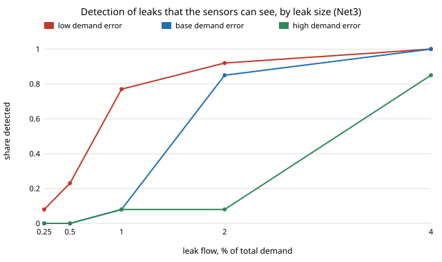

# infra-waterloss: how small a water-main leak can pressure sensors find, and does a changepoint detector beat a threshold or CUSUM?

Track 21 (`infra`), milestone 3 of [`PROJECTS.md`](../PROJECTS.md), done on a **different network than the milestone names**: the BattLeDIM L-Town network and leak schedule are on Zenodo and GitHub, which this environment's proxy refused (HTTP 403), so this uses EPANET's Net3 with leaks simulated in WNTR. Water utilities lose a large share of treated water to leaks, and the practical question is how small a leak a few pressure sensors can see before the false alarms drown the crew. Produced with AI assistance (Claude).

**Live page:** https://duncan-haywood.github.io/monorepo-projects/research/infra-waterloss/

**Headline (simulated leaks on Net3; assumed demand error; not a field result).** At a budget of at most 5 % of leak-free weeks raising any alarm, with 5 pressure sensors and base demand error (10 % per node, 3 % system-wide), the best detector (CUSUM on a pressure residual regressed on a noisy inflow meter, "flow-adjusted") finds **100 % of the leaks the sensors can see at 4 % of mean demand (28 L/s) but only 8 % at 1 % (7 L/s) and 85 % at 2 %**; counting every leak location, including the 72 % no sensor feels above 0.5 m, it finds **3 % of 1 % leaks and 38 % of 4 % leaks**. **Demand error and sensor coverage set the limit, not the detector or sensor noise**: with low demand error (5 % / 1 %) covered 2 % leaks are found 92 % of the time, with high (20 % / 5 %) 8 %; moving sensor noise from 0.05 to 1 m leaves covered 4 % leaks at 92-100 % (CUSUM). **PELT did not beat CUSUM on 2 % leaks** at the same false-alarm budget in any condition (base error, 0.25 m, flow-adjusted: 0.08 vs 0.85); at 4 % they tie within noise; the moving average was mixed.

**Builds on.** EPANET (Rossman 2000) and its example network Net3 as shipped with WNTR 1.5 (Klise, Hart, Moriarty, Haxton et al. 2017, "Water Network Tool for Resilience", US EPA; BSD-3); the leak model is WNTR's orifice-law `add_leak` (discharge coefficient 0.75). Problem framing after the BattLeDIM competition (Vrachimis et al. 2022, *J. Water Resources Planning and Management*), whose data I could not reach. PELT: Killick, Fearnhead and Eckley (2012), *JASA*. CUSUM: Page (1954). Method transfer (track 21): changepoint detection from sensor and meter monitoring. The repository has no `changepoint-detector` project (the milestone assumed one), so PELT is implemented here (`src/infra_waterloss/detect.py`) and tested against an unpruned dynamic programme. No CU Boulder group's work is reproduced; no connection is claimed.



## Method
- **Network and leaks (`src/infra_waterloss/net.py`).** Net3: 92 junctions, 2 reservoirs, 3 tanks, pumps; WNTR demand-driven simulation, hourly, one week (168 h). A leak opens at hour 96 at one junction. Its area is set so the flow at the nominal pressure is 0.25, 0.5, 1, 2 or 4 % of the nominal mean total demand (691 L/s); realised flows 24 h later match to two decimals (results section B). Each size is run at 60 randomly chosen junctions (seeded).
- **Demand error (what the model does not know).** The true week has every junction's demand multiplied by a fixed lognormal factor (sd 0.05, 0.10 or 0.20) and every hour by one shared AR(1) factor (autocorrelation 0.9, sd 0.01, 0.03 or 0.05). The detector's model is the nominal week. These sizes are **assumed**; L-Town's real figures were not reachable. All three are reported.
- **Sensors.** Pressure at junctions chosen greedily (`pick_sensors`) to maximise the summed log noise-free response over all 92 leak locations to a 2 % leak, then Gaussian noise of sd 0.05, 0.25 or 1.0 m (assumed; typical transducer accuracies are of this order, not sourced). The first 5 or all 15 are used. An inflow meter reads total demand with 0.5 % noise (assumed).
- **Residual and score.** Residual = measured minus nominal-model pressure, per sensor. Hours 0-47 (leak-free) give its mean and sd. In "flow-adjusted" mode each sensor's residual is first regressed on the inflow residual over those 48 h and the fit removed (this strips the system-wide demand swings, and some of a large leak with it). Score = minus the mean standardised residual across sensors, standardised again on the training window.
- **Detectors.** Moving average of 3 h above a threshold; one-sided CUSUM (k = 0.5); PELT with penalty beta on squared error, rerun on the series so far every 6 h, alarming when the last segment starts at or after hour 48 and its mean is higher than before. Each threshold is **calibrated per condition and detector on 120 leak-free weeks** (separate seeds) to the smallest grid value with at most 5 % of weeks raising any alarm after hour 48, so the detectors are compared at the same false-alarm budget; the achieved rate is printed (`fa_cal`), and the rate on the pre-leak hours 48-95 of the test runs (`fa_test`).
- **Scoring.** Detection = first alarm at or after hour 96; runs alarming earlier are excluded from detection rates (`fa_test` counts them); delay = hours from onset to alarm (median over detected runs). A leak is **covered** if it lowers some chosen sensor by more than 0.5 m, noise-free, at 2 % size; "covered" is a property of the location, so at 0.25-0.5 % sizes the covered rates are mostly zero by construction.

### Checks (`tests/`, 6)
PELT equals an unpruned dynamic programme on 15 random series; it finds a step to within 2 hours and returns nothing on noise; CUSUM ignores negative drift and its delay falls with shift size (and equals 4 steps for a 2.0 shift at k 0.5, h 5); the moving average waits for its window; a leak's flow is zero before onset, within 50-110 % of target afterwards and proportional to the square root of head; the leak node and most junctions lose pressure (a few gain: pumps and tanks); the demand perturbation is seeded and moves pressures.

## Reproduce
```bash
pip install pytest numpy wntr
cd research/infra-waterloss
python -m pytest -q tests                      # 6 tests
PYTHONPATH=src python experiments/run.py       # about 20 min on 4 cores (hydraulics are cached in $WATERLOSS_CACHE, default /tmp/waterloss_cache); writes experiments/results.txt
python experiments/figure.py                   # experiments/detection.svg
```

## Results (`experiments/results.txt`; deterministic)
Five conditions at 5 sensors (sensor sd 0.05, 0.25, 1.0 m at base demand error; low and high demand error at 0.25 m) and one at 15 sensors; three detectors, two residual modes each, five leak sizes.
- **Sensors see little of the network.** Five greedily placed sensors move by more than 0.5 m for only 28 % of leak locations at a 2 % leak (34 % above 0.25 m, 51 % above 0.05 m, 7 % above 1 m). In Net3 most pressure is held by tanks and pumps, so most leaks are invisible to a few sensors. Detection of leaks everywhere is therefore bounded by coverage.
- **Small leaks are not found.** At base error and 0.25 m noise, all-leak detection is at most 8 % at 1 % leak and at most 38 % at 4 %; among covered leaks the best row is 100 % at 4 %, 85 % at 2 %, 8 % at 1 %.
- **Detector ranking.** On covered leaks flow-adjusted CUSUM is best at 2 % in all five 5-sensor conditions, and within one or two covered leaks of the best at 4 % (e.g. base error, 0.25 m: 0.85 and 1.00 against PELT 0.08 and 0.85, moving average 0.23 and 0.77). Median delays for detected 2-4 % leaks run from about 14 to 65 h. PELT's penalty had to be large (beta 40-190) to hold the false-alarm budget, which costs it detections.
- **Flow adjustment helps CUSUM, not always the others.** Covered 2 % leaks, base error: 0.31 to 0.85 (CUSUM, 0.25 m); moving average 0.08 to 0.23; but at 1 m noise it removes more signal than noise for the moving average (0.15 to 0.00).
- **Demand error beats sensor noise.** Covered 2 % leaks with flow-adjusted CUSUM: 0.92 (low error), 0.85 (base), 0.08 (high), at 0.25 m noise. Over sensor noise of 0.05, 0.25 and 1.0 m at base error the same cell is 0.69, 0.85 and 0.46: not monotone, which shows the noise floor of 13 covered leaks.
- **More sensors, averaged, are worse.** With 15 sensors the score averages many sensors that do not see the leak, and covered 4 % detection drops from 1.00 to 0.85 (CUSUM, flow-adjusted) and from 0.62 to 0.31 (moving average, pressure). The averaging rule, not the sensor count, is at fault; a per-sensor test or a localisation step would not dilute.
- **Calibration caveat.** Thresholds are calibrated on 120 weeks, so the 5 % target has binomial error of about plus or minus 2 points; achieved `fa_cal` is 1-5 % (a few conditions land below target because the grid is coarse). Each detection rate comes from 60 runs (covered: about 13), so differences under 0.12 (all) or 0.3 (covered) are noise.

## Limitations
- **Not L-Town and not a field result.** The BattLeDIM data could not be downloaded, so the milestone's baseline (the competition's best methods, scored by its own metrics) is not reproduced. Net3 is a textbook network with tank-held pressures and no district metering.
- **Demand error, sensor noise and flow-meter noise are assumed** (swept for the first two, fixed for the flow meter), not measured.
- **The score is a plain average**, with no sensor weighting, localisation or model of daily patterns; the training window is only two days. A tuned production method (e.g. a sensor-wise residual test, a model fitted to a longer history) would do better; the numbers are a floor for a transparent pipeline, not a ceiling.
- **Greedy sensor placement is for 2 % leaks** and ignores noise; leaks at the sensor's own node are not scored.
- **The leak model** is an orifice with fixed area and no growth (real leaks grow and burst), pressure-driven only through the leak itself (customer demand is not pressure-dependent here); a few Net3 nodes have near-zero pressure.
- Nothing here is operating advice for a utility.

## Next steps
1. Fetch BattLeDIM (L-Town, 2018 and 2019 sets) when the data is reachable, and score the same detectors with the competition's metrics against the published best methods.
2. Replace the average with a per-sensor test or a localisation step, and re-run the 15-sensor case.
3. Fit the nominal model on a longer history and give it daily and weekly pattern terms; measure what a calibrated model buys over the nominal one.
4. Pressure-dependent demand and growing leaks.

## Outside dependencies
WNTR (EPANET hydraulics via its own solver), NumPy; matplotlib only through WNTR's import. Net3 ships with WNTR.
