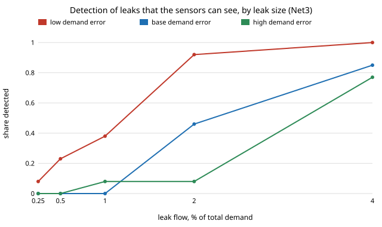

# infra-waterloss: how small a water-main leak can pressure sensors find, and does a changepoint detector beat a threshold or CUSUM?

Track 21 (`infra`), milestone 3 of [`PROJECTS.md`](../PROJECTS.md), done on a **different network than the milestone names**: the BattLeDIM L-Town network and leak schedule are on Zenodo and GitHub, which this environment's proxy refused (HTTP 403), so this uses EPANET's Net3 with leaks simulated in WNTR. Water utilities lose a large share of treated water to leaks, and the practical question is how small a leak a few pressure sensors can see before the false alarms drown the crew. Produced with AI assistance (Claude).

**Live page:** https://marisstella.app/research/infra-waterloss/

**Headline (simulated leaks on Net3; assumed demand error; not a field result; rerun 2026-11-23 after a meter bug, see below).** At a budget of at most 5 % of leak-free weeks raising any alarm, with 5 pressure sensors and base demand error (10 % per node, 3 % system-wide) and 0.25 m sensor noise, the best pressure detector finds **92 % of the leaks the sensors can see at 4 % of mean demand (28 L/s, CUSUM), 46 % at 2 % (flow-adjusted CUSUM) and 8 % at 1 %**. Only 28 % of leak locations are "seen" at all, and that is **a property of Net3, not of five sensors**: with every one of the 92 junctions as a sensor it is still 28 %. **A flow balance on the inflow meter alone, which needs no pressure sensor, is the strongest detector when demand is well known**: at low demand error (5 % / 1 %) it finds 100 % of 4 % leaks and 62 % of 2 % leaks anywhere in the network, against 52 % and 30 % for the best pressure detector. At base and high demand error it does no better than pressure (33 % and 17 % of 4 % leaks, against 27 % and 18 %). **Demand error sets the limit** for both channels; sensor noise from 0.05 to 0.25 m changes little. **PELT did not beat CUSUM** on covered 2 % leaks in any condition at the same false-alarm budget (base error, 0.25 m, flow-adjusted: 0.08 vs 0.46).

**Correction (2026-11-23).** Until the round 105 quality audit ([`portfolio/quality/audits/2026-11-23-infra-waterloss.json`](../../portfolio/quality/audits/2026-11-23-infra-waterloss.json)) the simulated inflow meter read junction demand only, and WNTR keeps leak flow out of junction demand, so the meter could not see the leak. The earlier headline (flow-adjusted CUSUM 85 % of covered 2 % leaks, "the detector does not matter, demand error does") came from that bug: regressing pressure on a leak-blind meter removed demand noise without removing any leak. The meter now reads demand plus leak; flow adjustment then also removes part of the leak, and covered 2 % detection falls to 46 %. The flow-balance mode was added in the same change, since a flow balance is the first tool of water-loss practice and its absence was the audit's other high-severity finding.

**Builds on.** EPANET (Rossman 2000) and its example network Net3 as shipped with WNTR 1.5 (Klise, Hart, Moriarty, Haxton et al. 2017, "Water Network Tool for Resilience", US EPA; BSD-3); the leak model is WNTR's orifice-law `add_leak` (discharge coefficient 0.75). Problem framing after the BattLeDIM competition (Vrachimis et al. 2022, *J. Water Resources Planning and Management*), whose data I could not reach. PELT: Killick, Fearnhead and Eckley (2012), *JASA*. CUSUM: Page (1954). Method transfer (track 21): changepoint detection from sensor and meter monitoring. The repository has no `changepoint-detector` project (the milestone assumed one), so PELT is implemented here (`src/infra_waterloss/detect.py`) and tested against an unpruned dynamic programme. No CU Boulder group's work is reproduced; no connection is claimed.



## Method
- **Network and leaks (`src/infra_waterloss/net.py`).** Net3: 92 junctions, 2 reservoirs, 3 tanks, pumps; WNTR demand-driven simulation, hourly, one week (168 h). A leak opens at hour 96 at one junction. Its area is set so the flow at the nominal pressure is 0.25, 0.5, 1, 2 or 4 % of the nominal mean total demand (691 L/s); realised flows 24 h later match to two decimals (results section B). Each size is run at 60 randomly chosen junctions (seeded).
- **Demand error (what the model does not know).** The true week has every junction's demand multiplied by a fixed lognormal factor (sd 0.05, 0.10 or 0.20) and every hour by one shared AR(1) factor (autocorrelation 0.9, sd 0.01, 0.03 or 0.05). The detector's model is the nominal week. These sizes are **assumed**; L-Town's real figures were not reachable. All three are reported.
- **Sensors.** Pressure at junctions chosen greedily (`pick_sensors`) to maximise the summed log noise-free response over all 92 leak locations to a 2 % leak, then Gaussian noise of sd 0.05, 0.25 or 1.0 m (assumed; typical transducer accuracies are of this order, not sourced). The first 5 or all 15 are used. An inflow meter reads total demand plus the leak with 0.5 % noise (assumed).
- **Residual and score.** Residual = measured minus nominal-model pressure, per sensor. Hours 0-47 (leak-free) give its mean and sd. In "flow-adjusted" mode each sensor's residual is first regressed on the inflow residual over those 48 h and the fit removed (this strips the system-wide demand swings, and part of the leak with it, since the meter sees the leak). In "flow-balance" mode no pressure is used: the score is the inflow residual alone, standardised on the training window. Score = minus the mean standardised residual across sensors, standardised again on the training window.
- **Detectors.** Moving average of 3 h above a threshold; one-sided CUSUM (k = 0.5); PELT with penalty beta on squared error, rerun on the series so far every 6 h, alarming when the last segment starts at or after hour 48 and its mean is higher than before. Each threshold is **calibrated per condition and detector on 120 leak-free weeks** (separate seeds) to the smallest grid value with at most 5 % of weeks raising any alarm after hour 48, so the detectors are compared at the same false-alarm budget; the achieved rate is printed (`fa_cal`), and the rate on the pre-leak hours 48-95 of the test runs (`fa_test`).
- **Scoring.** Detection = first alarm at or after hour 96; runs alarming earlier are excluded from detection rates (`fa_test` counts them); delay = hours from onset to alarm (median over detected runs). A leak is **covered** if it lowers some chosen sensor by more than 0.5 m, noise-free, at 2 % size; "covered" is a property of the location, so at 0.25-0.5 % sizes the covered rates are mostly zero by construction.

### Checks (`tests/`, 7)
PELT equals an unpruned dynamic programme on 15 random series; it finds a step to within 2 hours and returns nothing on noise; CUSUM ignores negative drift and its delay falls with shift size (and equals 4 steps for a 2.0 shift at k 0.5, h 5); the moving average waits for its window; a leak's flow is zero before onset, within 50-110 % of target afterwards and proportional to the square root of head; the leak node and most junctions lose pressure (a few gain: pumps and tanks); the demand perturbation is seeded and moves pressures; the inflow the detectors see is junction demand plus the leak (WNTR keeps them apart).

## Reproduce
```bash
pip install pytest numpy wntr
cd research/infra-waterloss
python -m pytest -q tests                      # 7 tests
PYTHONPATH=src python experiments/run.py       # about 20 min on 4 cores (hydraulics are cached in $WATERLOSS_CACHE, default /tmp/waterloss_cache); writes experiments/results.txt
python experiments/figure.py                   # experiments/detection.svg
```

## Results (`experiments/results.txt`; deterministic up to a near-tie in the 13th greedy sensor, which a clean rerun on another machine broke the other way, changing one 15-sensor row)
Five conditions at 5 sensors (sensor sd 0.05, 0.25, 1.0 m at base demand error; low and high demand error at 0.25 m) and one at 15 sensors; three detectors, three modes each (pressure, flow-adjusted pressure, flow balance), five leak sizes. Coverage does not apply to flow balance, so compare it on the all-leaks columns.
- **Coverage is set by the network.** Five greedily placed sensors move by more than 0.5 m for 28 % of leak locations at a 2 % leak (34 % above 0.25 m, 51 % above 0.05 m, 7 % above 1 m). Using all 92 junctions as sensors still gives 28 % above 0.5 m (41 % above 0.25 m): in Net3 tanks and pumps hold most pressures, so most leaks barely move any node. Pressure detection of leaks everywhere is bounded by this.
- **"Small" is relative to demand, not to background leakage.** The 1 % leak is 7 L/s, about 600 m&sup3;/day, roughly 12 times the mains term of the IWA unavoidable real losses for Net3 (18 L/km/day/m &times; 65.7 km &times; 42 m mean pressure = 50 m&sup3;/day). Even the 0.25 % leak is burst-sized by water-audit standards. At base error and 0.25 m noise, all-leak detection is at most 8 % at 1 % and 33 % at 4 %; among covered leaks the best rows are 92 % at 4 %, 46 % at 2 %, 8 % at 1 %.
- **Flow balance wins when demand is known well, and only then.** All leaks, 4 % / 2 %: low demand error, flow-balance CUSUM 1.00 / 0.62 (PELT 1.00 / 0.63) against the best pressure row 0.52 / 0.30; base error 0.33 / 0.10 against 0.27 / 0.13; high error 0.17 / 0.10 against 0.18 / 0.03. The meter's 0.5 % noise is small; the nominal model's demand error is what hides the leak in the inflow.
- **Detector ranking.** On covered 2 % leaks CUSUM is the best pressure detector in all five 5-sensor conditions (flow-adjusted in four, plain pressure at 1 m noise). PELT's penalty had to be large (beta 40-280) to hold the false-alarm budget, which costs it detections. Median delays for detected 2-4 % leaks run from about 5 to 66 h.
- **Flow adjustment helps CUSUM a little now that the meter sees the leak.** Covered 2 % leaks, base error, 0.25 m: 0.31 (pressure) to 0.46 (flow-adjusted); covered 4 %: 0.92 to 0.85. At 1 m noise it removes more signal than noise for every detector (moving average 0.15 to 0.00).
- **Demand error beats sensor noise.** Covered 2 % leaks with flow-adjusted CUSUM: 0.92 (low error), 0.46 (base), 0.08 (high), at 0.25 m noise. Over sensor noise of 0.05, 0.25 and 1.0 m at base error the same cell is 0.46, 0.46 and 0.15.
- **More sensors, averaged, are worse.** With 15 sensors the score averages many sensors that do not see the leak, and covered 4 % detection drops from 0.85 to 0.62 (CUSUM, flow-adjusted) and from 0.62 to 0.31 (moving average, pressure). The averaging rule, not the sensor count, is at fault; a per-sensor test or a localisation step would not dilute.
- **Calibration caveat.** Thresholds are calibrated on 120 weeks, so the 5 % target has binomial error of about plus or minus 2 points; achieved `fa_cal` is 1-5 % (a few conditions land below target because the grid is coarse). Each detection rate comes from 60 runs (covered: about 13), so differences under 0.12 (all) or 0.3 (covered) are noise.

## Limitations
- **Not L-Town and not a field result.** The BattLeDIM data could not be downloaded, so the milestone's baseline (the competition's best methods, scored by its own metrics) is not reproduced. Net3 is a textbook network with tank-held pressures and no district metering.
- **Demand error, sensor noise and flow-meter noise are assumed** (swept for the first two, fixed for the flow meter), not measured.
- **The score is a plain average**, with no sensor weighting, localisation or model of daily patterns; the training window is only two days. A tuned production method (e.g. a sensor-wise residual test, a model fitted to a longer history) would do better; the numbers are a floor for a transparent pipeline, not a ceiling.
- **Greedy sensor placement is for 2 % leaks** and ignores noise; leaks at the sensor's own node are not scored.
- **The leak model** is an orifice with fixed area and no growth (real leaks grow and burst), pressure-driven only through the leak itself (customer demand is not pressure-dependent here); a few Net3 nodes have near-zero pressure.
- Nothing here is operating advice for a utility.

## Next steps
1. Fetch BattLeDIM (L-Town, 2018 and 2019 sets) when the data is reachable, and score the same detectors with the competition's metrics against the published best methods.
2. Replace the average with a per-sensor test or a localisation step, and re-run the 15-sensor case.
3. Fit the nominal model on a longer history and give it daily and weekly pattern terms; measure what a calibrated model buys over the nominal one.
4. Pressure-dependent demand and growing leaks.

## Outside dependencies
WNTR (EPANET hydraulics via its own solver), NumPy; matplotlib only through WNTR's import. Net3 ships with WNTR.
