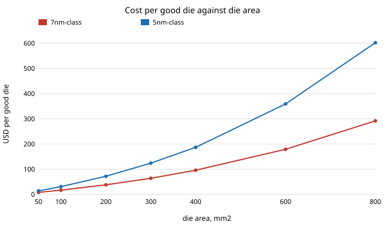

# infra-yield: what does a good die cost, and at what area do chiplets beat one big die? Yield models, dies per wafer and the chiplet break-even

Milestone 9 of track 21, applied R&D for the industries modern life runs on (`PROJECTS.md`). It asks what a good (working) die costs when the wafer price, the defect density and the die area are all taken from sources, how much the choice of yield model matters, and at what logic area splitting a design into chiplets becomes cheaper than one die. Produced with AI assistance (Claude).

**Live page:** https://duncan-haywood.github.io/oss-monorepo/research/infra-yield/

**Headline.** With negative-binomial yield (&alpha; = 3, assumed) a 600 mm&sup2; die costs about **$179 on a 7nm-class wafer and $359 on a 5nm-class wafer** (yield 61% and 55%). The yield model changes the 5nm figure between $328 (Seeds) and $382 (Poisson), a spread of 16%. Splitting the logic into two chiplets is cheaper from about **300 mm&sup2;** at 0.11 defects/cm&sup2; across the swept defect densities (0.05 to 0.3) and assembly costs ($10 to $120 per package) the crossing runs from **126 to 728 mm&sup2;**, so packaging cost matters more than which yield model is used.



## Method (`src/infra_yield/model.py`)
- **Yield models**, as a function of *x* = die area &times; D<sub>0</sub>: Poisson e<sup>&minus;x</sup>; Murphy (1964) ((1&minus;e<sup>&minus;x</sup>)/x)<sup>2</sup>; Seeds (1967) 1/(1+x); Bose-Einstein (1+x/n)<sup>&minus;n</sup> with n critical layers; negative binomial (Stapper) (1+x/&alpha;)<sup>&minus;&alpha;</sup>. Poisson is the &alpha; &rarr; &infin; limit of the last and Seeds its &alpha; = 1 case; tests check both.
- **Dies per wafer.** The textbook closed form (wafer area over die area minus an edge term) on the usable diameter (300 mm less a 3 mm edge exclusion), and an exact count of whole square dies inside the usable circle, best over a 40&times;40 grid of offsets. Scribe lines are not included.
- **Cost per good die** = wafer price / (dies per wafer &times; yield).
- **Chiplets.** A design of logic area *A* is split into *n* equal chiplets, each *A*(1+o)/*n* with o = 10% die-to-die overhead. Dies are tested before assembly (known good die), so only good dies are bought. Assembly costs a fixed package price plus a price per chiplet, and each bond succeeds with probability 0.99; a failed assembly loses all its dies. One die (n = 1) has the package price and the same bond step once.

### Inputs and where they come from
| Input | Value | Source |
|---|---|---|
| 300 mm wafer price, 7nm-class | 9,346 USD | CSET, *AI Chips: What They Are and Why They Matter* (2020), estimate of TSMC prices; a small-window average, not a quote. [cset.georgetown.edu](https://cset.georgetown.edu/article/analysts-believe-that-a-single-tsmc-5nm-wafer-costs-17000/) |
| 300 mm wafer price, 5nm-class | 16,988 USD | same |
| Defect density D<sub>0</sub> | 0.09 /cm&sup2; (N7, about three quarters into volume), 0.10&ndash;0.11 (N5, mid-2020; 0.11 used) | TSMC figures reported by AnandTech (Cutress, Aug 2020), [anandtech.com/show/16028](https://www.anandtech.com/show/16028). A mid-2020 snapshot; N5 later fell below 0.10. |
| Wafer, edge exclusion | 300 mm, 3 mm | standard wafer size; edge exclusion assumed |
| Clustering &alpha; | 3 (swept 1 to 10 in section D) | assumed |
| Bose-Einstein layers | 10 | assumed |
| Die-to-die overhead, bond yield | 10%, 0.99 | assumed |
| Package and per-chiplet assembly cost | (10, 2) to (120, 20) USD | assumed, swept (section E) |

The wafer prices are 2020 estimates and have risen since (reports of 2026 increases of a few to 15%); they set the scale of the costs and not the ordering of the results.

## Reproduce
```bash
pip install pytest
cd research/infra-yield
python -m pytest -q tests                       # 9 tests
PYTHONPATH=src python experiments/run.py        # about a minute; writes experiments/results.txt
python experiments/figure.py                    # experiments/cost.svg from results.txt
```
Standard library only.

## Results (`experiments/results.txt`; deterministic)
- **A. Yield models.** At *x* = 1 Poisson gives 0.368, Murphy 0.400, negative binomial (&alpha; = 3) 0.422, Seeds 0.500; at *x* = 3 the range is 0.050 to 0.250. They agree below *x* = 0.25 (within 3 points) and part ways above it. Murphy at *x* = 1 matches the closed form (0.3996).
- **B. Dies per wafer.** The closed form undercounts the exact count by 0.9% at 25 mm&sup2;, 2.1% at 100, 7.4% at 400 and 11.6% at 800. Large dies are therefore a little cheaper than the closed form says.
- **C. Cost per good die.** 100 mm&sup2;: $17 (7nm-class), $31 (5nm-class). 400 mm&sup2;: $96 and $187. 800 mm&sup2;: $292 and $602. Cost grows faster than area (400 mm&sup2; costs 5.6 times 100 mm&sup2; at 7nm) because both yield and edge loss worsen. The 5nm-class die costs 1.8 to 2.1 times the 7nm-class one at the same area.
- **D. Yield model at 600 mm&sup2;.** 7nm-class $167 (Seeds) to $186 (Poisson); 5nm-class $328 to $382. Over &alpha; = 1 to 10 the 5nm figure runs $328 to $374. **Not reproduced:** CSET quotes about $233 (7nm) and $238 (5nm) per chip for a die of about this size. The 7nm figure is 30% above ours; the 5nm figure is 34% below. Their per-die model, die sizes (a 5nm design is smaller than the 7nm one it replaces) and defect densities are not given where this run read them, so the gap is unexplained, not an error found on either side.
- **E. Chiplet break-even.** At 0.11/cm&sup2;: two chiplets win from 233 mm&sup2; (package $10 + $2 per chiplet) to 490 mm&sup2; (package $120 + $20); at 0.05, 362 to 720; at 0.3, 128 to 286. Four chiplets cross at nearly the same area as two (e.g. 301 against 304 at the middle cost), a little earlier when assembly is cheap and later when it is dear.
- **F. Best number of chiplets.** For 800 mm&sup2; of logic at 0.11/cm&sup2;, package $30 + $5 per chiplet: one die $639, two $482, four $390, six $374, eight $375. The gain flattens at six because the 10% overhead and the per-chiplet cost grow with *n*.
- **G. Yield model and the crossing.** For two chiplets: Poisson 290 mm&sup2;, Bose-Einstein 298, Murphy 299, negative binomial 304, Seeds 333. A spread of 15% on the crossing, much smaller than the 5.8-fold spread from assembly cost and defect density.

## Limitations
- **Prices and defect densities are 2020 snapshots** from secondary reports, not foundry quotes. Defect density depends on the design and the month; a maturing node moves down the D<sub>0</sub> axis of section E.
- **One D<sub>0</sub> for all of the die.** Memory and analog area, redundancy and repair (which lift the effective yield of SRAM-heavy dies) and parametric yield loss are not modelled; real large dies sell partly binned.
- **Assumed packaging.** The overhead, bond yield and the assembly prices are assumptions, swept in E but not sourced; advanced packaging (interposers, hybrid bonding) is a range of prices and yields wider than the one swept. Test cost, die-to-die link power and performance loss, and design (mask) cost per chiplet are not counted.
- **Reticle.** Dies above the 858 mm&sup2; reticle limit are not allowed; this is the strongest argument for chiplets and is outside the cost comparison.
- **Square dies, no scribe lanes** in the dies-per-wafer counts.
- **Not financial or engineering advice.**

## Next steps
- Source a primary D<sub>0</sub> and wafer price per node (foundry disclosures, IEDM and ISSCC papers) and fit &alpha; from published yield-versus-area data instead of assuming it.
- Add redundancy for memory-heavy dies and mask cost, so the break-even includes volume.
- Reconcile with the CSET per-chip numbers by obtaining their die sizes.

## Outside dependencies
None: standard library for the code, pytest for the tests. Prices and defect densities are from the public pages listed above, read on 2026-10-21 through a search summary, not the full documents. No CU Boulder group's work is built on.
