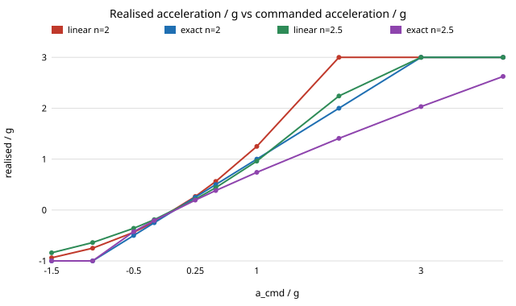

# Inverse-thrust twin: does the exact square-root inverse fix the quadratic-thrust error of `thrust-twin`, and what if the thrust model is also wrong?

Pure Python, no dependencies. Free-choice run (`PROJECTS.md`, Picking work): it takes the "next step" listed in `research/thrust-twin` (use the exact inverse instead of the linear one) and asks what that buys when the twin's thrust exponent is itself misidentified. Produced with AI assistance (Claude). Stylised: 1-D altitude, unit mass, noiseless, a simulated "real" system with an assumed `T = g r²` thrust curve (`r` = throttle / hover throttle), exact hover trim, throttle ratio limited to [0, 2] (assumed), no field data.

**Setup.** `ẍ = g (r² − 1)`. The controller computes `a_cmd = kp (x₀ − x) − kd v` and inverts its thrust model `T = g r^n̂`, with assumed exponent `n̂` (truth: 2). *Linear* inverse: `r = 1 + a_cmd/(n̂ g)` (what `thrust-twin` used, with `n̂ = 2`). *Exact* inverse: `r = (1 + a_cmd/g)^(1/n̂)`. Hover trim is exact for every `n̂`, so there is no steady offset and overshoot is comparable.

## Reproduce
```bash
cd research/invthrust-twin
PYTHONPATH=src python3 -m unittest discover -s tests -v   # 7 tests, under a second
PYTHONPATH=src python3 experiments/run.py > experiments/results.txt   # seconds
python experiments/figure.py                              # writes experiments/inv.svg
```

## Results (from `experiments/results.txt`; RK4, dt = 1 ms, ζ = 0.7, ωn = 1, twin overshoot 0.0460)
- With the right exponent (`n̂ = 2`) the exact inverse realises `ẍ = a_cmd` exactly while `a_cmd ∈ [−g, 3g]` (tested); outside, the throttle limits bind (free fall at `−g`, cap at `3g`).
- Overshoot for step `p = ωn²|x₀|/g = 2`, `n̂ = 2`: linear 0.064 up / 0.034 down; exact 0.046 / 0.045. The up/down gap falls from 3.00 to 0.09 points. The exact case is still not the twin's 0.0460 on the descent at `p = 2` (0.0450) because the damping term pushes `a_cmd` below `−g` and the floor binds.
- With a wrong exponent the exact inverse does not stay ahead. `n̂ = 2.5` at `p = 2`: linear 0.102 up / 0.065 down (gap 3.67 points); exact 0.071 / 0.088 (gap 1.65). The exact inverse flips the asymmetry's sign (descent now overshoots more) and the gap is about half as large, but the overshoot is 0.071–0.088 against the twin's 0.046 in both modes. `n̂ = 1.5`: linear gap 1.63, exact 0.79.
- Settling time at `n̂ = 2.5`, `p = 2`: 6.71 / 6.79 s (linear up / down) and 6.68 / 6.81 s (exact), against 5.98 s in the twin: no meaningful difference.



## Limitations and next steps
Stylised: one axis, static thrust map with no motor lag (`lag-twin`), exponent error is the only model error considered, throttle ceiling `2 u_hover` assumed, a single gain pair, no noise. The exponent range (1.5 to 2.5) is arbitrary and the conclusions are for it only. Next: identify `n̂` online from hover-and-step data and measure the residual; add motor lag to see whether the exact inverse changes the stability margin.

**Builds on.** `research/thrust-twin` (this repository) and the digital-twin simulation-fidelity direction of ARPG (<https://arpg.colorado.edu/>), the Autonomous Systems IRT (<https://www.colorado.edu/irt/autonomous-systems/>) and RECUV (<https://www.colorado.edu/recuv/>); no specific paper from those groups is reproduced and nothing here is affiliated with or endorsed by them. Inverting a nonlinear actuator map (feedback linearisation) is textbook practice; no external citations are used. MIT.
