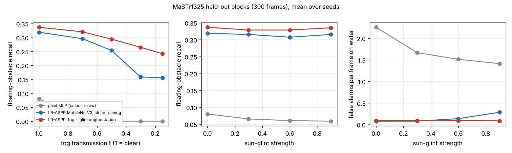

# How well does a small maritime segmentation network see floating obstacles, and how much do fog and sun glint cost? MaSTr1325 on a CPU

**Status: preliminary; milestone 9a of `marine-detect` (track 23), a sub-study of the
[`marine-hull`](../marine-hull/PROPOSAL.md) programme.** An autonomous boat's collision avoidance
([`marine-colregs`](../marine-colregs/README.md)) is only as good as what its camera finds on the water. This step trains
a published lightweight segmentation network on the public MaSTr1325 dataset on four CPU cores, scores it on held-out
sequence blocks by whether it finds each *floating* obstacle (not just pixel IoU), and measures what physically modelled
fog and sun glint do to that. Research code, not a certified perception system.

**Live page:** https://marisstella.app/research/marine-detect/

## Result (300 held-out frames from 16 sequence blocks, 204 floating obstacles, 3 seeds, mean and 95% t-interval)

| model | mIoU | obstacle IoU | floating obstacles found | of those at least 16 px (n = 31) | false alarms per frame |
|---|---|---|---|---|---|
| pixel MLP (colour, saturation, row) | 0.848 | 0.642 | 8.0% | 10.8% | 2.25 |
| LR-ASPP MobileNetV3, clean training | 0.967 +- 0.004 | 0.919 | 31.9% +- 4.9 | 60.2% +- 12.2 | 0.08 |
| LR-ASPP, fog + glint augmentation | 0.967 +- 0.000 | 0.920 | 33.7% +- 6.2 | 64.5% +- 16.0 | 0.09 |



- **A 0.97 mIoU hides a detector that misses most floating obstacles.** Pixel IoU is dominated by water, sky and
  shore. Of the 204 obstacle components surrounded by water, the network covers half the pixels of only a third.
  173 of them are under 16 pixels at 320x240 (41 px in the 512x384 originals): distant buoys and swimmers, and
  fragments of thin structures (poles, mooring lines); recall there is 27%. Larger objects: 60% (32 to 256 px 48 to
  64%, over 256 px 100%; n = 31, so the object-sampling interval alone is about +-17 points).
- **Fog costs the clean-trained network most of its large-object recall.** At transmission 0.3 (an object at 31% of
  the visibility range) recall of objects of at least 16 px falls from 60% to 28%, and to 23% at t = 0.15, while
  mIoU only drops from 0.967 to 0.884. The pixel MLP finds nothing at t = 0.5.
- **Fog augmentation makes recall almost fog-invariant, but on the same fog model it was trained on.** With fog and
  glint in training, large-object recall stays at 61 to 65% across every fog level, and all-object recall falls only
  from 34% to 24%. Real fog thickens with range and is not this uniform affine change, so this is an upper bound on
  what augmentation buys.
- **Glint does not hide obstacles; it creates false ones.** Recall is flat under glint for every model, but the
  clean-trained network's false alarms on open water rise from 0.08 to 0.28 per frame at glint strength 0.9 (3.6x);
  with augmentation they stay at 0.09.
- **Far obstacles are missed first.** Objects within 10 rows of the water edge (far away on a flat sea) are found
  10 to 26% of the time; those more than 40 rows below it 46 to 50% (clean frames). At t = 0.15 the near group also
  falls, to 12% (clean training) and 19% (augmented).
- Full tables, by size and by rows below the water edge: [`experiments/results.txt`](experiments/results.txt).
  Training takes 12 to 13 minutes per LR-ASPP run on 4 CPU cores. CPU training is not bit-reproducible: a rerun of
  one seed moved clean mIoU by 0.002.

## Method and reproduce

```bash
cd research/marine-detect
pip install -r requirements.txt                       # CPU torch is enough
PYTHONPATH=src python3 -m pytest tests -q             # metric and degradation tests, no torch needed
# MaSTr1325 (CC BY 4.0), 22 MB + 2 MB, unpacked into one directory:
curl -O https://data.vicos.si/borja/mastr1325_dataset/MaSTr1325_images_512x384.zip
curl -O https://data.vicos.si/borja/mastr1325_dataset/MaSTr1325_masks_512x384.zip
unzip -q MaSTr1325_images_512x384.zip -d mastr && unzip -q MaSTr1325_masks_512x384.zip -d mastr
PYTHONPATH=src python3 experiments/run.py --data mastr --cache mastr320.npz    # about 2 hours on 4 cores
PYTHONPATH=src python3 experiments/horizon.py --data mastr --cache mastr320.npz
python3 experiments/aggregate.py > experiments/results.txt
python3 experiments/figure.py
```

SHA-256 of the two archives used here are in `src/marine_detect/data.py`.

- **Data.** MaSTr1325 (Bovcon et al. 2019): 1325 frames at 512x384 from a small USV in the Gulf of Koper, with
  per-pixel labels obstacle/environment, water, sky and unknown (ignored). Frames come from sequences, so a random
  frame split leaks near-duplicates into test. The split here is by blocks of 25 consecutive ids, hashed: 1025 train
  frames, 300 test frames. Everything runs at 320x240.
- **Models.** LR-ASPP on an ImageNet MobileNetV3-Large backbone (Howard et al. 2019; torchvision), 3 classes, AdamW
  with a one-cycle schedule, 10 epochs, batch 8, horizontal flips; trained twice, once on clean frames and once with
  fog and glint augmentation (each applied with probability 0.5, t from 0.15 to 1, glint 0 to 0.9). A per-pixel MLP on
  colour, saturation and image row is the classical rung (3 epochs). Three seeds each.
- **Scores.** Pixel IoU per class, and two detection-style scores in the spirit of MODS (Bovcon et al. 2022), which
  MaSTr1325 has no boxes for: a *floating obstacle* is an obstacle component that does not touch the frame and whose
  3-pixel ring (unknown pixels skipped) is mostly water; it is *found* when at least half its pixels are predicted
  obstacle. A *false alarm* is a predicted obstacle blob of at least 4 pixels lying wholly on ground-truth water.
  The test blocks hold 204 floating obstacles.
- **Fog** is the atmospheric scattering model I = J t + A (1 - t) (Koschmieder 1924; Narasimhan and Nayar 2002;
  synthetic fog for segmentation as in Sakaridis et al. 2018), with uniform transmission t and airlight 0.8. With
  the 2% contrast threshold an object seen through transmission t sits at d / V = -ln(t) / 3.912 of the
  meteorological visibility V: t = 0.5 is an object at 18% of the visibility range, t = 0.15 at 48%.
- **Glint** is stylised: three saturating Gaussian highlights (sigma 6% of the width) centred on random water pixels,
  added and clipped at 1; its strength is swept 0.3 to 0.9 because no glint statistics for this site exist.
- **Range.** Each floating obstacle's waterline row is compared with its frame's water edge (median topmost water
  row, from the ground truth); on a flat sea, rows below the edge fall roughly as 1 / range.

## Related work

- Bovcon, Muhovič, Perš and Kristan (2019), *The MaSTr1325 dataset for training deep USV obstacle detection models*,
  IROS, doi:10.1109/IROS40897.2019.8967909. The data used here.
- Bovcon and Kristan (2022), *WaSR: a water segmentation and refinement maritime obstacle detection network*, IEEE
  Transactions on Cybernetics, doi:10.1109/TCYB.2021.3085856. The strong published baseline this step does not yet
  reproduce (it needs the IMU channel and a ResNet-101 encoder).
- Bovcon, Muhovič, Vranac, Mozetič, Perš and Kristan (2022), *MODS: a USV-oriented object detection and obstacle
  segmentation benchmark*, IEEE Transactions on Intelligent Transportation Systems, doi:10.1109/TITS.2021.3124192.
  The detection-style protocol the scores here imitate.
- Žust, Perš and Kristan (2023), *LaRS: a diverse panoptic maritime obstacle detection dataset and benchmark*, ICCV,
  arXiv:2308.09618. A larger successor dataset.
- Howard et al. (2019), *Searching for MobileNetV3*, ICCV, arXiv:1905.02244. The backbone and LR-ASPP head.
- Narasimhan and Nayar (2002), *Vision and the atmosphere*, IJCV 48(3), doi:10.1023/A:1016328200723. The scattering model.
- Sakaridis, Dai and Van Gool (2018), *Semantic foggy scene understanding with synthetic data*, IJCV,
  arXiv:1708.07819. Synthetic fog for training and testing segmentation.

Related labs: ARPG (Heckman; perception and sim-to-real for field robots), RECUV (unmanned vehicles).

## Limitations

- 320x240 instead of 512x384, 10 epochs on a CPU, no IMU channel: a baseline, not a reproduction of WaSR's numbers.
- MaSTr1325 has no official test split; the block split is ours, and every frame is from one harbour in fair weather.
- Fog is uniform over the frame (real fog thickens with range), and the glint model has no sourced statistics.
- "Floating obstacle" and "found" are mask-based analogues of MODS, not the MODS protocol, and the smallest
  components include annotation fragments a person would not call an obstacle.

## Next steps

- Evaluate on MODS itself (its sequences and protocol) so the numbers compare with WaSR and the published leaderboard.
- Depth-dependent fog from the flat-sea geometry and the camera height, instead of uniform transmission.
- Turn recall against range into a miss-rate model and feed it to `marine-colregs`: how late does the boat see a
  buoy, and what does that do to its closest point of approach?

AI-assisted (Claude Code).
