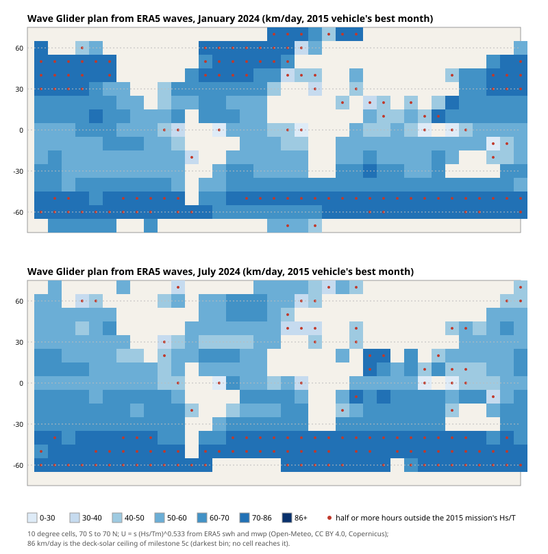
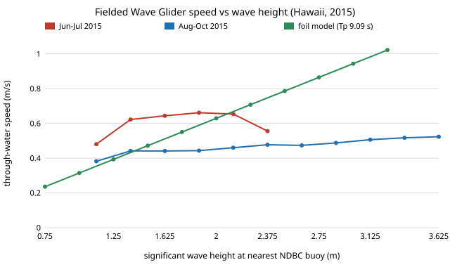

# Which body carries a survey payload furthest per kWh? Hull choice for small autonomous boats

**Status: open research programme (proposal stage), milestones 1 and 2 done.** A stdlib resistance and
range calculator for small displacement survey boats (`src/marine_hull/`, 9 tests) and a first
sweep: at equal displacement, a catamaran out-ranges a monohull in only **0.4% of 6,561 swept
cases and in none at equal length**, because friction (wetted area) sets drag at survey speed
below 1 m/s and hotel load fixes the best speed near 1 m/s. Milestone 2 replaces the placeholder wave term with Michell thin-ship theory: the catamaran
wins **3.3%** of 6,561 cases, still none at equal length, and wave resistance moves best range by
only 4%. Milestone 5 adds a hydrofoil rung: in 2,916 swept cases a foilborne 200 kg craft never out-ranges the monohull (best case about a quarter of its range; foil coefficients swept, not sourced). Preliminary: Michell is checked against one published Wigley tank point only (milestone 3a: with no form factor the model is within a few per cent; at the central k = 0.25 it is about 20% high). Milestone 3b checks the placeholder wave term against five tank speeds of a published 2.8 m catamaran (Zenodo 18459868, CC BY 4.0): it is 35 to 43% low at Fn 0.33 to 0.58 and no single wave scale keeps all five within 20%, so it is not safe above Fn 0.3 (the programme's survey speeds are below that). See [`PROPOSAL.md`](PROPOSAL.md) and
[`LOG.md`](LOG.md).

**Paper draft in IEEE format (milestone 7s).** [`paper/main.tex`](paper/main.tex) and [`paper/refs.bib`](paper/refs.bib) set the hull-ranking result as an OCEANS (IEEE/MTS) conference draft: seven body types on one energy basis, the ranking table, the tank checks and threats to validity, with one figure generated from `experiments/results_solar_mc.txt` by `paper/make_figures.py`. No experiment was run for it: `paper/check_numbers.py` checks each of its quoted figures (83 since 7v) against the results file it names (`tests/test_paper.py`). Build: `cd paper && python3 make_figures.py && pdflatex main && bibtex main && pdflatex main && pdflatex main` (needs `texlive-latex-recommended`, `texlive-fonts-recommended` and `texlive-publishers` for IEEEtran). **First compiled in milestone 7zb: 5 pages, five figures and one table, no LaTeX errors, warnings or overfull boxes** (the proposal aims at 6 to 10 pages). Every step from 7s to 7za said "not compiled here", and the first build found an unescaped underscore in a `refs.bib` note that broke the bibliography, Table I running 44 pt past the column, and a stale threats-to-validity sentence ("no seakeeping", written before 7y to 7za added head-sea added resistance); all three are fixed. `check_numbers.py` now checks 130 quoted figures. Before submission: 8 of 19 references still carry a "not machine-checked" or "from memory" note in `refs.bib`, and they print in the PDF. Not submitted; the learned solar corrections and wing-sail chains are left for companion papers. **References checked (milestone 7zc):** each of the 20 entries in `refs.bib` was looked up in Crossref or Zenodo. All 12 DOIs resolve (`paper/cite_check.json`). One field was wrong (Savitsky 1964 is in issue 4, not 1), and Wang et al. (2017) has six named authors. Every entry still without a DOI says why in its note.

**Where does a small survey boat's energy go (milestone 7zb, the paper's method figure)?** At survey speed, mostly to the payload. Splitting the central 4 m monohull's electrical energy per km (200 kg, 10 kWh, 30 W hotel load) into ITTC 1957 friction, form factor, Michell wave and hotel terms puts the minimum at **12.14 Wh/km at 1.00 m/s** (Fig. 2's 823.7 km), where propulsion is only **31.4%** of the power. At 0.5 m/s the hotel term is 16 times the hull terms; at 2 m/s the hull terms are 4.4 times the hotel term and waves are 31% of the hull resistance. Without the wave term the best speed would be 1.10 m/s (share 0.358); the wave term, rising past 1 m/s, pulls it down by 0.1 m/s. Drawn as the paper's Fig. 1 (`paper/fig_energy_split.tex`) and [`experiments/energy_split.svg`](experiments/energy_split.svg), from [`experiments/results_energy_split.txt`](experiments/results_energy_split.txt) (`experiments/run_energy_split.py`, under 1 s, stdlib; 4 tests in `tests/test_energy_split.py`).

**Where does each hull's range peak (milestone 7t, a paper figure)?** At survey speed only for the displacement hulls. At the centre of each rung's swept box (200 kg, 10 kWh, 30 W hotel load) the monohull peaks at **823.7 km at 1.00 m/s**, the catamaran at 713.1 km at 0.90 m/s and SWATH at 546.1 km at 0.70 m/s, while the hydrofoil cannot fly below 9 m/s (peak 116.4 km at 10.25 m/s) and the planing hull peaks at 80.3 km at 3.25 m/s. Varying the monohull's hotel load from 5 to 120 W moves its best speed from 0.60 to 1.65 m/s (slope 0.32 in log-log, near the 1/3 of a cube drag law) and its range from 2,670 to 323 km. Drawn as the paper's range-against-speed figure (`paper/fig_range_speed.tex`) and as [`experiments/range_speed.svg`](experiments/range_speed.svg), from [`experiments/results_range_speed.txt`](experiments/results_range_speed.txt) (`experiments/run_range_speed.py`, 1 s, stdlib). No new sweep: each curve uses its own milestone's model.

**SUBOFF check (milestone 3u).** Integrating the DARPA SUBOFF bare-hull equations gives 5.988 m² of wetted area, and with it the measured DTMB tow-tank resistance implies a bare-hull form factor 1+k = **1.17** (1.14 to 1.18 over water viscosity) above 5 m/s. Hoerner's streamlined-body formula gives 1.07, **8% low**; the bow tripwire's drag is part of that gap. See [`LOG.md`](LOG.md).

**Do real ocean waves change the hull ranking (milestone 7y)?** Not on energy, but they decide whether a hydrofoil can fly at all. Using the ITTC's STAWAVE-2 added-resistance method (ITTC 7.5-04-01-01.1, 2021) over **14,758 hourly NDBC sea states** (11 buoys, January and July 2024, mean significant wave height 1.44 m), the 4 m survey monohull loses **2.5% of its 30 W range** when, as the ITTC prescribes, only waves within 45 degrees of the bow add resistance, and **9.4%** if every wave were met head-on; its best speed stays at 1.00 m/s, and the loss falls from 5.1% at 1 W of payload to 0.5% at 1 kW. Even with the hydrofoil paying nothing in waves, the monohull still goes furthest up to 200 W in all 972 foil cases, and the central crossover moves only from 659 W to **651 W** (627 W all head-on; 698 W with 7x's measured wind too). The bigger finding is operability: only **2.4% of open-ocean hours** have waves at or below the foil's 0.3 m strut draft, 37% at or below 1 m, and at the four Pacific buoys at most 23% at or below 1 m in either month. All eight pre-registered expectations held. Caveat: STAWAVE-2 is fitted to 50 to 400 m ships, so at 4 m these are extrapolations. See [`experiments/wave_added_resistance.svg`](experiments/wave_added_resistance.svg) and [`experiments/results_wave_added_resistance.txt`](experiments/results_wave_added_resistance.txt) (`experiments/run_wave_added_resistance.py`, about 1 minute, stdlib).

**Is the ship-scale wave formula right for a 4 m hull (milestone 7z)?** It underestimates. STAWAVE-2 is fitted to 50 to 400 m ships, so we recomputed the wave term from the hull's own sections with a stdlib strip-theory solver written for this step ([`src/marine_hull/strip.py`](src/marine_hull/strip.py): Frank close-fit 2D heave coefficients, heave and pitch by ordinary strip theory, Gerritsma-Beukelman 1972 added resistance). Over the same 14,758 sea states it gives **2.1 times STAWAVE-2's wave term** at the monohull's 1 m/s, so the 30 W range loss is **4.3%** (bow sector) rather than 2.5%, and 15.1% rather than 9.4% all head-on. Part of the gap is the methods' own: on an in-range Wigley (L/B 7, B/T 2.5) strip theory already peaks 2.6 times above STAWAVE-2, against 5.7 times on the slender, deep 4 m hull. Either way the ranking and the 200 W scope hold: no foil case overtakes the monohull at or below 200 W, and the central crossover is 641 W. The solver is checked against reference values, a free-surface residual of 4e-6 and near/far-field energy balance within 3%; it has no viscous damping and no tank validation yet. See [`experiments/strip_added_resistance.svg`](experiments/strip_added_resistance.svg) and [`experiments/results_strip_added_resistance.txt`](experiments/results_strip_added_resistance.txt) (`experiments/run_strip_added_resistance.py`, about 4 minutes on 4 cores, stdlib).

**Does the factor of two survive viscous damping (milestone 7za)?** Only partly. 7z's gap comes from a sharp heave/pitch resonance that the potential-flow model damps by wave radiation alone (12.9% of critical in heave). Adding an equivalent viscous damping swept 0 to 20% of critical cuts the pooled 1 m/s ratio to STAWAVE-2 from 2.13 to 1.20 at 10% and to 1.00 at 20%, and the 30 W range loss from 4.3% to 2.8% and 2.5%. Calibrating the damping so strip theory matches STAWAVE-2 on an in-range Wigley (9.1% of critical) and carrying it to the 4 m hull gives **a 2.9% loss**, the programme's best single estimate (post hoc, and it assumes STAWAVE-2 is right in range). The ranking and the 200 W scope hold at every damping level. See [`experiments/strip_viscous.svg`](experiments/strip_viscous.svg) and [`experiments/results_strip_viscous.txt`](experiments/results_strip_viscous.txt) (`experiments/run_strip_viscous.py`, about 4 minutes, stdlib).

**Is the in-house strip theory as good as the published state of the art (milestone 7ze)?** In heave, yes; in added resistance, no. The same Kashiwagi (2022) figures plot four computed curves (his enhanced unified theory EUT, his strip method NSM, and both with a forward-speed correction) and the measured heave-pitch cross-coupling coefficients; we read them from the PDF's vectors ([`experiments/digitise_kashiwagi2022_curves.py`](experiments/digitise_kashiwagi2022_curves.py), [`data`](experiments/data/kashiwagi2022_curves_fn020.csv)). Our strip code matches his strip code to within 5% in heave and 2% at the added-resistance peak. Heave rms error over lambda/L 0.8 to 2.0: modified NSM 0.145, modified EUT 0.156, **ours 0.166**, NSM 0.170, EUT 0.375. Added-resistance rms over lambda/L 0.65 to 2.0: modified EUT 0.95, modified NSM 1.06, **ours 1.55**, STAWAVE-2 3.01. Our +26% heave overshoot at resonance is shared by every method but the modified NSM, and it is carried by the speed-induced added-mass coupling A35: with the measured A35 and A53 in our motion equations it becomes -10%, while swapping in the measured damping coupling changes nothing. Our Gerritsma-Beukelman form also has A53 = 0 exactly, which the measurement contradicts. Limits: one hull at one speed, curves read from figures, the A35 = A53 = 0 variant is post hoc. See [`experiments/kashiwagi_baselines.svg`](experiments/kashiwagi_baselines.svg) and [`experiments/results_kashiwagi_baselines.txt`](experiments/results_kashiwagi_baselines.txt) (`experiments/run_kashiwagi_baselines.py`, 45 s, stdlib).

**Does dropping the heave-pitch added-mass coupling change the wave-loss estimate (milestone 7zf)?** No. 7ze's rule (A35 = A53 = 0) refitted on the Kashiwagi tank hull lowers the measurement-fitted viscous damping from 2.5% to 1.8% of critical, and the 4 m monohull's 30 W bow-sector wave loss moves from 3.69% to 3.75% (per-series fits 3.1% to 4.2%; 200 W scope holds in all 14 rows). The motions decide between the readings: the damping fitted to the added resistance alone already brings heave to +3.3% at resonance (rms 0.135, lower than any published curve), while the rule plus its damping overdamps heave to -19%. So the rule stays a sensitivity case and the 3.7% estimate stands ([`results_a0_coupling_transfer.txt`](experiments/results_a0_coupling_transfer.txt)).

**Is the strip theory right in three dimensions (milestone 7zl)?** In the motions and the added resistance, yes, at zero speed; in the coefficients, no. We checked the in-house strip solver against [Capytaine](https://github.com/capytaine/capytaine) (Ancellin and Dias 2019, doi:10.21105/joss.01341), an open-source 3D boundary-element (panel) code, on the Kashiwagi tank hull (L/B 6.67) and the 4 m monohull (L/B 10), with the same mass, inertia and restoring on both sides. On an L/B 30 Wigley the two codes agree within 0.9% (code check), and the panel results move by at most 1.4% from 640 to 2,560 panels. On the real hulls strip theory's heave added mass is 19% to 27% *below* the 3D value over lambda/L 0.5 to 2.0 (the opposite of our prediction) and its pitch damping up to 5 times above it in long waves, but the errors cancel in the motions: heave RAO areas agree to 0.2%, pitch to 5% (tank) and 1% (monohull), and the Gerritsma-Beukelman added resistance computed with the 3D motions is **1.055** (tank) and **1.009** (monohull) of the strip value. So the motion term that carries almost all of the monohull's 3.4% to 4.2% wave loss is not sensitive to strip theory's missing longitudinal flow, at least at zero speed; forward speed is not tested. Read with 7zk below, this makes the missing flow along the hull an unlikely cause of the L/B 10 shortfall at zero speed; it says nothing yet about forward speed. Five of eight expectations committed before the run held. [`experiments/run_panel_check.py`](experiments/run_panel_check.py), [`results_panel_check.txt`](experiments/results_panel_check.txt), [`src/marine_hull/panel.py`](src/marine_hull/panel.py), `LOG.md`.
**Does the wave model hold at the monohull's slenderness, L/B 10 (milestone 7zk)?** Not yet: it predicts too little. Every tank check so far was on Kashiwagi's L/B 6.67 hull at one Froude number. Journée's (1992, Delft report 0909) Wigley I and III are L/B 10, tested at Fn 0.2, 0.3 and 0.4; the report could not be opened from here, so this uses the measured added-resistance peaks as quoted by the documentation of an independent open strip-theory code (second-hand, peak only). With nothing refitted, the model with the damping fitted to the L/B 6.67 hull's motions gives **0.70 (Wigley I) and 0.78 (III) of the measured peak at Fn 0.2**, and 0.75 and 0.81 with no viscous damping at all; the heave RAO of Wigley I at Fn 0.3 near resonance is **31.6% low** (12% undamped), so a damping fraction fitted on one hull does not carry to another. The model does order the two hulls as the tank does, and the reflection-term choice moves the Fn 0.2 peak by under 8%. Post hoc, scaling the 4 m monohull's motion term by those Fn 0.2 ratios would raise its 30 W wave loss from 3.4% to **4.2% to 4.8%**, at or above the top of the 3.4% to 4.2% bracket; the ranking and the 200 W scope hold in every row. Three of six expectations committed before the run held. The paper's threats section now says so; the bracket stays until the report's own tables are read. [`experiments/run_journee_lb10.py`](experiments/run_journee_lb10.py), [`results_journee_lb10.txt`](experiments/results_journee_lb10.txt), `LOG.md`.

**Does the NMRI fine-bow correction used in ISO 15016 speed trials fix the short-wave deficit (milestone 7zj)?** No: it overshoots. The NMRI reflection term uses the same waterline integral as Faltinsen et al. (1980) but multiplies it by 1 + C_U Fn with C_U = max(10, 68 &minus; 310 B_f), a coefficient that grows as the bow gets finer. On the Kashiwagi tank hull (B_f 0.0517, so 1 + C_U Fn = 11.4 at Fn 0.2) with the damping fitted to the motions alone, strip theory plus the NMRI term is 1.124 of the held-out added-resistance area and 2.01 of the measured short-wave resistance, almost exactly STAWAVE-2's 1.134 and 2.08, where Faltinsen's term gave 0.929 and 0.58. With C_U at its floor of 10 the rows are 0.962 and 0.73. On the 4 m monohull the NMRI term gives a 30 W loss of 3.73% (3.40% to 3.73% over the variants), inside the 3.4% to 4.2% bracket of 7zi. All six expectations, committed before the run, held. Source caveat: ISO 15016 and the ITTC procedure could not be opened in this session (egress proxy), so the coefficients are as those documents are quoted; the paper does not rely on this row yet. [`experiments/run_nmri_reflection.py`](experiments/run_nmri_reflection.py), [`results_nmri_reflection.txt`](experiments/results_nmri_reflection.txt), `LOG.md`.

**Paper section on wave added resistance (milestone 7zi).** Section III-B of [`paper/main.tex`](paper/main.tex) now sets out the wave chain of milestones 7y to 7zh in one place, with Table II listing six estimates of the 4 m monohull's 30 W wave loss (2.52% to 4.31%) and which of them were fitted to the tank data they are compared against. The two rows whose damping comes from the measured motions alone straddle the tank measurement (areas 0.929 and 1.134) and give **3.4% to 4.2%**; they share the motion term (2.84 N at 1 m/s) and differ only in the reflection term (0.03 N against 0.73 N), so the bracket's width is the short-wave reflection term. A semi-empirical short-wave correction was not applied because no source for one could be opened from here (`LOG.md`). The paper compiles to 6 pages with no warnings.

**Is the remaining 13% added-resistance excess the reflection term (milestone 7zh)?** Yes. STAWAVE-2's short-wave (reflection) term scales with the beam, so on a fine Wigley bow it acts as if the bow were nearly blunt. Replacing it with the waterline-shape formula of Faltinsen et al. (1980), computed from the hull's own waterline and with nothing fitted to the added resistance, moves the held-out tank area from **1.134 to 0.929** of the measured mean (sigma rms 1.555 to 1.289; per series 0.82 to 1.16), at 7zg's motion-fitted damping. In short waves (lambda/L 0.3 to 0.6) the waterline term is 0.58 of the measurement where STAWAVE-2's was 2.08. On the 4 m monohull, whose L/B 10 waterline is finer still, the reflection term at 1 m/s falls from 0.73 N to 0.03 N and the 30 W bow-sector loss is **3.4%** (3.38% to 3.43% over the draft-factor and speed-factor variants). The tank data are now bracketed from both sides: 3.4% (tank area 0.93) and 4.2% (tank area 1.13), so the best estimate is **3.4% to 4.2%**, and the ranking and 200 W scope hold ([`results_faltinsen_reflection.txt`](experiments/results_faltinsen_reflection.txt), `experiments/run_faltinsen_reflection.py`, 3 minutes, stdlib).

**Fitted to the tank motions alone, what damping and wave loss do the data support (milestone 7zg)?** Heave damping 3.75% of critical, pitch none, and a 30 W wave loss of **4.2%**, not 3.7%. Earlier damping values were fitted to the measured added resistance itself. Fitting separate heave and pitch fractions to Kashiwagi's 32 heave and pitch points only (heave rms 0.127, pitch 0.138, both better than any single fraction) and holding the added resistance out, strip theory plus STAWAVE-2's reflection term still comes out **1.13 times** the measured mean area. So the damping that fits the motions leaves a 13% excess that sits in the added-resistance formula, not in the motions, and the 3.7% estimate came from damping pitch that the pitch data say is undamped. Carried to the 4 m monohull the motion fit gives 4.18% (4.10% to 4.23% over the near-best cells; 4.13% to 4.20% with A35 = A53 = 0); the best estimate is now 3.7% to 4.2%, and the ranking and 200 W scope hold ([`results_motion_damping_holdout.txt`](experiments/results_motion_damping_holdout.txt), `experiments/run_motion_damping_holdout.py`).

**Which wave method does the towing tank believe (milestone 7zd)?** Strip theory, at the resonance. Kashiwagi (2022, *J. Ship Research* 66(1), doi:10.5957/JOSR.04200028) plots measured added resistance for a slender modified Wigley (2 m, L/B 6.67, B/T 2.4, Froude number 0.2), a hull **inside** STAWAVE-2's fit range. We read the 64 measured points straight from the PDF's vector markers ([`experiments/digitise_kashiwagi2022.py`](experiments/digitise_kashiwagi2022.py), [`data`](experiments/data/kashiwagi2022_slender_wigley_fn020.csv)) and ran both methods on the same hull. Strip theory peaks at **11.4** (in R_aw/(rho g zeta^2 B^2/L)) against measured peaks of 9.2 to 13.2. STAWAVE-2 peaks at **5.4**. STAWAVE-2's area still lands near the tank (0.94 of it) only because its short-wave reflection term is 2.5 times the measurement. Strip heave overshoots by 13% to 49% near resonance, while pitch is within 18%. Fitting viscous damping to the tank rather than to STAWAVE-2 gives 2.5% of critical, and the 4 m monohull's 30 W wave loss becomes **3.7%** (3.1% to 4.3% across the four measured series), replacing 7za's 2.9%. The ranking and the 200 W scope hold. Limits: one in-range hull at one speed, points read from a secondary source's figures, and the monohull's L/B 10 is still untested. See [`experiments/wigley_seakeeping_tank.svg`](experiments/wigley_seakeeping_tank.svg) and [`experiments/results_wigley_seakeeping_tank.txt`](experiments/results_wigley_seakeeping_tank.txt) (`experiments/run_wigley_seakeeping_tank.py`, about 4 minutes, stdlib).

**Does real ocean wind change that (milestone 7x)?** Barely, and in the direction a reader might not expect. Still air is the kind case for a slow boat: in a wind met from every heading, the average air force on a craft at speed u grows roughly as 1.5 x u x wind speed, not u squared. Averaging 7w's drag term over all headings and **84,776 ten-minute NDBC buoy winds** (19 buoy-months, 2024, mean 5.68 m/s) costs the 4 m monohull **2.21% of its 30 W range at CdA 0.1 m2 and 8.23% at 0.4 m2**, more than any other hull, yet the hydrofoil's break-even moves **up**, not down: 700 to **706 W** at 0.1 m2 and 818 to **841 W** at 0.4 m2 (box minimum 420 W). At the crossover the monohull already runs at 2.3 m/s and the foil's whole hull is in air, so wind costs the foil more there (+1.01% energy per metre against +0.51%). The 200 W scope holds in every case, with winds scaled to 1 m height (x0.86) or by 1.5 (874 W at 0.4 m2), and per buoy-month the break-even spans only 701 to 711 W. Re-choosing speed per wind and heading recovers nothing: the monohull's best speed stays pinned at a Michell wave-resistance hollow (1.00 m/s). Five of seven pre-registered expectations held; the misses are the sign of the crossover shift and the catamaran and SWATH 30 W ratios moving more than 1% at the larger drag areas (SWATH +1.16% at 0.1 m2, catamaran +1.87% at 0.4 m2). Not modelled: side force and leeway, spray, waves, and how wind and sea state co-vary. See [`experiments/wind_air_drag.svg`](experiments/wind_air_drag.svg) and [`experiments/results_wind_air_drag.txt`](experiments/results_wind_air_drag.txt) (`experiments/run_wind_air_drag.py`, 15 s, stdlib).

**Does air drag change where a hydrofoil out-ranges a monohull (milestone 7w)?** It moves the crossover up, not the conclusion. Adding still-air drag (0.5 x 1.225 kg/m3 x CdA x speed squared) to every rung, with the drag area CdA swept from 0 to 0.4 m2 because no measured value exists for these 200 kg craft, the monohull still goes furthest at every hotel load up to 200 W at every CdA, in the central case and in all 972 hydrofoil cases. The central hydrofoil's break-even rises from **659 W to 700 W at 0.1 m2 and 818 W at 0.4 m2** (box median 881 to 1,063 W; earliest case 310 to 398 W); the planing hull's from 1,068 W to 1,744 W. Air drag also removes 7v's planing grid artefact at large drag areas: at 0.4 m2 the planing hull's best speed at 10 kW falls from 38.75 to 23.5 m/s and the hydrofoil out-ranges it at all 49 loads (only 39 of 49 without air drag). Four of five pre-registered expectations held; the miss is that planing stays near its 40 m/s ceiling up to CdA 0.1 m2 (38.25 m/s), so its crossover is still not a design figure below about 0.2 m2. Spray drag, wind and waves are not modelled. See [`experiments/air_drag.svg`](experiments/air_drag.svg) and [`experiments/results_air_drag.txt`](experiments/results_air_drag.txt) (`experiments/run_air_drag.py`, 2 s, stdlib).

**Does the hull ranking hold for a power-hungry payload (milestone 7v, a paper figure)?** Yes, up to **200 W**, which covers every payload load sourced in this programme (8 to 175 W). Re-running each rung's central case with the hotel load from 1 W to 10 kW, the 4 m monohull goes furthest at every load up to 200 W; the catamaran never overtakes it (best ratio 0.969) and nor does SWATH (0.733). The fast rungs do: the hydrofoil at **659 W** and the planing hull at 1,068 W. Over the hydrofoil's whole 972-case box against the monohull at form factor 0.10 to 0.40 the earliest crossover is 291 W (median 881 W at k 0.25), and no foil or planing case overtakes at or below 200 W. Every crossover lies where the monohull's best speed is already past Froude number 0.3 (from 215 W), where the programme's displacement models are not validated, so the fast-rung crossover is indicative only. The planing peak sits at its 20 m/s grid ceiling above 215 W; a post-hoc 40 m/s grid moves its crossover to 798 W at speeds where the omitted air and spray drag matter, so that number is not a design figure (4 of 5 pre-registered expectations held; "foil beats planing at every load" failed at the top three loads). Drawn as `paper/fig_hotel_ranking.tex` and [`experiments/hotel_ranking.svg`](experiments/hotel_ranking.svg), from [`experiments/results_hotel_ranking.txt`](experiments/results_hotel_ranking.txt) (`experiments/run_hotel_ranking.py`, 2 s, stdlib).

**When does an underwater glider out-range a propeller AUV (milestone 7u, a paper figure)?** When the AUV's hotel load (sensors, computer, everything but propulsion) is more than about **4.9 times** the glider's. Over the 2,430 milestone-4b cases the share the glider wins passes 10%, 50% and 90% at hotel ratios of 2.38, 4.88 and 10.83; with almost no AUV hotel load the glider's median range is only 0.083 of the AUV's, because propeller drag is cheap at the AUV's best speed. Above the crossover the glider's lead grows as about the 2/3 power of the hotel ratio (slope 0.645 from 1 to 10). A post-hoc check found milestone 4b's AUV speed grid stops at 1.5 m/s, which binds in 56% of cases at ratio 20 and steepens the curve there to 0.850; widening it to 4 m/s gives 0.653 and leaves the crossover at 4.87. A REMUS-100-class AUV (ratio 21 to 250) sits where the glider wins at least 99.92% of cases. Drawn as `paper/fig_glider_hotel.tex` and [`experiments/glider_hotel.svg`](experiments/glider_hotel.svg), from [`experiments/results_glider_hotel_curve.txt`](experiments/results_glider_hotel_curve.txt) (`experiments/run_glider_hotel_curve.py`, under 1 s, stdlib).

**Wave Glider check (milestone 6p).** Does a wave-powered glider go faster in bigger waves? On 1,245 hours of a fielded Wave Glider off Hawaii (2015, NOAA ERDDAP) matched to NDBC buoy sea state, barely: median through-water speed is only **1.05 times** higher at 2.5 m+ significant wave height than at 1.5 m or less, where a quasi-steady two-body foil model predicts 1.9 times, and the one-parameter model loses to a constant on held-out months. A **30% speed loss** from June-July to August-October (cause not in the data) is as large as the whole sea-state effect; within a month speed does track wave height. At the programme's buoys a wave glider makes about **33 to 50 km/day**, half the solar ceiling. See [`LOG.md`](LOG.md) and [`experiments/results_waveglider.txt`](experiments/results_waveglider.txt).

**What forecasts a Wave Glider's speed (milestone 6q)?** Its own recent speed does. On the same held-out August to October hours, the median speed of the previous 24 h predicts speed a day ahead with **0.048 m/s** mean absolute error, against 0.135 for a constant. Adding sea state, even with the observed wave height used as a perfect forecast, does not improve it (error ratio 0.99, 95% interval 0.86 to 1.16). Within a month speed scales as about **Hs^0.2**, so doubling the wave height adds roughly 16%. A time-since-launch trend fitted on May to July is useless when extrapolated. See [`experiments/results_waveglider_drift.txt`](experiments/results_waveglider_drift.txt).

**Wave Glider km/day: site or vehicle (milestone 6r)?** Mostly the vehicle. With the measured Hs^0.22 response, a Wave Glider at the programme's 2024 NDBC buoys plans to **30 to 61 km/day**. Picking the best buoy over the worst is worth 20% in January and 34% in July; the 2015 mission's own speed state (best month over worst) is worth 64%, and 82% of the variance in log km/day is between vehicle states. See [`experiments/results_waveglider_site.txt`](experiments/results_waveglider_site.txt).

**Does wave period matter for a Wave Glider (milestone 6s)?** Not measurably, once the vehicle state is held fixed: the period exponent is -0.025 (95% -0.27 to 0.17), adding it to an oracle day-ahead forecast changes the error by under 1%, and 6r's km/day rows move by -0.5% to +1.2%. The Pacific buoys' 10 to 14% lead is from wave height. See [`experiments/results_waveglider_period.txt`](experiments/results_waveglider_period.txt).

**Is the Wave Glider's speed loss fouling or an event (milestone 6t)?** Mostly an event. The 30% loss is mainly one drop between 14 and 15 UTC on **7 August 2015**: through-water speed falls from 0.63 to 0.51 m/s in an hour and stays near 0.45 m/s. The GPS track drops too (over-ground ratio 0.76 over a week), so it is not a sensor fault. On every hour, a step model beats a smooth ramp by 15 to 21 BIC. After the step, speed declines slowly, at about **0.2 to 0.3% a day** (7% a month), the size a fouling ramp would be. A similar drop on 12 June reversed after a week. The pre-registered test, which used only hours within 300 km of a buoy, could not locate the step: the vehicle was 900+ km from every buoy in July, and that test preferred the ramp. The step result comes from the post-hoc analysis on all hours. See [`experiments/results_waveglider_step.txt`](experiments/results_waveglider_step.txt).

**What does the Wave Glider's own wave sensor change (milestone 6u)?** A lot. Milestones 6p to 6t took sea state from an NDBC buoy up to 300 km away. The vehicle also logged its own waves (a Datawell MOSE sensor on the float), wind and battery, on the same NOAA ERDDAP server, and no earlier step used them. Hour by hour the buoy's wave height barely tracks the vehicle's (within-month correlation **0.20**), so it was a poor proxy. With on-board waves, over 3,281 hours, speed scales as **Hs^0.35** (95% 0.30 to 0.42) at a fixed vehicle state, against 0.22 with buoys. That is still far from the quasi-steady model's Hs^1. **Wave period matters a lot:** at a fixed height, longer average period is slower (exponent -0.71, 95% -0.80 to -0.61), which overturns 6s's null. Speed behaves roughly like **(Hs/T)^0.53**, a sub-linear power of heave velocity. Headwind has no measurable effect. Post hoc, an oracle on-board Hs-and-period term cuts the day-ahead forecast error to **0.77** of persistence (95% 0.67 to 0.87), and to 0.67 at three days. That reverses 6q's conclusion that sea state adds nothing. The 7 August step is still mostly the vehicle: speed falls between 14 and 15 UTC while on-board Hs does not move, and sea state explains 30% of the week-scale drop. The battery reached its lowest level of the mission the morning before, but the overnight drain did not change across the step. The June drop that 6t read as a reversible event is mostly sea state (73% of the drop, 52% of the recovery). See [`experiments/results_waveglider_onboard.txt`](experiments/results_waveglider_onboard.txt) (pre-registered) and [`experiments/results_waveglider_onboard_posthoc.txt`](experiments/results_waveglider_onboard_posthoc.txt).

**Wave Glider km/day with the on-board law (milestone 6v).** Re-planning 6r's 2024 NDBC buoy-months with U = s (Hs/T)^0.53 and each buoy's own average period (APD): a Wave Glider plans to **55 km/day (January) and 45 km/day (July)** fleet median at the 2015 vehicle's best month, 33 and 27 at its worst. In **January site matters less** than 6r said (best buoy over worst 1.12, from 1.20): the Pacific's 2.3 to 2.6 m seas come with 8 to 9 s periods, so their heave velocity is no higher than the Gulf's. In **July site matters more** (1.73, from 1.34), now above the vehicle-state ratio (1.68), but the slowest buoys (Gulf of Mexico, Nantucket; Hs about 0.4 m) spend 88 to 95% of their hours below anything the vehicle sailed in, so those rows are extrapolations. Between-state share of the variance falls from 82% to 66%. Matching the MOSE sensor to buoys within 150 km (k_H 1.09, k_T 0.99) moves the medians by +5%. See [`experiments/results_waveglider_site_period.txt`](experiments/results_waveglider_site_period.txt).

**Can a wave model replace the Wave Glider's own wave sensor (milestone 6w)?** For planning, yes; for a day-ahead forecast, barely. ERA5 reanalysis waves (0.5 degree grid, via Open-Meteo) at the vehicle's hourly position correlate 0.87 with the on-board MOSE heave velocity Hs/T within a month (a buoy 100 to 300 km away: 0.20). They give the **same speed exponent, 0.533 (95% 0.45 to 0.62) against 0.534**, and the same monthly km/day to within 0.4 km/day. So a Wave Glider's km/day can be planned from ERA5 anywhere, using the mean period (mwp; the peak period gives 0.33). As a forecast term it adds about 4% skill a day ahead (not significant) and 15% at three days, against 12% and 23% for an oracle on-board sea state with the same law. See [`experiments/results_waveglider_era5.txt`](experiments/results_waveglider_era5.txt).

**How far does a Wave Glider go per day over the open ocean, from a wave model (milestone 6x)?** About **50 to 79 km/day** (10th to 90th percentile; median 63 in January, 61 in July 2024) at the 2015 vehicle's best month, from ERA5 waves on a 10 degree grid, and **no ocean point reaches the 86 km/day deck-solar ceiling**. The winter storm belts near 50 degrees plan fastest (75 to 77 km/day band medians), the long-swell tropics slowest (56 to 57). Checked against 6v's buoy-measured plan at the 2024 NDBC buoys, the ERA5 plan runs **about 10% high** (median ratio 1.10; 75% of buoy-months within 15%). It ranks the buoys right in July (Spearman 0.93) but not in January (-0.12), when the sites differ by only 12%. Post hoc, calibration explains 98% of the buoy-to-buoy variance in that error (r 0.991): ERA5's mean period runs 1.20 times the buoy's average period but 1.29 times the vehicle's own, and the ratio varies with sea type. A third of open-ocean hours lie outside the seas the law was fitted on. See [`experiments/results_waveglider_era5_sites.txt`](experiments/results_waveglider_era5_sites.txt).

**Wave Glider or solar boat: which goes further per day (milestone 6y)?** It depends on the season and latitude, not on the vehicle. 6x compared the Wave Glider with a single 86 km/day solar figure. Using each corridor site's own NASA POWER sunlight for January and July 2024 instead, a 4 m deck-solar survey boat with a 30 W payload sustains **0 km/day whenever daily-mean sunlight is below about 153 W/m2**, because the panels cannot even cover the payload. That was every January site except the equator (North Sea 22 W/m2, Gulf of Alaska 14). Above the threshold it sustains **58 to 103 km/day**. So in July the solar boat beats the 2015 Wave Glider's best-state ERA5 plan at all five sites (the glider plans 44 to 55 km/day), and in January the Wave Glider wins at four of five (58 to 75 km/day in the winter storm belts). Over 54 swept boats and 10 site-months the Wave Glider's best state wins 62% of cases. A full 10 kWh pack lifts the solar boat by 1.2 to 1.6 times over a month, enough to carry it through January in the Florida Straits. Calm-water solar boat; the Wave Glider's own payload power is not modelled. See [`experiments/results_wave_vs_sun_sites.txt`](experiments/results_wave_vs_sun_sites.txt).

**Where does the Wave Glider or solar boat lead, month by month (milestone 6z)?** Along two ocean meridians (150 W and 30 W, 60 S to 60 N) for every month of 2024, using NASA POWER sunlight and ERA5 waves: a 4 m deck-solar survey boat with a 30 W payload goes further per day than the 2015 Wave Glider at its best in **every month within about 20 degrees of the equator** (11 to 12 months a year at 0 to 10 degrees), and the Wave Glider wins **everywhere poleward of about 40 degrees in that hemisphere's winter**, where the boat's panels cannot cover its payload and it sustains 0 km/day. The flip latitude swings about 30 degrees through the year (30 N in January, 50 N from April to August, no flip in June). On the year's mean the boat leads below about 30 degrees and the Wave Glider above about 35; a boat that starts every month with a full 10 kWh pack leads to 40 degrees. Eight of nine pre-registered predictions held; deflating the Wave Glider plan by ERA5's 10% bias changes 2.6% of winners. Calm-water solar boat; one year; the Wave Glider's payload power is not modelled. See [`experiments/results_flip_map.txt`](experiments/results_flip_map.txt) and the map [`experiments/waveglider_vs_solar_flip_map.svg`](experiments/waveglider_vs_solar_flip_map.svg).

**A year at sea on one battery: how far does a solar survey boat get, and how long is its payload off (milestone 6zj)?** 6z gave the boat either the month's mean sun or a full pack every month (a monthly port call). Carrying one 10 kWh pack through all 366 days of 2024 from a 1 January launch, at 30 points along 150 W and 30 W and the five corridor sites: within **20 degrees of the equator the 30 W payload never goes dark** and a simple causal speed policy covers **27,000 to 39,000 km**, 1.25 to 1.86 times the 2015 Wave Glider's best-state year. At **30 degrees** the two tie on distance (0.97) and the payload is dark 13 to 76 days under the causal policy (0 to 54 with perfect foresight). At **40 degrees and beyond**, the payload is dark **77 to 214 days a year** with perfect foresight, exactly as many as a vehicle with the same 1.15 m² panel, pack and payload that never moves: the limit there is the power system, not the hull. The largest payload a full year carries with no dark day is 54 W at the equator, 31 W at 30 degrees, 17 to 22 W at 40, 10 to 13 W at 50 and 8 to 9 W at 60. A 20 kWh pack ends the dark days at 30 degrees but not at 40 or above. Seven of nine pre-registered predictions held; the causal policy reaches 81 to 99% of the foresight plan's distance where neither goes dark. Calm-water boat, daily energy steps, one year; the Wave Glider's own payload power is still not modelled. See [`experiments/results_year_pack.txt`](experiments/results_year_pack.txt).

**How should a solar survey boat bank its battery for winter (milestone 6zk)?** With a **reserve curve**: a pack target for each day of the year, built the way reservoir operators build a rule curve, from the sun of other years. Using ten years of NASA POWER sunlight (2015 to 2024) at the same 30 points, with each year's curve built only from the other nine (300 one-year missions), the curve cuts the payload's dark hours above the unavoidable minimum (what a vehicle that never moves suffers) by **91%**, from 31,664 to 2,937 hours summed, and keeps the payload within a day of that minimum in 119 of 140 point-years at 40 degrees and beyond. A calendar rule that fills the pack from the autumn equinox cuts them only 22%. A curve built from the test year's own sun does barely better (2,767 hours), so the climatology is not the bottleneck. The cost is distance, and it is larger than predicted: a median **0.84** of 6zj's km at 30 degrees and beyond (prediction: 0.90), 0.65 to 0.72 at 50 to 60 degrees. There the mean sun (17 to 24 W of harvest) is below the 30 W payload, the winter shortfall is 110 to 230 kWh against a 10 kWh pack, and the curve reduces to "keep the pack full". In the tropics nothing changes. The foresight plan still covers 6 to 16% more than 6zj's rule while matching the minimum, so a better causal rule exists. Seven of eight pre-registered predictions held. Calm-water boat, daily energy steps. See [`experiments/results_reserve_curve.txt`](experiments/results_reserve_curve.txt).

**Does a battery target that knows the pack's size give the distance back (milestone 6zl)?** Partly. 6zk's reserve curve asked for a full pack all year at 40 degrees and beyond, because the winter shortfall there is ten to twenty times the 10 kWh pack. Putting the pack's capacity inside the rule-curve recursion (the finite-reservoir form) lets the target fall away for 4 to 8 months a year. Over the same 300 one-year missions it adds **7%** to the distance at 40 degrees or more (11 to 13 points of the simple rule's km at 50 to 60 degrees), but raises the avoidable payload downtime from 2,937 to **11,211 hours** (still 65% below the simple rule's 31,664). A curve built from the year's own sun does no better (10,729), so the cause is the speed rule's 10-day lag in refilling the pack, not the climate record. After seeing that, leading the target by 30 days recovered 6zk's downtime (2,954 hours) while keeping the 7% (in sample: chosen from 12 variants on the same data, not yet a held-out result). Four of eight pre-registered predictions held. The perfect-foresight plan still covers 6% more than the simple rule even in the tropics, where no policy goes dark, so most of the remaining distance is in when to spend sun, not how full to keep the pack. See [`experiments/results_two_sided_curve.txt`](experiments/results_two_sided_curve.txt).

**Does the led battery target hold up on years and oceans it was not tuned on (milestone 6zm)?** Yes. 6zl's 30-day lead was picked in sample, so this step fixed an 18-variant grid and a selection rule in advance, tuned on 2015 to 2019 and scored on 2020 to 2024 with every target built only from the five earlier years of sun, then tuned on one ocean meridian and scored on the other. On the held-out years the picked curve (lead 45 days) has **0.95 times** the avoidable payload downtime of 6zk's full-pack curve and covers **6.8% more distance at 40 degrees or more** (11 to 12% at 50 to 60 degrees). The two ocean splits agree (0.84 and 1.09 times the downtime, 4.1% and 8.4% more distance). Five years of climatology work as well as nine (0.99 times the downtime). Four of six pre-registered predictions held; the two misses were the exact lead picked (45, not 20 to 30) and one tropical point where a 20% sun haircut changes, and adds to, the distance. See [`experiments/results_led_curve_holdout.txt`](experiments/results_led_curve_holdout.txt).

**Should a solar boat speed up on sunny days (milestone 6zn)?** No: it should hold its speed steadier. Over the same 300 one-year missions, the perfect-foresight plan covers about 10% more distance than the causal battery-target rule, and that edge is almost all in *how evenly* it spends energy, not in how much it has to spend: it uses only 0.5% more propulsion energy (when made to end the year with the same half-full pack) but gets 0.82 km per even-spend km where the rule gets 0.75. Within 20 degrees of the equator it spends 99% as evenly as is possible. Every rule that follows the sun more closely loses distance: a perfect one-day-ahead sun forecast costs **3.6%**, yesterday's sun 4.6%; catching the sun lost to a full battery gains only 0.2%. Two of seven pre-registered predictions held. Post hoc, a rule that plans power from the *climatological* sun for the day (the same curve the battery target uses) instead of the last week's actual sun covers 2.2% more distance with **0.27 times** the payload dark hours, and with a 30-day battery feedback 5.0% more for 1.09 times the dark hours, half the gap to foresight (in sample; a held-out check is next). See [`experiments/results_speed_timing.txt`](experiments/results_speed_timing.txt).

**Does planning speed from the average sun hold up on years and oceans it was not tuned on (milestone 6zo)?** Yes. 6zn's climatology rule was found in sample, so this step fixed a 24-variant grid (power estimate: 7-day mean, 30-day mean, day-of-year climatology, or climatology scaled by the last 30 days' anomaly; battery feedback 10 to 90 days) and picked on one part of the data. Tuned on 2015 to 2019 with only those years' climatology, the pick, **climatology with a 20-day feedback**, covers **3.5% more distance on 2020 to 2024 with 0.56 times the avoidable payload dark hours** of the 7-day rule, a third of the way to perfect foresight. Tuning on one ocean and scoring on the other gives 3.6% at 0.54 times and 5.5% at 1.17 times. Every climatology variant beats the trailing-mean variant with the same feedback on both distance and downtime; scaling the climatology by recent weather gains nothing and adds 43% to the dark hours. All six pre-registered predictions held. See [`experiments/results_power_estimate_holdout.txt`](experiments/results_power_estimate_holdout.txt).

**Does the 20-day battery feedback hold for other packs and payloads (milestone 6zp)?** Mostly yes, and it is not set by how many days the pack can carry the payload. Across 12 boats (2.5 to 20 kWh packs, 10 to 50 W payloads, 2 to 83 days of storage), tuned on 2015 to 2019 and scored on 2020 to 2024, the picked feedback is **20 days in 5 of the 8 configurations with a 10 or 30 W payload and 10 days in the other three (the smaller packs)**, and the climatology rule beats the 7-day rule on both distance and payload downtime in all 8. Its gain grows with the pack: 0.5 to 1.2% more distance at 2.5 kWh, 1.2 to 3.7% at 20 kWh. With a 50 W payload, more than the deck's 36 W mean harvest, the rule cuts dark hours to about half but loses 1 to 8% of distance at packs up to 10 kWh, and a test-period sun about 1% above the tuning years' average is a likely cause (post hoc). One of six pre-registered predictions held. See [`experiments/results_pack_hotel_tau.txt`](experiments/results_pack_hotel_tau.txt).

**Should the battery target's lead change with the pack and payload (milestone 6zq)?** A little, and it does not fix what 6zp left open. Freeing the target's lead (0 to 90 days) along with the feedback for each of the same 12 boats, tuned on 2015 to 2019 and scored on 2020 to 2024, moves the picked lead with the pack (30 to 60 days at 10 W and 30 W payloads) but does not settle the feedback: it now **rises with the pack too, about 10 days at 2.5 kWh, 20 at 5 to 10 kWh and 30 at 20 kWh**. Where the deck can carry the payload, re-tuning adds at most 0.8% distance over 6zp's lead-45 rule (usually 0.2%), mostly by spending some of the payload-downtime margin. With a 50 W payload no lead or feedback in the grid makes the climatology rule cover the 7-day rule's distance at 2.5 to 10 kWh, so that regime needs a different power estimate, not a different target. Three of six pre-registered predictions held. See [`experiments/results_lead_retune.txt`](experiments/results_lead_retune.txt).

**Does the 50 W payload lose distance because the speed rule waits for the sun to clear the payload draw (milestone 6zr)?** Partly. The climatology rule held station whenever the average sun for the day was below the payload draw, which at 50 W is 78% of test days. Letting it move once that estimate clears 75% of the draw (or dropping the threshold, which gives the same distance at 50 W to four decimals) adds 0.5 to 2.0 points of distance at 50 W and makes the rule beat the 7-day rule on both distance and downtime at 10 and 20 kWh (1.004 and 1.051 x its km), up from 20 kWh alone. At 2.5 and 5 kWh it still covers only 93% and 96% of the 7-day rule's distance: the battery feedback can lift the planned power by at most half the pack over 24 tau hours, under a watt to a few watts on a small pack, so it cannot carry the boat through a below-payload season. Two of five pre-registered predictions held. See [`experiments/results_hotel_gate.txt`](experiments/results_hotel_gate.txt).

**Does mixing the average sun with last week's sun fix the heavy-payload case (milestone 6zs)?** Yes. Planning each day's speed from the average of the climatological harvest for that day and the last 7 days' harvest, with the battery error closed over 30 to 60 days, beats the 7-day trailing-mean rule on both distance and payload downtime at **every pack with a 50 W payload**: **4 to 12% more distance** (1.04 x at 2.5 kWh, 1.05 x at 5 kWh, where climatology alone covered 0.93 and 0.96 x) at 0.53 to 0.94 x the downtime, tuned on 2015 to 2019 and scored on 2020 to 2024. The gain is speed on the days the boat moves, not more moving days. Taking the larger of the two estimates or scaling the climatology by last week's anomaly both overspend the pack. With 10 or 30 W payloads plain climatology stays the pick at 5 of 8 boats. Four of five pre-registered predictions held. See [`experiments/results_season_week.txt`](experiments/results_season_week.txt).

**Does the half-and-half sun estimate hold on an ocean it was not tuned on (milestone 6zt)?** The weight does; the safety margin needs care. Tuning the blend weight on the Pacific, the Atlantic or all points (2015 to 2019) and scoring it on the other ocean and the corridor sites (2020 to 2024) puts it between 0.375 and 0.625 in all 12 heavy-payload (50 W) cases, within one eighth of a step across splits at every pack, and near 0 for a 10 W payload (mean 0.08). Tuned on the Pacific, the rule goes 14 to 35% further than the trailing-mean rule on the Atlantic at 10 and 20 kWh but overshoots its payload downtime (1.05 and 1.98 x); one eighth less weight (0.375, 30-day feedback) goes 11 to 15% further with less downtime there. On a nine-step grid the 10 kWh / 50 W boat gains 2.6 points over 6zs's three-step pick. Three of six pre-registered predictions held. See [`experiments/results_blend_transfer.txt`](experiments/results_blend_transfer.txt).

**Does the battery-scaled blend rule hold on years it was not read from (milestone 6zu)?** Its settings do; its downtime margin depends on the climatology being honest. Building the climatology from 2020 to 2024 and flying 2015 to 2019 instead, tuning picks exactly 6zt's rule (weight 0.5, 0.5, 0.375, 0.375 and feedback 60, 30, 30, 30 days for 2.5 to 20 kWh at 50 W), and that rule goes 11 to 16% further than the 7-day trailing-mean rule in every region. It keeps the payload as lit as that rule in all four Atlantic-and-corridor cases but in only one of four Pacific-and-corridor ones (1.14 to 1.22 x the downtime), where the years flown were 1.4% dimmer than the climatology. One step shorter feedback (20 days, 30 for 2.5 kWh) won on both counts at every battery size, giving up 4 to 8 points of distance (post hoc). Four of seven pre-registered predictions held. See [`experiments/results_reverse_split.txt`](experiments/results_reverse_split.txt).

**Which battery feedback keeps the blend rule's payload margin when the sun climatology is off by 1 to 3% (milestone 6zv)?** It depends on which way the climatology is wrong, and the answer is a window, not a threshold. Scaling the climatology the boat plans with by 0.97 to 1.03 (each five-year half planning with the other half's average, 50 W payload, 2.5 to 20 kWh), the longest correction time at which some blend weight still beats the 7-day trailing-mean rule on both distance and payload downtime shortens as the climatology grows more optimistic in all 8 (half x pack) series: 60 days when it is about 2% pessimistic, 30 when it is honest, 20 when it is 2% optimistic, 10 or none beyond 2.5%. A fixed rule wins only inside a band about 3 to 4 points of bias wide: too pessimistic and it falls behind on distance, too optimistic and it overspends the battery. The shorter-feedback rule from 6zu slides that band about one point toward optimism (it wins from 0.98 to 1.02 x realised sun, the longer rule from 0.97 to 1.00), so it is the safer choice only when the climatology may run sunny. Matched for effective bias, the two halves agree in 15 of 16 cases (post hoc), so the bias, not the years, decides. Three of seven pre-registered predictions held. See [`experiments/results_bias_sweep.txt`](experiments/results_bias_sweep.txt).

**Can the boat tell how far its sun climatology is off and set its own battery feedback (milestone 6zw)?** Yes. Each day the boat divides its last 60 days of solar harvest by what its climatology promised for those days and picks its battery correction time from 6zv's table (60 days if the climatology looks pessimistic, 30 if honest, 20 or 10 if optimistic). On 6zv's 56 cases (climatology scaled 0.97 to 1.03, 50 W payload, 2.5 to 20 kWh, 30 ocean points, ten years) that self-tuning rule goes further than the 7-day trailing-mean rule with no more payload downtime in 46 cases (48 with a 90-day window), against 30 and 36 for the two best fixed rules and 44 for an oracle told the true bias; it never wins fewer than 5 of 8 at any bias. Using the same ratio to correct the climatology itself does worse than doing nothing (24 of 56): it overspends the battery. Four of seven pre-registered predictions held; the table was read from these same cases, so a fresh-data test is next. See [`experiments/results_self_bias.txt`](experiments/results_self_bias.txt).

**Does the self-tuning battery rule hold on years it has never seen (milestone 6zx)?** Yes. With the feedback table, the 60-day harvest-over-climatology ratio and the blend weights all frozen, and ten new years of NASA POWER sun (2005 to 2014, 30 ocean points) planned with a 2015 to 2024 climatology, the self-tuning rule goes further than the 7-day trailing-mean rule with no more payload downtime in 48 of 56 cases (51 with a 90-day window), against 37 and 44 for the two best fixed rules and 47 for an oracle told the true bias; it never wins fewer than 6 of 8 at any bias from 0.97 to 1.03. All seven pre-registered predictions held. See [`experiments/results_fresh_years.txt`](experiments/results_fresh_years.txt).

**Does the self-tuning rule survive a sun climatology that is wrong by season rather than all year (milestone 6zy)?** Yes, and a seasonal error turns out to be a far milder stress than a uniform one. With the climatology scaled day by day by 1 + A cos(2&pi;(d &minus; &phi;)/365.25), A up to 3% and the peak on 1 January, 1 April, 2 July or 1 October, on 2005 to 2014 sun at the 30 points with everything frozen, the 90-day self-tuning rule goes further than the 7-day rule with no more payload downtime in 93 of 96 cases, an oracle told each day's bias in 94, and the slow fixed rule that failed every case at a uniform 3% pessimism in 96. What hurts a battery rule is the climatology's error averaged over months, not its seasonal shape. Four of seven pre-registered predictions held. See [`experiments/results_seasonal_bias.txt`](experiments/results_seasonal_bias.txt).

**Does the self-tuning rule hold when the sun climatology is wrong on average and by season at once, and how large is a real climatology's seasonal error (milestone 6zz)?** Yes. With the climatology scaled day by day by s0 (1 + 0.03 cos(2&pi;(d &minus; &phi;)/365.25)), a mean bias s0 of 0.97, 0.98, 1.02 or 1.03 plus a 3% seasonal swing peaking in any quarter, on 2005 to 2014 sun at 30 ocean points with everything frozen, the 90-day self-tuning rule goes further than the 7-day rule with no more payload downtime in 104 of 128 cases. That is 4 fewer than with the mean bias alone. The best fixed rules win 65 and 71, and an oracle told each day's bias wins 120. Measured from the data, the 2015 to 2024 NASA POWER climatology's seasonal error on 2005 to 2014 has a median amplitude of 1.8% across the 30 points, but 4.5 to 8.5% above 50 degrees latitude. All nine pre-registered predictions held. See [`experiments/results_mean_seasonal_bias.txt`](experiments/results_mean_seasonal_bias.txt).

**Can the boat learn its sun climatology's seasonal error from its own earlier years (milestone 6zza)?** Yes, and that closes the whole gap to the oracle. The boat learns a month-by-month ratio of its own harvest to the climatology over five earlier years (2005 to 2009 or 2010 to 2014), scales the climatology by it, and runs the 90-day self-tuning rule on the other five. Under 6zz's mean plus seasonal biases it goes further than the 7-day rule with no more payload downtime in 120 of 128 cases, against 104 for the uncorrected rule and 120 for an oracle told each day's bias, and goes at least as far as the 7-day rule in all 168 cases. The test that matters most uses no added bias, only the climatology's own error, at the nine points where that error swings by more than 3% through the year (mostly above 50 degrees): there the uncorrected rule wins 1 of 8 cases, the corrected rule 5, and the corrected climatology with a fixed 30-to-60-day feedback 7. A per-point mean correction alone does not help (21 of 168 at those points). All seven pre-registered predictions held. In the added-bias sweeps the bias is the same in the learning and scored years, so learning removes it by construction; see the limits in `LOG.md`. See [`experiments/results_learned_season.txt`](experiments/results_learned_season.txt).

**How many earlier years does the boat need to learn that correction (milestone 6zzb)?** About three; one is worse than none outside high latitudes. Learning the month-by-month harvest / climatology ratio from the 1, 2, 3 or 5 years of the other half nearest the scored half, with everything else as in 6zza, the corrected 90-day rule goes further than the 7-day rule with no more payload downtime in 97, 116, 142 and 158 of 168 cases, against 139 for no correction. A one-year ratio is off the five-year one by 4.4% per month (median over 30 points), more than the climatology's real seasonal error at most points (1.8%), so it adds error: with only the climatology's own error it wins 4 of 8 pooled cases against 8 for no correction. Three years cut the noise to 1.7% and win 8 of 8. Above 50 degrees, where the real error is 4.5 to 8.5%, even one year helps (77 of 168 against 25 uncorrected; 2 years 138, 3 and 5 years 104 and 105, not monotone). Four of eight pre-registered predictions held. See [`experiments/results_learn_years.txt`](experiments/results_learn_years.txt).

**Can one year of the boat's log be made safe by shrinking each learned month toward its mean (milestone 6zzc)?** Partly. Pulling each month's learned ratio toward the year's mean ratio by the share of its spread that is noise (empirical Bayes, with the noise estimated from the same year's daily residuals and its median about 11% below the real year-to-year spread), the one-year correction ties no correction on the climatology's own error (7 of 8 pooled cases and 129 of 240 per-point cases, against 8 and 126; unshrunk 4 and 106) and never loses more than 1% of distance. Across all 168 cases it still trails no correction (110 against 139; unshrunk 97), because a flat prior shrinks a real seasonal swing as hard as noise, and above 50 degrees it costs (61 against 77 unshrunk). Five of eight pre-registered predictions held. See [`experiments/results_shrunk_season.txt`](experiments/results_shrunk_season.txt).

**Does a smooth seasonal prior use one year of log better (milestone 6zzd)?** Yes, if the prior is the whole correction. Fitting one yearly cosine (three numbers) to the boat's one-year harvest / climatology ratio and using it alone wins 126 of 168 cases against 110 for the flat-shrunk months and 97 for the raw months, all 8 pooled real-shape cases, and 134 of 240 per-point real-shape cases against 126 for no correction; with two years it reaches 140 of 168 against no correction's 139, and with five 161, the best of any rule so far. Shrinking the months back toward that cosine (rather than using it alone) does worse (106 of 168), except at high latitude, where two years of it win 142 of 168. Over all 168 cases one year still trails no correction (126 against 139). Three of eight pre-registered predictions held. See [`experiments/results_harmonic_season.txt`](experiments/results_harmonic_season.txt).

**Does shrinking that cosine's amplitude by its own noise help (milestone 6zze)?** A little on ordinary water, and it hurts at high latitude. Shrinking the one-year cosine's seasonal swing toward zero by its standard error (empirical Bayes, per fit or with a prior pooled over all 30 points) lifts the one-year rule from 126 to 130 or 132 of 168 cases and to 136 of 240 per-point real-shape cases, the best one-year count so far, but it still trails no correction (139). With two years and the pooled prior it reaches 143. At the nine points above about 50 degrees, where the real seasonal error is bigger than one year's noise, it costs (54 to 61 of 168 against 89 unshrunk). Seven of nine pre-registered predictions held. See [`experiments/results_amp_shrink_season.txt`](experiments/results_amp_shrink_season.txt).

**Does a latitude-dependent prior fix that high-latitude loss (milestone 6zzf)?** Partly. Pooling the shrinkage prior within three latitude bands instead of over the whole ocean keeps the one-year rule at 133 of 168 cases (132 pooled ocean-wide) and gives back 11 of the 35 cases lost at the nine high-amplitude points (65 against 54; unshrunk 89). A straight line in latitude does worse (130), because from one year the prior has no clean latitude trend. The rest of the loss is the one-year fit's own noise, which is also larger at high latitude. One year still trails no correction (139); with five years the banded rule wins 162, the programme's best by one. Five of nine pre-registered predictions held. See [`experiments/results_lat_prior_season.txt`](experiments/results_lat_prior_season.txt).

**Does pooling the cosine itself across neighbours help instead (milestone 6zzg)?** Not toward a hemisphere-aligned band mean. Shrinking each point's one-year cosine toward its latitude band's mean, with southern points shifted six months, scores 127 of 168 cases and 133 of 240 per-point real-shape cases, below the banded prior of 6zzf (133, 135): the high band does share a seasonal swing, but the pull toward it overrides each point's own signal. The unaligned version, which pools in calendar phase and so trusts each point's own fit more, is the best one-year rule so far: 140 of 168 (no correction 139), 97 of 168 at the nine high-amplitude points (unshrunk 89) and 140 of 240 per-point real-shape cases (previous best 136). Three of nine pre-registered predictions held. See [`experiments/results_hier_season.txt`](experiments/results_hier_season.txt).

**Does a better estimate of the neighbour spread fix it (milestone 6zzh)?** No. A REML estimate of the band's between-point variance, with each point weighted by its own noise ([Morris 1983](https://doi.org/10.1080/01621459.1983.10477920)), agrees with the simple moment estimate within 0.004 in 44 of 48 band and year cases and scores 140 of 168 (moment pool 140, no correction 139) but 137 of 240 per-point real-shape cases (140); hemisphere-aligned it stays worse (130). The safest one-year rule is the bluntest: keep a boat's own fitted cosine unshrunk at 50 degrees and above and pool the rest within bands, 140 of 168, 102 of 168 at the nine high-amplitude points (moment pool 97) and 141 of 240 per-point cases, a margin within noise. Every one-year rule on the fitted cosine in milestones 6zze to 6zzh lands at 126 to 140 of 168 against no correction's 139; the gain they buy is at high latitude. Five of eight pre-registered predictions held. See [`experiments/results_reml_season.txt`](experiments/results_reml_season.txt).

**Does it matter which years the boat learns from (milestone 6zzi)?** More than how many. Scoring the learned month-by-month correction on every subset of the other half's five years (31 sets) shows the history-length curve of milestone 6zzb is right in shape but wrong in level: 6zzb's fixed choice, the year next to the scored half, was the worst single year to learn from (97 of 168 against 117 to 152 for the other four). Averaged over the years drawn, the correction wins 121.8 / 140.8 / 149.3 / 152.2 / 158.0 of 168 for one to five years of log (no correction 139), so two seasons already beat no correction on average, not three, and at the nine high-latitude points the count rises steadily (81 to 105), so 6zzb's two-year peak there was luck. There is no sign that recent years teach more than older ones (Spearman rho +0.40 over the five single years); the year-to-year weather of the learning years sets the outcome, with a 55-case swing between single years.

**Does one season of log beat no correction once the year is drawn fairly (milestone 6zzj)?** Yes, if the fit is pooled within latitude bands. Every one-year rule of milestones 6zzd to 6zzh had learned only from the year next to the scored half, and that year turns out to be the worst of the five for every rule. Rerun on each of the five single years, the band pool of the fitted cosine (HR) wins 147.0 of 168 cases on average (range 140 to 153) and its high-latitude variant (HX) 146.6 (140 to 153), against no correction's 139: they never fall below it in any year. The fleet- and band-prior rules average 142.2 and 143.4, and the unshrunk cosine 138.8. Pooling cuts the year-to-year swing from 55 cases (raw month ratios) to 13. At the nine high-latitude points the ordering reverses: the raw month ratios average 81.0 of 168 and the unshrunk cosine 74.2, against about 50 for the pooled rules (no correction 25), and one learning year (lag 3) is a near-total loss there for every rule (1 to 9 of 168). Seven of nine pre-registered predictions held. See [`experiments/results_single_year_rules.txt`](experiments/results_single_year_rules.txt).

**What does a second season of log add, drawn fairly over all ten pairs of years (milestone 6zzk)?** Mostly a floor. Learned on each of the ten pairs of the other half's five years, the five fitted-cosine rules converge: 151.2 to 152.1 of 168 cases on average, against no correction's 139 and against 138.8 to 147.0 for one season. The band pools (HR, HX) never fall below 145 over the ten pairs; the unshrunk cosine falls to 137 on one pair. The raw month ratios average 140.8 (116 to 155). The pair next to the scored half, which every earlier two-year count used, ranks 8 of 10 for the band pool. At the nine high-latitude points the raw ratios stay best (92.3 of 168 against 54 to 59 for the pooled rules; no correction 25), and any pair that includes one particular year (lag 3) roughly halves every rule's count there. All ten pre-registered predictions held. See [`experiments/results_pair_year_rules.txt`](experiments/results_pair_year_rules.txt).

**Why does learning from one particular year (2007 or 2012) wreck the high-latitude cases (milestone 6zzl)?** Not because it is a bad estimate. Learned from that year, the month-by-month correction wins 1 of 168 high-latitude cases against the trailing-mean baseline, yet its month ratios are as close to the scored years' own as any other year's (energy-weighted mean error 0.062, against 0.062 to 0.066 for the other four). All 167 losses are on distance, none on dark hours: the correction makes the boat cautious (0.64 to 0.93 of the baseline's km on the real error, with far fewer dark hours). Swapping in the scored years' own ratios for the local-summer months recovers 87% of the gap (90 cases); fixing the annual level alone recovers 8% and the seasonal shape alone 84%. And the in-sample five-year correction itself wins only 103, below the years learned at lags 2 (153) and 4 (124), so the high-latitude count measures which side of the baseline's distance a correction lands on, not how accurate it is. Per point the same corrections differ little (42 to 49 of 72 cases).

**Is the one learning year that wipes out every correction at high latitude real weather, or a NASA POWER artefact (milestone 6zzm)?** Real weather, and an ordinary year. ERA5 reanalysis sunlight at the same nine high-latitude points records the same month departures for 2007 and 2012 as NASA POWER (r = 0.71, as well as in any other year), the two sources' learning errors correlate at r = 0.77 and agree in sign in 69 of 74 months that matter. By the size of its departures from the scored years, that year is middling in both sources (third of five in NASA, second in ERA5), while it wins 1 of 168 cases against 153 for the best year: a bad learning year cannot be spotted by how unusual it looks, so the guard is more history or shrinkage, not a data-source switch. Four of five pre-registered predictions held. A post-hoc check of milestone 6zzl's mechanism (the bad years learned a brighter local summer) holds in NASA POWER but not in ERA5, where the best year also learned a brighter summer: the 1% summer differences that would separate years are as large as the disagreement between sources. See [`experiments/results_lag3_era5.txt`](experiments/results_lag3_era5.txt).

**Does a brighter learned summer make a solar boat's seasonal correction too cautious at high latitude (milestone 6zzn)?** No, the opposite. Multiplying a learned correction's local-summer months by 0.97 to 1.03 at the nine high-latitude points, the boat travels further as the summer is brightened in all 8 battery and half-decade series (best year's km against the 7-day baseline 1.46 to 1.79 at 10 kWh), and its dark hours rise with it. The year that wins 1 of 168 cases loses fewer, not more, when its summer is brightened (32 at +3%), and needs about +10% to match the second-best year (124), some 25 times the 0.4% summer difference between the years; the best year starts losing on dark hours above +1%. So milestone 6zzl's reading (bad years learned a brighter summer, and that made the boat hold back) is refuted: the high-latitude count is a window on how bold a correction makes the boat, and the bad year fell below it through the month-to-month shape of its summer, not its level. One of eight pre-registered predictions held. See [`experiments/results_summer_shift.txt`](experiments/results_summer_shift.txt).

**Is it the shape of a bad learning year's summer, or its level, that wrecks a solar boat's seasonal correction at high latitude (milestone 6zzo)?** The level, point by point, with the shape mattering only on top of it. Splitting the learned local summer at the nine high-latitude points into level, tilt (early against late) and curvature, and putting the in-sample correction's parts into the bad year one at a time: the right level alone recovers 0.54 of what the full summer repair does (49 of 168 cases against the 7-day baseline, from 1), the right tilt and curvature together 0.03 (4), all three 0.87 (90). Post hoc, all of the level's gain comes from the 159 of 378 cells where the bad year learned a darker summer than the scored years saw; fixing the cells where it erred bright does nothing. Given the bad year's summer shape, the best year still wins 135 of its 153. Forcing the best year's summer tilt early-bright by 0.03 wins 166, late-bright 148. Two of nine pre-registered predictions held. See [`experiments/results_summer_tilt.txt`](experiments/results_summer_tilt.txt).

**How many seasons of its own log does a solar survey boat need before a learned seasonal correction is safe (milestone 6zzq, a paper section)?** On ordinary water, one: pooling the fitted yearly cosine within a latitude band beats the uncorrected climatology in every one of the five learning years (140 to 153 of 168 cases, against 139). Above about 50 degrees, no one- or two-season rule tested is safe in every year, and of every rule tabulated only four or more seasons of raw month-by-month ratios never fall below the uncorrected rule in both the 30-point and the high-latitude pool. The table is parsed from the results of milestones 6zzi to 6zzp with no new runs, and section 2.7 of [`paper/DRAFT.md`](paper/DRAFT.md) carries it with its limits. See [`experiments/results_history_length_table.txt`](experiments/results_history_length_table.txt).

**With three or more seasons of log, does a shrunk or pooled correction become safe everywhere sooner than the raw ratios (milestone 6zzr)?** Yes, by one season. Scoring all six learned corrections on every set of three, four and five learning years, the band-pooled cosine (HR, HX) and the unshrunk cosine (LHF) never fall below the uncorrected climatology in either the 30-point pool or the nine high-latitude points from three seasons of log (HR worst 150 of 168 and 31 of 168, against 139 and 25), while the raw month-by-month ratios need four. On ordinary water the pooled rules also lead the raw ratios by 6 to 7 cases at three and four seasons (155.5 against 149.3); at high latitude the raw ratios still lead at every history length (95.7 against 56.7 at three seasons), so the trade-off narrows but never closes. All ten pre-registered predictions held; the high-latitude margins are thin (31 and 34 against 25). See [`experiments/results_many_year_rules.txt`](experiments/results_many_year_rules.txt).

**Is the Wave Glider's payload on when it out-sails a solar boat at high latitude (milestone 6zzza)?** Mostly not, and it still out-sails it. Until now the solar boat paid for its 30 W payload from its own panel and pack while the Wave Glider's payload power was not modelled. Giving the Wave Glider SV3 the same 30 W payload on its own published maxima (225 W of deck solar, 6.8 kWh of storage) over ten years of NASA POWER sunlight (2015 to 2024, 30 ocean points, 300 one-year missions), its payload is dark at least as many days as the solar boat's in **all 300 point-years** at the same load, and with a 5 W vehicle bus **147 days a year at 31 to 45 degrees and 229 at 46 to 60** (boat: 98 and 173). The largest payload it carries all year without a dark day is 18 to 47 W within 30 degrees, 10 to 13 W at 40 and **0 to 6 W at 50 to 60**. Yet counting only the kilometres sailed with the payload on, the Wave Glider still beats the boat at all 14 points of 40 degrees or more where it led in 2024 (1.02 to 25 times the boat's payload-on km, median 1.65; North Sea 12,278 against 7,860), because the boat also holds station through the dark months; the one point that flips is P+30. So at high latitude the hull decides how far the line runs and the power system decides whether anything is measured on it, for both vehicles. Six of nine pre-registered predictions held; the Wave Glider's bus load is not published and moves the dark days by 54 a year between 3 and 10 W. See [`experiments/results_waveglider_payload.txt`](experiments/results_waveglider_payload.txt).

**Does the best sun-correction clamp width depend on how old the climatology is (milestone 6zzzh)?** No. ±2% is best under a current climatology too, and only the wide clamps change. Rescoring the fixed clamps from ±1% to ±10% under the 2015 to 2024 climatology, on 2010 to 2014 (the boat's learning years outside it) and on the same 2020 to 2025 as 6zzzg (learning years inside it), the mean with three seasons of log is **±2% 66.6, ±3% 66.1** of 84 cases on 2020 to 2025 against no correction's 59.5, and ±2% 80.5 against 71.6 on 2010 to 2014. **±2% and ±3% beat no correction in all eleven years** (and in all seventeen scored-year rows across 6zzzg and 6zzzh). Paired year by year with 6zzzg, the narrow clamps gain the same under either climatology (±2% +6.9 and +7.1 cases), while ±5% to ±10% lose 2 to 3 cases each (±10% goes from +0.3 to -2.6): their extra width had been letting a decade-level offset through. Per point no width beats the plain climatology. One boat, 50 W payload, calm-water daily model, NASA POWER sunlight; the eleven years share learning seasons. [`experiments/results_width_new_clim.txt`](experiments/results_width_new_clim.txt)

**Does a brighter sun forecast remove the wide clamp's one win at high latitude (milestone 6zzzk)?** No. In the one design where the ±10% sun-correction clamp beat ±2% at the nine high-latitude points (2015 to 2024 climatology, scored 2010 to 2014, three seasons of log), forcing every learned month ratio darker or brighter by up to 3% before the clamp never removes its lead: ±10% scores 36.7 to 47.3 of 84 cases and ±2% 31.2 to 35.2, against no correction's 27.6. Darker still costs, most through the wide clamp, as in 6zzzj. The plain climatology fails on distance in 281 of its 282 failing cases even in these dark years, and the learned offset at the nine is only about -0.5%, so neither an accurate dark forecast nor the offset's sign explains the win; it rides on the month-to-month shape the wide clamp lets through (inferred, not yet tested). ±2% stays at or above no correction in every year at every shift. Two of nine pre-registered predictions held. [`experiments/results_offset_sign_out.txt`](experiments/results_offset_sign_out.txt)

**Does the sign of the solar boat's learned sunlight offset decide how wide its sun-correction clamp should be (milestone 6zzzj)?** No, and it pushes the other way. Forcing every learned month ratio darker or brighter by up to 3% before the clamp, at the nine high-latitude points (2005 to 2014 climatology, scored 2020 to 2025, three seasons of log), every clamp gains with a brighter expectation and loses with a darker one: ±2% goes from 45.5 to 50.5 of 84 cases, ±10% from 25.4 to 41.9, against no correction's 48.5. The wide clamp never catches the narrow one, and a darker offset widens its loss (20 cases at -3%). 88% to 100% of the failing cases there fail on distance alone, not dark hours, so a cautious boat is what costs. This withdraws 6zzzi's post-hoc reading that a dark offset is why the wide clamp won in 6zzzh. Three of nine pre-registered predictions held. [`experiments/results_offset_sign.txt`](experiments/results_offset_sign.txt)

**At the high-latitude points, does the solar boat need a wider sun-correction clamp (milestone 6zzzi)?** No. ±2% is still the best width there, but it only matches the plain climatology, and wide clamps lose. Rescoring the fixed clamps at the nine high-amplitude points (frozen from 6zz, so the pool no longer depends on the climatology) under the 2005 to 2014 climatology on 2020 to 2025, the mean with three seasons of log is **±2% 48.5 of 84, level with no correction's 48.5**, while ±5% gives 44.1 and ±10% 36.6, below no correction in five of six years. That reverses 6zzzh, where the widest clamp won at the same nine with learning years darker than the climatology: here the learning years are 1.5% brighter, and the wide clamp loses 12 cases instead of gaining 19. So the sign of the climatology's drift, not the size of the high-latitude season, decided that result (a post-hoc reading). Three of eight pre-registered predictions held. [`experiments/results_width_hi9.txt`](experiments/results_width_hi9.txt)

**Is the ±3% sun-correction clamp an optimum or a plateau out of sample (milestone 6zzzg)?** A plateau, and its safe end is the narrow one. Sweeping fixed clamps on the boat's learned month ratios from ±1% to ±10% over 2020 to 2025, with learning years outside a 2005 to 2014 climatology so no width was tuned on them, the six-year mean with three seasons of log is **±2% 62.9, ±3% 63.1, ±4% 62.3** of 84 cases against no correction's 56.0, falling to 56.2 at ±10%. **±2% and ±3% beat no correction in all six years** (worst margins +4.0 and +1.5 cases); ±4% fails one year, ±5% and wider fail half, because the wide clamps win big in 2021 and 2023 (+20 cases) and lose up to 12.6 in 2025. More seasons of log do not widen the best clamp (±2% at five seasons). Per point on the real hull no width beats planning on the plain climatology. Eight of ten predictions, committed before the run, held. Results: [`experiments/results_width_oos.txt`](experiments/results_width_oos.txt); code: [`experiments/run_width_oos.py`](experiments/run_width_oos.py).

**Was the 2025 lead of the learned sun corrections real, or a decade offset (milestone 6zzzf)?** Mostly the offset, except for the fixed ±3% clamp. In 6zzze the 2025 corrections learned from years inside the climatology decade while the in-sample ones learned from outside it. Rebuilding the climatology from 2005 to 2014, so the 2025 corrections (and a 2020 to 2024 reference) learn from years outside it as well, the spread clamp (AP) and the band-pooled cosine (HR) fall from **+5 to +6 to about level with no correction** (+0.4 and -0.4 of 84 cases on the 30-point pool), the ±3% clamp keeps **+5.0**, and the wide clamps fall 11 to 13 cases below no correction. Across both designs (twelve scored-year rows), ±3% is the only rule above no correction in every row: a post-hoc reading of rows that share years. Seven of eight predictions, committed before the run, held. Results: [`experiments/results_old_clim_2025.txt`](experiments/results_old_clim_2025.txt); code: [`experiments/run_old_clim_2025.py`](experiments/run_old_clim_2025.py).

**Do the learned sun corrections hold on a year they were never tuned on (milestone 6zzze, 2025 out of sample)?** The narrow ones do and the wide ones do not. Scoring every rule on 2025 NASA POWER sunlight (published in full in 2026, read by no earlier milestone), each learning from the boat's own log of the seasons just before (2020 to 2024), a ±3% clamp on the learned month ratios, the self-set spread clamp (AP) and the band-pooled yearly cosine (HR) beat the uncorrected plan by **5 to 6 of 84** one-year cases on the 30-point pool, about their in-sample lead over 2010 to 2014 under the same design, while the wider clamps (the √k-scaled AK, the k-scaled A1 and a fixed ±15%) fall **6 to 9 cases below** it. 2025 is harder against the 7-day baseline for every rule (no correction 63 against 66 to 80 in-sample), and weighting each point equally puts every rule within 2 cases of no correction. One fresh year, and its learning years sit inside the climatology decade while the in-sample ones do not; five of nine predictions, committed before the run, held. Results: [`experiments/results_oos_2025.txt`](experiments/results_oos_2025.txt); code: [`experiments/run_oos_2025.py`](experiments/run_oos_2025.py).

**Why does no sun-correction rule beat the 7-day baseline at 50 to 60 degrees of latitude (milestone 6zzzd)?** Because the boat is hardly moving there, and the baseline is the bolder rule. Splitting the 168 pooled cases at the eight band points by which half of the test fails, every loss for every rule is a **distance shortfall, never extra dark hours**: the corrected rules sail about a quarter of the baseline's km (median 0.22 to 0.27) with about 22 fewer dark hours, and no tolerance of up to 480 dark hours or 2% of km turns a single case. Point by point, with a 50 W payload the boat sails **0 km in ten years** at three of the eight points under every rule (so those "wins" are ties at zero), loses every case on km at the two Southern Ocean points, and has a real contest only in the North Sea. One of six pre-registered predictions held. The high-latitude counts should not be used to rank rules for this payload. See [`experiments/results_band_failure.txt`](experiments/results_band_failure.txt).

**Does a solar boat's self-set sun-correction clamp need to widen above 50 degrees, or as its log grows (milestone 6zzzc)?** Mostly neither: the earlier "widen it up north" result came from one bright point. Scaling the clamp on the learned month ratios by k^alpha (alpha 0, 0.5 and 1, one to five seasons of log, fixed before the run) and re-scoring the nine high-amplitude points with every point weighted equally, the fixed ±15% clamp's lead over the narrow spread clamp (AP) falls from **21.2 of 168 cases to 2.5** at three seasons; pooled without the one point at 30°S, no rule (and not the uncorrected plan either) wins a single case at three or more seasons. On that footing AP, the best rule on ordinary water (160.8 of 168 on all 30 points with four seasons, 161.0 with five), is also the most robust (never more than 3.3 cases behind the best rule at two to four seasons). The wider √k clamp still earns its place when the planning sun product and the real sun disagree (47.0 against AP's 36.2 at the eight band points) and is the most robust exponent on the old pooled count from three seasons on. Seven of ten registered predictions held; all reproduction checks passed; in-sample on 2005 to 2014. Results: [`experiments/results_clamp_exponent.txt`](experiments/results_clamp_exponent.txt).

**Should a solar boat widen its self-set sun-correction clamp as its log grows, or only above 50 degrees of latitude (milestone 6zzzb)?** Widen it with the log. Scaling the clamp on the learned month ratios by the square root of the number of seasons pooled (AK, h = spread × √k, fixed before the run) gives the smallest worst-case shortfall of any clamp tested: with three seasons it is never more than 7.1 of 168 cases behind the best of five earlier rules in any of four scorings (the fixed spread clamp AP: 26.6; a fixed ±15%: 10.3), wins 89.0 cases at the nine high-amplitude points against AP's 74.5, and is the best rule when the boat plans on one sun product and sails under another (57.5). It gives up 5 cases on ordinary water (154.5 against 159.5) and its worst triple of years (136) falls below no correction's 139. Switching to ±15% only at 50 degrees and above changes the pooled counts by under one case: the earlier "±15% wins up north" lead came from the one high-amplitude point at 30°S, not from high latitude. Seven of ten registered predictions held; all 21 reproduction checks passed; in-sample on 2005 to 2014. Results: [`experiments/results_k_aware_clamp.txt`](experiments/results_k_aware_clamp.txt).

**With two or three seasons of log, should a solar boat clamp its sun correction to the spread of its own ratios (milestone 6zzz)?** On ordinary water yes; above about 50 degrees, a wider fixed clamp still wins. Clamping the learned month ratios to their own mean distance from 1 (AP, fixed before 6zzy) and scoring it on every pair and triple of learning years, it wins 158.1 of 168 cases on all 30 points with two seasons and 159.5 with three, against 151.9 and 155.5 for the band-pooled cosine HR and 139 for no correction, and 74.5 against 56.7 at the nine high-latitude points; with three seasons its worst draw (155 / 33) clears no correction in both pools. HR still wins more single points (142.6 against 134.2 of 240). With more log the ratios sit closer to 1 and AP's clamp narrows (mean ±6.3%, ±5.1%, ±4.6% at one, two and three seasons), which helps on ordinary water but leaves it 21 to 27 cases behind a fixed ±15% at the high-latitude points and when the climatology is brighter than the sea. Seven of ten registered predictions held; all scores are in-sample on 2005 to 2014, with ERA5 standing in for a second sun. Results: [`experiments/results_multi_season_clamp.txt`](experiments/results_multi_season_clamp.txt).

**Can a solar boat pick its own sun-correction clamp from its own log (milestone 6zzy)?** Mostly. Setting the clamp on the one-season learned month ratios to their own mean distance from 1 (between ±2% and ±40%, fixed before the run) is never more than 13.8 of 168 cases behind the best fixed width in any of five settings, against 23.8 for the best fixed width; on all 30 points it wins 147.8 (no correction 139), and when the boat plans on NASA POWER but sails under ERA5 it wins 52.8 (±5%: 22.2). A two-value switch (±5% when the ratios sit within 10% of 1 on average, else ±30%) does better on all 30 points (150.2) and in the plan-NASA, sail-ERA5 case (57.4), but falls 25 cases short when the plan is brighter than the sea. Below ±5% the fixed curve is flat (±2% to ±5%: 152.0 to 152.6), and a ±1% clamp is the first rule in this line to beat no correction point by point (130.4 against 126 of 240), a selection from eleven fixed widths on the scored years. Eight of ten pre-registered predictions held. See [`experiments/results_adaptive_clamp.txt`](experiments/results_adaptive_clamp.txt).

**How tightly should a solar boat clamp its one-season learned sun correction (milestone 6zzx)?** Tightly, unless its climatology and its sun come from different products. Sweeping the clamp on the learned month ratios from ±5% to ±40% (fixed before the run), on all 30 points the ±5% clamp wins 151.4 of 168 cases on the five-year mean, the first one-season rule in this line to clear the uncorrected climatology's 139 (worst learning year 138), and the count falls as the clamp widens (±15%, the setting since 6zzj, 121.8; ±20% and wider, 117.6). At the nine high-latitude points it keeps 60.0 against no correction's 25 (±15%: 81.0). When the boat plans on NASA POWER but sails under ERA5, the opposite holds: the count rises with every widening, from 22.2 at ±5% to 62.4 at ±40%. No single width is within 5 cases of the best in every case tried. The ±5% figure is the best of seven fixed values, so it is a selection on the scored years, and per point it still trails no correction (124.2 against 126 of 240). Six of ten pre-registered predictions held. See [`experiments/results_clamp_sweep.txt`](experiments/results_clamp_sweep.txt) and [`experiments/clamp_sweep.svg`](experiments/clamp_sweep.svg).

**Is a solar boat's one-season sun correction a level correction or a seasonal one (milestone 6zzw)?** Seasonal. When the boat plans on NASA POWER and sails under ERA5 at the nine high-latitude points, a single learned annual ratio leads no correction by 2 of 168 cases (5.2 against 3), while the learned month ratios with their level divided out lead by 42 (45.4, the same as the full correction's 45.2). The 90-day running ratio already absorbs a level error; what one logged season adds is the seasonal shape of the error, so milestone 6zzv's "level correction" reading was wrong. Widening the month-ratio clamp from ±15% to ±30% lifts the mismatched case from 45.2 to 61.6 and changes the self-consistent worlds by under 3. With the mismatch reversed (ERA5 plan, NASA sea) the learned correction leads by 66 (83.8 against 18), and no correction still fails on distance, not dark hours. Five of ten pre-registered predictions held. See [`experiments/results_level_season.txt`](experiments/results_level_season.txt).

**What if a solar boat plans with one sunlight product and sails under another (milestone 6zzv)?** The learned correction matters more, not less. At the nine high-latitude points the boat plans with the NASA POWER climatology while its panels, its logged learning year and its scored years see ERA5 sunlight, which runs 2% to 22% brighter there. Uncorrected, the plan is too cautious: no correction wins 3 of 168 cases (29 when ERA5 is used throughout), and every case it loses, it loses on distance. One season of logged month ratios absorbs much of that level error and leads no correction by 42 cases (45.2 against 3; +28 in the ERA5-only world); the dark-summer guard leads by 64 (67.4). A quarter of the learned months hit the +15% clamp (7% in the ERA5-only world), so the clamp caps what one season can learn. Per point on the real climatology the lead is a fraction of a case (35.4 against 35 of 72). Seven of eight pre-registered predictions held. See [`experiments/results_cross_source.txt`](experiments/results_cross_source.txt).

**Does the high-latitude case for a solar boat's one-season sun correction survive a second irradiance source (milestone 6zzu)?** In direction yes, in size only partly. Rescoring the single-season rules at the nine high-latitude points with ERA5 reanalysis sunlight in place of NASA POWER (for the climatology, the learning year and the scored years alike) keeps every ordering: the dark-summer guard (75.6 of 168 winning cases) beats the replay-gated rules (66.8 to 68.2), which beat the raw learned ratios (57.4), which beat no correction (29), and the five learning years rank identically. But the leads over no correction shrink by a third to a half (raw ratios +56 to +28, guard +84 to +47), and on the real climatology scored point by point the learned corrections no longer beat no correction (36.4 against 38 of 72). Six of nine pre-registered predictions held. See [`experiments/results_era5_rules.txt`](experiments/results_era5_rules.txt).

**If the replay of its logged year says the uncorrected plan did fine, should a solar boat drop its one-season correction altogether (milestone 6zzt)?** It helps, but over all 30 points no one-season rule yet beats no correction. Falling back to the climatology wherever the replay is not short on distance, and using the dark-summer guard where it is, averages 128.8 of 168 winning cases over the five learning years, below no correction's 139 and 6zzs's 131.6; every case it loses there it loses on dark hours. Using the raw ratios instead of the guard on short replays does better (135.0), and shrinking the guard toward the climatology by the replay's km shortfall does better still, rising monotonically with the shrinkage scale (130.0, 132.0, 137.2 at 1%, 3%, 10%) toward no correction from below. These fallback rules are the first one-season rules to beat no correction on the per-point count (OA 129.2, CS10 130.2 against 126 of 240) and raise the worst high-latitude learning year from 18 (6zzs) to 41 of 168. Three of seven pre-registered predictions held. See [`experiments/results_replay_fallback.txt`](experiments/results_replay_fallback.txt).

**Can a solar boat tell from replaying its own logged year whether to guard its summer correction (milestone 6zzs)?** On ordinary water, yes; at high latitude, mostly not. The boat replays the uncorrected plan and the 7-day baseline over its one learning year and applies 6zzp's dark-summer guard only where the uncorrected plan fell short on distance. Over all 30 points that gated guard averages 127.2 of 168 winning cases over the five learning years, against 121.8 for the raw correction and 106.0 for the guard everywhere (gating the mirror guard on dark-heavy years too: 131.6), but it keeps little of the guard's high-latitude gain (85.8 against 109.2; the worst learning year 18, not 74). At the nine high-latitude points the replay says "short" in only 20% of cases and "fine" in 80%, so the years the guard rescues look fine in replay, and the replay side matches the scored years' side in 65% of per-point cases. Five of ten pre-registered predictions held. See [`experiments/results_side_guard.txt`](experiments/results_side_guard.txt).

**Can a solar boat guard a one-year seasonal correction by refusing a summer it learned darker than the climatology (milestone 6zzp)?** At high latitude, yes; across the globe, no. Over the five single learning years, never letting a learned local-summer month fall below the climatology lifts the nine high-latitude points from a mean of 81.0 to 109.2 of 168 cases that beat the 7-day baseline (the worst year from 1 to 74, the best barely touched, 152 of 153), twice what dropping the summer correction altogether gives (52.8). Over all 30 points it lowers the mean from 121.8 to 106.0, and every case it loses, it loses on dark hours: the guard makes the boat too bold where it was not already short on distance. Post hoc, gating the guard to latitudes of 50 degrees or more keeps the 30-point pool (123.2) but loses the high-latitude gain, which runs through one point (P-30). 6zzo's early-bright summer tilt, applied to every year, is the better all-points rule (133.6) but no high-latitude fix. Eight of eleven pre-registered predictions held. See [`experiments/results_dark_summer_guard.txt`](experiments/results_dark_summer_guard.txt).





**Live page:** https://marisstella.app/research/marine-hull/

**Programme.** Track 23 (`marine`, autonomous water vehicles) in [`../PROJECTS.md`](../PROJECTS.md).
Related labs: the repository's robotics and autonomy groups (ARPG, RECUV) for field vehicles; no
lab has reviewed this.

## Method and reproduce

```bash
cd research/marine-hull
PYTHONPATH=src python3 -m pytest tests -q          # 159 tests
python3 experiments/fetch_waveglider.py   # milestone 6p data (NOAA ERDDAP + NDBC), under a minute
PYTHONPATH=src python3 experiments/run_waveglider.py > experiments/results_waveglider.txt   # milestone 6p (Wave Glider vs foil model), 47 s
PYTHONPATH=src python3 experiments/figure_waveglider.py   # experiments/waveglider_speed.svg
python3 experiments/run_waveglider_drift.py > experiments/results_waveglider_drift.txt   # milestone 6q (forecast skill: recent speed vs sea state vs trend), under 1 s
python3 experiments/run_waveglider_site.py > experiments/results_waveglider_site.txt   # milestone 6r (km/day at the 2024 buoys: site vs vehicle state), under 1 s
python3 experiments/run_waveglider_period.py > experiments/results_waveglider_period.txt   # milestone 6s (period term at fixed vehicle state), under 2 s
python3 experiments/run_waveglider_step.py > experiments/results_waveglider_step.txt   # milestone 6t (step against ramp in the speed loss), 7 s
python3 experiments/fetch_waveglider_onboard.py   # milestone 6u data (on-board MOSE waves, wind, battery; NOAA ERDDAP), under a minute
PYTHONPATH=experiments python3 experiments/run_waveglider_onboard.py > experiments/results_waveglider_onboard.txt   # milestone 6u, pre-registered, 80 s
PYTHONPATH=experiments python3 experiments/run_waveglider_onboard_posthoc.py > experiments/results_waveglider_onboard_posthoc.txt   # milestone 6u post hoc, 30 s
python3 experiments/run_waveglider_site_period.py > experiments/results_waveglider_site_period.txt   # milestone 6v (6r's plan with (Hs/T)^0.53 and buoy APD), under 1 s
python3 experiments/fetch_era5_waveglider.py   # milestone 6w data: ERA5 waves at the vehicle's position (Open-Meteo), about a minute
python3 experiments/run_waveglider_era5.py > experiments/results_waveglider_era5.txt   # milestone 6w (ERA5 in place of the on-board oracle), about 60 s
python3 experiments/fetch_era5_sites.py   # milestone 6x data: ERA5 at the 2024 buoys, corridor sites and a 10 degree grid (Open-Meteo; retries 429s, a few minutes)
python3 experiments/run_waveglider_era5_sites.py > experiments/results_waveglider_era5_sites.txt   # milestone 6x, under 1 s
python3 experiments/figure_waveglider_era5_map.py   # milestone 6x map
PYTHONPATH=src python3 experiments/run_flip_map.py > experiments/results_flip_map.txt   # milestone 6z, under 1 s
PYTHONPATH=src python3 experiments/figure_flip_map.py   # milestone 6z figure (experiments/waveglider_vs_solar_flip_map.svg)
PYTHONPATH=src python3 experiments/run_clamp_sweep.py > experiments/results_clamp_sweep.txt   # milestone 6zzx (clamp half-width sweep, four worlds), about 20 min on 4 cores
python3 experiments/figure_clamp_sweep.py   # milestone 6zzx figure (experiments/clamp_sweep.svg)
PYTHONPATH=src:experiments python3 experiments/run_range_speed.py > experiments/results_range_speed.txt   # milestone 7t (range against speed per rung), 1 s
python3 experiments/figure_range_speed.py   # milestone 7t figure (experiments/range_speed.svg); paper/make_figures.py writes the TikZ copy
PYTHONPATH=src:experiments python3 experiments/run_glider_hotel_curve.py > experiments/results_glider_hotel_curve.txt   # milestone 7u (glider vs AUV against hotel ratio, with the post-hoc 4 m/s grid), under 1 s
python3 experiments/figure_glider_hotel.py   # milestone 7u figure (experiments/glider_hotel.svg); paper/make_figures.py writes the TikZ copy
PYTHONPATH=src:experiments python3 experiments/run_hotel_ranking.py > experiments/results_hotel_ranking.txt   # milestone 7v (ranking against hotel load 1 W to 10 kW, foil and planing boxes), 2 s
PYTHONPATH=src:experiments python3 experiments/run_air_drag.py > experiments/results_air_drag.txt   # milestone 7w (7v with still-air drag, CdA swept 0 to 0.4 m2), 2 s
PYTHONPATH=src:experiments python3 experiments/run_wind_air_drag.py > experiments/results_wind_air_drag.txt   # milestone 7x (7w's air drag under measured NDBC wind, all headings), 15 s
PYTHONPATH=src:experiments python3 experiments/run_wave_added_resistance.py > experiments/results_wave_added_resistance.txt   # milestone 7y (ITTC STAWAVE-2 added resistance over NDBC sea states; foil operability), about 1 minute
PYTHONPATH=src:experiments python3 experiments/run_strip_added_resistance.py > experiments/results_strip_added_resistance.txt   # milestone 7z (strip-theory Gerritsma-Beukelman check of STAWAVE-2 at 4 m), about 4 minutes on 4 cores
PYTHONPATH=src:experiments python3 experiments/run_wigley_seakeeping_tank.py > experiments/results_wigley_seakeeping_tank.txt   # milestone 7zd (strip theory and STAWAVE-2 against Kashiwagi slender-Wigley tank data), about 4 minutes
PYTHONPATH=src:experiments python3 experiments/run_kashiwagi_baselines.py > experiments/results_kashiwagi_baselines.txt   # milestone 7ze (strip theory against Kashiwagi's EUT/NSM curves and measured cross-coupling), 45 s
PYTHONPATH=src:experiments python3 experiments/run_a0_coupling_transfer.py > experiments/results_a0_coupling_transfer.txt   # milestone 7zf (A35 = A53 = 0 rule carried to the damping fit and the monohull's 30 W loss), about 3.5 min
PYTHONPATH=src:experiments python3 experiments/run_strip_viscous.py > experiments/results_strip_viscous.txt   # milestone 7za (viscous heave/pitch damping sweep on the strip-theory wave term), about 4 minutes
python3 experiments/figure_hotel_ranking.py   # milestone 7v figure (experiments/hotel_ranking.svg); paper/make_figures.py writes the TikZ copy
PYTHONPATH=src:experiments python3 experiments/run_energy_split.py > experiments/results_energy_split.txt   # milestone 7zb, the method figure
python3 experiments/figure_energy_split.py   # milestone 7zb figure (experiments/energy_split.svg); paper/make_figures.py writes the TikZ copy
PYTHONPATH=src python3 experiments/run_adaptive_clamp.py > experiments/results_adaptive_clamp.txt   # milestone 6zzy (adaptive clamp, four worlds), about 30 min on 4 cores
PYTHONPATH=src python3 experiments/run_multi_season_clamp.py > experiments/results_multi_season_clamp.txt   # milestone 6zzz (adaptive clamp at one to three seasons, three worlds), about 80 min on 4 cores
PYTHONPATH=src python3 experiments/run_k_aware_clamp.py > experiments/results_k_aware_clamp.txt   # milestone 6zzzb (sqrt(k)-scaled and latitude-switched spread clamp), about 30 min on 4 cores
PYTHONPATH=src python3 experiments/run_clamp_exponent.py > experiments/results_clamp_exponent.txt   # milestone 6zzzc (clamp exponent at one to five seasons, equal-weight and P-30-free high-latitude counts), about 70 min on 4 cores
PYTHONPATH=src python3 experiments/run_band_failure.py > experiments/results_band_failure.txt   # milestone 6zzzd (why no rule beats B at the eight band points), about 9 min on 4 cores; add --posthoc for the per-point km table
python3 experiments/fetch_sun_2025.py   # milestone 6zzze data: NASA POWER 2025 at the 30 points, about a minute
PYTHONPATH=src python3 experiments/run_oos_2025.py > experiments/results_oos_2025.txt   # milestone 6zzze (2025 out of sample, 2010-2014 reference), about 35 min on 4 cores
PYTHONPATH=src python3 experiments/run_old_clim_2025.py > experiments/results_old_clim_2025.txt   # milestone 6zzzf (2025 and 2020-2024 on a 2005-2014 climatology), about 52 min on 4 cores
PYTHONPATH=src python3 experiments/run_width_oos.py > experiments/results_width_oos.txt   # milestone 6zzzg (fixed clamp widths ±1% to ±10%, 2020-2025 on a 2005-2014 climatology), about 38 min on 4 cores
PYTHONPATH=src python3 experiments/run_width_new_clim.py > experiments/results_width_new_clim.txt   # milestone 6zzzh (the same widths on 2010-2014 and 2020-2025 under the 2015-2024 climatology), about 66 min on 4 cores
PYTHONPATH=src python3 experiments/run_width_hi9.py > experiments/results_width_hi9.txt   # milestone 6zzzi (6zzzg's widths at the fixed nine high-amplitude points), about 4 min on 4 cores
PYTHONPATH=src python3 experiments/run_offset_sign.py > experiments/results_offset_sign.txt   # milestone 6zzzj (forced level shift of the learned ratios at the nine), about 6 min on 4 cores
PYTHONPATH=src python3 experiments/run_offset_sign_out.py > experiments/results_offset_sign_out.txt   # milestone 6zzzk (the same shift under 6zzzh's 2010 to 2014 design), about 5 min on 4 cores
PYTHONPATH=src python3 experiments/run_year_pack.py > experiments/results_year_pack.txt   # milestone 6zj (year-long pack, no port call), about 40 s
PYTHONPATH=src python3 experiments/run_waveglider_payload.py > experiments/results_waveglider_payload.txt   # milestone 6zzza (Wave Glider payload on its own 225 W / 6.8 kWh budget), about 10 s
python3 experiments/fetch_sun_years.py   # milestone 6zk data: NASA POWER 2015-2023 at the 25 transect points, under a minute
PYTHONPATH=src python3 experiments/run_reserve_curve.py > experiments/results_reserve_curve.txt   # milestone 6zk (reserve curve, ten years), about 4 min
PYTHONPATH=src python3 experiments/run_two_sided_curve.py > experiments/results_two_sided_curve.txt   # milestone 6zl (capacity-aware curve), about 5 min
PYTHONPATH=src python3 experiments/run_led_curve_holdout.py > experiments/results_led_curve_holdout.txt   # milestone 6zm (held-out check of the led curve), about 4 min
PYTHONPATH=src python3 experiments/run_speed_timing.py > experiments/results_speed_timing.txt   # milestone 6zn (energy vs timing in the foresight gap; speed rules), about 2 min on 4 cores
PYTHONPATH=src python3 experiments/run_power_estimate_holdout.py > experiments/results_power_estimate_holdout.txt   # milestone 6zo (held-out check of the climatology power estimate), about 3 min on 4 cores
PYTHONPATH=src python3 experiments/run_pack_hotel_tau.py > experiments/results_pack_hotel_tau.txt   # milestone 6zp (pack size x hotel load sweep of the feedback constant), about 7 min on 4 cores
PYTHONPATH=src python3 experiments/run_lead_retune.py > experiments/results_lead_retune.txt   # milestone 6zq (target lead x feedback re-tuned per pack and hotel load), about 3 min on 4 cores
PYTHONPATH=src python3 experiments/run_hotel_gate.py > experiments/results_hotel_gate.txt   # milestone 6zr (station-keeping gate below the hotel load), about 3 min on 4 cores
PYTHONPATH=src python3 experiments/run_season_week.py > experiments/results_season_week.txt   # milestone 6zs (season + week power estimates), about 3.5 min on 4 cores
PYTHONPATH=src python3 experiments/run_blend_transfer.py > experiments/results_blend_transfer.txt   # milestone 6zt (blend weight across oceans, 9-step grid), about 6.5 min on 4 cores
PYTHONPATH=src python3 experiments/run_reverse_split.py > experiments/results_reverse_split.txt   # milestone 6zu (6zt's battery-scaled blend rule on a reversed time split), about 5 min on 4 cores
PYTHONPATH=src python3 experiments/run_reverse_split_bias.py > experiments/results_reverse_split_bias.txt   # milestone 6zu post hoc (test-window harvest vs climatology), about 30 s
PYTHONPATH=src python3 experiments/run_bias_sweep.py > experiments/results_bias_sweep.txt   # milestone 6zv (climatology scaled 0.97 to 1.03, cross-half climatology, 50 W), about 3 min on 4 cores
python3 experiments/run_bias_sweep_posthoc.py > experiments/results_bias_sweep_posthoc.txt   # milestone 6zv post hoc (paired cells at matched effective bias), under 1 s
PYTHONPATH=src python3 experiments/run_self_bias.py > experiments/results_self_bias.txt   # milestone 6zw (trailing harvest / climatology ratio picks tau), a few minutes on 4 cores
python3 experiments/fetch_sun_2005_2014.py   # milestone 6zx data: NASA POWER 2005-2014 at the 30 points (committed)
PYTHONPATH=src python3 experiments/run_fresh_years.py > experiments/results_fresh_years.txt   # milestone 6zx (frozen tau table and AT rule on 2005-2014), under a minute on 4 cores
PYTHONPATH=src python3 experiments/run_seasonal_bias.py > experiments/results_seasonal_bias.txt   # milestone 6zy (seasonal climatology bias, 2005-2014), a few minutes on 4 cores
PYTHONPATH=src python3 experiments/run_mean_seasonal_bias.py > experiments/results_mean_seasonal_bias.txt   # milestone 6zz (mean plus seasonal bias; measured seasonal error), about 8 minutes on 4 cores
PYTHONPATH=src python3 experiments/run_learned_season.py > experiments/results_learned_season.txt   # milestone 6zza (seasonal correction learned from the other five years), about 10 minutes on 4 cores
PYTHONPATH=src python3 experiments/run_learn_years.py > experiments/results_learn_years.txt   # milestone 6zzb (the same correction learned from 1, 2, 3 or 5 years), about 12 minutes on 4 cores
PYTHONPATH=src python3 experiments/run_shrunk_season.py > experiments/results_shrunk_season.txt   # milestone 6zzc (empirical-Bayes shrinkage of that correction), about 20 minutes on 4 cores
PYTHONPATH=src python3 experiments/run_harmonic_season.py > experiments/results_harmonic_season.txt   # milestone 6zzd (shrinkage toward a fitted yearly cosine, and the cosine alone), about 25 minutes on 4 cores
PYTHONPATH=src python3 experiments/run_amp_shrink_season.py > experiments/results_amp_shrink_season.txt   # milestone 6zze (empirical-Bayes shrinkage of the fitted cosine's amplitude), about 5 minutes on 4 cores
PYTHONPATH=src python3 experiments/run_lat_prior_season.py > experiments/results_lat_prior_season.txt   # milestone 6zzf (latitude-banded and latitude-linear priors on that amplitude), about 5 minutes on 4 cores
PYTHONPATH=src python3 experiments/run_hier_season.py > experiments/results_hier_season.txt   # milestone 6zzg (pooling the cosine itself within latitude bands, hemisphere-aligned or not), about 8 minutes on 4 cores
PYTHONPATH=src python3 experiments/run_reml_season.py > experiments/results_reml_season.txt   # milestone 6zzh (REML tau for the band pool, and an unshrunk high band), about 9 minutes on 4 cores
PYTHONPATH=src python3 experiments/run_subset_years.py > experiments/results_subset_years.txt   # milestone 6zzi (the learned correction on every k-subset of learning years), about 14 minutes on 4 cores
PYTHONPATH=src python3 experiments/run_single_year_rules.py > experiments/results_single_year_rules.txt   # milestone 6zzj (the one-year rules of 6zzb to 6zzh on each of the five single learning years), about 11 minutes on 4 cores
PYTHONPATH=src python3 experiments/run_pair_year_rules.py > experiments/results_pair_year_rules.txt   # milestone 6zzk (the rules of 6zzb to 6zzh on each of the ten pairs of learning years), about 25 minutes on 4 cores
PYTHONPATH=src python3 experiments/run_lag3_diagnosis.py > experiments/results_lag3_diagnosis.txt   # milestone 6zzl (month, season, level and shape repairs of the lag-3 correction at the nine high-amplitude points), about 1.5 minutes on 4 cores
PYTHONPATH=src python3 experiments/run_lag3_summer_sign.py > experiments/results_lag3_summer_sign.txt   # milestone 6zzl exploratory (signed local-summer error per lag), seconds
python3 experiments/fetch_era5_sun.py   # milestone 6zzm data (ERA5 shortwave at the nine high-amplitude points, 2005 to 2024, Open-Meteo, 9 requests)
PYTHONPATH=src python3 experiments/run_lag3_era5.py > experiments/results_lag3_era5.txt   # milestone 6zzm (the lag-3 learning year, NASA POWER against ERA5), seconds
PYTHONPATH=src python3 experiments/run_summer_shift.py > experiments/results_summer_shift.txt   # milestone 6zzn (forced local-summer shifts of the lag 2, 3 and 4 corrections at the nine high-amplitude points), about 1.5 minutes on 4 cores
PYTHONPATH=src python3 experiments/run_summer_shift_posthoc.py > experiments/results_summer_shift_posthoc.txt   # milestone 6zzn post hoc (lag 3 brightened +3 to +10%, summer and whole year), about 1 minute on 4 cores
PYTHONPATH=src python3 experiments/run_summer_tilt.py > experiments/results_summer_tilt.txt   # milestone 6zzo (local-summer level, tilt and curvature swapped between lag 3, lag 2 and the in-sample correction at the nine high-amplitude points), about 1 minute on 4 cores
PYTHONPATH=src python3 experiments/run_summer_tilt_posthoc.py > experiments/results_summer_tilt_posthoc.txt   # milestone 6zzo post hoc (lag 3's level repaired by the sign of its error), about 1 minute on 4 cores
PYTHONPATH=src python3 experiments/run_dark_summer_guard.py > experiments/results_dark_summer_guard.txt   # milestone 6zzp (asymmetric dark-summer guard and early-bright tilt on every single-year lag, all 30 points), about 6 minutes on 4 cores
PYTHONPATH=src python3 experiments/run_dark_summer_guard_posthoc.py > experiments/results_dark_summer_guard_posthoc.txt   # milestone 6zzp post hoc (failure modes, guard gated to |lat| >= 50), about 4 minutes on 4 cores
PYTHONPATH=src python3 experiments/run_many_year_rules.py > experiments/results_many_year_rules.txt   # milestone 6zzr (every rule on every set of 3, 4 and 5 learning years), about 40 minutes on 4 cores
PYTHONPATH=src python3 experiments/run_side_guard.py > experiments/results_side_guard.txt   # milestone 6zzs (dark-summer guard gated on the replayed operating side of the learning year), about 6 minutes on 4 cores
python3 experiments/history_length_table.py   # milestone 6zzq / 6zzr (history-length design table parsed from the 6zzi, 6zzj, 6zzk, 6zzp and 6zzr results; no simulation), under a second
PYTHONPATH=src python3 experiments/run_suboff_bare.py > experiments/results_suboff_bare.txt   # milestone 3u (SUBOFF bare-hull form factor), under 1 s
PYTHONPATH=src python3 experiments/run_solar.py > experiments/results_solar.txt   # milestone 5c, 5 s
PYTHONPATH=src python3 experiments/run_solar_mass.py > experiments/results_solar_mass.txt   # milestone 5d, 10 s
PYTHONPATH=src python3 experiments/run_solar_sites.py > experiments/results_solar_sites.txt   # milestone 5e, 1 s
PYTHONPATH=src python3 experiments/run_solar_policy_bound.py > experiments/results_solar_policy_bound.txt   # milestone 5h, 3 s
PYTHONPATH=src python3 experiments/run_solar_surge_holdout.py > experiments/results_solar_surge_holdout.txt   # milestone 5i
PYTHONPATH=src:experiments python3 experiments/run_sail_dwell.py > experiments/results_sail_dwell.txt   # wing-sail milestone 5g (minimum dwell between tacks), about 20 min
PYTHONPATH=src:experiments python3 experiments/run_sail_hrrr_bc.py > experiments/results_sail_hrrr_bc.txt   # wing-sail milestone 5i (HRRR bias correction), 4 min
PYTHONPATH=src:experiments python3 experiments/run_sail_hrrr_learned.py > experiments/results_sail_hrrr_learned.txt   # wing-sail milestone 5j (learned station bias), 3 min
PYTHONPATH=src:experiments python3 experiments/run_sail_hrrr_buoy.py > experiments/results_sail_hrrr_buoy.txt   # wing-sail milestone 5k (open-water NDBC buoys; data fetched by fetch_ndbc_buoys.py), 3 min
PYTHONPATH=src:experiments python3 experiments/run_foil.py > experiments/results_foil.txt   # milestone 5
PYTHONPATH=src:experiments python3 experiments/run_swath.py > experiments/results_swath.txt   # milestone 5b, 25 s
PYTHONPATH=src python3 experiments/run_michell.py > experiments/results_michell.txt   # milestone 2, 2 s
PYTHONPATH=src python3 experiments/run_wigley_tank.py > experiments/results_wigley_tank.txt   # milestone 3a, 1 s
PYTHONPATH=src python3 experiments/run_catamaran_tank.py > experiments/results_catamaran_tank.txt   # milestone 3b, 1 s
PYTHONPATH=src python3 experiments/run.py > experiments/results.txt
PYTHONPATH=src python3 experiments/run_glider.py > experiments/results_glider.txt   # milestone 4, 1 s
PYTHONPATH=src python3 experiments/run_slocum.py > experiments/results_slocum.txt   # milestone 4b, 1 s
PYTHONPATH=src:experiments python3 experiments/run_remus.py > experiments/results_remus.txt   # milestone 4c, 1 s
PYTHONPATH=src:experiments python3 experiments/run_value.py > experiments/results_value.txt   # milestone 4e, 1 s
PYTHONPATH=src:experiments python3 experiments/run_current.py > experiments/results_current.txt   # milestone 4f, 1 s
PYTHONPATH=src:experiments python3 experiments/run_panel_check.py > experiments/results_panel_check.txt   # milestone 7zl (strip theory against Capytaine 3D panels, zero speed; needs `pip install capytaine`), 3 min
```

`hull.py`: ITTC 1957 friction line (checked analytically: Cf = 0.003 at Re = 1e7), form factor,
wetted area S = c_s sqrt(V L), a placeholder wave term, propulsive and motor efficiency, hotel
load. Craft: 200 kg, 25% battery. Results: [`experiments/results.txt`](experiments/results.txt).

`michell.py` (milestone 2): Michell (1898) thin-ship wave resistance of Wigley hulls (closed-form
x and z integrals, checked against Simpson sums) with Havelock's two-hull interference factor.
`experiments/run_michell.py` swaps it in for the placeholder and uses the exact Wigley wetted area.
Results: [`experiments/results_michell.txt`](experiments/results_michell.txt).

`glider.py` (milestone 4): quasi-steady buoyancy glider (force balance, best-glide incidence, pump work
B tan(gamma)/(2 eta), independent of depth) against a same-mass propeller AUV. No glider coefficient is
sourced (the cited papers were unreachable); all are swept. Results: [`experiments/results_glider.txt`](experiments/results_glider.txt).

`solar.py` (milestone 5c): daily-mean deck solar (area x efficiency x derate x insolation, all swept) against the monohull's load. Energy-neutral at 1 m/s in 25% of 4,374 cases (0% at 3 m, 20% at 4 m, 56% at 5 m hull length); no case sustains 2 m/s; otherwise solar doubles range (median). Results: [`experiments/results_solar.txt`](experiments/results_solar.txt).

Milestone 5e replaces the swept insolation with NASA POWER monthly climatology (25-year all-sky horizontal means) at five sites, 0 to 60 degrees latitude. The 5 m central boat holds 1 m/s on deck solar in all 12 months at the equator and at 25 N, in 7 at 42 N and in 5 at 60 N; the 4 m boat in 7, 6, 4 and 0. An annual-mean verdict overstates year-round neutrality wherever winter insolation collapses (Gulf of Maine: 161 W/m2 annual, 53 in December). Results: [`experiments/results_solar_sites.txt`](experiments/results_solar_sites.txt); data as fetched: `experiments/data/`.

`experiments/run_slocum.py` (milestone 4b): the same glider model with Slocum aerodynamics read from the
MIT-licensed `gliderflight` package (PyPI 1.2.1; Merckelbach's implementation of the Slocum flight model):
S = 0.1 m^2, lift slope 7.5 /rad, K = 10.5 /rad^2, Cd0 0.15 to 0.31. Hotel load, pump efficiency and dive
energy stay swept. Results: [`experiments/results_slocum.txt`](experiments/results_slocum.txt).

`experiments/run_remus.py` (milestone 4c): a REMUS-100-class AUV (38.6 kg, 1.85 m, 0.19 m; vendor figures: 1.5 kWh,
12 h at 1.5 m/s or 8 h at 3 kn) whose non-propulsion load is the vendor's total power minus the model's propulsion
power. Results: [`experiments/results_remus.txt`](experiments/results_remus.txt).

`experiments/run_time.py` (milestone 4d): energy-delay product of the 4b glider cases against 4c's REMUS-class AUV
cases. Results: [`experiments/results_time.txt`](experiments/results_time.txt).

## Results (preliminary)

- Milestone 5b (SWATH: two submerged parabolic torpedoes on Wigley-form struts, Michell wave drag for both, 4,374 pairs against the 4 m monohull): the SWATH out-ranges the monohull in none, at its best speed (range ratio median 0.69, best 0.83) and at a fixed 3 m/s (median 0.46), because strut wave drag and wetted area outweigh the torpedoes' small wave drag at 200 kg. Wave drag of the torpedo falls with depth at about 2 k0 as theory says; no SWATH tank curve was reachable, so the absolute wave level is unvalidated. Stability and seakeeping, the reasons to build a SWATH, are not modelled.
- Milestone 4e (break-even value of time, same 14,580 pairs): the glider and the AUV tie when a day of delay is worth a median 0.37 kWh (10th to 90th 0.17 to 0.72), about 8% of the AUV's own daily energy use. No ship day rate could be sourced (hosts unreachable), so the exchange rate is the output, not an input.
- Milestone 4f (steady cross-current, swept 0 to 0.5 m/s, same 810 x 18 cases): the glider's energy win is lost by stalling, not gradually. It beats the AUV in 97% of pairs at 0.10 m/s, 50% at 0.20 m/s (about its median glide speed, 0.21 m/s) and none from 0.45 m/s; among gliders that can hold the track it stays above 90% at every current. Currents are swept, not sourced.
- Milestone 4d (time penalty, 14,580 pairs): the glider takes a median 5.5 days per 100 km against the AUV's
  12 h. The AUV has the lower energy-delay product in 78% of pairs; the glider's energy win holds only while delay
  is weighted below about 0.7 of energy. Two predictions refuted (see `LOG.md`). The AUV's best speed sits at the
  datasheet maximum, so this is a bound; the time-energy exchange rate is not sourced.

- Milestone 7c (H1 and H5 run as stated, `experiments/run_h1_h5.py`): H1 is refuted, with range spreading 20.6% (and best speed 20.0%) across 27 hull-form combinations, though each constant alone moves range under 10%; propulsion is 0.33 to 0.37 of power at the best speed (theory for v^3 drag: 1/3). H5 is refuted: 0 rank swaps in 2,187 monohull-catamaran cases over 150 to 250 Wh/kg, because range is proportional to pack energy; a flip needs a term that is not.
- Milestone 4e (`experiments/run_auv_hotel_sourced.py`): against the sourced AUV hotel loads (8 W Tethys design estimate; 104 to 175 W implied for REMUS-class), the glider with a measured Seaglider load has the longer best range in 270 of 270 cases; the AUV wins only below about 0.4 to 1.7 W. Energy per metre, not time; no measured AUV budget found.
- Milestone 4c (REMUS-class AUV, hotel implied by vendor endurance): total power 125 to 188 W at 1.5 m/s, model
  propulsion 13 to 21 W, so the implied non-propulsion load is 104 to 175 W, 21 to 250 times the glider's swept
  0.7 to 5 W. The glider has the longer best range in 100% of 810 glider cases against all 18 AUV cases (median
  AUV/glider energy ratio 5.4). 4b's "decided by the power budgets" becomes "the glider wins on energy per metre
  unless the AUV's non-propulsion load is under about 5 to 24 W". Energy per metre is not time: the glider moves at
  0.2 m/s. Vendor figures are marketing and disagree with each other; the glider side is still swept.


- Milestone 3k (`experiments/run_michell_lowk.py`, 729 cases): Michell wave term with tank-bound form factors (k 0.03 to 0.15): the catamaran out-ranges the monohull in 7 cases (1.0%, milestone 2: 3.3%) and in 0 of 243 at equal length; all wins pair a 3 m monohull with a longer catamaran.
- Milestone 3o (`experiments/run_wigley_ju.py`): an independent 4 m Wigley tank point (Ju 1983, second-hand via Wang et al. 2017) implies k -0.06 to +0.01 above Michell + ITTC 1957, agreeing with 3n at 1 m; one speed, temperature unstated.
- Milestone 3i (`experiments/run_yacht_formfactor.py`): the 22 Delft yacht hulls imply a form factor of at most 0.06 (median, 10th to 90th percentile 0.03 to 0.13) at Fn 0.125, against 0.29 to 0.36 from Holtrop-Mennen's k1 and the programme's central 0.25: the 3g low-speed over-prediction is the form factor. Keeled yachts, wetted area from the HM regression, mirror unverified.
- Milestone 3g (Holtrop-Mennen vs 308 Delft yacht-series tank points, `experiments/run_holtrop_yacht.py`): HM is within 20% for 42% to 82% of points at Fn 0.2 to 0.3, but over-predicts residuary resistance 1.3 to 2.2 times (median) at Fn 0.125 to 0.2, the survey regime; swept Cm, Cwp, model length; yacht hulls with keels; exploratory.

- Milestone 4b (Slocum coefficients from `gliderflight`, 2,430 cases): at equal hotel load the glider has the
  longer best range in 0 cases (median AUV/glider energy ratio 0.36); the break-even AUV hotel load is a median
  4.9 times the glider's (10th to 90th 2.4 to 10.7), and the glider wins in 52% of cases at 5 times and 99.9% at
  20 times. The hotel-load reading of milestone 4 survives sourced aerodynamics; the measured hotel loads of a
  fielded glider and AUV are still the missing inputs.

- Milestone 4 (glider vs AUV, 52 kg, 19,683 swept cases, battery cancels): with the same hotel load the
  glider has the longer best range in only 5.9% of cases; it wins when the AUV's hotel load is 5 times the
  glider's (89%) or 20 times (100%). So the glider advantage is a hotel-load advantage, not a hydrodynamic
  one. The glider's horizontal speed tops out at 0.13 to 0.70 m/s (median 0.30) with a 10 N pump, so "glider
  loses above 1 m/s" is a capability limit, and H4's 0.4 to 0.9 m/s crossover is not supported (45 of 19,683
  cases). Not checked against a published glider range figure.

- Milestone 2 (Michell wave term, Wigley hulls): catamaran wins 216 of 6,561 cases (3.3%), none of
  729 equal-length cases at wave scale 0.5, 1, 1.5; median range ratio 0.87. Wave resistance is
  under 10% of viscous at the best-range speed (about 1 m/s, Fr 0.16) in 81.5% of cases; scaling
  it from 0 to 1.5 changes a 4 m monohull's range by 4%. Spacing barely matters at these speeds.
  Wave resistance is not validated against a tank curve.

- Catamaran wins 27 of 6,561 cases; median range ratio cat/mono 0.85 (0.72 to 1.02).
- Monohull range 560 to 1,188 km (upper bound: no waves, current, turns, reserve); best speed about 1 m/s.

- Deck-solar boat (milestone 5j, `experiments/run_solar_hull_uncertainty.py`): over 27 hulls in the milestone-1 box the best constant speed moves by 0.2 to 0.3 m/s, and running the central hull's best speed on another hull costs up to 9.1% of km/day (3 of 10 site-boat cases at 5% or more). Absolute km/day at the best speed spans about +-10% across the box (5 m Equator 109 to 133). Hull constants matter more than the surge rule of 5i (under 3%).
- Deck-solar sensitivity (milestone 5k, `experiments/run_solar_sensitivity.py`): one-at-a-time swings of six inputs over ranges I chose, not measured. Hotel load (19 to 50% of km/day), panel efficiency (16 to 30%) and derate (12 to 23%) move km/day 2 to 5 times more than the hull constants c_s and k_form (8 to 9%); the wave scale moves it 0.3 to 1.2%. Every input shifts the best speed by only 0.0 to 0.2 m/s. Source the hotel load and panel yield before the hull.
- Deck-solar joint interval (milestone 5m, `experiments/run_solar_mc.py`): drawing hotel load (5 to 20 W), panel efficiency (0.17 to 0.22) and three derate factors jointly (500 seeded draws, ranges partly my choices) gives 5 m km/day of about 133 / 125 / 97 / 77 / 69 (Equator, Florida, Gulf of Maine, North Sea, Gulf of Alaska), each within about -10/+9% (5% to 95%); the site ordering holds in 500 of 500 draws. It excludes the hull-constant uncertainty (5j, about +-10% more).

## Wing-sail drone (milestone 5a, `marine-sail`)

Does tack control matter for an autonomous sailing drone beating to windward? A first-order force-balance polar
(`src/marine_hull/sail.py`) plus three tack controllers on 24 h NOAA CO-OPS wind series (`src/marine_hull/tack.py`,
`experiments/run_sail_tack.py`). Headline (July holdout, 30 s tack loss, share of the ideal upwind progress): tacking at the
corridor edge reaches 83.7%, tacking when headed 87.6% (+3.2 points, positive at all 12 stations), a clairvoyant 99.7%. The
gap to the clairvoyant is about information, not the tack cost. Spatial wind fields and isochrone routing are not done. Full
numbers, limits and the predictions that failed: `LOG.md` (2026-11-04, milestone 5a).

Milestone 5b (negative): giving a receding-horizon controller a persistence, smoothed or even perfect forecast of the wind (up to the whole day, 5 to 15 minute planning blocks) recovers none of the roughly 12-point gap between the header-follower and the clairvoyant; the gap is minute-scale gust information. Caveat: the planner is not optimal. **Superseded by 5c below: the planner was the limit.** `LOG.md` (2026-11-04, milestone 5b), `experiments/results_sail_forecast*.txt`.

Milestone 5c (corrects 5a and 5b): the clairvoyant of 5a let the boat ride the corridor edge without tacking while every simulated controller had to tack there; with the same rule (`tack.dp_values`) the clairvoyant is 92.7% (July) rather than 99.7%, so about 7 of the 12 headroom points were an artefact. A full-day tack policy computed on wind smoothed to 15 minutes and executed on the true wind closes 93 to 95% of the rest (+5 points over the header-follower, 4.7 to 6.1 bootstrap), 60-minute smoothing keeps about 38%, 120-minute smoothing about 0 to 11%. It assumes a perfect day-long forecast of the slow wind; forecast error and lead are not modelled. `LOG.md` (2026-11-04, milestone 5c), `experiments/results_sail_policy.txt`, `experiments/run_sail_policy.py`.

Milestone 5d: 5c's gain needs forecast skill. Replanning hourly with a forecast that blends the 15-minute-smoothed truth with persistence (error e-folding time T), the policy keeps 16 to 20% of the +5 points at T = 30 min, 38 to 45% at 60, 51 to 58% at 120 and 62 to 68% at 240; pure persistence is below the header-follower (-0.2 Jan, -2.6 Jul points) and tacks 150 to 250 times a day. Synthetic error model, not an archived NWP forecast. `LOG.md` (milestone 5d), `experiments/results_sail_lead.txt`, `experiments/run_sail_lead.py`.

Milestones 5e to 5g (negative): hysteresis does not rescue the low-skill replanner. A proportional switch margin (0.02 to 2) is best at zero or within noise everywhere; a minimum dwell between voluntary tacks cuts tacks per day by 39 to 55% at T = 0 but loses 1.8 to 3.9 points to the header-follower, and at T = 120 even a 10-minute dwell costs 1.6 to 1.8 points. Below about 30 minutes of forecast skill, follow the headers. `LOG.md` (milestones 5e, 5f, 5g), `experiments/results_sail_margin.txt`, `results_sail_margin_fine.txt`, `results_sail_dwell.txt`. The paper draft (`paper/DRAFT.md`, section 2.5) now carries 5a to 5g.

- Wing-sail on archived HRRR (milestones 5h to 5j, `experiments/run_sail_hrrr*.py`): raw 3 km HRRR winds lose to following the headers (-2.9 Jan, -6.5 Jul points) and to persistence; a trailing-hour bias correction recovers about 2 points, and neither a longer window, a fade nor a station bias learned from other days lifts it above the header-follower (best -0.5 Jan / -3.0 Jul). Pier anemometers against 3 km cells. Milestone 5k repeats it at 9 to 10 open-water NDBC buoys: raw HRRR -0.8 (Jan) / -2.3 (Jul) points, corrected +0.0 / -0.9, so siting explained part of the loss but HRRR still only matches following the headers. Milestones 5l and 5m close two escape routes: a nowcast of buoy level plus HRRR trend only equals persistence (no variant beats the header-follower by more than 0.1 points), and correcting buoy anemometer height to 10 m shrinks the speed bias but leaves the gap (-0.8 to -1.0 Jan, -1.7 to -1.9 Jul). Milestone 5n tests latency on hourly cycles: 1 h against 3 h delivery changes raw HRRR by only +0.2 points in both months (bias-corrected 1 h: +0.1 Jan, -0.6 Jul against the header-follower), so delivery lag is not the cause and the archived-NWP branch is closed. Milestone 6h (exploratory) compares wind and sun on a free course: the default drone reaches 1 m/s at 1.5 m/s of wind and covers a median 272 (Jan) / 219 (Jul) km/day on 19 buoy-months of real wind, against the solar boat's 86 km/day ceiling (`experiments/run_wind_vs_sun.py`); unsourced drone parameters, upper bound.

## Limitations

Seawater properties, efficiencies, form factors and wave term are unsourced or swept; no published
resistance curve has been reproduced yet (Michell's absolute level is unchecked); stability, deck area and payload are not
modelled. Simulation only: nothing here has been built or tested in water. Any real operation needs
the flag state's and local authority's rules (COLREGs, harbour master, permits).

## Next steps

Milestone 3 (Holtrop-Mennen is implemented, `src/marine_hull/holtrop.py`, and run on one Wigley tank point: +19% to +24% on its own area with the m2 low-speed wave form (the m4 alternative moves total resistance by at most 2.4%, LOG 3e and 3f); coefficients checked against the 1982 worked example (LOG 3k, which fixed an inverted lambda branch; figures here are the post-fix ones), see LOG 3c to 3k; a small-hull tank curve is still needed; LOG 3m checked `michell.py` against an independent fine integral, within 0.01%, and read a six-point Kajitani CT curve second-hand: implied form factor k between -0.13 and +0.58 depending on the unknown model length) and milestones 5 to 7 in the proposal; the measured hotel load of a fielded glider and AUV is the number milestone 4 needs most. AI-assisted (Claude Code).

Milestone 6k (check against a fielded drone): Saildrone SD 1020 averaged 112 km/day over its 196-day, 22,000 km Antarctic circumnavigation (2019, vendor release). The wind-driven drone model of 6h to 6j gives 179 to 272 km/day on buoy winds and 303 km/day at Southern Ocean wind, so it is an upper bound by a factor of 2 to 3, and the 6h wind-over-sun margin is overstated by about that much. The fielded mean is still 1.3 times the solar ceiling. One vehicle, one press-release figure; `experiments/run_fielded_check.py`, `LOG.md`.

Milestone 6l (864 fielded drone-days): NOAA's west-coast Saildrone surveys (13 drones, 2018 and 2019, each drone's own wind) give a median 75 km/day. The 6h drone model sailing the same wind and course gives 2.5 times that (observed/model median 0.40; 0.33 against a free beam reach, rising from 0.28 below 4 m/s of wind to 0.60 above 10), and even the 99th percentile 10-minute block stays under 0.82 of the model at 4 to 12 m/s. Scaled by 0.33, the buoy corridor medians fall to 79 km/day (January) and 60 (July) against the 86 km/day solar ceiling, so 6h's wind-over-sun margin is gone and the ranking is open. Survey missions, not capability trials; Explorer 7 m against a 5 m model with unsourced parameters; `experiments/run_saildrone_daily.py`, `LOG.md`.

Milestone 6m (fit on 2018, test on 2019): fitting the drone's sail area (0.45 m2 against the default 5; hull drag unchanged, and the two are not separately identified) to cell-mean SOG of the 2018 Saildrone blocks cuts the unseen-2019 daily-distance error from 2.4 times observed (default) to 0.89 (10th to 90th 0.68 to 1.18; median absolute error 0.15 against 0.24 for the 0.33 scalar). Re-running the buoy winds with it: corridor median 100 km/day in January (1.16 times the 86 km/day solar ceiling) and 62 in July (0.72 times), no buoy-month at 2x solar. The wind drone has a thin edge in winter and none in summer at these sites; the drone is a survey-mission drone, not a capability bound. `experiments/run_saildrone_fit.py`, `LOG.md`.

Milestone 6o (capability drone): re-running the buoy winds with 6n's capability drone (0.90 m2, hull drag x1.2) gives a corridor median of 126 km/day in January (1.47 times the 86 km/day solar ceiling) and 80 in July (0.93 times), 1.26 to 1.29 times 6m's mission drone, and still no buoy-month at 2x solar (0 of 19). The wind drone's winter edge is 1.2 to 1.5 times the solar ceiling; in July it is level. `experiments/run_wind_vs_sun_capability.py`, `LOG.md`.

Milestone 6p (wave-powered rung): a fielded Wave Glider's speed rises only 5% (18% after removing a month-scale drift) from 1.5 m to 2.5 m seas, against 90% in a quasi-steady foil model, which loses to a constant on held-out months; a 30% speed loss over the mission matches the whole sea-state effect. Next: a second Wave Glider deployment (SECOORA ERDDAP) and a model with sub lag, tether slack and a drift term. `experiments/run_waveglider.py`, `LOG.md`.

Milestone 6q (Wave Glider forecasting): a 24 h trailing median speed cuts the held-out day-ahead error to 0.35 of the constant's (0.048 against 0.135 m/s). An oracle sea-state term adds nothing measurable (0.99 of M1), the within-month exponent is Hs^0.22, and a time-since-launch trend fails when extrapolated. `experiments/run_waveglider_drift.py`, `LOG.md`.

Milestone 6r (Wave Glider planning): at the 2024 buoys the site moves km/day by 20 to 34% within a month, the vehicle state by 64%; fleet medians 52 / 49 km/day (Jan / Jul) at the best state and 32 / 30 at the worst. `experiments/run_waveglider_site.py`, `LOG.md`.

Milestone 6s (Wave Glider period): at a fixed vehicle state the DPD exponent is -0.025 (95% -0.27 to 0.17), so 6p's pooled period residual was mostly the mission drift; the period term adds no forecast skill (0.991 of M2) and moves 6r's buoy rows by under 1.2%. `experiments/run_waveglider_period.py`, `LOG.md`.

Milestone 6t (Wave Glider step or ramp): the mission's speed loss is mostly an hour-scale step on 2015-08-07 (ratio 0.70 to 0.74, GPS-confirmed; step beats ramp by 15 to 21 BIC on all hours, post hoc) plus a decline of 0.2 to 0.3%/day; a June step of the same size reversed after a week. The pre-registered 300 km series has a 67-day July gap and could not locate it (ramp preferred there). `experiments/run_waveglider_step.py`, `LOG.md`.

Milestone 6u (Wave Glider on-board sea state): with the vehicle's own MOSE waves in place of a buoy (within-month correlation 0.20), the height exponent at a fixed state is 0.35 (0.30 to 0.42; buoy 0.22) and the average-period exponent -0.71 (-0.80 to -0.61), so speed goes roughly as (Hs/T)^0.53; headwind has no effect. Post hoc, an oracle Hs-and-period term cuts the 24 h persistence error to 0.77 (0.67 to 0.87), reversing 6q. The 7 August step is about 70% vehicle; the June drop is mostly sea state. `experiments/run_waveglider_onboard.py`, `LOG.md`.

Milestone 6v (Wave Glider plan, on-board law): fleet medians 55.4 / 45.2 km/day (Jan / Jul) at the best state, 33.0 / 27.0 at the worst; site ratio 1.12 (Jan) and 1.73 (Jul) against a state ratio of 1.68; the slow July sites are 88 to 95% extrapolation in Hs/T. `experiments/run_waveglider_site_period.py`, `LOG.md`.

Milestone 6w (Wave Glider, ERA5 in place of on-board waves): within-month corr of log Hs/T 0.866; exponent 0.533 (0.447 to 0.618) against 0.534 on board; forecast MAE ratio to persistence 0.955 (24 h) and 0.845 (72 h), 38% and 68% of the oracle's gain; monthly plan within 0.4 km/day of the on-board plan. `experiments/run_waveglider_era5.py`, `LOG.md`.

Milestone 6x (Wave Glider plan from ERA5 at the buoys and over open ocean): ERA5 plan 1.10 times the buoy plan (median, 20 buoy-months), Spearman 0.93 in July and -0.12 in January; post hoc period and height calibration explains the per-site error (r 0.991); open-ocean grid 50 to 79 km/day at the best state, no point above the 86 km/day solar ceiling; 33% of hours outside the law's range. `experiments/run_waveglider_era5_sites.py`, `LOG.md`.

Milestone 6zj (year-long pack, no port call): one 10 kWh pack carried through 2024 from a 1 January launch. Payload never dark within 20 degrees, and the causal policy covers 1.31 to 1.86 times the Wave Glider's best-state year there; at 30 degrees a tie on distance (ratio 0.97) with 13 to 76 dark days; at 40 degrees and beyond 77 to 214 dark days a year with perfect foresight, equal to a vehicle that never moves (P8, gap 0 at all 30 points). Largest dark-free payload 54 W at the equator, 8 to 9 W at 60 degrees. P4 (causal within 15% of foresight) and P7 (causal within 5% of 6z's summed monthly (A)) refuted. Next: the same payload budget on the Wave Glider (a sourced SV3 panel and battery), added resistance in waves on the solar side, and a hybrid policy that holds the pack for the payload from the autumn equinox. `experiments/run_year_pack.py`, `LOG.md`.

Milestone 6zk (climatology reserve curve, 2015 to 2024, leave-one-year-out): excess dark hours over the idle vehicle 31,664 (6zj's rule) to 2,937 (reserve curve), 24,630 (equinox rule), 2,767 (own-year oracle curve); within 24 h of the idle minimum in 119 of 140 point-years at 40 degrees or more; tropics unchanged (0.0000 km deviation); P5 refuted, median km 0.840 of 6zj's rule at 30 degrees or more. `experiments/run_reserve_curve.py`, `LOG.md`.

Milestone 6zl (capacity-aware two-sided curve, same 300 point-years): km at |lat| >= 40 1.071 x the 6zk curve; excess dark hours 11,211 (6zk curve 2,937, 6zj rule 31,664, own-year oracle 10,729, 10% haircut 5,237); post hoc a 30-day lead gives 2,954 with the same km gain (in sample). P1, P2, P4 refuted. `experiments/run_two_sided_curve.py`, `LOG.md`.

Milestone 6zm (held-out check of the led curve; grid haircut 1.0/0.9/0.8 x lead 0 to 60 days): split T (tune 2015-2019, score 2020-2024, strict-history climatology) picks (1.0, 45): excess dark hours 1,334 against the 6zk curve's 1,409, km at |lat| >= 40 1.068 x; split S1 (tune Pacific, score Atlantic + corridor) picks (0.8, 10): 0.84 x and 1.041 x; S2 picks (1.0, 30): 1.09 x and 1.084 x. Strict-history 6zk curve 0.99 x its leave-one-year-out downtime. P4 (lead 20 or 30) and P6 (tropics unchanged for every variant; P-20 differs under a 0.8 haircut) refuted. `experiments/run_led_curve_holdout.py`, `LOG.md`.

Milestone 6zn (where the foresight gap comes from; 300 point-years, target lead 45 days, leave-one-year-out climatology): (F) 1.115 x and (Fh, ends the year with at least 0.5 C) 1.098 x the km of the 7-day-trailing rule (L); (Fh) uses 27.13 MWh of propulsion energy against (L)'s 27.00, so of its 573,886 km edge the energy term is 25,300 km and timing 548,586; even-spend efficiency eta (L) 0.748, (F) 0.819 (0.948 and 0.991 within 20 degrees). Persistence (P) 0.954 x, perfect day-ahead (O) 0.964 x, spill recapture (S) 1.002 x (L)'s km. P4 held; P1, P2, P3, P5, P6, P7 refuted. Post hoc, in sample: climatological power estimate (K) 1.022 x km at 737 excess dark h (L 2,681); (K) with 30-day feedback 1.050 x at 2,923. `experiments/run_speed_timing.py`, `LOG.md`.

Milestone 6zo (held-out check of the power estimate; grid {L, L30, K, KA} x feedback tau 10 to 90 days, baseline B = (L, 10), rule S: most km with excess dark h <= B's): split T (tune 2015-2019, score 2020-2024, strict-history climatology) picks (K, 20): 1.0349 x B's km, 744 excess dark h against 1,334, 35% of the B to (Fh) gap; (K, 10) 1.0184 x at 343. S1 (Pacific to Atlantic + corridor) picks (K, 20): 1.0355 x at 0.54 x; S2 picks (K, 30): 1.0554 x at 1.17 x. (KA) at its best tau 0.9994 x (K)'s km with 1,067 excess dark h against 744. P1 to P6 held. `experiments/run_power_estimate_holdout.py`, `LOG.md`.

Milestone 6zp (pack {2.5, 5, 10, 20} kWh x hotel {10, 30, 50} W; grid {L, K} x tau 5 to 90 days; 6zo's split T and rule S; target rebuilt per configuration): tau_K picked on 2015-2019 is 10, 20, 20, 20 (10 W), 10, 10, 20, 20 (30 W) and 60, 30, 30, 30 (50 W) for packs 2.5 to 20 kWh, against storage D of 2.1 to 83 days. Test km / B of (K, tau_K): 1.0055 to 1.0123 at 10 W, 1.0118 to 1.0372 at 30 W, 0.9228 to 1.0309 at 50 W; dark hours 0.09 to 0.96 x B. (Fh) 1.015 to 1.557 x B. 10 kWh / 30 W picks (K, 20) (P6 held); P1 to P5 refuted. `experiments/run_pack_hotel_tau.py`, `LOG.md`.

Milestone 6zq (6zp's 12 configurations; grid (K) x tau {10, 20, 30, 60} x target lead {0, 15, 30, 45, 60, 90} days; B = (L, 10, lead 45); split T, rule S): lead* 30, 45, 60, 60 (10 W), 30, 30, 30, 60 (30 W), 0, 30, 45, 30 (50 W) and tau* 10, 20, 20, 30 (10 W), 10, 10, 20, 30 (30 W), 30 at every pack (50 W) for packs 2.5 to 20 kWh. Test km / B of the pick: 1.0057 to 1.0140 at 10 W, 1.0137 to 1.0453 at 30 W, 0.9470 to 1.0556 at 50 W; gain over the lead-45 pick +0.0000 to +0.0081 at 10 and 30 W, up to +0.0247 at 50 W. P1, P5, P6 held; P2, P3, P4 refuted. `experiments/run_lead_retune.py`, `LOG.md`.

Milestone 6zr (6zp's 12 configurations; grid (K) x tau {10, 20, 30, 60} x gate theta {1, 0.75, 0.5, 0.25, 0} x hotel; B = (L, 10, theta 1); lead 45; split T, rule S): theta* 0.75 at every 50 W pack; test km / B of the pick 0.9277, 0.9620, 1.0036, 1.0513 at 50 W (2.5 to 20 kWh), dominating B at 10 and 20 kWh; gain over the theta-1 pick +0.0049 to +0.0204 at 50 W, +0.0000 to +0.0077 at 10 W. At 50 W theta 0.75 to 0 give identical km in all 16 (pack, tau) cells (feedback reach <= 0.5 C / (24 tau)). P2, P4 held; P1, P3, P5 refuted. `experiments/run_hotel_gate.py`, `LOG.md`.

Milestone 6zs (6zp's 12 configurations; grid {K, L, max(K, L), B25, B50, B75, KA7} x tau {10, 20, 30, 60}, gate dropped; B = (L, 10, theta 1); lead 45; split T, rule S): every 50 W pick is a blend (B50, B50, B25, B50 for 2.5 to 20 kWh), test km / B 1.0385, 1.0523, 1.0459, 1.1214 at 0.72, 0.69, 0.53, 0.94 x B's excess dark hours, dominating B at 4 of 4 packs (6zr: 2); at 10 and 30 W the pick is K in 5 of 8 cells, gain over the K pick +0.0000 to +0.0131. P1 to P4 held; P5 refuted (max(K, L) moves on +0.041 of point-days, predicted >= 0.05). `experiments/run_season_week.py`, `LOG.md`.

Milestone 6zt (6zp's 12 configurations; grid a L + (1 - a) K for a in {0, 0.125, ..., 1} x tau {10, 20, 30, 60}, gate dropped; B = (L, 10, theta 1); lead 45; splits T, S1 (Pacific -> Atlantic + corridor), S2 (Atlantic -> Pacific + corridor), select 2015-2019, test 2020-2024; rule S): 50 W a* 0.375 to 0.625 in 12 of 12 cells, span across splits <= 0.125 at every pack; pick dominates B at 4/4 packs in T and S2, 2/4 in S1 (10 and 20 kWh overshoot B's dark hours, 1.05 and 1.98 x, at 1.139 and 1.348 x km); 9-step grid adds +0.026 x B km at 10 kWh / 50 W on T, 0 elsewhere; mean a* 0.083 / 0.167 / 0.469 at 10 / 30 / 50 W. P2, P3, P5 held; P1, P4, P6 refuted. Post hoc: W(0.5, 60) / W(0.5, 30) / W(0.375, 30) for 2.5 / 5 / 10-20 kWh dominates B in 12 of 12 50 W cells (read from test tables). `experiments/run_blend_transfer.py`, `LOG.md`.

Milestone 6zu (split R: climatology 2020-2024, test 2015-2019; 6zt's grid, B and rule S; PS = W(0.5) tau 60 / W(0.5) tau 30 / W(0.375) tau 30 for 2.5 / 5 / 10-20 kWh at 50 W, scored unchanged on All, Atlantic + corridor, Pacific + corridor): R pick = PS at 4 of 4 packs; PS km/B 1.111 to 1.164 in 12 of 12 cells; dominates B in 6 of 12 (4/4 Atlantic + corridor, 1/4 Pacific + corridor, 1/4 all points; failures at 1.10 to 1.22 x B's dark hours); default W(0.5, 30) dominates in 7 of 12; mean a* 0.094 / 0.125 / 0.438 at 10 / 30 / 50 W. P3, P4, P5, P7 held; P1, P2, P6 refuted. Post hoc: test harvest / climatology 0.989 (all), 0.986 (Pacific + corridor), 0.998 (Atlantic + corridor) on R against 1.011 / 1.014 / 1.002 on T; one step shorter tau at PS's weights dominates B at 4 of 4 packs on all points (km/B 1.072 to 1.081, dark h 0.74 to 0.86 x). `experiments/run_reverse_split.py`, `LOG.md`.

Milestone 6zv (cross climatology: 2020-2024 plan with 2015-2019 and vice versa; climatology and target scaled by s in 0.97 to 1.03; 50 W, 4 packs, 30 points; B rerun at each s; 56 (s x half x pack) cells): realised / climatology 1.0108 (T, 2020-2024) and 0.9893 (R, 2015-2019); dominance counts per s (of 8) PS 4/7/8/5/4/2/0, PSS 3/4/5/8/7/5/4, default 6/7/6/6/3/2/1; longest safe tau non-increasing in s in 8 of 8 series; PSS km/B 0.929 to 1.153; B's own km moves 0.7 to 7.3% across s. P1, P4, P6 held; P2, P3, P5, P7 refuted. Post hoc: at matched effective bias (T at s vs R at s - 0.02) PS agrees 15/16, PSS 15/16, default 13/16, safe tau within one grid step 16/16; PS dominates at effective bias 0.969 to 1.011 (pack-dependent upper edge 1.001 to 1.011), PSS at 0.979 to 1.031 (upper edge 1.019 to 1.031). `experiments/run_bias_sweep.py`, `run_bias_sweep_posthoc.py`, `LOG.md`.

Milestone 6zw (6zv's 56 cells; r(d) = trailing-N harvest / climatology with a 14-day prior; tau table 60 / 30 / 20 / 10 at eff_hat < 0.985 / 1.015 / 1.025 / above; PS's weights): dominance counts of 56 AT_30 42, AT_60 46, AT_90 48, DC (K x r) 24, AD 12, oracle 44, PS 30, PSS 36; AT_60 per s 7/7/7/7/7/6/5; AT_60 km/B >= 1.0 in 52 of 56 (min 0.927); mean eff_hat within 0.01 of eff in 12 of 14 (s, half), max |diff| 0.0135. P1, P2, P4, P5 held; P3, P6, P7 refuted. `experiments/run_self_bias.py`, `LOG.md`.

Milestone 6zx (2005-2014, new to the programme, climatology from 2015-2024; 6zv's bias sweep; table, ratio, weights frozen): dominance counts of 56 AT_30 42, AT_60 48, AT_90 51, oracle 47, PS 37, PSS 44; AT_60 per s 6/7/8/8/7/6/6; AT_60 km/B >= 1.0 in 53 of 56 (min 0.973); realised / climatology 0.9954 (2005-09) and 0.9926 (2010-14). P1 to P7 held. `experiments/run_fresh_years.py`, `LOG.md`.

Milestone 6zy (6zx's data and split; climatology x 1 + A cos(2 pi (d - phi) / 365.25), A 0.01 to 0.03, phi 0 / 91 / 182 / 274 days; rules frozen; 96 seasonal cells): dominance counts of 96 AT_30 82, AT_60 89, AT_90 93, per-day oracle 94, PS 87, PSS 96; AT_90 32 / 31 / 30 of 32 by amplitude; AT_60 km/B >= 1.0 in 96 of 96 (min 1.013). Q1, Q3, Q6, Q7 held; Q2, Q4, Q5 refuted. `experiments/run_seasonal_bias.py`, `LOG.md`.

Milestone 6zz (6zx's data and split; climatology x s0 (1 + 0.03 cos(2 pi (d - phi) / 365.25)), s0 0.97 / 0.98 / 1.02 / 1.03, phi 0 / 91 / 182 / 274; rules frozen; 128 combined cells, 32 flat references): dominance counts of 128 AT_30 88, AT_60 101, AT_90 104 (flat x 4: 108), per-day oracle 120, PS 65, PSS 71; AT_90 by s0 23 / 26 / 28 / 27 of 32; AT_60 km/B >= 1.0 in 115 of 128 (min 0.956). Measured first-harmonic amplitude of 2005-2014 harvest / 2015-2024 climatology: median 0.018, above 0.03 at 9 of 30 points, max 0.085 (A+60). R1 to R7, M1, M2 held. `experiments/run_mean_seasonal_bias.py`, `LOG.md`.

Milestone 6zza (6zz's data, split and 20 shapes plus the real shape; monthly harvest / climatology ratio learned on the other half, clamped 0.85 to 1.15, interpolated; 168 cells): dominance counts of 128 combined AT_90 104, per-day oracle 120, PS 65, LC_90 120, LM_90 109, LCP 115; of 168 AT_90 139, OR 152, LC_90 158; LC_90 km/B >= 1.0 in 168 of 168 (min 1.008). Real shape at the 9 points with 6zz A_hat > 0.03: AT_90 1, OR 2, PS 3, LC_90 5, LM_90 0, LCP 7 of 8. L1 to L7 held. `experiments/run_learned_season.py`, `LOG.md`.

Milestone 6zzb (6zza's data, shapes and cells; correction learned on the k nearest years of the other half, k = 1, 2, 3, 5): LC_k dominance of 168 97 / 116 / 142 / 158 (AT_90 139), of 128 combined 76 / 88 / 109 / 120; real shape 4 / 7 / 8 / 8 of 8; real shape at the 9 high-amplitude points 4 / 7 / 5 / 5 (AT_90 1), LCP_k 2 / 4 / 4 / 7; median per-month deviation from the 5-year ratio 0.044 / 0.027 / 0.017; LC_k km/B >= 1.0 in 153 / 166 / 168 / 168 of 168. K2, K4, K7, K8 held; K1, K3, K5, K6 refuted. `experiments/run_learn_years.py`, `LOG.md`.

Milestone 6zzc (6zzb's data, shapes, cells and learning years; each month's ratio shrunk toward the k-year mean ratio, w = tau^2 / (tau^2 + se^2), se from AR(1)-inflated daily residuals, tau^2 by moments over months): LS_k dominance of 168 110 / 128 / 144 / 154 (LC_k 97 / 116 / 142 / 158, AT_90 139); real shape 7 / 8 / 8 / 8 of 8; real shape at the 9 high-amplitude points 3 / 6 / 3 / 3 (LC_k 4 / 7 / 5 / 5), LSP_k 6 / 4 / 6 / 5; per-point real-shape LS_1 129 of 240 (AT_90 126, LC_1 106); noise calibration median 0.886; LS_1 km/B >= 1.0 in 161 of 168. S1, S5, S6, S7, S8 held; S2, S3, S4 refuted. `experiments/run_shrunk_season.py`, `LOG.md`.

Milestone 6zzd (6zzc's data, cells, learning years, r_m and se_m; OLS first harmonic g_m through the 12 month ratios; LH_k shrinks months toward g_m, LHF_k uses g_m alone): 168-cell dominance LH_k 106 / 127 / 148 / 158, LHF_k 126 / 140 / 152 / 161 (LS_k 110 / 128 / 144 / 154, LC_k 97 / 116 / 142 / 158, AT_90 139); real shape LH_k 6 / 8 / 8 / 8, LHF_k 8 / 8 / 8 / 8 of 8; high-amplitude points of 168 LH_k 94 / 142 / 96 / 103, LHF_k 89 / 132 / 85 / 92 (LC_1 77, AT_90 25); per-point real-shape LH_1 122, LHF_1 134 of 240 (AT_90 126); LH_1 km/B >= 1.0 in 158 of 168. H4, H5, H7 held; H1, H2, H3, H6, H8 refuted. `experiments/run_harmonic_season.py`, `LOG.md`.

Milestone 6zze (6zzd's data, cells, learning years and harmonic fit; (a1, b1) shrunk toward zero by w = tau_A^2 / (tau_A^2 + V), V = sum se_m^2 / 72, tau_A^2 per fit (LA_k) or pooled over the 30 points (LAP_k)): 168-cell dominance LA_k 130 / 138 / 150 / 160, LAP_k 132 / 143 / 151 / 161 (LHF_k 126 / 140 / 152 / 161, AT_90 139); real shape 8 of 8 for every rule; high-amplitude points of 168 LA_k 61 / 101 / 62 / 71, LAP_k 54 / 86 / 59 / 85 (LHF_k 89 / 132 / 85 / 92); per-point real-shape LA_1 136, LAP_1 134 of 240 (LHF_1 134, AT_90 126); LA_1 km/B >= 1.0 in 158 of 168 (min 0.985). A1, A3, A4, A5, A7, A8, A9 held; A2, A6 refuted. `experiments/run_amp_shrink_season.py`, `LOG.md`.

Milestone 6zzf (6zze's data, cells, learning years, harmonic fit and V; prior variance of (a1, b1) pooled within |lat| bands <= 20 / 25 to 42 / >= 50 (LB_k) or an OLS line in |lat| (LL_k)): 168-cell dominance LB_k 133 / 143 / 151 / 162, LL_k 130 / 141 / 151 / 159 (LAP_k 132 / 143 / 151 / 161, AT_90 139); real shape 8 of 8 for every rule; high-amplitude points of 168 LB_k 65 / 78 / 59 / 81, LL_k 55 / 79 / 59 / 85 (LAP_k 54 / 86 / 59 / 85); per-point real-shape LB_1 135, LL_1 135 of 240 (LAP_1 134, AT_90 126); LB_1 km/B >= 1.0 in 158 of 168. F1, F3, F7, F8, F9 held; F2, F4, F5, F6 refuted. `experiments/run_lat_prior_season.py`, `LOG.md`.

Milestone 6zzg (6zzf's data, cells, learning years, harmonic fit, V and bands; (a1, b1) shrunk toward the leave-one-out pool mean by w = tau_H^2 / (tau_H^2 + V), pool = p's band hemisphere-aligned (HB_k), all 30 points aligned (HF_k) or p's band in calendar phase (HR_k)): 168-cell dominance HB_k 127 / 143 / 149 / 162, HF_k 131 / 142 / 150 / 162, HR_k 140 / 149 / 151 / 160 (LB_k 133 / 143 / 151 / 162, AT_90 139); real shape 8 of 8 for every rule; high-amplitude points of 168 HB_k 64 / 78 / 63 / 86, HF_k 61 / 89 / 61 / 87, HR_k 97 / 80 / 56 / 73 (LB_k 65 / 78 / 59 / 81); per-point real-shape HB_1 133, HF_1 136, HR_1 140 of 240 (LB_1 135, AT_90 126); HR_1 km/B >= 1.0 in 158 of 168. G5, G8, G9 held; G1, G2, G3, G4, G6, G7 refuted. `experiments/run_hier_season.py`, `LOG.md`.

Milestone 6zzh (6zzg's data, cells, fit, V, bands and leave-one-out; tau^2 by REML on z_q ~ N(mu, tau^2 + V_q) with a precision-weighted leave-one-out mean (Morris 1983), in calendar phase (RR_k) or aligned (RB_k); HX_k = HR_k below 50 degrees and the unshrunk fit at the high band): 168-cell dominance RR_k 140 / 148 / 152 / 161, RB_k 127 / 143 / 150 / 162, HX_k 140 / 149 / 151 / 160 (HR_k 140 / 149 / 151 / 160, AT_90 139, reproduced); high-amplitude points of 168 RR_1 66, RB_1 69, HX_1 102 (HR_1 97); per-point real-shape RR_1 137, RB_1 130, HX_1 141 of 240 (HR_1 140); REML and moment tau within 0.004 in 44 of 48 band x half x k x phase cases. R1, R4, R5, R7, R8 held; R2, R3, R6 refuted. `experiments/run_reml_season.py`, `LOG.md`.

Milestone 6zzi (6zzb's data, shapes, cells, clamp and LC; learning years as every lag set S of {1..5}, 31 sets, scoring L from 2010 - lag and E from 2009 + lag): 168-cell dominance subset mean [min, max] for k = 1 to 5: 121.8 [97, 152] / 140.8 [116, 155] / 149.3 [123, 160] / 152.2 [143, 160] / 158.0 (AT_90 139); high-amplitude 168 cells 81.0 [1, 153] / 92.3 [33, 149] / 95.7 [50, 128] / 99.8 [81, 107] / 105.0 (AT_90 25); per-point real-shape 240 cells 114.0 / 125.4 / 130.0 / 134.6 / 138.0 (AT_90 126). The nearest sets reproduce 6zzb exactly (97 / 116 / 142 / 158) and rank last of their k at k = 1 and 2. Single years by lag 1 to 5: 97 / 117 / 132 / 152 / 111 (Spearman rho +0.40; within-k over 30 sets +0.33; high-amplitude -0.30 and -0.28; none distinguishable from zero). Five of eight predictions held (`experiments/results_subset_years.txt`, `LOG.md`).

Milestone 6zzj (6zzi's data, shapes, cells and lags; rules LC, LHF, LAP, LB, HR, HX of 6zzb to 6zzh learned on one year, lag 1 to 5, every pool on that same year): 168-cell dominance mean [min, max] over the five lags LC 121.8 [97, 152], LHF 138.8 [126, 155], LAP 142.2 [132, 153], LB 143.4 [133, 152], HR 147.0 [140, 153], HX 146.6 [140, 153] (AT_90 139); high-amplitude 168 cells LC 81.0 [1, 153], LHF 74.2 [1, 140], LAP 54.4, LB 49.4, HR 50.2 [9, 97], HX 51.8 [9, 102] (AT_90 25); per-point real-shape 240 cells LC 114.0, LHF 128.8, LAP 131.2, LB 133.2, HR 133.6, HX 133.8 (AT_90 126). Lag 1 reproduces 6zzd to 6zzh exactly (126 / 132 / 133 / 140 / 140) and is the worst lag over 168 cells for LC, LHF, LB, HR and HX (LAP: tied worst). Spearman rho of the per-lag counts against LC's: LHF +1.00, LAP +0.95, LB +0.90, HR and HX +0.50. Seven of nine predictions held (`experiments/results_single_year_rules.txt`, `LOG.md`).

Milestone 6zzk (6zzj's data, shapes, cells and rules, each learned on the two years of a lag pair {a, b}, ten pairs, every pool on the same two years): 168-cell dominance mean [min, max] over the ten pairs LC 140.8 [116, 155], LHF 151.2 [137, 163], LAP 151.9 [143, 162], LB 152.0 [142, 159], HR 151.9 [145, 159], HX 152.1 [145, 159] (AT_90 139); high-amplitude 168 cells LC 92.3 [33, 149], LHF 76.6 [9, 132], LAP 59.2, LB 56.0, HR 54.0 [18, 80], HX 56.0 [19, 83] (AT_90 25), with lag-3 pairs against the rest LC 59.0 / 114.5, HR 40.2 / 63.2; per-point real-shape 240 cells LC 125.4, LHF 137.1, LAP 137.7, LB 139.3, HR 140.2, HX 140.5 (AT_90 126). The nearest pair reproduces 6zzd to 6zzh exactly (140 / 143 / 143 / 149 / 149) and ranks 8 to 10 of 10 over 168 cells for every rule. One to two years adds LC +19.0, LHF +12.4, LAP +9.7, LB +8.6, HR +4.9, HX +5.5. All ten predictions held (`experiments/results_pair_year_rules.txt`, `LOG.md`).

Milestone 6zzl (6zzi's data, shapes, cells and rules at the nine high-amplitude points; lag 3's c_m repaired with the scored half's own c*_m by calendar month, by local season, in annual level only (LV3) or in shape only (SH3); predictions D1 to D7 in `experiments/run_lag3_diagnosis.py`, committed in c7e975186 before the run): checks reproduce 6zzi's single-lag high-amplitude counts 77 / 153 / 1 / 124 / 50. hi168 dominance: OC (in-sample five-year c*) 103, AT_90 25, R3_summer 90, R3_spring 27, R3_winter 1, R3_autumn 2, R3_01 44, R3_02 51, other months 0 to 2, LV3 9, SH3 87; per-point real 72 cells LC_1..5 47 / 48 / 42 / 49 / 47, OC 49, AT_90 43. Energy-weighted mean |e_m| by lag 0.0617 / 0.0633 / 0.0617 / 0.0636 / 0.0659. LC_3's 167 failing cells all fail on km alone. Predictions: D1 refuted (103 < 153), D2 refuted (largest lag 5), D3 refuted (0 on dark hours), D4 held (summer, recovery 0.87), D5 refuted (summer, not winter), D6 held (best month February, 0.49), D7 refuted (shape 87 vs level 9). Exploratory, written after the run: local-summer signed error by lag -0.0031 / -0.0021 / +0.0023 / -0.0106 / +0.0057, Spearman rho with hi168 -0.60 over five lags (`experiments/results_lag3_summer_sign.txt`).

Milestone 6zzm (ERA5 shortwave_radiation_sum via Open-Meteo at the nine high-amplitude points against NASA POWER, month anomalies against each source's 2015 to 2024 means, lag error = learning year's anomaly minus the scored half's mean): anomaly r over 2007 and 2012 +0.711 (other eight years mean +0.737, range +0.604 to +0.796); lag-3 error r +0.765; energy-weighted mean |e| by lag 1 to 5 NASA 0.0651 / 0.0663 / 0.0679 / 0.0689 / 0.0690, ERA5 0.0763 / 0.0697 / 0.0789 / 0.0774 / 0.0822; sign agreement 69 of 74 where NASA |e| >= 0.05 and w_m >= 1/24. Four of five predictions held (M3, lag 3 largest in ERA5, refuted) (`experiments/results_lag3_era5.txt`, `LOG.md`).

Milestone 6zzn (6zzl's cells and scoring; learned c_m of lags 2, 3, 4 with local-summer months x (1 + d), d -3 to +3%, not re-clamped; lag 2 local winter +/-3% control; predictions F1 to F8 in `experiments/run_summer_shift.py`, committed in bdd4ddc82 before the run): d = 0 reproduces 153 / 1 / 124. hi168 by d = -3, -2, -1, -0.5, 0, +0.5, +1, +2, +3%: lag 2 128 / 151 / 153 / 154 / 153 / 152 / 152 / 148 / 142 (losses below 0 on km, above on dark hours), lag 3 0 / 0 / 0 / 0 / 1 / 2 / 4 / 10 / 32 (all km); lag 4 at -3, -1, 0, +1, +3%: 63 / 105 / 124 / 126 / 146; lag 2 winter -3% 153, +3% 155. Lag 2 real-shape pooled km/B rises with d in 8 of 8 series. F2 held, F1 and F3 to F8 refuted. Post hoc: lag 3 summer +4 / +5 / +6 / +8 / +10%: 57 / 70 / 80 / 100 / 124; whole year +3 to +10%: 9 to 91 (`experiments/results_summer_shift.txt`, `experiments/results_summer_shift_posthoc.txt`, `LOG.md`).

Milestone 6zzo (6zzn's cells and scoring; local summer (c1, c2, c3) split into L = mean, T = (c3 - c1) / 2, K = c2 - (c1 + c3) / 2 and rebuilt with components swapped per point, half and shape; predictions T1 to T9 in `experiments/run_summer_tilt.py`, committed in bccbf3e1a before the run): checks AT_90 25, LC_2 153, LC_3 1, OC 103, R3_S 90. hi168: lag 3 with OC's L 49, T 10, K 10, T and K 4; lag 2 with lag 3's T 130, K 157, T and K 135; lag 3 with lag 2's T and K 35; lag 2 tilt -0.03 / -0.01 / 0 / +0.01 / +0.03: 166 / 156 / 153 / 150 / 148. T8 and T9 held, T1 to T7 refuted. Post hoc: lag 3's summer level is brighter than OC's in 219 of 378 cells; repairing only the bright ones 1, only the dark ones 49, the dark ones plus OC's T and K 90 (`experiments/results_summer_tilt.txt`, `experiments/results_summer_tilt_posthoc.txt`, `LOG.md`).

Milestone 6zzp (6zzj's data, shapes, cells and counts for single-year lags 1 to 5; DG local-summer months max(c_m, 1), DH halfway to 1 when below, SZ summer set to 1, DA every month max(c_m, 1), TE summer tilt -0.03; predictions G1 to G11 in `experiments/run_dark_summer_guard.py`, committed in 264af1f77 before the run): checks LC all168 97 / 117 / 132 / 152 / 111, hi168 77 / 153 / 1 / 124 / 50, TE_2 166, AT_90 139 / 25 / 8 / 126. Five-lag mean all168 / hi168: LC 121.8 / 81.0, DG 106.0 / 109.2, DH 125.0 / 89.8, SZ 136.2 / 52.8, DA 82.0 / 103.4, TE 133.6 / 79.8; DG_3 hi168 74, DG_2 152. G1 to G3, G6 to G8, G10, G11 held; G4, G5, G9 refuted. Post hoc: all of DG's failing all168 cells fail on dark hours; DG gated to |lat| >= 50: all168 mean 123.2, hi168 81.0 (DGX_3 2) (`experiments/results_dark_summer_guard.txt`, `experiments/results_dark_summer_guard_posthoc.txt`, `LOG.md`).

Milestone 6zzq (no new runs; `experiments/history_length_table.py` parses the "mean [min, max]" rows of 6zzi, 6zzj, 6zzk and 6zzp): AT_90 139 / 25 (all168 / hi168). LC by seasons k = 1 to 5: all168 121.8 [97, 152], 140.8 [116, 155], 149.3 [123, 160], 152.2 [143, 160], 158.0; hi168 81.0 [1, 153], 92.3 [33, 149], 95.7 [50, 128], 99.8 [81, 107], 105.0. Never below AT_90 on all168: one-season HR, HX; two-season LAP, LB, HR, HX. Never below on hi168: one-season DG, DH, SZ; two-season LC. Never below on both: LC at k = 4 and 5 only. Paper section 2.7 (`paper/DRAFT.md`, `experiments/results_history_length_table.txt`, `LOG.md`).

Milestone 6zzr (every subset of 3, 4 and 5 learning years, all six rules): mean [min, max] all168 / hi168 at k = 3: LC 149.3 [123, 160] / 95.7 [50, 128], LHF 156.5 [147, 164] / 83.0 [34, 112], LAP 156.4 / 66.6 [21, 102], LB 156.2 / 61.1 [23, 90], HR 155.5 [150, 161] / 56.7 [31, 86], HX 155.4 [150, 161] / 58.0 [31, 87]; at k = 4 every rule never below AT_90 on both pools (HR 156.6 [153, 161] / 69.8 [59, 82]). Fewest seasons never below on both: LHF, HR, HX 3; LC, LAP, LB 4. R1 to R10 held (`experiments/run_many_year_rules.py`, `experiments/results_many_year_rules.txt`, `LOG.md`).

Milestone 6zzs (6zzp's data, cells, counts and lags; side = AT_90 against B on the learning year itself: short if km below B, else dark if more excess dark hours, else ok; OG = DG where short, LC otherwise; OM = DG where short, BG (summer min(c_m, 1)) where dark, LC where ok; predictions S1 to S10 in `experiments/run_side_guard.py`, committed in 31b84d44a before the run): checks LC and DG reproduce 6zzp. Mean [min, max] over lags, all168 / hi168: LC 121.8 [97, 152] / 81.0 [1, 153], DG 106.0 [69, 136] / 109.2 [74, 152], BG 127.4 [116, 136] / 26.0 [0, 62], OG 127.2 [103, 154] / 85.8 [18, 152], OM 131.6 [111, 156] / 85.8 [18, 152]. Replay side shares short / dark / ok: all 30 points 0.246 / 0.144 / 0.611, high-amplitude 0.196 / 0.006 / 0.798. Replay side equals scored-year side 0.645 (all 30) / 0.806 (high-amplitude). Held S2, S3, S7, S8, S9; refuted S1, S4, S5, S6, S10.
