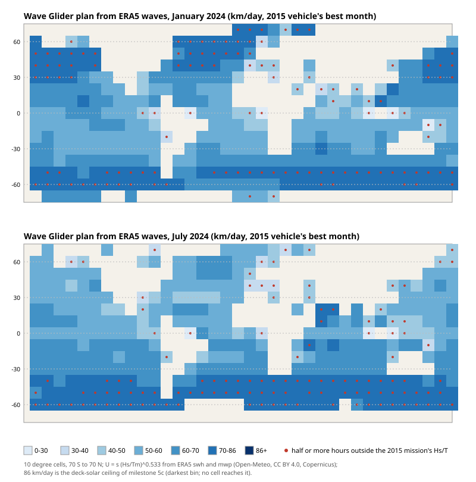
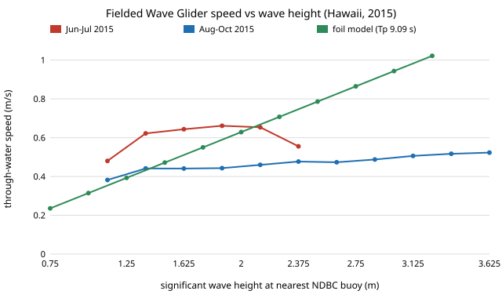

# Which body carries a survey payload furthest per kWh? Hull choice for small autonomous boats

**Status: open research programme (proposal stage), milestones 1 and 2 done.** A stdlib resistance and
range calculator for small displacement survey boats (`src/marine_hull/`, 9 tests) and a first
sweep: at equal displacement, a catamaran out-ranges a monohull in only **0.4% of 6,561 swept
cases and in none at equal length**, because friction (wetted area) sets drag at survey speed
below 1 m/s and hotel load fixes the best speed near 1 m/s. Milestone 2 replaces the placeholder wave term with Michell thin-ship theory: the catamaran
wins **3.3%** of 6,561 cases, still none at equal length, and wave resistance moves best range by
only 4%. Milestone 5 adds a hydrofoil rung: in 2,916 swept cases a foilborne 200 kg craft never out-ranges the monohull (best case about a quarter of its range; foil coefficients swept, not sourced). Preliminary: Michell is checked against one published Wigley tank point only (milestone 3a: with no form factor the model is within a few per cent; at the central k = 0.25 it is about 20% high). Milestone 3b checks the placeholder wave term against five tank speeds of a published 2.8 m catamaran (Zenodo 18459868, CC BY 4.0): it is 35 to 43% low at Fn 0.33 to 0.58 and no single wave scale keeps all five within 20%, so it is not safe above Fn 0.3 (the programme's survey speeds are below that). See [`PROPOSAL.md`](PROPOSAL.md) and
[`LOG.md`](LOG.md).

**SUBOFF check (milestone 3u).** Integrating the DARPA SUBOFF bare-hull equations gives 5.988 m² of wetted area, and with it the measured DTMB tow-tank resistance implies a bare-hull form factor 1+k = **1.17** (1.14 to 1.18 over water viscosity) above 5 m/s. Hoerner's streamlined-body formula gives 1.07, **8% low**; the bow tripwire's drag is part of that gap. See [`LOG.md`](LOG.md).

**Wave Glider check (milestone 6p).** Does a wave-powered glider go faster in bigger waves? On 1,245 hours of a fielded Wave Glider off Hawaii (2015, NOAA ERDDAP) matched to NDBC buoy sea state, barely: median through-water speed is only **1.05 times** higher at 2.5 m+ significant wave height than at 1.5 m or less, where a quasi-steady two-body foil model predicts 1.9 times, and the one-parameter model loses to a constant on held-out months. A **30% speed loss** from June-July to August-October (cause not in the data) is as large as the whole sea-state effect; within a month speed does track wave height. At the programme's buoys a wave glider makes about **33 to 50 km/day**, half the solar ceiling. See [`LOG.md`](LOG.md) and [`experiments/results_waveglider.txt`](experiments/results_waveglider.txt).

**What forecasts a Wave Glider's speed (milestone 6q)?** Its own recent speed does. On the same held-out August to October hours, the median speed of the previous 24 h predicts speed a day ahead with **0.048 m/s** mean absolute error, against 0.135 for a constant. Adding sea state, even with the observed wave height used as a perfect forecast, does not improve it (error ratio 0.99, 95% interval 0.86 to 1.16). Within a month speed scales as about **Hs^0.2**, so doubling the wave height adds roughly 16%. A time-since-launch trend fitted on May to July is useless when extrapolated. See [`experiments/results_waveglider_drift.txt`](experiments/results_waveglider_drift.txt).

**Wave Glider km/day: site or vehicle (milestone 6r)?** Mostly the vehicle. With the measured Hs^0.22 response, a Wave Glider at the programme's 2024 NDBC buoys plans to **30 to 61 km/day**. Picking the best buoy over the worst is worth 20% in January and 34% in July; the 2015 mission's own speed state (best month over worst) is worth 64%, and 82% of the variance in log km/day is between vehicle states. See [`experiments/results_waveglider_site.txt`](experiments/results_waveglider_site.txt).

**Does wave period matter for a Wave Glider (milestone 6s)?** Not measurably, once the vehicle state is held fixed: the period exponent is -0.025 (95% -0.27 to 0.17), adding it to an oracle day-ahead forecast changes the error by under 1%, and 6r's km/day rows move by -0.5% to +1.2%. The Pacific buoys' 10 to 14% lead is from wave height. See [`experiments/results_waveglider_period.txt`](experiments/results_waveglider_period.txt).

**Is the Wave Glider's speed loss fouling or an event (milestone 6t)?** Mostly an event. The 30% loss is mainly one drop between 14 and 15 UTC on **7 August 2015**: through-water speed falls from 0.63 to 0.51 m/s in an hour and stays near 0.45 m/s. The GPS track drops too (over-ground ratio 0.76 over a week), so it is not a sensor fault. On every hour, a step model beats a smooth ramp by 15 to 21 BIC. After the step, speed declines slowly, at about **0.2 to 0.3% a day** (7% a month), the size a fouling ramp would be. A similar drop on 12 June reversed after a week. The pre-registered test, which used only hours within 300 km of a buoy, could not locate the step: the vehicle was 900+ km from every buoy in July, and that test preferred the ramp. The step result comes from the post-hoc analysis on all hours. See [`experiments/results_waveglider_step.txt`](experiments/results_waveglider_step.txt).

**What does the Wave Glider's own wave sensor change (milestone 6u)?** A lot. Milestones 6p to 6t took sea state from an NDBC buoy up to 300 km away. The vehicle also logged its own waves (a Datawell MOSE sensor on the float), wind and battery, on the same NOAA ERDDAP server, and no earlier step used them. Hour by hour the buoy's wave height barely tracks the vehicle's (within-month correlation **0.20**), so it was a poor proxy. With on-board waves, over 3,281 hours, speed scales as **Hs^0.35** (95% 0.30 to 0.42) at a fixed vehicle state, against 0.22 with buoys. That is still far from the quasi-steady model's Hs^1. **Wave period matters a lot:** at a fixed height, longer average period is slower (exponent -0.71, 95% -0.80 to -0.61), which overturns 6s's null. Speed behaves roughly like **(Hs/T)^0.53**, a sub-linear power of heave velocity. Headwind has no measurable effect. Post hoc, an oracle on-board Hs-and-period term cuts the day-ahead forecast error to **0.77** of persistence (95% 0.67 to 0.87), and to 0.67 at three days. That reverses 6q's conclusion that sea state adds nothing. The 7 August step is still mostly the vehicle: speed falls between 14 and 15 UTC while on-board Hs does not move, and sea state explains 30% of the week-scale drop. The battery reached its lowest level of the mission the morning before, but the overnight drain did not change across the step. The June drop that 6t read as a reversible event is mostly sea state (73% of the drop, 52% of the recovery). See [`experiments/results_waveglider_onboard.txt`](experiments/results_waveglider_onboard.txt) (pre-registered) and [`experiments/results_waveglider_onboard_posthoc.txt`](experiments/results_waveglider_onboard_posthoc.txt).

**Wave Glider km/day with the on-board law (milestone 6v).** Re-planning 6r's 2024 NDBC buoy-months with U = s (Hs/T)^0.53 and each buoy's own average period (APD): a Wave Glider plans to **55 km/day (January) and 45 km/day (July)** fleet median at the 2015 vehicle's best month, 33 and 27 at its worst. In **January site matters less** than 6r said (best buoy over worst 1.12, from 1.20): the Pacific's 2.3 to 2.6 m seas come with 8 to 9 s periods, so their heave velocity is no higher than the Gulf's. In **July site matters more** (1.73, from 1.34), now above the vehicle-state ratio (1.68), but the slowest buoys (Gulf of Mexico, Nantucket; Hs about 0.4 m) spend 88 to 95% of their hours below anything the vehicle sailed in, so those rows are extrapolations. Between-state share of the variance falls from 82% to 66%. Matching the MOSE sensor to buoys within 150 km (k_H 1.09, k_T 0.99) moves the medians by +5%. See [`experiments/results_waveglider_site_period.txt`](experiments/results_waveglider_site_period.txt).

**Can a wave model replace the Wave Glider's own wave sensor (milestone 6w)?** For planning, yes; for a day-ahead forecast, barely. ERA5 reanalysis waves (0.5 degree grid, via Open-Meteo) at the vehicle's hourly position correlate 0.87 with the on-board MOSE heave velocity Hs/T within a month (a buoy 100 to 300 km away: 0.20). They give the **same speed exponent, 0.533 (95% 0.45 to 0.62) against 0.534**, and the same monthly km/day to within 0.4 km/day. So a Wave Glider's km/day can be planned from ERA5 anywhere, using the mean period (mwp; the peak period gives 0.33). As a forecast term it adds about 4% skill a day ahead (not significant) and 15% at three days, against 12% and 23% for an oracle on-board sea state with the same law. See [`experiments/results_waveglider_era5.txt`](experiments/results_waveglider_era5.txt).

**How far does a Wave Glider go per day over the open ocean, from a wave model (milestone 6x)?** About **50 to 79 km/day** (10th to 90th percentile; median 63 in January, 61 in July 2024) at the 2015 vehicle's best month, from ERA5 waves on a 10 degree grid, and **no ocean point reaches the 86 km/day deck-solar ceiling**. The winter storm belts near 50 degrees plan fastest (75 to 77 km/day band medians), the long-swell tropics slowest (56 to 57). Checked against 6v's buoy-measured plan at the 2024 NDBC buoys, the ERA5 plan runs **about 10% high** (median ratio 1.10; 75% of buoy-months within 15%). It ranks the buoys right in July (Spearman 0.93) but not in January (-0.12), when the sites differ by only 12%. Post hoc, calibration explains 98% of the buoy-to-buoy variance in that error (r 0.991): ERA5's mean period runs 1.20 times the buoy's average period but 1.29 times the vehicle's own, and the ratio varies with sea type. A third of open-ocean hours lie outside the seas the law was fitted on. See [`experiments/results_waveglider_era5_sites.txt`](experiments/results_waveglider_era5_sites.txt).

**Wave Glider or solar boat: which goes further per day (milestone 6y)?** It depends on the season and latitude, not on the vehicle. 6x compared the Wave Glider with a single 86 km/day solar figure. Using each corridor site's own NASA POWER sunlight for January and July 2024 instead, a 4 m deck-solar survey boat with a 30 W payload sustains **0 km/day whenever daily-mean sunlight is below about 153 W/m2**, because the panels cannot even cover the payload. That was every January site except the equator (North Sea 22 W/m2, Gulf of Alaska 14). Above the threshold it sustains **58 to 103 km/day**. So in July the solar boat beats the 2015 Wave Glider's best-state ERA5 plan at all five sites (the glider plans 44 to 55 km/day), and in January the Wave Glider wins at four of five (58 to 75 km/day in the winter storm belts). Over 54 swept boats and 10 site-months the Wave Glider's best state wins 62% of cases. A full 10 kWh pack lifts the solar boat by 1.2 to 1.6 times over a month, enough to carry it through January in the Florida Straits. Calm-water solar boat; the Wave Glider's own payload power is not modelled. See [`experiments/results_wave_vs_sun_sites.txt`](experiments/results_wave_vs_sun_sites.txt).

**Where does the Wave Glider or solar boat lead, month by month (milestone 6z)?** Along two ocean meridians (150 W and 30 W, 60 S to 60 N) for every month of 2024, using NASA POWER sunlight and ERA5 waves: a 4 m deck-solar survey boat with a 30 W payload goes further per day than the 2015 Wave Glider at its best in **every month within about 20 degrees of the equator** (11 to 12 months a year at 0 to 10 degrees), and the Wave Glider wins **everywhere poleward of about 40 degrees in that hemisphere's winter**, where the boat's panels cannot cover its payload and it sustains 0 km/day. The flip latitude swings about 30 degrees through the year (30 N in January, 50 N from April to August, no flip in June). On the year's mean the boat leads below about 30 degrees and the Wave Glider above about 35; a boat that starts every month with a full 10 kWh pack leads to 40 degrees. Eight of nine pre-registered predictions held; deflating the Wave Glider plan by ERA5's 10% bias changes 2.6% of winners. Calm-water solar boat; one year; the Wave Glider's payload power is not modelled. See [`experiments/results_flip_map.txt`](experiments/results_flip_map.txt) and the map [`experiments/waveglider_vs_solar_flip_map.svg`](experiments/waveglider_vs_solar_flip_map.svg).





**Live page:** https://marisstella.app/research/marine-hull/

**Programme.** Track 23 (`marine`, autonomous water vehicles) in [`../PROJECTS.md`](../PROJECTS.md).
Related labs: the repository's robotics and autonomy groups (ARPG, RECUV) for field vehicles; no
lab has reviewed this.

## Method and reproduce

```bash
cd research/marine-hull
PYTHONPATH=src python3 -m pytest tests -q          # 118 tests
python3 experiments/fetch_waveglider.py   # milestone 6p data (NOAA ERDDAP + NDBC), under a minute
PYTHONPATH=src python3 experiments/run_waveglider.py > experiments/results_waveglider.txt   # milestone 6p (Wave Glider vs foil model), 47 s
PYTHONPATH=src python3 experiments/figure_waveglider.py   # experiments/waveglider_speed.svg
python3 experiments/run_waveglider_drift.py > experiments/results_waveglider_drift.txt   # milestone 6q (forecast skill: recent speed vs sea state vs trend), under 1 s
python3 experiments/run_waveglider_site.py > experiments/results_waveglider_site.txt   # milestone 6r (km/day at the 2024 buoys: site vs vehicle state), under 1 s
python3 experiments/run_waveglider_period.py > experiments/results_waveglider_period.txt   # milestone 6s (period term at fixed vehicle state), under 2 s
python3 experiments/run_waveglider_step.py > experiments/results_waveglider_step.txt   # milestone 6t (step against ramp in the speed loss), 7 s
python3 experiments/fetch_waveglider_onboard.py   # milestone 6u data (on-board MOSE waves, wind, battery; NOAA ERDDAP), under a minute
PYTHONPATH=experiments python3 experiments/run_waveglider_onboard.py > experiments/results_waveglider_onboard.txt   # milestone 6u, pre-registered, 80 s
PYTHONPATH=experiments python3 experiments/run_waveglider_onboard_posthoc.py > experiments/results_waveglider_onboard_posthoc.txt   # milestone 6u post hoc, 30 s
python3 experiments/run_waveglider_site_period.py > experiments/results_waveglider_site_period.txt   # milestone 6v (6r's plan with (Hs/T)^0.53 and buoy APD), under 1 s
python3 experiments/fetch_era5_waveglider.py   # milestone 6w data: ERA5 waves at the vehicle's position (Open-Meteo), about a minute
python3 experiments/run_waveglider_era5.py > experiments/results_waveglider_era5.txt   # milestone 6w (ERA5 in place of the on-board oracle), about 60 s
python3 experiments/fetch_era5_sites.py   # milestone 6x data: ERA5 at the 2024 buoys, corridor sites and a 10 degree grid (Open-Meteo; retries 429s, a few minutes)
python3 experiments/run_waveglider_era5_sites.py > experiments/results_waveglider_era5_sites.txt   # milestone 6x, under 1 s
python3 experiments/figure_waveglider_era5_map.py   # milestone 6x map
PYTHONPATH=src python3 experiments/run_suboff_bare.py > experiments/results_suboff_bare.txt   # milestone 3u (SUBOFF bare-hull form factor), under 1 s
PYTHONPATH=src python3 experiments/run_solar.py > experiments/results_solar.txt   # milestone 5c, 5 s
PYTHONPATH=src python3 experiments/run_solar_mass.py > experiments/results_solar_mass.txt   # milestone 5d, 10 s
PYTHONPATH=src python3 experiments/run_solar_sites.py > experiments/results_solar_sites.txt   # milestone 5e, 1 s
PYTHONPATH=src python3 experiments/run_solar_policy_bound.py > experiments/results_solar_policy_bound.txt   # milestone 5h, 3 s
PYTHONPATH=src python3 experiments/run_solar_surge_holdout.py > experiments/results_solar_surge_holdout.txt   # milestone 5i
PYTHONPATH=src:experiments python3 experiments/run_sail_hrrr_bc.py > experiments/results_sail_hrrr_bc.txt   # wing-sail milestone 5i (HRRR bias correction), 4 min
PYTHONPATH=src:experiments python3 experiments/run_sail_hrrr_learned.py > experiments/results_sail_hrrr_learned.txt   # wing-sail milestone 5j (learned station bias), 3 min
PYTHONPATH=src:experiments python3 experiments/run_sail_hrrr_buoy.py > experiments/results_sail_hrrr_buoy.txt   # wing-sail milestone 5k (open-water NDBC buoys; data fetched by fetch_ndbc_buoys.py), 3 min
PYTHONPATH=src:experiments python3 experiments/run_foil.py > experiments/results_foil.txt   # milestone 5
PYTHONPATH=src:experiments python3 experiments/run_swath.py > experiments/results_swath.txt   # milestone 5b, 25 s
PYTHONPATH=src python3 experiments/run_michell.py > experiments/results_michell.txt   # milestone 2, 2 s
PYTHONPATH=src python3 experiments/run_wigley_tank.py > experiments/results_wigley_tank.txt   # milestone 3a, 1 s
PYTHONPATH=src python3 experiments/run_catamaran_tank.py > experiments/results_catamaran_tank.txt   # milestone 3b, 1 s
PYTHONPATH=src python3 experiments/run.py > experiments/results.txt
PYTHONPATH=src python3 experiments/run_glider.py > experiments/results_glider.txt   # milestone 4, 1 s
PYTHONPATH=src python3 experiments/run_slocum.py > experiments/results_slocum.txt   # milestone 4b, 1 s
PYTHONPATH=src:experiments python3 experiments/run_remus.py > experiments/results_remus.txt   # milestone 4c, 1 s
PYTHONPATH=src:experiments python3 experiments/run_value.py > experiments/results_value.txt   # milestone 4e, 1 s
PYTHONPATH=src:experiments python3 experiments/run_current.py > experiments/results_current.txt   # milestone 4f, 1 s
```

`hull.py`: ITTC 1957 friction line (checked analytically: Cf = 0.003 at Re = 1e7), form factor,
wetted area S = c_s sqrt(V L), a placeholder wave term, propulsive and motor efficiency, hotel
load. Craft: 200 kg, 25% battery. Results: [`experiments/results.txt`](experiments/results.txt).

`michell.py` (milestone 2): Michell (1898) thin-ship wave resistance of Wigley hulls (closed-form
x and z integrals, checked against Simpson sums) with Havelock's two-hull interference factor.
`experiments/run_michell.py` swaps it in for the placeholder and uses the exact Wigley wetted area.
Results: [`experiments/results_michell.txt`](experiments/results_michell.txt).

`glider.py` (milestone 4): quasi-steady buoyancy glider (force balance, best-glide incidence, pump work
B tan(gamma)/(2 eta), independent of depth) against a same-mass propeller AUV. No glider coefficient is
sourced (the cited papers were unreachable); all are swept. Results: [`experiments/results_glider.txt`](experiments/results_glider.txt).

`solar.py` (milestone 5c): daily-mean deck solar (area x efficiency x derate x insolation, all swept) against the monohull's load. Energy-neutral at 1 m/s in 25% of 4,374 cases (0% at 3 m, 20% at 4 m, 56% at 5 m hull length); no case sustains 2 m/s; otherwise solar doubles range (median). Results: [`experiments/results_solar.txt`](experiments/results_solar.txt).

Milestone 5e replaces the swept insolation with NASA POWER monthly climatology (25-year all-sky horizontal means) at five sites, 0 to 60 degrees latitude. The 5 m central boat holds 1 m/s on deck solar in all 12 months at the equator and at 25 N, in 7 at 42 N and in 5 at 60 N; the 4 m boat in 7, 6, 4 and 0. An annual-mean verdict overstates year-round neutrality wherever winter insolation collapses (Gulf of Maine: 161 W/m2 annual, 53 in December). Results: [`experiments/results_solar_sites.txt`](experiments/results_solar_sites.txt); data as fetched: `experiments/data/`.

`experiments/run_slocum.py` (milestone 4b): the same glider model with Slocum aerodynamics read from the
MIT-licensed `gliderflight` package (PyPI 1.2.1; Merckelbach's implementation of the Slocum flight model):
S = 0.1 m^2, lift slope 7.5 /rad, K = 10.5 /rad^2, Cd0 0.15 to 0.31. Hotel load, pump efficiency and dive
energy stay swept. Results: [`experiments/results_slocum.txt`](experiments/results_slocum.txt).

`experiments/run_remus.py` (milestone 4c): a REMUS-100-class AUV (38.6 kg, 1.85 m, 0.19 m; vendor figures: 1.5 kWh,
12 h at 1.5 m/s or 8 h at 3 kn) whose non-propulsion load is the vendor's total power minus the model's propulsion
power. Results: [`experiments/results_remus.txt`](experiments/results_remus.txt).

`experiments/run_time.py` (milestone 4d): energy-delay product of the 4b glider cases against 4c's REMUS-class AUV
cases. Results: [`experiments/results_time.txt`](experiments/results_time.txt).

## Results (preliminary)

- Milestone 5b (SWATH: two submerged parabolic torpedoes on Wigley-form struts, Michell wave drag for both, 4,374 pairs against the 4 m monohull): the SWATH out-ranges the monohull in none, at its best speed (range ratio median 0.69, best 0.83) and at a fixed 3 m/s (median 0.46), because strut wave drag and wetted area outweigh the torpedoes' small wave drag at 200 kg. Wave drag of the torpedo falls with depth at about 2 k0 as theory says; no SWATH tank curve was reachable, so the absolute wave level is unvalidated. Stability and seakeeping, the reasons to build a SWATH, are not modelled.
- Milestone 4e (break-even value of time, same 14,580 pairs): the glider and the AUV tie when a day of delay is worth a median 0.37 kWh (10th to 90th 0.17 to 0.72), about 8% of the AUV's own daily energy use. No ship day rate could be sourced (hosts unreachable), so the exchange rate is the output, not an input.
- Milestone 4f (steady cross-current, swept 0 to 0.5 m/s, same 810 x 18 cases): the glider's energy win is lost by stalling, not gradually. It beats the AUV in 97% of pairs at 0.10 m/s, 50% at 0.20 m/s (about its median glide speed, 0.21 m/s) and none from 0.45 m/s; among gliders that can hold the track it stays above 90% at every current. Currents are swept, not sourced.
- Milestone 4d (time penalty, 14,580 pairs): the glider takes a median 5.5 days per 100 km against the AUV's
  12 h. The AUV has the lower energy-delay product in 78% of pairs; the glider's energy win holds only while delay
  is weighted below about 0.7 of energy. Two predictions refuted (see `LOG.md`). The AUV's best speed sits at the
  datasheet maximum, so this is a bound; the time-energy exchange rate is not sourced.

- Milestone 7c (H1 and H5 run as stated, `experiments/run_h1_h5.py`): H1 is refuted, with range spreading 20.6% (and best speed 20.0%) across 27 hull-form combinations, though each constant alone moves range under 10%; propulsion is 0.33 to 0.37 of power at the best speed (theory for v^3 drag: 1/3). H5 is refuted: 0 rank swaps in 2,187 monohull-catamaran cases over 150 to 250 Wh/kg, because range is proportional to pack energy; a flip needs a term that is not.
- Milestone 4e (`experiments/run_auv_hotel_sourced.py`): against the sourced AUV hotel loads (8 W Tethys design estimate; 104 to 175 W implied for REMUS-class), the glider with a measured Seaglider load has the longer best range in 270 of 270 cases; the AUV wins only below about 0.4 to 1.7 W. Energy per metre, not time; no measured AUV budget found.
- Milestone 4c (REMUS-class AUV, hotel implied by vendor endurance): total power 125 to 188 W at 1.5 m/s, model
  propulsion 13 to 21 W, so the implied non-propulsion load is 104 to 175 W, 21 to 250 times the glider's swept
  0.7 to 5 W. The glider has the longer best range in 100% of 810 glider cases against all 18 AUV cases (median
  AUV/glider energy ratio 5.4). 4b's "decided by the power budgets" becomes "the glider wins on energy per metre
  unless the AUV's non-propulsion load is under about 5 to 24 W". Energy per metre is not time: the glider moves at
  0.2 m/s. Vendor figures are marketing and disagree with each other; the glider side is still swept.


- Milestone 3k (`experiments/run_michell_lowk.py`, 729 cases): Michell wave term with tank-bound form factors (k 0.03 to 0.15): the catamaran out-ranges the monohull in 7 cases (1.0%, milestone 2: 3.3%) and in 0 of 243 at equal length; all wins pair a 3 m monohull with a longer catamaran.
- Milestone 3o (`experiments/run_wigley_ju.py`): an independent 4 m Wigley tank point (Ju 1983, second-hand via Wang et al. 2017) implies k -0.06 to +0.01 above Michell + ITTC 1957, agreeing with 3n at 1 m; one speed, temperature unstated.
- Milestone 3i (`experiments/run_yacht_formfactor.py`): the 22 Delft yacht hulls imply a form factor of at most 0.06 (median, 10th to 90th percentile 0.03 to 0.13) at Fn 0.125, against 0.29 to 0.36 from Holtrop-Mennen's k1 and the programme's central 0.25: the 3g low-speed over-prediction is the form factor. Keeled yachts, wetted area from the HM regression, mirror unverified.
- Milestone 3g (Holtrop-Mennen vs 308 Delft yacht-series tank points, `experiments/run_holtrop_yacht.py`): HM is within 20% for 42% to 82% of points at Fn 0.2 to 0.3, but over-predicts residuary resistance 1.3 to 2.2 times (median) at Fn 0.125 to 0.2, the survey regime; swept Cm, Cwp, model length; yacht hulls with keels; exploratory.

- Milestone 4b (Slocum coefficients from `gliderflight`, 2,430 cases): at equal hotel load the glider has the
  longer best range in 0 cases (median AUV/glider energy ratio 0.36); the break-even AUV hotel load is a median
  4.9 times the glider's (10th to 90th 2.4 to 10.7), and the glider wins in 52% of cases at 5 times and 99.9% at
  20 times. The hotel-load reading of milestone 4 survives sourced aerodynamics; the measured hotel loads of a
  fielded glider and AUV are still the missing inputs.

- Milestone 4 (glider vs AUV, 52 kg, 19,683 swept cases, battery cancels): with the same hotel load the
  glider has the longer best range in only 5.9% of cases; it wins when the AUV's hotel load is 5 times the
  glider's (89%) or 20 times (100%). So the glider advantage is a hotel-load advantage, not a hydrodynamic
  one. The glider's horizontal speed tops out at 0.13 to 0.70 m/s (median 0.30) with a 10 N pump, so "glider
  loses above 1 m/s" is a capability limit, and H4's 0.4 to 0.9 m/s crossover is not supported (45 of 19,683
  cases). Not checked against a published glider range figure.

- Milestone 2 (Michell wave term, Wigley hulls): catamaran wins 216 of 6,561 cases (3.3%), none of
  729 equal-length cases at wave scale 0.5, 1, 1.5; median range ratio 0.87. Wave resistance is
  under 10% of viscous at the best-range speed (about 1 m/s, Fr 0.16) in 81.5% of cases; scaling
  it from 0 to 1.5 changes a 4 m monohull's range by 4%. Spacing barely matters at these speeds.
  Wave resistance is not validated against a tank curve.

- Catamaran wins 27 of 6,561 cases; median range ratio cat/mono 0.85 (0.72 to 1.02).
- Monohull range 560 to 1,188 km (upper bound: no waves, current, turns, reserve); best speed about 1 m/s.

- Deck-solar boat (milestone 5j, `experiments/run_solar_hull_uncertainty.py`): over 27 hulls in the milestone-1 box the best constant speed moves by 0.2 to 0.3 m/s, and running the central hull's best speed on another hull costs up to 9.1% of km/day (3 of 10 site-boat cases at 5% or more). Absolute km/day at the best speed spans about +-10% across the box (5 m Equator 109 to 133). Hull constants matter more than the surge rule of 5i (under 3%).
- Deck-solar sensitivity (milestone 5k, `experiments/run_solar_sensitivity.py`): one-at-a-time swings of six inputs over ranges I chose, not measured. Hotel load (19 to 50% of km/day), panel efficiency (16 to 30%) and derate (12 to 23%) move km/day 2 to 5 times more than the hull constants c_s and k_form (8 to 9%); the wave scale moves it 0.3 to 1.2%. Every input shifts the best speed by only 0.0 to 0.2 m/s. Source the hotel load and panel yield before the hull.
- Deck-solar joint interval (milestone 5m, `experiments/run_solar_mc.py`): drawing hotel load (5 to 20 W), panel efficiency (0.17 to 0.22) and three derate factors jointly (500 seeded draws, ranges partly my choices) gives 5 m km/day of about 133 / 125 / 97 / 77 / 69 (Equator, Florida, Gulf of Maine, North Sea, Gulf of Alaska), each within about -10/+9% (5% to 95%); the site ordering holds in 500 of 500 draws. It excludes the hull-constant uncertainty (5j, about +-10% more).

## Wing-sail drone (milestone 5a, `marine-sail`)

Does tack control matter for an autonomous sailing drone beating to windward? A first-order force-balance polar
(`src/marine_hull/sail.py`) plus three tack controllers on 24 h NOAA CO-OPS wind series (`src/marine_hull/tack.py`,
`experiments/run_sail_tack.py`). Headline (July holdout, 30 s tack loss, share of the ideal upwind progress): tacking at the
corridor edge reaches 83.7%, tacking when headed 87.6% (+3.2 points, positive at all 12 stations), a clairvoyant 99.7%. The
gap to the clairvoyant is about information, not the tack cost. Spatial wind fields and isochrone routing are not done. Full
numbers, limits and the predictions that failed: `LOG.md` (2026-11-04, milestone 5a).

Milestone 5b (negative): giving a receding-horizon controller a persistence, smoothed or even perfect forecast of the wind (up to the whole day, 5 to 15 minute planning blocks) recovers none of the roughly 12-point gap between the header-follower and the clairvoyant; the gap is minute-scale gust information. Caveat: the planner is not optimal. **Superseded by 5c below: the planner was the limit.** `LOG.md` (2026-11-04, milestone 5b), `experiments/results_sail_forecast*.txt`.

Milestone 5c (corrects 5a and 5b): the clairvoyant of 5a let the boat ride the corridor edge without tacking while every simulated controller had to tack there; with the same rule (`tack.dp_values`) the clairvoyant is 92.7% (July) rather than 99.7%, so about 7 of the 12 headroom points were an artefact. A full-day tack policy computed on wind smoothed to 15 minutes and executed on the true wind closes 93 to 95% of the rest (+5 points over the header-follower, 4.7 to 6.1 bootstrap), 60-minute smoothing keeps about 38%, 120-minute smoothing about 0 to 11%. It assumes a perfect day-long forecast of the slow wind; forecast error and lead are not modelled. `LOG.md` (2026-11-04, milestone 5c), `experiments/results_sail_policy.txt`, `experiments/run_sail_policy.py`.

Milestone 5d: 5c's gain needs forecast skill. Replanning hourly with a forecast that blends the 15-minute-smoothed truth with persistence (error e-folding time T), the policy keeps 16 to 20% of the +5 points at T = 30 min, 38 to 45% at 60, 51 to 58% at 120 and 62 to 68% at 240; pure persistence is below the header-follower (-0.2 Jan, -2.6 Jul points) and tacks 150 to 250 times a day. Synthetic error model, not an archived NWP forecast. `LOG.md` (milestone 5d), `experiments/results_sail_lead.txt`, `experiments/run_sail_lead.py`.

Milestones 5e to 5g (negative): hysteresis does not rescue the low-skill replanner. A proportional switch margin (0.02 to 2) is best at zero or within noise everywhere; a minimum dwell between voluntary tacks cuts tacks per day by 39 to 55% at T = 0 but loses 1.8 to 3.9 points to the header-follower, and at T = 120 even a 10-minute dwell costs 1.6 to 1.8 points. Below about 30 minutes of forecast skill, follow the headers. `LOG.md` (milestones 5e, 5f, 5g), `experiments/results_sail_margin.txt`, `results_sail_margin_fine.txt`, `results_sail_dwell.txt`. The paper draft (`paper/DRAFT.md`, section 2.5) now carries 5a to 5g.

- Wing-sail on archived HRRR (milestones 5h to 5j, `experiments/run_sail_hrrr*.py`): raw 3 km HRRR winds lose to following the headers (-2.9 Jan, -6.5 Jul points) and to persistence; a trailing-hour bias correction recovers about 2 points, and neither a longer window, a fade nor a station bias learned from other days lifts it above the header-follower (best -0.5 Jan / -3.0 Jul). Pier anemometers against 3 km cells. Milestone 5k repeats it at 9 to 10 open-water NDBC buoys: raw HRRR -0.8 (Jan) / -2.3 (Jul) points, corrected +0.0 / -0.9, so siting explained part of the loss but HRRR still only matches following the headers. Milestones 5l and 5m close two escape routes: a nowcast of buoy level plus HRRR trend only equals persistence (no variant beats the header-follower by more than 0.1 points), and correcting buoy anemometer height to 10 m shrinks the speed bias but leaves the gap (-0.8 to -1.0 Jan, -1.7 to -1.9 Jul). Milestone 5n tests latency on hourly cycles: 1 h against 3 h delivery changes raw HRRR by only +0.2 points in both months (bias-corrected 1 h: +0.1 Jan, -0.6 Jul against the header-follower), so delivery lag is not the cause and the archived-NWP branch is closed. Milestone 6h (exploratory) compares wind and sun on a free course: the default drone reaches 1 m/s at 1.5 m/s of wind and covers a median 272 (Jan) / 219 (Jul) km/day on 19 buoy-months of real wind, against the solar boat's 86 km/day ceiling (`experiments/run_wind_vs_sun.py`); unsourced drone parameters, upper bound.

## Limitations

Seawater properties, efficiencies, form factors and wave term are unsourced or swept; no published
resistance curve has been reproduced yet (Michell's absolute level is unchecked); stability, deck area and payload are not
modelled. Simulation only: nothing here has been built or tested in water. Any real operation needs
the flag state's and local authority's rules (COLREGs, harbour master, permits).

## Next steps

Milestone 3 (Holtrop-Mennen is implemented, `src/marine_hull/holtrop.py`, and run on one Wigley tank point: +19% to +24% on its own area with the m2 low-speed wave form (the m4 alternative moves total resistance by at most 2.4%, LOG 3e and 3f); coefficients checked against the 1982 worked example (LOG 3k, which fixed an inverted lambda branch; figures here are the post-fix ones), see LOG 3c to 3k; a small-hull tank curve is still needed; LOG 3m checked `michell.py` against an independent fine integral, within 0.01%, and read a six-point Kajitani CT curve second-hand: implied form factor k between -0.13 and +0.58 depending on the unknown model length) and milestones 5 to 7 in the proposal; the measured hotel load of a fielded glider and AUV is the number milestone 4 needs most. AI-assisted (Claude Code).

Milestone 6k (check against a fielded drone): Saildrone SD 1020 averaged 112 km/day over its 196-day, 22,000 km Antarctic circumnavigation (2019, vendor release). The wind-driven drone model of 6h to 6j gives 179 to 272 km/day on buoy winds and 303 km/day at Southern Ocean wind, so it is an upper bound by a factor of 2 to 3, and the 6h wind-over-sun margin is overstated by about that much. The fielded mean is still 1.3 times the solar ceiling. One vehicle, one press-release figure; `experiments/run_fielded_check.py`, `LOG.md`.

Milestone 6l (864 fielded drone-days): NOAA's west-coast Saildrone surveys (13 drones, 2018 and 2019, each drone's own wind) give a median 75 km/day. The 6h drone model sailing the same wind and course gives 2.5 times that (observed/model median 0.40; 0.33 against a free beam reach, rising from 0.28 below 4 m/s of wind to 0.60 above 10), and even the 99th percentile 10-minute block stays under 0.82 of the model at 4 to 12 m/s. Scaled by 0.33, the buoy corridor medians fall to 79 km/day (January) and 60 (July) against the 86 km/day solar ceiling, so 6h's wind-over-sun margin is gone and the ranking is open. Survey missions, not capability trials; Explorer 7 m against a 5 m model with unsourced parameters; `experiments/run_saildrone_daily.py`, `LOG.md`.

Milestone 6m (fit on 2018, test on 2019): fitting the drone's sail area (0.45 m2 against the default 5; hull drag unchanged, and the two are not separately identified) to cell-mean SOG of the 2018 Saildrone blocks cuts the unseen-2019 daily-distance error from 2.4 times observed (default) to 0.89 (10th to 90th 0.68 to 1.18; median absolute error 0.15 against 0.24 for the 0.33 scalar). Re-running the buoy winds with it: corridor median 100 km/day in January (1.16 times the 86 km/day solar ceiling) and 62 in July (0.72 times), no buoy-month at 2x solar. The wind drone has a thin edge in winter and none in summer at these sites; the drone is a survey-mission drone, not a capability bound. `experiments/run_saildrone_fit.py`, `LOG.md`.

Milestone 6o (capability drone): re-running the buoy winds with 6n's capability drone (0.90 m2, hull drag x1.2) gives a corridor median of 126 km/day in January (1.47 times the 86 km/day solar ceiling) and 80 in July (0.93 times), 1.26 to 1.29 times 6m's mission drone, and still no buoy-month at 2x solar (0 of 19). The wind drone's winter edge is 1.2 to 1.5 times the solar ceiling; in July it is level. `experiments/run_wind_vs_sun_capability.py`, `LOG.md`.

Milestone 6p (wave-powered rung): a fielded Wave Glider's speed rises only 5% (18% after removing a month-scale drift) from 1.5 m to 2.5 m seas, against 90% in a quasi-steady foil model, which loses to a constant on held-out months; a 30% speed loss over the mission matches the whole sea-state effect. Next: a second Wave Glider deployment (SECOORA ERDDAP) and a model with sub lag, tether slack and a drift term. `experiments/run_waveglider.py`, `LOG.md`.

Milestone 6q (Wave Glider forecasting): a 24 h trailing median speed cuts the held-out day-ahead error to 0.35 of the constant's (0.048 against 0.135 m/s). An oracle sea-state term adds nothing measurable (0.99 of M1), the within-month exponent is Hs^0.22, and a time-since-launch trend fails when extrapolated. `experiments/run_waveglider_drift.py`, `LOG.md`.

Milestone 6r (Wave Glider planning): at the 2024 buoys the site moves km/day by 20 to 34% within a month, the vehicle state by 64%; fleet medians 52 / 49 km/day (Jan / Jul) at the best state and 32 / 30 at the worst. `experiments/run_waveglider_site.py`, `LOG.md`.

Milestone 6s (Wave Glider period): at a fixed vehicle state the DPD exponent is -0.025 (95% -0.27 to 0.17), so 6p's pooled period residual was mostly the mission drift; the period term adds no forecast skill (0.991 of M2) and moves 6r's buoy rows by under 1.2%. `experiments/run_waveglider_period.py`, `LOG.md`.

Milestone 6t (Wave Glider step or ramp): the mission's speed loss is mostly an hour-scale step on 2015-08-07 (ratio 0.70 to 0.74, GPS-confirmed; step beats ramp by 15 to 21 BIC on all hours, post hoc) plus a decline of 0.2 to 0.3%/day; a June step of the same size reversed after a week. The pre-registered 300 km series has a 67-day July gap and could not locate it (ramp preferred there). `experiments/run_waveglider_step.py`, `LOG.md`.

Milestone 6u (Wave Glider on-board sea state): with the vehicle's own MOSE waves in place of a buoy (within-month correlation 0.20), the height exponent at a fixed state is 0.35 (0.30 to 0.42; buoy 0.22) and the average-period exponent -0.71 (-0.80 to -0.61), so speed goes roughly as (Hs/T)^0.53; headwind has no effect. Post hoc, an oracle Hs-and-period term cuts the 24 h persistence error to 0.77 (0.67 to 0.87), reversing 6q. The 7 August step is about 70% vehicle; the June drop is mostly sea state. `experiments/run_waveglider_onboard.py`, `LOG.md`.

Milestone 6v (Wave Glider plan, on-board law): fleet medians 55.4 / 45.2 km/day (Jan / Jul) at the best state, 33.0 / 27.0 at the worst; site ratio 1.12 (Jan) and 1.73 (Jul) against a state ratio of 1.68; the slow July sites are 88 to 95% extrapolation in Hs/T. `experiments/run_waveglider_site_period.py`, `LOG.md`.

Milestone 6w (Wave Glider, ERA5 in place of on-board waves): within-month corr of log Hs/T 0.866; exponent 0.533 (0.447 to 0.618) against 0.534 on board; forecast MAE ratio to persistence 0.955 (24 h) and 0.845 (72 h), 38% and 68% of the oracle's gain; monthly plan within 0.4 km/day of the on-board plan. `experiments/run_waveglider_era5.py`, `LOG.md`.

Milestone 6x (Wave Glider plan from ERA5 at the buoys and over open ocean): ERA5 plan 1.10 times the buoy plan (median, 20 buoy-months), Spearman 0.93 in July and -0.12 in January; post hoc period and height calibration explains the per-site error (r 0.991); open-ocean grid 50 to 79 km/day at the best state, no point above the 86 km/day solar ceiling; 33% of hours outside the law's range. `experiments/run_waveglider_era5_sites.py`, `LOG.md`.

