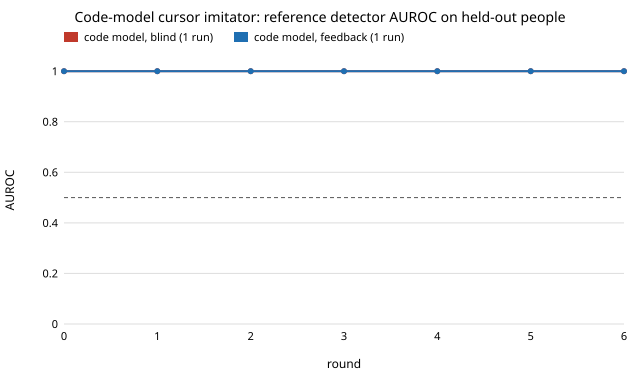

# Can a small open code model write a cursor-stroke generator that fools a human-vs-bot detector?

Milestone 11 (`mimic-codeloop`) of track 11, adversarial human imitation: replace `mimic-cursor`'s component search with a model that writes code. **Preliminary negative result: one seed per condition, 6 rounds, one 1.5B-parameter model.** Produced with AI assistance (Claude).

**Live page:** https://duncan-haywood.github.io/oss-monorepo/research/mimic-codeloop/

**Result.** Qwen2.5-Coder-1.5B-Instruct, rewriting a Python generator for 24 candidates (6 rounds of 4, the same per-round budget as the component search), did not move the boosted-tree reference detector off AUROC 1.000 on held-out people, with or without the detector's feature feedback. The component search at the same 24-candidate budget also sits at 1.000 (0.999 to 1.000 over 8 runs), so at this budget the two are tied at the ceiling. The informative number is how often the model's code was usable at all: 7 of 24 candidates (29%) blind and 6 of 24 (25%) with feedback. The rest were rejected by the sandbox as containing a banned token (17 of 48; I did not log which, most likely an import such as scipy), failed to load (10 of 48) or crashed or exceeded the failure cap (8 of 48). Numbers: `results.txt`, `results.json`; per-run data including every candidate's outcome and the final program: `results/`.



## Method

- **Data, detector, scoring and copy test** are `mimic-cursor`'s, imported unchanged: 46 people filling in a web form (DUX, Bieber et al. 2023, [Zenodo 7778612](https://zenodo.org/records/7778612), CC-BY-4.0), a loop detector that picks 3 of 11 feature functions and fits a logistic regression, a reference detector (boosted trees on every feature) the loop never sees, scored on held-out people.
- **Imitator.** `Qwen/Qwen2.5-Coder-1.5B-Instruct`, run locally on 4 CPUs (about 1 minute per candidate), temperature 0.8, up to 450 new tokens. Each round it is shown the current program and the detector's mean log-odds that its strokes are human, and writes a full replacement `generate(start, end, rng)`. Four candidates per round; the best by the loop detector's score replaces the program if it beats it. The start program is a straight line at constant speed.
- **Feedback condition.** The model is also shown each measurement the detector uses, with the people's mean and its own, and the gap in standard deviations.
- **Sandbox** (`sandbox.py`): model code runs with `np` and `math` only, no imports, no file or network builtins, a one-second alarm per stroke. This contains mistakes from a small local model; it is not a security boundary. A program whose strokes crash more than 2% of the time is invalid, as is one over the copy-rate cap. The model gets no human strokes, so unlike the component search it cannot retrieve templates.
- **Comparison.** `mimic-cursor`'s recorded runs, read at round 6 (24 candidates), for the blind and detector-explains conditions.

## Results (`results.txt`)

| condition | runs | candidates valid | final reference AUROC | component search at 24 candidates |
|---|---|---|---|---|
| code model, blind | 1 | 7 of 24 | 1.000 | 1.000 (0.999 to 1.000), 8 runs |
| code model, feedback | 1 | 6 of 24 | 1.000 | 1.000 (1.000 to 1.000), 8 runs |

- **A 1.5B code model mostly fails at the contract.** Of 48 candidates, 17 were rejected for a banned token, 10 did not load, 8 loaded but crashed or exceeded the failure cap. Rejected candidates were not retried.
- **What survived was little better than the start.** The two final programs (kept in `results/`) are a constant 16 ms clock with a random direction added to a line, and a random-angle walk; neither has pixel rounding or a human-like event clock, which I checked by reading them, not by measurement. The detector reads exactly those cues (`mimic-cursor`), so the reference AUROC stays at 1.000 from round 0 to 6.
- **Feedback did not visibly help**, but with one seed per condition and every final value at the ceiling, this study cannot tell a small effect from none.

## What this does not show

- Only one seed per condition ran: a planned 3 seeds were cut for time (each run takes about 30 minutes on 4 CPUs). No intervals over seeds are reported for the code model.
- A larger model, more rounds or a longer budget may do better. A 1.5B model with 24 candidates is a floor. A GPU run of a 7B or larger code model is an owner step if wanted (it needs a paid GPU); the code takes any model name: `python3 codeloop.py 6 3 <model>`.
- The component search's templates make the comparison unequal in the component search's favour on information; the model had none.
- Rejections for banned tokens may reflect the sandbox's rules rather than the model's ability.

## Reproduce

```bash
cd research/mimic-codeloop
python3 -m unittest discover -s tests -v      # 4 tests, no model needed
PY=$(python3 ../../platform/ci/pyenv.py torch transformers numpy scipy scikit-learn)
"$PY" codeloop.py 6 3                         # about 30 min per run on 4 CPUs; resumable
"$PY" report.py && "$PY" experiments/figure.py
```

## Guardrails

Detection research, not an evasion service: the detector is the shipped half and the strokes are simulated, kept in `results/` as generated, and sent nowhere. No real person is imitated; no third-party detector was tested.

## Builds on

`mimic-cursor` (data, detector, scoring, copy test; Meehan et al. 2020 for the data-copying idea) and Qwen2.5-Coder (Hui et al. 2024, Apache-2.0 for the 1.5B weights). No lab's work is built on and none is affiliated with or endorses this project.
