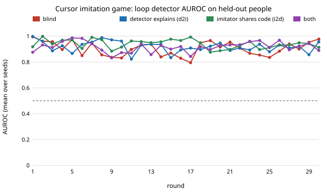

# Can an imitator that changes its own code fool a human-vs-bot cursor detector, and does shared feedback help either side?

Milestone 9 (`mimic-cursor`) of track 11, adversarial human imitation: the first subject beyond writing, browser use. **Preliminary, stylised: 8 seeds, 30 rounds, 46 people filling in one web form, a fixed library of code components (no model writes code).** Produced with AI assistance (Claude).

**Live page:** https://duncan-haywood.github.io/monorepo-projects/research/mimic-cursor/

**Result.** People's cursor strokes stay easy to tell from every generator here. A boosted-tree reference detector the loop never saw separates each condition's final imitator from held-out people at AUROC 0.99 to 1.00. Shared feedback did not make a better imitator: final reference AUROC 0.996 blind, 1.000 when the detector explains itself, 0.988 when the imitator shares its code, 0.989 both ways (paired differences against blind −0.009 to +0.003, all intervals including 0). It may make a better detector. In cross-play against other runs' imitators, detectors from the both-ways condition average AUROC 0.81 against 0.70 for blind, in the order both > imitator shares code > detector explains > blind, but the paired interval (+0.112, −0.007 to +0.255) includes 0. A search eight times larger, aimed straight at a detector on every feature, ends at 0.88 to 0.99. That is no better than replaying a real person's stroke onto the new start and end point (0.88), so the component library, not the budget, is the limit. Numbers: `results.txt`; per-run data: `results/`.

Human references are cursor strokes from DUX (Bieber, Leppich, Harms and Schubert 2023, [Zenodo 7778612](https://zenodo.org/records/7778612), CC-BY-4.0): 46 people filling in a travel-expense web form. A stroke is a run of mouse-move events with no gap above 250 ms and no click or key in between; 7,695 strokes, split by person (24 people for the loop, 6 for the copy test, 16 held out).



## Method

- **Imitator (code is the free parameter).** A stroke generator from start to end point, assembled from components (`programs.py`): path (line, arc, S-curve, or a retrieved human template blended with a second one), speed profile, corrective submovements, noise, event clock (fixed, jittered, polled, a human clock, or the template's own), pixel rounding and a duration law. Search swaps components and changes their parameters.
- **Detector (code too).** Picks 3 of 11 feature functions (timing, straightness, speed, jerk, event intervals, pixel steps, submovements, heading changes and others) and fits a logistic regression.
- **Shared feedback.** Four conditions at the same budget of 4 candidates per side per round: *blind*; *d2i*, where the detector tells the imitator which features caught it and by how much, and the imitator uses that to choose which component to mutate; *i2d*, where the imitator shares its program, so the detector can draw 4 times more strokes; and *both*.
- **Scoring.** A reference detector the loop never sees (boosted trees on every feature, held-out people); the loop detector on held-out people; cross-play of every final detector against every final imitator.
- **No copying.** An imitator is invalid when more than 15% of its strokes are at least twice as close to the template pool as to six people it never saw (a data-copying test after Meehan et al. 2020).

## Results

| condition | final reference AUROC | best reference, any round | final loop detector AUROC | cross-play detector strength |
|---|---|---|---|---|
| blind | 0.996 (0.990 to 1.000) | 0.933 | 0.977 | 0.699 |
| detector explains (d2i) | 1.000 (1.000 to 1.000) | 0.976 | 0.956 | 0.741 |
| imitator shares code (i2d) | 0.988 (0.971 to 1.000) | 0.943 | 0.913 | 0.777 |
| both | 0.989 (0.973 to 1.000) | 0.934 | 0.890 | 0.811 |

Means over 8 seeds with 95% bootstrap intervals over seeds. Cross-play strength is a final detector's mean AUROC against every other run's final imitator on held-out people.

- **The detector wins in every condition.** The reference detector starts at 1.000 against the naive bot and never drops below 0.82 in any round of any run. The in-loop detector, limited to 3 feature functions, swings: in 40 of 960 rounds the imitator pushes it below 0.6 on held-out people (once to 0.004, where it ranks imitator strokes as more human than people's), and in 23 of the 39 such rounds with a next round it is back above 0.8 one round later, after switching features (figure). Pixel steps, event rate, heading changes, jerk and speed are the features it settles on.
- **The imitator learns to borrow from people.** Most final imitators use a retrieved human template for the path (13 of 32), the human event clock or the template's own timing (22 of 32), the template's duration (24 of 32) and whole-pixel coordinates (25 of 32). Copy rates on held-out contexts stay at 0.07 to 0.11, under the 15% cap and near held-out people's own 0.064.
- **Feedback does not change who wins.** Explanations from the detector did not help the imitator at this budget: final reference AUROC is 0.003 higher than blind (0.000 to 0.010). Sharing code gives the detector 4 times more strokes to fit on; its effect on the detector's strength against other imitators (+0.078, −0.048 to +0.205) and the both-ways effect (+0.112) point the same way, but neither is established with 8 seeds.
- **Kinematic models are easy to catch; even real strokes, moved, are not safe.** For scale (`baselines.py`): a straight-line bot, a hand-tuned kinematic generator and the best of 100 random kinematic generators score 1.000, 1.000 and 0.998. Replaying a retrieved human stroke onto a new start and end scores 0.88 when retrieval allows 45 degrees of rotation, and 0.60 within 3 degrees, but then 92% of strokes are flagged as copies. Rotating a trajectory breaks the screen-axis pixel quantisation of real mouse data, and heading-change and pixel-step features see it.
- **Budget is not the limit.** A (1+4) evolution strategy with about 1,000 evaluations per restart (the game gives the imitator 120 candidates per run), maximising the cross-validated log-loss of a logistic regression on every feature, ends at reference AUROC 0.882, 0.953, 0.952 and 0.993 over 4 restarts, all using templates. The best equals the plain replay baseline.

## What this means for the track

Prompt or component search over a fixed library will not make a cursor twin that fools a detector on held-out people. The next step is the one the owner named: code a model writes (milestone 11, `mimic-codeloop`), for example a generator that models the mouse sensor in device counts rather than moving screen coordinates. On the detector side the both-ways result is worth a larger run (more seeds), because a detector that improves when imitators share their programs is the useful half of this game.

## Reproduce

```bash
cd research/mimic-cursor
pip install numpy scipy scikit-learn
python3 -m unittest discover -s tests -v    # 9 tests
python3 data.py        # optional: rebuilds strokes.json.gz from Zenodo (319 MB download)
python3 run.py 30 8 4  # 4 conditions x 8 seeds x 30 rounds, about 40 minutes on 4 CPUs
python3 baselines.py   # fixed generators for scale
python3 ceiling.py 200 4  # the larger search, about 40 minutes
python3 report.py && python3 experiments/figure.py
```

## Builds on

`mimic-loop` and `mimic-crossplay` (the game and cross-play, on text). DUX for the data. Fitts (1954) and Flash and Hogan (1985) for the kinematic components; Meehan, Chaudhuri and Dasgupta (2020) for the data-copying test. No lab's work is built on and none is affiliated with or endorses this project.

## Limitations

One web form and one population of 46 office-task users; strokes cut by pauses, so many are not aimed movements. Eight seeds per condition. The component library is the authors' choice; templates draw on training people, so they are the cursor counterpart of few-shot examples, checked by the copy test but not ruled out as partial copying. The in-loop detector is deliberately limited to 3 of 11 features; the reference detector uses all 11, so "fooled" always means fooled by these feature functions, not by any detector. The d2i channel helps only the imitator's choice of mutation, and i2d only the detector's sample size; other forms of sharing (gradients, the detector's code itself) are untested. Fitts' law target width is a fixed guess because DUX logs no widths. No fairness breakdown: DUX records no group labels for the people.

## Guardrails

Generated strokes stay in this repository and are scored only offline by detectors built here. They are never replayed in a live site, CAPTCHA, login or bot filter, and the generator is not packaged for browser-automation tools. Every generator ships with the detector that answers it.

## Owner steps

None.

## Outside dependencies

DUX (CC-BY-4.0; `strokes.json.gz` is derived from it), NumPy, SciPy, scikit-learn. MIT.
