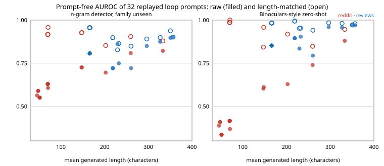

# Do prompts that beat a prompted detector also fool prompt-free detectors? A length-matched replay of the `mimic-loop` imitator prompts

Milestone 5 (`mimic-transfer`) of track 11, adversarial human imitation, a model-based slice. **Preliminary, stylised toy study: one frozen 0.5B model, 32 prompts from one seed of the loop, 24 human test texts and 48 generated texts per prompt, two families (reddit posts, film reviews). Read the numbers as a first measurement, not a result about LLM detection in general.** Produced with AI assistance (Claude).

**Live page:** https://duncan-haywood.github.io/monorepo-projects/research/mimic-looptransfer/

**Question.** `mimic-loop` evolved imitator prompts against a *prompted* 0.5B detector and saw its paired accuracy drop toward chance. Is that imitation, or did the imitator only learn the prompted detector's blind spots? This project replays every imitator prompt the loop produced (4 rounds x 4 proposers x 2 families) and scores the new texts with detectors that use no prompt and that the loop never saw: the `mimic-contexts` n-gram classifier and its Binoculars-style zero-shot score (Hans et al. 2024).

**Headline.** No. Once texts are compared with human texts of similar length, every one of the 26 prompts that has enough length-matched pairs is still caught: the n-gram detector's AUROC is 0.83 to 0.96 (mean 0.91) and the Binoculars-style score's is 0.84 to 1.00 (mean 0.97). The unmatched AUROCs that look low (down to 0.55 for the n-gram detector, 0.13 for observer log-perplexity) track text length, not human-likeness (Spearman rho +0.86 to +0.97 with mean generated length). A prompt's loop score does not predict its prompt-free score (rho between -0.46 and +0.40 across detectors, all conflicting in sign).

## Method

1. `gen.py` reads the imitator prompt, shots and loop metrics of every round of the 8 `mimic-loop` runs (`../mimic-loop/results/*_s0.json`; 32 prompts, 19 unique after deduplicating the identical round-0 plain prompt and unchanged rounds). The loop kept only 3 sample texts per round, so each prompt is replayed with the same frozen Qwen2.5-0.5B-Instruct (Apache-2.0) on the loop's own 24 held-out test titles with two fresh sampling seeds (1000, 1001): 48 texts per prompt. Every text is cut to 400 characters like the loop's. The same script computes the zero-shot scores (observer Qwen2.5-0.5B log-perplexity and cross-perplexity with the instruct model, first 64 tokens) for generated texts and the 24 human texts.
2. `analyze.py` fits the detectors on the `mimic-contexts` suite (RAID text, MIT; human against plain-prompt LLM text), cut to 400 characters, **with every item whose id is a loop test title removed** (reddit is a training family, so otherwise the detector would have seen the test humans). Detectors: `length` (log character count, a control), `ngram` (char 1-4 and word 1-2 gram TF-IDF logistic regression on the 5 training families), `ngram-unseen` (refit without the target family; for reviews it equals `ngram`, as reviews is already held out), `logppl` and `bino` (two-parameter logistic fits on the zero-shot scores, as in `mimic-contexts`).
3. Per prompt, AUROC of generated against human test texts (bootstrap 95% interval over texts in `results.json`), and a **length-matched AUROC** over only the (generated, human) pairs whose character lengths are within a factor of 1.5, reported when at least 20 pairs qualify.
4. Spearman correlation across prompts between the loop's recorded paired detector accuracy (higher = the prompted detector wins) and each prompt-free AUROC.

## Results (what the code produced; full table in `results.txt`)



| detector | AUROC range, all 32 prompts | length-matched range (26 prompts) | Spearman vs mean generated length |
|---|---|---|---|
| length (control) | 0.57 to 1.00 | 0.48 to 0.84 | -0.87 |
| n-gram, family seen | 0.64 to 0.90 | 0.83 to 0.99 | +0.86 |
| n-gram, family unseen | 0.55 to 0.90 | 0.83 to 0.96 | +0.86 |
| observer log-perplexity | 0.13 to 0.99 | 0.92 to 1.00 | +0.97 |
| Binoculars-style | 0.34 to 0.97 | 0.84 to 1.00 | +0.88 |

- **Short texts fool the content detectors for the wrong reason.** The reddit prompts whose texts stay under about 70 characters (GrIPS and random search, which the loop itself marked invalid) get observer-log-perplexity AUROCs of 0.13 to 0.19, i.e. the detector rates them *more* human than people. Short text has a higher mean per-token log-perplexity, and that score is not a human-likeness measure. The same texts are caught by length alone (AUROC 0.97 to 1.00), because human reddit bodies are about 400 characters.
- **Matching length removes the effect.** The six prompts with no length-matched pairs are exactly those short reddit texts. For the rest, the lowest length-matched AUROC is 0.83 (n-gram, reviews, random search round 3) and 0.84 (Binoculars-style, reddit, LLM proposer round 1). The loop's best validity-passing prompt under the unmatched n-gram score (0.70, reddit GA round 3) is 0.85 length-matched.
- **The loop's detector and the prompt-free detectors disagree.** Across the 32 prompts, rho between the loop's paired accuracy and prompt-free AUROC is +0.16 (n-gram), -0.05 (n-gram unseen), -0.01 (observer), -0.19 (Binoculars-style), none significant; among length-matched cells it is -0.40 (n-gram unseen, p = 0.04) and -0.46 (Binoculars-style, p = 0.02), i.e. prompts the loop's detector caught more often were caught *less* often by the prompt-free ones. These are 10+ exploratory tests on non-independent rows (prompts repeat across rounds and share a round-0), so treat the signs, not the p-values, as the finding: there is no sign that fooling the prompted detector transfers.
- **Why the 0.5B loop detector was a poor yardstick.** `mimic-loop` found the plain detector below chance (it picked the imitator's text as human in 88% of pairs); this replay is consistent with that: the prompted detector's signal is not the one that separates RAID human from LLM text.

## Limitations

- One seed of the loop, one 0.5B model, two families, 24 human test texts per family: AUROC intervals are about +-0.1 (`results.json`). Length-matched AUROCs pool pairs that share texts, so no interval is given for them.
- The prompt-free detectors are trained on RAID's plain-prompt chat-model text (not Qwen output) and tested here on Qwen-0.5B text; part of the distance may be generator shift (compare `mimic-genshift`). The 400-character cut applies equally to both sides.
- The zero-shot scores use only the first 64 tokens; their strong length dependence is a property of the score as used here, not a claim about Binoculars as published.
- Texts were regenerated, not the loop's own: sampling is stochastic, so a prompt's numbers differ slightly from the loop's recorded ones.
- Not done: other detectors (a larger open model, MAUVE), RAID's generations scored with the loop's detector prompts (the reverse direction of milestone 5), and a loop that scores length-matched pairs (see next steps).

## Reproduce

```bash
cd research/mimic-looptransfer
python3 -m pytest -q tests          # 5 tests, no model needed
pip install torch transformers scikit-learn scipy numpy
python3 gen.py                      # about 45 minutes on 4 CPUs; writes texts.json
python3 analyze.py                  # writes results.json and results.txt
python3 figure.py                   # writes results/figure.svg (stdlib only)
```

`mimic-contexts/data/zeroshot.json` and `suite.jsonl.gz` must be present (they are in the repository).

## Next steps

Rerun the loop with a length-matched or length-penalised fitness (the detector sees pairs within 1.5x in length) and re-score with these prompt-free detectors; and repeat with a second model family, since 0.5B on both sides is the weakest setting.

## Owner steps

None needed; a larger model or GPU run would improve it.

## Outside dependencies

`mimic-loop` (prompts, titles), `mimic-contexts` (suite, zero-shot scores); Qwen2.5-0.5B and -Instruct from Hugging Face (Apache-2.0); NumPy, SciPy, scikit-learn, PyTorch, transformers.

Prior work: Hans et al. (2024), "Spotting LLMs with Binoculars", ICML; Dugan et al. (2024), the RAID benchmark; Lu et al. (2024), SICO; Hu, Chen and Ho (2023), RADAR; Lopez-Paz and Oquab (2017).
